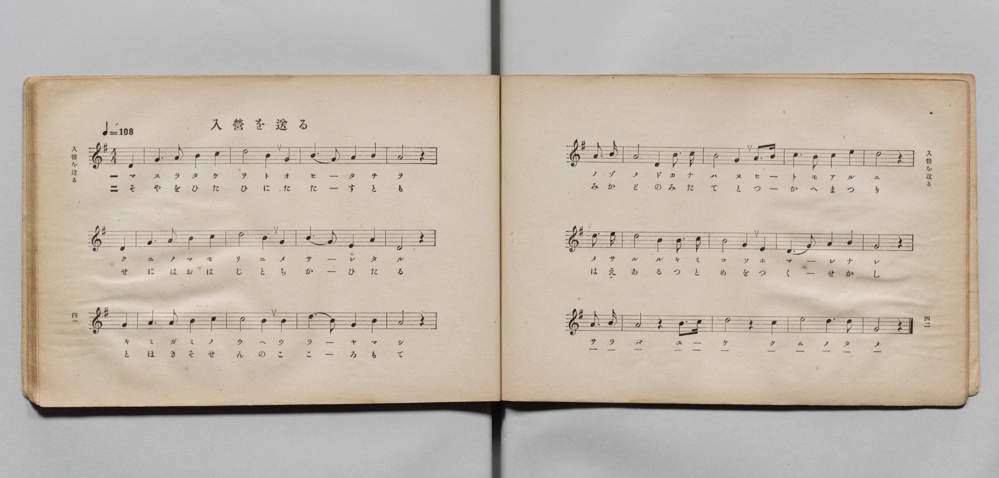
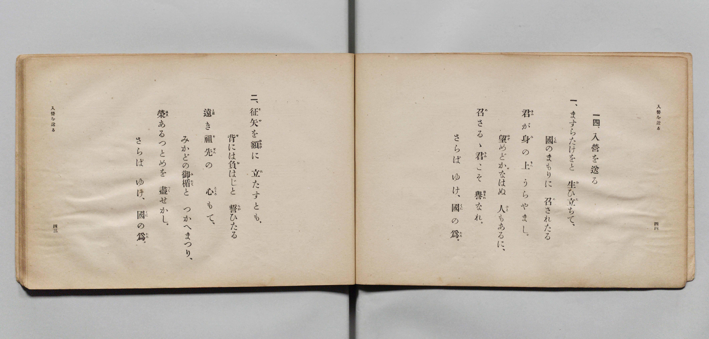

# 入營を送る

> Re:Shōka 使用 AI 協助辨識與重建樂譜，可能會有錯誤。歡迎回報。

- **鋼琴伴奏版**：<br><audio controls src="nyuei_wo_okuru.mp3"></audio>

- 文部省《尋常小學唱歌 第五學年用》（大正二年五月，索書號 4100）

## 說明

原書資訊與歌詞全文（對應 P024.jpg–P025.jpg，原書 pp. 41–44）：
- 調性與拍號：ト長調（G 大調）4/4 拍，速度 ♩=108


## 歌詞

```text
一四、入營を送る
一、ますらたけをと　生（お）ひ立（た）ちて、
國（くに）のまもりに　召（め）されたる
君（きみ）が身（み）の上（うへ）　うらやまし。
望（のぞ）めどかなはぬ　人（ひと）もあるに、
召（め）さるゝ君（きみ）こそ　譽（ほまれ）なれ。
さらば　ゆけ、國（くに）の爲（ため）。
二、征矢（そや）を額（ひたひ）に　立（た）たすとも、
背（せ）には負（お）はじと　誓（ちか）ひたる
遠（とほ）き祖先（そせん）の　心（こころ）もて、
みかどの御楯（みたて）と　つかへまつり、
榮（はえ）あるつとめを　盡（つく）せかし。
さらば　ゆけ、國（くに）の爲（ため）。
```

## ABC

<div class="abc-score" data-abc-src="nyuei_wo_okuru.abc" aria-label="五線譜載入中"></div>

[下載 ABC 原始檔](nyuei_wo_okuru.abc)

## TMD 檔案連結

- [主旋律 TMD 檔案](nyuei_wo_okuru.tmd) [[在 TMD Studio 編輯](https://tmdlang.github.io/Tmd-TS/#tmd=s7IKdvYPcrWy4qpTUCpJTLdSSM7PyUlNLsnMz7PKyszLyo8vzshPT8wuBdHZiUpwdWX5OaW5qVbpRYkpqfGm8SaGBgYIyeL80qLkVKvi5Iz8_Jz4ktSKkqT8_Gx0-fiCxPRUqwADIxOETEFRfllqXmIeUHdBUWZeSWoKWDtCQWpZZkoqSLostSgzLTM1BclJqUXFIHdDTS8pSswrTi7KLAB5BqEqv6gE6KOixIKMSquMzOKS_KLM5MSc-OzEPCTflWSkAj2Xm5mTWZJYVIkunpyfm1ual1mCJAE0JT0zzyo3Py-pFBhSmBKpmVmZSCGhpaXwtHXp8_b5j5smvWxofNzUraClxaVoq2BoYMFlb6vgzmVjom9iBzLm2bT2l80rns9pfNzQ9XRD99MdO55u6H-6dsfTKRufre1ReL5mzZNdU0D8nVueT1nxuKH7_Z6Op0uWP1u7-MmuHqAgUPbZnI73e3qeb1n0bPaOFzPnK4Bi6_2eTiUuLn0tBVtqAS4FBYWnffNBdmxuf7Gi60VHO9CBL1bOe9q6AugJkLM29D5r71QARbleVkH6o4bJQKYpiAl0HkSrQkGBHtB9QCkTE6AT3--ZBTJWV-HFqv3PGpaDjOzuBXoBKP64uePl1O1AcaDB7gpAH4OZncBgUwCqARr4smH-013LFB7NXGkLClWQOU92NDydPftxQyNa4EPlgBKPG_c9bpz5uKnzceP8x40TgSoeNwIDteH5FKCdHY8bu4BWPG7c9Hw1KJiBasDchY8blwH1gkwBgadzIJL9jxtXg-XXgUxtanrc1AUUARr2tH8NSEFTI1h26uOmHpBtEGeADZgwG2xA7-NGkJceN_a82AU0CSgC4a57sgPoDiC37XHjDpBIQwOIDXR0UwvYA9MfNzTBDHs2B2IY0BHzQGqbgH5c-bix-3HjqseN6x83rgHqfrJrF1jNJqBnwWqaHjcCnQtUA3Quwl_ozu5-3DQXw62THzfOBRr5Yu1esPhusN97wFKrQD5FuAxsBlB4A8j9TUC_TATFDEbgPe_YBAlrqM0QA4CJG6R6X-Pz-YvA0nOBnge7fdLLhcDoh_gGGIdAzUBTQMGOGmlAqZmguAX6FeHFF81AlwKVAP0E1tS4_sWmBUgRDwyvGZAE8WLVZLA4MO6BpoLSBGocvmyE6FsBDAKwfO_zpdOetgIzItitjbMfNwENACcOYILY3wwWB4bd5MdNQNdDogA5UQGDFxxpwKhb93TfwmdL10MSBNgjy8AmgZz1uHEJWNkOcDpYAkpyCDOeLVsH1gT0BdAdQB2QOAbqAAYDMB9MAgXS7IVgNUDBfrCa2WDzkFMURfFGeTkDBQpa-lxcfpWlqZnh-f7ZpUWlVgGZiXn5DjUGNdVgl9oYmmnZgVnYSjlwwbmj4cXCHgUNEwVgkfp8fYMOvGhSeLp92csFjcB8polFK9BmkLE1CqbxwKIJBA2hNAgaAbExlA1UAmXBRECyyDpq4CLoemE6UVUgQwOYCrBzfAxrFB43z4OKPW7aiaTycfNKsNh-uJmPmzbC5TbBWR1w3asQKpsn1SEZBfIywqDHzY1ICttwOBQWTFCHGgHVNs6FW9WC7NCmSSCyEeYkkMr5MDm4KDCNwVkwWbBKDIc2zoQrXIFQ2NRE0KH4E86uHkIJZy3ehGMGswjOAEFQmgALgNMVZrzD0gxcUw1GwsOiBJ5I0SGW5NO0Hir2uLkbSeXj5j4wCUpcj5sXgY193AxLIghVMD2PmxfCrX_ctBUjVprXwBQip8hmWKSiQ2zJZzbMBHhSgPBAHgCW1nA2SO0MdIfC0wKw_EbY39iNmXwQKQ4pnQFba4QcSqDc6SSUfLrxJh9YLKMXHSBxEI0odmAQs1AxQ5IFiaIXUJhmwCC2dLMWKva4GRZOYF4TKKIhYpA0BFK7DM28x82wCELIgZLDSsx0swSuBVbOgQzcjsOh2NINIuZ3IzuhsRdMggolSNoCmTsZ3aGN6-AsmBzIzMmY5SPIOIiPYEUNSCG6zzEdijfdANuuONNN_2Yi6itQHIMwLI5BbFAsw9IC7nQD0WGMpUJDT4tIhRs6xFZfgQuWpn0gEl5oPG7uBIuCcvbjZlBehgZgcz-aiY-be-AsaC0VD1YIr8jApRUkJuAseEEDUkk4LyMSD6iwAhYTYBJUoYJNAycKmBxybYSRzpES3xIkx4INhAjvgLNAIQJVijCyCRYWuB1LoN6aQigB4a-3QJGPXFggRz5IDLVCAkF4YoBXQ5iVFmbRg24KDGJLQaBUA6xkQCQ8YpFY4KIJUgSBQnAzmomPm_bC9cDqFHA7Ck-lhZIkYaLoEFv6gVROoLQJbHvDHYCIflBUQ1IJyKmwlhXCqaC2EUIl1AWN_ZjVFqJ2hBkOUjidoFPxFz-tawmlHvzVFiR-jRTM0QsIeLRCI94IniQwVcDKH1iZBeOTlXjAyQYUoyuBeAKuYAHKLYPlV0S7GYsyLM0nSAkHZqG0dWBlHTrElmymQvV3Atkb8NjeBndk40TcyhphhShyKxpRsSG3c9BTIKYja7m4dO0UkLth0T6GsQoYYkZgMWUuAA)]
- [鋼琴伴奏 TMD 檔案](nyuei_wo_okuru_piano.tmd) [[在 TMD Studio 編輯](https://tmdlang.github.io/Tmd-TS/#tmd=s7IKdvYPcrWy4qpTUCpJTLdSSM7PyUlNLsnMz7PKyszLyo8vzshPT8wuBdHZiUpwdWX5OaW5qVbpRYkpqfGm8SaGBgYIyeL80qLkVKvi5Iz8_Jz4ktSKkqT8_Gx0-fiCxPRUqwADIxOETEFRfllqXmIeUHdBUWZeSWoKWDtCQWpZZkoqSDoxOTk_tyAxLzM3NQ9Jviy1qBjkeKgVJUWJecXJRZkFIB8hVOUXlQC9VZRYkFFplZFZXJJflJmcmBOfnZiH5MXEIqDm9FSQ-VYFmYl5-fE47CzJACqyys3MySxJLKpEFwdqyS3NyyxBkgBal56ZZ5Wbn5dUCgxXTInUzKxMpHDT0lJ42rr0efv8x02TXjY0Pm7qfr-n42X3nucTtjzZs-Xp0v7nnR3v93QqaGlxKdoqGBpYcNnbKrhz2Zjom9iBzH42rf1l84rncxofN3Q93dD9dMeOpxv6n67d8XTKxmdrexSer1nzZNcUEH_nludTVjxuABn_dMnyZ2sXP9nVAxQEyj6bA7Sh5_mWRc9m73gxc74CKMKBVipxcflVlqZmhuf7Z5cWlVoFgMIpyMOhxqCmmksBCGwMzbTswCx9LQVbdAC2ekfDi4U9ChomCkBHPV_foKMAShJ6WQXpCk-3L3u5oPHJji5NLFq19MHG1iiYxivogqEhlAZBIyA2hrKBSqAsmAhIFllHDVwEXS9MJ6oKZGgAUwF2jo9hjcLj5nlQscdNO5FUPm5eCRbbDzfzcdNGuNwmOKsDrnsVQmXzpDoko0BeRhj0uLkRSWEbDofCggnqUCOg2sa5cKtakB3aNAlENsKcBFI5HyYHF33cuBrOgsmCVWI4tHEmXOEKhMKmJoIOxZ9wdvUQSjhr8SYcM5hFcAYIgtIEWACcrjDjHZZm4JpqMBIeFiXwRIoOsSSfpvVQscfN3UgqHzf3gUlQ4nrcvAhs7ONmWBJBqILpedy8EG7946atGLHSvAamEDlFNsMiFR1iSz6zYSbAkwKEB_LA48YuOBukdga6Q-Fp4XEjkkMbuzGTDyLFIaWzJuSwwe5QAuVOJ6Hk0403-cBiGb3oAImDaESxA4OYhYoZkixIFL2AwjQDBrGlm7VQscfNsHAC85pAEQ0Rg6QhkNplaOY9boZFEEIOlBxWYqabJXAtsHIOZOB2HA7Flm4QMb8b2QmNvWASVChB0hbI3MnoDm1cB2fB5EBmTsYsH0HGQXwEK2pACtF9julQvOnm6ezZONNN_2Yi6itQHIMwLI5BbFAsw9IC7nQD0WGMpUJDT4tIhRs6xFZfgQuWpn0gEl5oPG7uBIuCcvbjZlBehgZgcz-aiY-be-AsaC0VD1YIr8jApRUkJuAseEEDUkk4LyMSD6iwAhYTYBJUoYJNAycKmBxybYSRzpES3xIkx4INhAjvgLNAIQJVijCyCRYWuB1LoN6aQigB4a-3QJGPXFggRz5IDLVCAkF4YoBXQ5iVFmbRg24KDGJLQaBUA6xkQCQ8YpFY4KIJUgSBQnAzmomPm_bC9cDqFHA7Ck-lhZIkYaLoEFv6gVROoLT5uBFWLiBqE0hUQ1IJyKmwlhXCqaC2EUIl1AWN_ZjVFqJ2hBkOUjidoFPxFz-tawmlHvzVFiR-jRTM0QsIeLRCI94IniQwVcDKH1iZBeOTlXjAyQYUoyuBeAKuYAHKLYPlV0S7GYsyLM0nSAkHZqG0dWBlHTrElmymQvV3Atkb8NjeBndk40TcyhphhShyKxpRsSG3c9BTIKYja7H1wnyQe2EmiE7YsxlNz_pnvWzYBExGz2ZvAlZnz7p7n66dAOlJIjVv4hWM47WBBQacgSRmGg8S1zYGCYLYRugqEYIglgE0JEHVEkwjggVMk_EKJvHawFIKWRBuGrIgLnNRXAZRgN0LJiDztA1BQjBlBM0EMiDOQxXDZg1MDNWf2M3ECFWQUqATtIHBQdgmhJkY7kdXR5RZwESka6eAnI6ifQxjFTDEjMBiylwA)]

## 分析

```text
================================================================================
📊 TMD Song Profile: [ 入營を送る ]
================================================================================
⏱  Duration:       1:46 (106.7s), 48 measures total
🎼 Key & Tempo:    首調基準 G, != 108.0 BPM, <4/4>
   - 分析範圍：      由實際發聲的音符與和弦推測調性；播放脈絡另行呈現
🎤 人聲音域:    D4 (MIDI 62) – E5 (MIDI 76) [跨度: 14 個半音 / 1.2 個八度, 難度: moderate]
   - 最低音:  D4 in [NyueiWoOkuru[L1] #1 @ m.1, 0:00]
   - 最高音: E5 in [NyueiWoOkuru[L1] #1 @ m.11, 0:22]
   - 適合: soprano, mezzo-soprano, contralto, tenor, baritone, bass
🏛  結構:      NyueiWoOkuru[L1] (53.3s) -> NyueiWoOkuru[L2] (53.3s)
⚡ 編曲密度:        Peak 1 軌道同時演奏
🗝  調性診斷：       D 調性不明確（純淨自然大調，未偵測到可信轉調）
   - 風格氣質:    純淨自然大調（陽光明朗、易唱易記，無明顯調外色彩）
   - 轉調歷程:    全曲維持單一推測調性（未偵測到可信轉調）
   - 核心骨幹音:  D, G, A, B, E
   - 調性數值:    D 調性不明確 [相關度: 0.83, 穩定度: Ambiguous, 自然音純度: 100.0%]
   - 候選調性 (K-S): D 大調 (0.83), G 大調 (0.81), E 小調 (0.57)
   - 五度圈歷程:   +2 -> +2
   - 各段落調性細節:
     • [NyueiWoOkuru[L1] #1]: D 調性不明確 (r: 0.83, 自然音純度: 100.0%)
     • [NyueiWoOkuru[L2] #1]: D 調性不明確 (r: 0.83, 自然音純度: 100.0%)

  [ 五度圈游移軌跡 ]
               C  
         F            G  
      Bb              [D ]*
      Eb               A  
         Ab           E  
            Db       B  
               F# 
     (* = active key center)

  [ 十二半音累積音高分佈 ]
     C  :                            0.0%
     C# :                            0.0%
     D  : ████████████████████████  23.3%
     D# :                            0.0%
     E  : ███████████████           14.2%
     F  :                            0.0%
     F# : ██                         2.3%
     G  : ████████████████████████  23.0%
     G# :                            0.0%
     A  : ███████████████████████   22.2%
     A# :                            0.0%
     B  : ████████████████          15.1%
--------------------------------------------------------------------------------
Assignment 軌道音域：
  - Piano         : D4 – E5 (14 個半音 / 1.2 個八度, 158 個音符)
================================================================================
```


## 原書掃描頁






