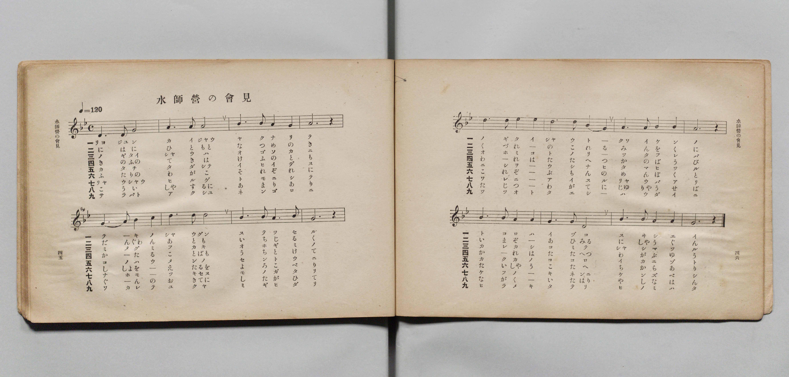
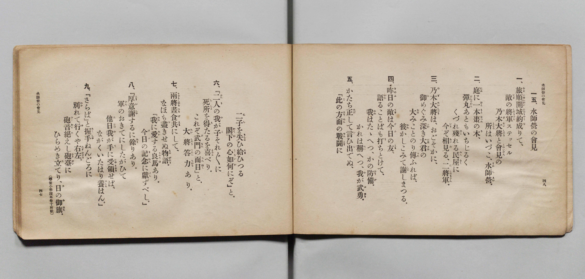

# 水師營の會見

> Re:Shōka 使用 AI 協助辨識與重建樂譜，可能會有錯誤。歡迎回報。

- **鋼琴伴奏版**：<br><audio controls src="suishiei_no_kaiken.mp3"></audio>

- 文部省《尋常小學唱歌 第五學年用》（大正二年五月，索書號 4100）
- lyricist: 佐佐木信綱
- composer: 岡野貞一

## 說明

原書資訊與歌詞全文（對應 P026.jpg–P027.jpg，原書 pp. 45–48）：
- 調性與拍號：ト短調（g 小調）4/4 拍，速度 ♩=120
- 備註：原書歌詞末註「（尋常小學讀本卷十所載）」


## 歌詞

```text
一五、水師營の會見
一、旅順開城（りよじゆんかいじやう）約（やく）成（な）りて、
敵（てき）の將軍（しやうぐん）ステッセル
乃木大將（のぎたいしやう）と會見（くわいけん）の
所（ところ）はいづこ、水師營（すゐしえい）。
二、庭（には）に一本（ひともと）棗（なつめ）の木（き）、
彈丸（だんぐわん）あともいちじるく、
くづれ殘（のこ）れる民屋（みんをく）に
今（いま）ぞ相見（あひみ）る、二將軍（にしやうぐん）。
三、乃木大將（のぎたいしやう）は、おごそかに、
御（み）めぐみ深（ふか）き大君（おほぎみ）の
大（おほ）みことのり傳（つた）ふれば、
彼（かれ）かしこみて謝（しや）しまつる。
四、昨日（きのふ）の敵（てき）は今日（けふ）の友（とも）、
語（かた）ることばも打（う）ちとけて、
我（われ）はたゝへつ、かの防備（ばうび）。
かれは稱（たた）へつ、我（わ）が武勇（ぶゆう）。
五、かたち正（ただ）して言（い）ひ出（い）でぬ、
『此（こ）の方面（はうめん）の戰鬪（せんとう）に
二子（にし）を失（うしな）ひ給（たま）ひつる
閣下（かつか）の心（こころ）如何（いか）にぞ』と。
六、『二人（ふたり）の我（わ）が子（こ）それ〳〵に
死所（ししよ）を得（え）たるを喜（よろこ）べり。
これぞ武門（ぶもん）の面目（めんぼく）』と、
大將（たいしやう）答（こたへ）力（ちから）あり。
七、兩將（りやうしやう）晝食（ひるげ）共（とも）にして、
なほも盡（つ）きせぬ物語（ものがたり）。
『我（われ）に愛（あい）する良馬（りやうば）あり。
今日（けふ）の記念（きねん）に獻（けん）ずべし。』
八、『厚意（こうい）謝（しや）するに餘（あま）りあり。
軍（ぐん）のおきてにしたがひて
他日（たじつ）我（わ）が手（て）に受領（じゆりやう）せば、
ながくいたはり養（やしな）はん。』
九、『さらば』と握手（あくしゆ）ねんごろに
別（わか）れて行（ゆ）くや右左（みぎひだり）。
砲音（つつおと）絶（た）えし砲臺（はうだい）に
ひらめき立（た）てり、日（ひ）の御旗（みはた）。
```

## ABC

<div class="abc-score" data-abc-src="suishiei_no_kaiken.abc" aria-label="五線譜載入中"></div>

[下載 ABC 原始檔](suishiei_no_kaiken.abc)

## TMD 檔案連結

- [主旋律 TMD 檔案](suishiei_no_kaiken.tmd) [[在 TMD Studio 編輯](https://tmdlang.github.io/Tmd-TS/#tmd=s7IKdvYPcrWy4qpTUCpJTLdSSM7PyUlNLsnMz7PKyszLyo8vzshPT8wuBdHZiUpwdWX5OaW5qVbpRYkpqfGm8SaGBgYIyeL80qLkVKvi5Iz8_Jz4ktSKkqT8_Gx0-fiCxPRUqwADIzOETEFRfllqXmIeUHdBUWZeSWoKWDtCQWpZZkoqSLostSgzLTM1BclJqUXFIHdDTS8pSswrTi7KLAB5BqEqv6gE6KOixIKMSquMzOKS_KLM5MSc-OzEPCTflWSkAj2Xm5mTWZJYVIkuDtGGJAw0Iz0zzyo3Py-pFBhOmBKpmVmZSOGgpaXwbMOWpztWP2-f_7hx3bM5zS-WdStoaXEp2ioYGhlw2dsqOOlwZadW2iq453LZmOib2IGMfDat_WXziudzGh83dD3d0P10x46nG_qfrt3xdMrGZ2t7FJ6vWfNk1xQQf-eW51NWPG7ofr-n4-mS5c_WLn6yqwcoCJR9Nqfj_Z6e51sWPZu948XM-QqgeHu_pxPs4pxKYFAAvWal8GTvBCB6NmfFk_0Ln2_bCJZNzs8tyC9OLbJSeLpp4cv2vheb5j3Z0aDExaWvpWBLLcCloKDwtG8-yHGb21-s6HrR0Q702YuV8562rgD6HuSfDb3P2jsVQKlGL6sg_VHDZCDTHMQE-guiVaGgQE_BxBQoZWIB9Nv7PbNAxuoqvFi1_1nDcpCR3b1AvwPFHzd3PJ-_FigONDhdARiYYGYnMLwVgGqABr5smP901zKFRzNX2oLiBWzM06aZL1bsBuqG2AZx37M5q4GCjxt6wE5ERM2LdQ3P5qx52rv9aW_js86GFyDndD5u6OUCmQUMP2CUPG5oxEwMUGmQ3PTWlwvaXk7rfjq_D2j446aux00djxtnPG5qe9w0-XFj9-PGFjAXSLYBDX--pQWsDMjtB3KfdUwAcRtXgewF6m1cBjQTZDoIPJu6FSy57HEj0LedQNufbmh_sRvIBgpOhxj5uHEC0B6w7p2Pm9seNzc_btr9uHk1zIwnO5uBCQWYzIBawfrWPW7se9wI9ApQN9QMsNkrID4Dq-l_3NQPVjARanbjOribOhvASlY8bpz8uAnirPVgtUtBIkiBBVY283HTBJA9jUA20OPAsG0Ch92uHqDSp7vWghWtBhoBNmg1MEyB8QEW3ASyo6kJSIKCafF0SDA9blzyuKkR4iSgv8CCYEcgQu3p3o4nO3aAZRaAowAYQEAPQfwBMg9sKtDBC8HxAoygfiTdIB7QK009z9bNgIUXJHh7gGqfbZj4dCMkjPaDzG6aBIlGoNPhAb67CywPtGAfWGbec2B2gQYs0GKgv0CJGGRxQyMo4yOiFBgOGLEKDa8dIB8SHZfrgYofNwJT05THjXPBaXA1cgDtWwjxAdgZQIXAGNr_bPtGsOBWoHKwGb0geybMBgsCTdoNtgqsBZEYgErg8mCZ_aA0AEob64CJ-WnTZrDsEqATwbJbQYHYuAElrvaAlXQDZcBKgE4FJhagGUCTlr1YMxee1MGyQKl94BQADDtwuDydPRuU5GaseDZ9KSQtgAMFmG3ACQQ9_6wHRg5M5US4sqf9kMgBJQzUpPRi1Tyo8yA-ACUWiP82ANU-6wTGEFAWEubA1AQUB5qKkoM7JoJzOzD9QfwHzCrzHzcB42QHyB-gWAIaue7ljE3AYgts2AZw7AMDDhb1kEQJCiCg7ucrILEEjHJIkEKNgdsDFux5tnbZ025IEtkGKoggToRlPVCRBvET0NXA2gdm4gJYGC97sQKSySGhvulp-y4k7vLHjWuQM0xD37O1S8Dy0KLi2bSdL-cuAosAvQssBhvhpcizjg0v1wDLOqDUbHDeBAYZJPgQ-QeYJdZCCkVQfgAH-6SnSyD-BnoF6D5wYdm46fnWZTCnQ3IaMGuB0gbMpJfTFj_ZAYlaoGeBqRCSsNc93d8McS68CHu6rOnJ3qmwbAtRBrR83uMGYGEArKkhaa11LSjgGvqALnyyCxIiwNwCjE5ghod4DiUSYL6AeH0uKAIbNj9uAGqB-_XZ2t2w8hToLWAyB9b-YO_ugxR3YC7IBmD0T3o6bQ7YeCACpnKIqTtBdQZyOgF6CJhO5gETwMtpEIOBCaAJHv7AeHk-ex3YGFCkPG7cAy2_oB5FZExEIYNevDxfOwUWfEApYEHb-bQLUkwAswDQoeAqFFjSwV32ZEczqLBvXQk1EVRFQgo5hKHPZs59uRhSZWwCZ7NJIHNbIbEOy5iQAhIlg4GrhN1A-eezIYUaMCWCCi9Q-mpc87xzJTQLg4p8YMEADBtYfCGFGjAFo-fT1c9aIH4CVRVgEWBN1v2ic_3LZeDqCeGHDejeBSdibOXMixUznu6HlEhA962FRcrq573AwhOsEioyCxSxQJ82NAHjBZL0QOU30J1P-2Y9awFGGCT4gbaD3IZRTIKcCjT35RJIDQb0Ajh_gJoXaO6E1Tyw2gYURkBVQOcBy0xIaAPjGBhqwKy1DOG5aTDPASVnQMIcvQTqhGQ8YA4FefFp__SXCyCugbSMoMEHlgXGFHKdAI5SoJWQFgjQhvVA5S-XgGtVkCZ4AQAUBzY4YGH0ZOdcSBg9bpwKTIRgM0GJ-ln_QphjgAEBFAEGE8ReUAyAqkhQdoJnyacdYJ-B2j_gcgCUnZa9WAhqOML0ARNJy9P-zU-3Q4ofYE0FtBMYQMDWBlrKer5g08v58EoQiIBhC2rOPN-6DRJ8YPNAUQdU-QJayoLLTKBh0HQHdxk4Z0Aq7N7nqyE-ghiwDBypwKYoJFI2QYu5fQufTYeUI0AngioehOMo7wpAgYKWPhdXcGlmcUZmaqZfvndiZnZqnlVAZmJevkONQU012PE2Flp2YAa2vgi4X7SjARjEChomoEb-8_UNOvAOhAIwlF8uaHyyo0sTi1ag5SBjaxSM44Etf10QZQZigYkaBXOIKJACs8BEjYIhWNAQwkVVCYEGICGwwT6GNQqPm1c9bl4OlnjctONx81KgyGaoSqBs02qo1BKI9GIwZxlEsnkJVHI9kN0FYjWvgsq0IVkIdgPEQiOgXCPUyEagLigbrKdxE1R8BdDEJigLIgMyFcQHOaIRzFoHlenFbo8xyA19UNetA-L9UE9APLUd4hGIVx439yP5F2pV0xYg3gtmgZwIMq4bu1UmCGeAnAUsDlEcCAoqEL8X7GGEZydCxbdC1cI9C_Y6FntMkWNjP9A9oICAuRrkPVDwN4A8B2aBIgAkA42i5klQ9uPmdqh_erDbYwZyHcgPIDfNB-oCRyzMP02QsAKWYKDaGMk_c6EuA4nPg7IgMrAoRrPHHJr2kCICFi-IBDYJ6vrVQDFI8oCId0DFF0HjBeJrPAnPAuQSiHuB5Q8QtyC5HVhkNkOlZgKNAhsIdjZIEhIdwDoGHhQgEVBQgHhYrLIEyUEDsHklEE8As0BOBsksgvoXmPpB_l2K5CtoKgLmP1D6A7HWQmUw0x7-AmdXD6ECpxtvgQMuN8BFCqg4MQK7whgsZAymQRitqAEx4BohEL2kgcXN4yaQvyAZFDM7Nm2ABgJEcic0UICR1gyNpabd4EDBkbDAZcwCqMrJQDaogwzloEYprKCBpQNImgA29IB4BtSAbrAMrIRAswpczMyHOhCoC-p0kAhIZirUDFDqBfkYag-sjGmeDS6cIOz5YB2QIgvDHnAZA0sDoFwJcRnE1bBUDfRNI9h-sJ9AMpDwhvgHVLqA2BORSiUMe8BlDKT0B7kFUjIicuNCqAwwfcJdCtKxG0kcmjOBevCUmeAyZjrURaB-AVADJKtDHA41BFz8QLI3SBZkFcx4UHEK8_hOfLkRXMxA5MABDiwy4PY0QyMcGDkQT0AKRZAMNJeCAqFpDVTVfrAMJPIw7AEXMKCcDkt3SIVmI9R-cCUACkxE6QILBKBPgUUqhL0JXxSBSpdmSEUCTljNINfBi_tmaHUDrpEhRT9EHJpIQXUhvFBtwOEfAm2ZTpxFS_9mYtoyYJuMFUyAJAgjREDFCUbTBiQIwgQaMUTX9ZAEBJFajwhJUMtiIzhUoOUOrqwILl1glSCwsQSu5mDpFpqZgSkTIo7IpNAKGlQegdMyxAw81SOoaEEuKMAxCMmcyBUgKJPCYhA5RYMaCKDiB5I-QDKwtIlmD6hogVbqIH1gV4MbKiC3QVMNOHXuALOgoQotjCANHnChAy5sQDKwxiOaPaCiBV4cwBopoCodZD8s1W6H5lVIGgXJwBo286BiEB_iKf3BRQu0ZIA3RmDxsw0q3oSeQ8GtSmj8NO4By8DiB1JwYtgDLlegqQcYxgi_IdfxoFQFqr8grgXnNtTUCG4agJUTKlpgUTEDGgkwq5DbY6hFC6gnCrUK1B2FRhGwPwqVB0UbFtvABQw0GQFpSCJENF9gCRlUd4IiEZbwoO4A-6oB6nmIDIltF-CYJ6ECBn_bBaVVAu0UQZslQArclQITeFVCIHopA6t9QBXdWnCwQFMJvJndCq9AIeKw1ssGWJoHBhyyDozgB5cvsIYIsM2Jkn5hDZdN0BIFUb7A-lSgQRJ4TINSF8gqWDsdzSpwEQPVCErCYDa8JQ1vBwAzP7zlhlaggvIruLFPKFeiNmCILWVQEjco70JSNEgPjmY-cicJnHjBXoI3NKFegscfzEuwfiyoPoW0N_ZB_QOrLtDsAZcyMHeDAhwc7sjFIKxxAvMULAqhbShgYABHO8AsAt0JUEEDrpognoIU6jAPQTwB6jlAKi6I8xE6IH2JXWDWTKgMLNei2QMuZWAdbVCAI_WK4QkS5BtQtEFcCzINJjMdqhserbhSHbh8gTVBQN0jUIhAfIJc4LehVWwwHaAKD1wVwrMeRAeyPbVcXLp2CujDNtE-hrEKWMWNcIgb4xA3wSFuikPcDIe4OQ5xCxzilmBxZS4A)]
- [鋼琴伴奏 TMD 檔案](suishiei_no_kaiken_piano.tmd) [[在 TMD Studio 編輯](https://tmdlang.github.io/Tmd-TS/#tmd=s7IKdvYPcrWy4qpTUCpJTLdSSM7PyUlNLsnMz7PKyszLyo8vzshPT8wuBdHZiUpwdWX5OaW5qVbpRYkpqfGm8SaGBgYIyeL80qLkVKvi5Iz8_Jz4ktSKkqT8_Gx0-fiCxPRUqwADIzOETEFRfllqXmIeUHdBUWZeSWoKWDtCQWpZZkoqSDoxOTk_tyAxLzM3NQ9Jviy1qBjkeKgVJUWJecXJRZkFIB8hVOUXlQC9VZRYkFFplZFZXJJflJmcmBOfnZiH5MXEIqDm9FSQ-VYFmYl5-fE47CzJACqyys3MySxJLKpEF4eYjyQMtCw9M88qNz8vqRQYqpgSqZlZmUihpqWl8GzDlqc7Vj9vn_-4cd2zOc0vlnW_39PxsnvP8wlbnuzZ8nRp__POjvd7OhW0tLgUbRUMjQy47G0VnHS4slMrbRXcc7lsTPRN7ED2PJvW_rJ5xfM5jY8bup5u6H66Y8fTDf1P1-54OmXjs7U9Cs_XrHmyawqIv3PL8ykrHjeA7Hm6ZPmztYuf7OoBCgJln80BWtXzfMuiZ7N3vJg5XwEU9UC7wd7IqQQGJNC_VgpP9k4AomdzVjzZv_D5to1gWVDg5RenFlkpPN208GV734tN857saFDi4gouzSzOyEzN9Mv3TszMTs2zCgAFd5CHQ41BTTWXAhDYWGjZgRn6Wgq26ADs7B0NLxb2KGiYKAA99Hx9g44CKGHpZRWkKzzdvuzlgsYnO7o0sWjV0gcbW6NgHK-gC4RAygzEAhM1CuYQUSAFZoGJGgVDsKAhhIuqEgINQEJgg30MaxQeN6963LwcLPG4acfj5qVAkc1QlUDZptVQqSUQ6cVgzjKIZPMSqOR6ILsLxGpeBZVpQ7IQ7AaIhUZAuUaokY1AXVA2WE_jJqj4CqCJTVAWRAZkKogPckQjmLUOKtOL3R5jkBv6oK5bB8T7oZ6AeGo7xCMQrzxu7kfyL9Sqpi1AvBfMAjkRZFw3dqtMEM4AOetx41YUB4KCCsTvBXsY4dmJUPGtULVwz4K9jsUeU-TY2A90DyggYK4GeQ8U_A0gz4FZoAgAyUCjqHkSlP24uR3qnx7s9piBXAfyA8hN84G6wBEL808TJKweN_YA8WQk_8yFugwkPg_KgsjAohjNHnNo2kOKCFi8IBLYJKjrVwPFIMkDIt4BFV8EjReIr_EkPAuQSyDufdzYBsQtSG6f_ripGSo1E2gU2ECws0GSkOh43LgPHhQgEVBQgHhYrLIEyUEDsHklEE8As0BOBsksgvoXmPpB_l2K5CtoKgLmP1D6A7HWQmUw0x7-AmdXD6ECpxtvgQMuN8BFCqg4MQK7whgsZAymQRitqAEx4BohEL2kgcXN4yaQvyAZFDM7Nm2ABgJEcic0UICR1gyNpabd4EDBkbDAZcwCqMrJQPYESKoFcVCjFFbQwNIBJE08blwIxDOgBnSDZWAlBJpV4GJmPtSBQF1Qp4NEQDJToWaAUi_Ix1B7YGVM82xw4QRhzwfrgBRZGPaAyxhYGgDlSojLIK6GpWqgbxrB9oP9BJKBhDfEP6DSBcSeiFQqYdgDLmMgpT_ILZCSEZEbF0JlgOkT7lKQjt1I4tCcCdSDp8wElzHToS4C5r4OoAZIVoc4HGoIuPiBZG-QLMgqmPGg4hTm8Z34ciO4mIHIgQMcWGTA7WmGRjgwciCegBSKIBloLgUFQtMaqKr9YBlI5GHYAy5gQDkdlu6QCs1GqP3gSgAUmIjSBRYIQJ8Ci1QIexO-KAKVLs2QigScsJpBroMX983Q6gZcI0OKfog4NJGC6kJ4odqAwz8E2jKdOIuW_s3EtGXANhkrmABJEEaIgIoTjKYNSBCECTRiiK7rIQkIIrUeEZKglsVGcKhAyx1cWRFcusAqQWBjCVzNwdItNDMDUyZEHJFJoRU0qDwCp2WIGXiqR1DRglxQgGMQkjmRK0BQJoXFIHKKBjUQQMUPJH2AZGBpE80eUNECrdRB-sCuBjdUQG6Dphpw6twBZkFDFVoYQRo84EIHXNiAZGCNRzR7QEULvDiANVJAVTrIfliq3Q7Nq5A0CpKBNWzmQcUgPsRT-oOLFmjJAG-MwOJnG1S8CT2HgluV0Php3AOWgcUPpODEsAdcrkBTDzCMEX5DruNBqQpUf0FcC85tqKkR3DQAKydUtMCiYgY0EmBWIbfHUIuWGY-boBVAU9fjphZoFD1unA2VB0UbFtvABQw0GQFpSCJENF9gCRlUd4IiEZbwoO4A-6oB6nmIDIltl6ezZxMqYPC3XVBaJdBOEbRZAqTAXSkwgVclBKKXMrDaB1TRrQUHCzSVwJvZrfAKFCIOa71sgKV5YMAh68AIfnD5AmuIANucKOkX1nDZBC1REOULrE8FrEwRMQ1KXSCrYO10NKvARQxUIygJg9nwljS8HQDM_PCWG1qBCsqv4MY-oVyJ2oAhtpRBSdygvAtJ0SA9OJr5yJ0kcOIFewne0IR6CR5_MC_B-rGg-hTS3tgH9Q-sukCzB1zKwNwNCnBwuCMXg7DGCcxTsCiEtqGAgfG4qRPMItCdABU04KoJ4ilIoQ7zEMQToJ4DpOKCOB-hA9KX2AVmzYTKwHItmj3gUgbW0QYFOFKvGJ4gQb4BRRvEtSDTYDLTobrh0Yor1YHLF1gTBNQ9AoUIxCfIBX4bWsUG0wGq8MBVITzrQXQg21OLa9TGB3nUxgQxavOir-tle--zqTOe7OoGlj_Punufrp0ALH5erNoPGcJC7hkB2yTx2uChGBgLNEADGoSJj9c2ApUwCDayeiMgC8iL1zaE6TBVB3FBasFcA2gQ4bMEwkawalCMRTMU3SBsFqC6irDv0MVx-gHdXdiCBNkwEv0BjGNdOwX0aI72MYxVwCpuhEPcGIe4CQ5xUxziZjjEzXGIW-AQtwSLK3MBAA)]

## 分析

```text
================================================================================
📊 TMD Song Profile: [ 水師營の會見 ]
================================================================================
⏱  Duration:       4:48 (288.0s), 144 measures total
🎼 Key & Tempo:    首調基準 B,, != 120.0 BPM, <4/4>
   - 分析範圍：      由實際發聲的音符與和弦推測調性；播放脈絡另行呈現
🎤 人聲音域:    D4 (MIDI 62) – D#5 (MIDI 75) [跨度: 13 個半音 / 1.1 個八度, 難度: moderate]
   - 最低音:  D4 in [SuishieiNoKaiken[L1] #1 @ m.1, 0:00]
   - 最高音: D#5 in [SuishieiNoKaiken[L1] #1 @ m.9, 0:17]
   - 適合: soprano, mezzo-soprano, contralto, tenor, baritone, bass
🏛  結構:      SuishieiNoKaiken[L1] (32.0s) -> SuishieiNoKaiken[L2] (32.0s) -> SuishieiNoKaiken[L3] (32.0s) -> SuishieiNoKaiken[L4] (32.0s) -> SuishieiNoKaiken[L5] (32.0s) -> SuishieiNoKaiken[L6] (32.0s) -> SuishieiNoKaiken[L7] (32.0s) -> SuishieiNoKaiken[L8] (32.0s) -> SuishieiNoKaiken[L9] (32.0s)
⚡ 編曲密度:        Peak 1 軌道同時演奏
🗝  調性診斷：       G 小調（純淨自然小調，未偵測到可信轉調）
   - 風格氣質:    純淨自然小調（陰鬱抒情、旋律集中，無明顯調外色彩）
   - 轉調歷程:    全曲維持單一推測調性（未偵測到可信轉調）
   - 核心骨幹音:  A, G, A#, D, D#
   - 調性數值:    G 小調 [相關度: 0.70, 穩定度: Moderate, 自然音純度: 100.0%]
   - 候選調性 (K-S): G 小調 (0.70), D 大調 (0.56), D 小調 (0.53)
   - 五度圈歷程:   +1 -> +1 -> +1 -> +1 -> +1 -> +1 -> +1 -> +1 -> +1
   - 各段落調性細節:
     • [SuishieiNoKaiken[L1] #1]: G 小調 (r: 0.70, 自然音純度: 100.0%)
     • [SuishieiNoKaiken[L2] #1]: G 小調 (r: 0.70, 自然音純度: 100.0%)
     • [SuishieiNoKaiken[L3] #1]: G 小調 (r: 0.70, 自然音純度: 100.0%)
     • [SuishieiNoKaiken[L4] #1]: G 小調 (r: 0.70, 自然音純度: 100.0%)
     • [SuishieiNoKaiken[L5] #1]: G 小調 (r: 0.70, 自然音純度: 100.0%)
     • [SuishieiNoKaiken[L6] #1]: G 小調 (r: 0.70, 自然音純度: 100.0%)
     • [SuishieiNoKaiken[L7] #1]: G 小調 (r: 0.70, 自然音純度: 100.0%)
     • [SuishieiNoKaiken[L8] #1]: G 小調 (r: 0.70, 自然音純度: 100.0%)
     • [SuishieiNoKaiken[L9] #1]: G 小調 (r: 0.70, 自然音純度: 100.0%)

  [ 五度圈游移軌跡 ]
               C  
         F           [G ]*
      Bb               D  
      Eb               A  
         Ab           E  
            Db       B  
               F# 
     (* = active key center)

  [ 十二半音累積音高分佈 ]
     C  : █                          1.7%
     C# :                            0.0%
     D  : ███████████████           20.0%
     D# : ███                        3.3%
     E  :                            0.0%
     F  :                            0.0%
     F# :                            0.0%
     G  : █████████████████         22.5%
     G# :                            0.0%
     A  : ████████████████████████  31.7%
     A# : ████████████████          20.8%
     B  :                            0.0%
--------------------------------------------------------------------------------
Assignment 軌道音域：
  - Piano         : D4 – D#5 (13 個半音 / 1.1 個八度, 468 個音符)
================================================================================
```


## 原書掃描頁






