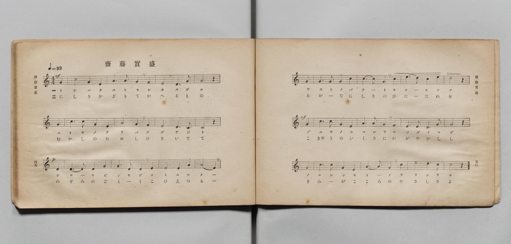
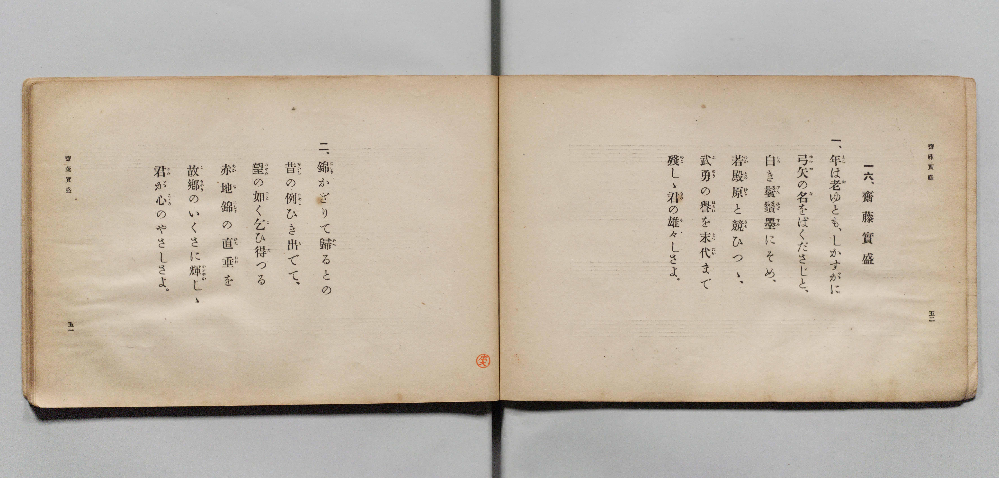

# 齋藤實盛

> Re:Shōka 使用 AI 協助辨識與重建樂譜，可能會有錯誤。歡迎回報。

- **鋼琴伴奏版**：<br><audio controls src="saito_sanemori.mp3"></audio>

- 文部省《尋常小學唱歌 第五學年用》（大正二年五月，索書號 4100）

## 說明

原書資訊與歌詞全文（對應 P028.jpg–P029.jpg，原書 pp. 49–52）：
- 調性與拍號：ハ長調（C 大調）4/4 拍，速度 ♩=92


## 歌詞

```text
一六、齋藤實盛
一、年（とし）は老（お）ゆとも、しかすがに
弓矢（ゆみや）の名（な）をばくださじと、
白（しろ）き鬢鬚（びんひげ）墨（すみ）にそめ、
若殿原（わかとのばら）と競（きそ）ひつゝ、
武勇（ぶゆう）の譽（ほまれ）を末代（まつだい）まで
殘（のこ）しゝ君（きみ）の雄々（をを）しさよ。
二、錦（にしき）かざりて歸（かへ）るとの
昔（むかし）の例（ためし）ひき出（い）でて、
望（のぞみ）の如（ごと）く乞（こ）ひ得（え）つる
赤地錦（あかぢにしき）の直垂（ひたたれ）を
故郷（こきやう）のいくさに輝（かがや）かしゝ
君（きみ）が心（こころ）のやさしさよ。
```

## ABC

<div class="abc-score" data-abc-src="saito_sanemori.abc" aria-label="五線譜載入中"></div>

[下載 ABC 原始檔](saito_sanemori.abc)

## TMD 檔案連結

- [主旋律 TMD 檔案](saito_sanemori.tmd) [[在 TMD Studio 編輯](https://tmdlang.github.io/Tmd-TS/#tmd=s7IKdvYPcrWy4qpTUCpJTLdSSM7PyUlNLsnMz7PKyszLyo8vzshPT8wuBdHZiUpwdWX5OaW5qVbpRYkpqfGm8SaGBgYIyeL80qLkVKvi5Iz8_Jz4ktSKkqT8_Gx0-fiCxPRUqwADIwuETEFRfllqXmIeUHdBUWZeSWoKWDtCQWpZZkoqSLostSgzLTM1BclJqUXFIHdDTS8pSswrTi7KLAB5BqEqv6gE6KOixIKMSquMzOKS_KLM5MSc-OzEPCTflWSkAj0Hka5EF87NzMksSUQWB5qRnplnlZufl1QKDCdMidTMrEykcNDSUni5t_vF9CVP1y97Pnu2gpYWl6KtgqURl72tgjOXjYm-iR3IiGfT2l82r3g-p_FxQ9fTDd1Pd-x4uqH_6dodT6dsfLa2R-H5mjVPdk0B8XdueT5lxeOG7vd7Op4uWf5s7eInu3qAgkDZZ3M63u_peb5l0bPZO17MnK8Aiqf3ezqVuLj0tRRsqQW4FBQUnvbNB9mxuf3Fiq4XHe1AB75YOe9p6wqgJ0DO2tD7rL1TARTZelkF6Y8aJgOZliAm0HkQrQoFBXoKJpZAKVMjoBPf75kFMlZX4cWq_c8aloOM7O4FegEo_ri5_-XU7UBxoMHOCkAfg5mdwGBTAKoBGviyYf7TXcsUHs1caQsMVJAxT3Y0PG1d-7ihETncoRJAUWBgAc163LjiceN0oEmPG9e_aGgEi3SBuE1tIKmmJqBKoILHjd2PG2c-bux53LgaZAQIPN0z-fn8RSAdILX7Hze1gI1Z93QC0D1AY1aBjZn0uHHD48b-x40LHjdOfdw4A2RqQyPMjOcz94LVTn_cBNQE1N37cs2il2tmgQU3P26a_Lhx0-PGSUCpp4tWgAWBjgB5HOiOx41zHzcB0wncsBfdS5-t2w8MWbCbgFYC3Qz03TqQC5qAgQvUtOL56m1gY3qBusEiQOOXPG6ai2TMs7XLnnaDIvBx4zaw19og_nqxFuLW3Y8b9z1u6oH47tmc1U92LwaL7wOZBPImJByA3OVwI9fNACsBOmUyWBLo37lPJ8yGOQXio3UvZ7c8bmgFu34SEEFVAoOtqeNxQxM46nb1gCK0ZxlYJzAIgNKQgAP6ddrjpq7Hjcuerd0BlgWKABlAR0KDAe6YGVPAVjSAlUDift2TfaCc9LhxPihIoYLAoOl92r4LLA7x03Kg8cghNQfiA6C35sE98XRZE1hwCtBWsEj_k53zwCIQr296ug9oPJALzKVALjDwu-ERuHXJ0zkbYL5rArtvEao31z2fveXpPIgNQPfNB7sYGhdwZ01tfdm8HWIlKHibWuBxCPQIODECU-LqF3uAKQASTj2wxAsKEGDUwJM4ehT1PN3fDDN4MizNrgPbADQSNa4oL2OgQEFLn4srODGzJD84MS81F1jAWgVkJublO9QY1FSDnWpjoWUHZmAr4YAZdeOLrduBpQmo9NzR8GJhj4IGrFRSeLp92csFjU92dGli0Qm0GGRqjYIBsFCCwerctFoFUyCjRsEwDipmDsQQITMoH0RDRIyhaozApDFQBCQOgiBTwWrAtvgY1ijEI9nzuLkDrP9x03a4SD-IbFoFEW9eBlf3uHkRWAakEqRjNUxH004ovQasoxsqDrIHoh9qtxGa3Y0gE4A6GqfDRXrBJMgEkPg0qLldQDbIHITMDrjdENuA-QAsvg7Z7qYGsN24Iw1c0_WA48pEAVgHPl_foAOvS-CxthZvrMFCHhTGoPiAhDxIFBQXIBoRFxC1RqBIhYqAYqe6oBaiDh5Dj5vnw2NjCZjsg8ZGF5i3CUxOAPtxPVQG5FdIiGyF0jvA4qD4RYQIOO7gsQEJT0j4geIAEn4gcZD9wFIKSQZkJ0gGFEMQHS1QejlYHJJOoPZAzCEQ8js6CYV8N96Qh6R1SKgi8oUZkA2LAWxqYCKgGABh5FBfW4cSWGuhQTsZHNybgXgSUBQc-OAkjxpRoKB83LQXKr4QxahmcCwhhfs8eCjuRwn3KWDeijqgNmAZCuaAbAdJgeyFaAFFKbBQh4g3daPY1NhEOOSfzp6NM-T7NxNRUiGHIYgNyQWm4LCHhTO42IIVUKiRAU708AIOEf6IEgWcahGpHpzSm1eCQwUiBYubpr0g30PCeBKYBKVKkB5I6oTJgUoS7OkeXKahlETANA4Jf1CkIBL-fLhN0NzRA3UCyF5E-IOji1CZM4VQ-OMvc4iuEmDVASSSkAsd9AIHln0fN4ELWnjQz4ZGyDwgXgNmQcMDKAILbhDdANQJTZFgGUTQt6MFPaitAA_9NjAJS_2wEqUfiKeixAs4czWCQhzkxBakmgBWd0BCH8QjlPpb1xIKfXLKHWicQGIAtRKAVMiw0IfFAHLog0Ib4rXNYBJWxYJoYFqH5HBQ4gelPJgGWD0AKRhAikFaIKU_IkxQgh4e7pBSB5qCwWkWSMKtaQIphFWnkOiCRAgkiEEyEB6yNbVcXLp2CihNqGgfw1gFTEEjsKAyFwA)]
- [鋼琴伴奏 TMD 檔案](saito_sanemori_piano.tmd) [[在 TMD Studio 編輯](https://tmdlang.github.io/Tmd-TS/#tmd=s7IKdvYPcrWy4qpTUCpJTLdSSM7PyUlNLsnMz7PKyszLyo8vzshPT8wuBdHZiUpwdWX5OaW5qVbpRYkpqfGm8SaGBgYIyeL80qLkVKvi5Iz8_Jz4ktSKkqT8_Gx0-fiCxPRUqwADIwuETEFRfllqXmIeUHdBUWZeSWoKWDtCQWpZZkoqSDoxOTk_tyAxLzM3NQ9Jviy1qBjkeKgVJUWJecXJRZkFIB8hVOUXlQC9VZRYkFFplZFZXJJflJmcmBOfnZiH5MXEIqDm9FSQ-VYFmYl5-fE47CzJACqCmlOJLpybmZNZkogsDrQsPTPPKjc_L6kUGKqYEqmZWZlIoaalpfByb_eL6Uuerl_2fPbs93s6XnbveT5hy5M9W54u7X_e2fF-T6eClhaXoq2CpRGXva2CM5eNib6JHcjcZ9PaXzaveD6n8XFD19MN3U937Hi6of_p2h1Pp2x8trZH4fmaNU92TQHxd255PmXF44ZuoOlPlyx_tnbxk109QEGg7LM5QAt6nm9Z9Gz2jhcz5yuAohpooxIXV3BiZkl-cGJeai7Q5VYBoCAK8nCoMaip5lIAAhsLLTswQ19LwRYdKDzds_HF1u0vOtpBbtjR8GJhj4IGKC3oZRWkKzzdvuzlgsYnO7o0sejU0gebWqNgoKALh9W5abUKpkBGjYJhHFTMHIghQmZQPoiGiBhD1RiBSWOgCEgcBEGmgtWAbfExrFGIR7LncXMHWP_jpu1wkX4Q2bQKIt68DK7ucfMisAxIJUjHapiOpp1Qeg1YRzdUHGQPRD_UbiM0uxtBJgB1NE6Hi_SCSZAJIPFpUHO7gGyQOQiZHXC7IbY9blwBFl-HbHdTA9hu3JEGTi894LgyUQCmpOfrG3QUMGJtLd5Yg4U8KIxB8QEJeZAoKC5ANCIuIGqNQJEKFQHFTnVBLUQdPIYeN8-Hx8YSMNkHjY0uMG8TmJwA9uN6qAzIr5AQ2Qqld4DFQfGLCBFw3MFjAxKekPADxQEk_EDiIPsfNzUiyYDsBMmAYgiiowVKLweLQ9IJ1B6IOQRCfkcnoZDvxhvykLQOCVVEvjADsmExgE0NTAQUAyCMHOpr61ACay00aCeDg3szEE8CioIDH5zkUSMKFJSPm_ZCxReiGNUMjiWkcJ8HD8X9KOE-BcxbUQfU9rgRnBEbQbaDpED2QrSAovRxIyhhgLJhN4pNjU2EQ_7p7Nk4Q75_MxElFXIYgtiQXGAKDntYOIOLLVgBhRoZ4EQPL-AQ4Y8oUcCpFpHqwSm9eSU4VCBSsLhp2gvyPSSMJ4FJUKoE6YGkTpgcqCTBnu7BZRpKSQRM45DwB0UKIuHPh9sEzR09UCeA7EWEPzi6CJU5UwiFP_4yh-gqAVYdQCIJudBBL3Bg2fdxE7ighQf9bGiEzAPiNWAWNDyAIrDgBtENQJ3QFAmWQQR9O1rQ9z5ugsXN48Y2MAlL_bASpR-Ip6LECzhzNYJCHOTEFqSaAFZ3QEIfxCOU-lvXEgp9csodaJxAYgC1EoBUyLDQh8UAcuiDQhvitc1gElbFgmhgWofkcFDiB6U8mAZYPQApGECKQVogpT8iTFCCHh7ukFIHmoLBaRZIwq1pAimEVaeQ6IJECCSIQTIQHrI1tVhbUD7ILSgTRAvqaf-Sl7Nbn61d9nTx6mdTZzzZ1Q0slZ519z5dOwHSEERuF0EgMAjjFYzjtU3jFUzj4xWMwKwaBZN4BbN4bUOEJA51cEEgA2gYLCshiZrEa5thaDeM1zYGCSKMImwoQgWSo7C4E6s6FEFsZuKynyiLQCwsvqdegOL1O4wm0kRgktK1U0BJVdE-hrEKmIJGYEFlLgA)]

## 分析

```text
================================================================================
📊 TMD Song Profile: [ 齋藤實盛 ]
================================================================================
⏱  Duration:       2:10 (130.4s), 50 measures total
🎼 Key & Tempo:    首調基準 C, != 92.0 BPM, <4/4>
   - 分析範圍：      由實際發聲的音符與和弦推測調性；播放脈絡另行呈現
🎤 人聲音域:    C4 (MIDI 60) – C5 (MIDI 72) [跨度: 12 個半音 / 1.0 個八度, 難度: easy]
   - 最低音:  C4 in [SaitoSanemori[L1] #1 @ m.9, 0:20]
   - 最高音: C5 in [SaitoSanemori[L1] #1 @ m.2, 0:02]
   - 適合: soprano, mezzo-soprano, contralto, tenor, baritone, bass
🏛  結構:      SaitoSanemori[L1] (65.2s) -> SaitoSanemori[L2] (65.2s)
⚡ 編曲密度:        Peak 1 軌道同時演奏
🗝  調性診斷：       G 大調（純淨自然大調，未偵測到可信轉調）
   - 風格氣質:    純淨自然大調（陽光明朗、易唱易記，無明顯調外色彩）
   - 轉調歷程:    全曲維持單一推測調性（未偵測到可信轉調）
   - 核心骨幹音:  G, D, E, C, A
   - 調性數值:    G 大調 [相關度: 0.85, 穩定度: Moderate, 自然音純度: 100.0%]
   - 候選調性 (K-S): G 大調 (0.85), C 大調 (0.76), E 小調 (0.69)
   - 五度圈歷程:   +1 -> +1
   - 各段落調性細節:
     • [SaitoSanemori[L1] #1]: G 大調 (r: 0.85, 自然音純度: 100.0%)
     • [SaitoSanemori[L2] #1]: G 大調 (r: 0.85, 自然音純度: 100.0%)

  [ 五度圈游移軌跡 ]
               C  
         F           [G ]*
      Bb               D  
      Eb               A  
         Ab           E  
            Db       B  
               F# 
     (* = active key center)

  [ 十二半音累積音高分佈 ]
     C  : ██████████████████        17.9%
     C# :                            0.0%
     D  : ██████████████████████    21.7%
     D# :                            0.0%
     E  : █████████████████████     20.7%
     F  :                            0.0%
     F# :                            0.0%
     G  : ████████████████████████  23.9%
     G# :                            0.0%
     A  : ████████████              12.0%
     A# :                            0.0%
     B  : ████                       3.8%
--------------------------------------------------------------------------------
Assignment 軌道音域：
  - Piano         : C4 – C5 (12 個半音 / 1.0 個八度, 156 個音符)
================================================================================
```


## 原書掃描頁






