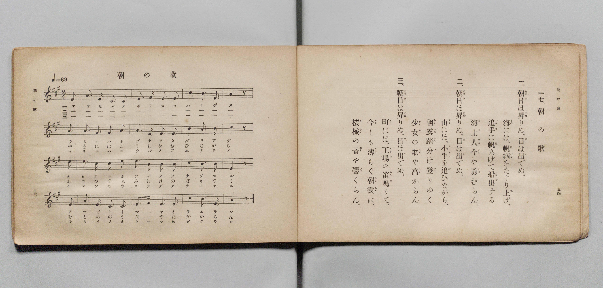

# 朝の歌

> Re:Shōka 使用 AI 協助辨識與重建樂譜，可能會有錯誤。歡迎回報。

- **鋼琴伴奏版**：<br><audio controls src="asa_no_uta.mp3"></audio>

- 文部省《尋常小學唱歌 第五學年用》（大正二年五月，索書號 4100）

## 說明

原書資訊與歌詞全文（對應 P030.jpg，原書 pp. 53–54）：
- 調性與拍號：イ長調（A 大調）2/4 拍，速度 ♩=69


## 歌詞

```text
一七、朝の歌
一、朝日（あさひ）は昇（のぼ）りぬ、日（ひ）は出（い）でぬ。
海（うみ）には、帆綱（ほづな）をたぐり上（あ）げ、
追手（おひて）に帆（ほ）あげて船出（ふなで）する
海士人（あまびと）今（いま）や勇（いさ）むらん。
二、朝日（あさひ）は昇（のぼ）りぬ、日（ひ）は出（い）でぬ。
山（やま）には、小牛（こうし）を追（お）ひながら、
朝露（あさつゆ）踏分（ふみわ）け登（のぼ）りゆく
少女（をとめ）の歌（うた）や高（たか）からん。
三、朝日（あさひ）は昇（のぼ）りぬ、日（ひ）は出（い）でぬ。
町（まち）には、工場（こうば）の笛（ふえ）鳴（な）りて、
今（いま）しも薄（うす）らぐ朝靄（あさもや）に、
機械（きかい）の音（おと）や響（ひび）くらん。
```

## ABC

<div class="abc-score" data-abc-src="asa_no_uta.abc" aria-label="五線譜載入中"></div>

[下載 ABC 原始檔](asa_no_uta.abc)

## TMD 檔案連結

- [主旋律 TMD 檔案](asa_no_uta.tmd) [[在 TMD Studio 編輯](https://tmdlang.github.io/Tmd-TS/#tmd=s7IKdvYPcrWy4qpTUCpJTLdSSM7PyUlNLsnMz7PKyszLyo8vzshPT8wuBdHZiUpwdWX5OaW5qVbpRYkpqfGm8SaGBgYIyeL80qLkVKvi5Iz8_Jz4ktSKkqT8_Gx0-fiCxPRUqwADYySdBUX5Zal5iXlA3QVFmXklqSlg7QgFqWWZKakg6bLUosy0zNQUJCelFhWD3A01vaQoMa84uSizAOQZhKr8ohKgj4oSCzIqrTIyi0vyizKTE3PisxPzkHxXkpEK9FxJZm5qfH5afEpiJbpUSmJmTmV8TmZaKrLJmemZeVa5-XlJpcDQwpRIzczKRAoNLS2FZ3PmPm5c92xtj4KWFpeirYKZJZe9rYIjl42RvokdSP-zae0vm1c8n9P4uKHr6Ybupzt2PN3Q_3TtjqdTNoJ0PV-z5smuKSD-zi3Pp6x43ND9fk_H0yXLn61d_GRXD1AQKPtsTsf7PT3Ptyx6NnvHi5nzFUBR9X5PpxIXl76Wgi21AJeCgsLTvvkgOza3v1jR9aKjHejAFyvnPW1dAfQEyFkbep-1dyqA4lsvqyAd6CaIeoWCAj0FU-NHDZNNTYDuer9nFsgsXYUXq_Y_a1gOMqe7F-huoPjjpiUvp24HigNNc1QAehPM7ASGlQJQDdDAlw3zn-5apvBo5kpbYEiCjHmyo-HJjubHDY3wkIaKQoSeTV8KNOtxY9PjxqmPGzcBDXvcuP7ZDJBzgaofN-4BiTR1PW5cA1IPVQxV9rR9F5jbAuYuB6tpApkOAs-2bgdLtj1uBDnxceNqoA6gGU93tD3fthEstftx49LHjavANkx63Dj_ceMEoFVPdnRBXATWNQmoBWbki_17n3WC4vdxI9BBmx43LoMYDDQSYh6YC_QJ0LBlLzp2wty3FWgJ0H1g2ZmPm7qRnPh08eonuyCqgPr2PW7c_LhxBVDhk90QR7QABcHua3naDQkToMhUsEjD4yYgORnqZWBio3GAPt0IDrUmmJPgAbqh_3nnbLC-yeDgng4JUGBoQYIKrBgYWsAw6AG5GRGgQOe-nAO0G-7cJY-bgEHZ-WJH_9MOSJgCw27_46Z-sBkTn88EBjGqN5qAFvbDnbhh4tOlm8GuBEbBisdNjWB9oEQHSwvAVAwKzZerZ4BFgHEOjFCgmm7U0NwBciYtQ_P5FIgkMMoXooTm9qVPF2xBCs0NEC88XwMJYmB4AAuTzpebIWogiRdo_zKkYEVPPI3THzc1vZgGdAckDGaCNQHFJ4AiYC5EHOzDpiZg2ECdgxRNK-c_WwR0B1BVLyikoD5a93I-OKxBmQGUZkHBOh9UMoBjGygFVNOPEqyUF3JQoKClz8XlWJzolx9akmgVkJmYl-9Qo2tYUw12so2hmZYdmIWtfFV4umfji63bgcUaqOze0fBiYY-CBqxMVHi6fdnLBY2aWLQBrQQZWaNgACwaQRBEm8YDiRoFQ7AAkGMM4oOJGoicroJZPIQFVWoM1W0E0wLTjWwg2CYfwxoFiBG6YPpx0yKwCY-btoLFHjdPAuJ-MKsPItM8ByqzCoh7oGogMiB1YLmmJVA17WBxkCqEDcsQthuh2d7YBDGpcSpEf-MmIF4PZq2DyuyB2tAFZK-BqoHIgNRBdLVA6eVgcZAqhO0gOajtxnT3e_M8sO240w24qu8BJxcTYFHT_3x9gw68MiUm4ZiCLTMGJwEQGyZiBE4MIIyePIwQyQiSPEBJBZE6HjfPh_qnGx4as6F-boXKAOOiGRQLj5v2Q0NwAyw0gCEFCZVFYHGQKkR4g-QQKQFYkkDUNq6Gx_pkiHmNbVCZ6UBdoBAHFghQGZiJwHIKSveAbepEtgmSruCx_ri5Ed1PTZuhLgelTpDMBGisP24GpUWQzAq4n0B2Q_wGMgviNpifQLFPKIZ3dFIQw5CcDMzxQASNLETZgFwKQKIXogQSzbCIx1IIQBIyyFNt4GBBimZwtgB5DZgZwZ6FBwk0ICCJHaJmJ1h8NUqQgLMVUjTDMvcSoBzYvEZQhgPJgJIPSEc_kD0RLIOa7SEZH0K3gcVh2Q5iEzgzIkUzKLuBxLcD2SBXQAsfsDsh7l4JTazomR8kB_V38xKwn0BhgrBpLdgmvNH8dPZsiqOZGsU9CCJHNDRQmicDcQfYM-A0C5Kpg_oQ5GckCaQwWQAPN5AGUKaBhQmSNeBYhmQXYPsIGouQTAySmQ-3BlwaAwWgErAghrFAuRhkPagUwGINKIqbIEkN5FRofoWUKiC_ofkGXlTDjHvcBKkycPumlotL104B1giI9jGMVUDhG6HxjcF8ZS4A)]
- [鋼琴伴奏 TMD 檔案](asa_no_uta_piano.tmd) [[在 TMD Studio 編輯](https://tmdlang.github.io/Tmd-TS/#tmd=s7IKdvYPcrWy4qpTUCpJTLdSSM7PyUlNLsnMz7PKyszLyo8vzshPT8wuBdHZiUpwdWX5OaW5qVbpRYkpqfGm8SaGBgYIyeL80qLkVKvi5Iz8_Jz4ktSKkqT8_Gx0-fiCxPRUqwADYySdBUX5Zal5iXlA3QVFmXklqSlg7QgFqWWZKakg6cTk5PzcgsS8zNzUPCT5stSiYpDjoVaUFCXmFScXZRaAfIRQlV9UAvRWUWJBRqVVRmZxSX5RZnJiTnx2Yh6SFxOLgJrTU0HmWxVkJublx-OwsyQDqMiqBCgan58Wn5JYiS6VkpiZUxmfk5mWiuyEzPTMPKvc_LykUmDYYkqkZmZlIoWdlpbCszlzHzeue7a25_2ejpfde55P2PJkz5anS_ufd3a839OpoKXFpWirYGbJZW-r4MhlY6RvYgcy9Nm09pfNK57PaXzc0PV0Q_fTHTuebuh_unbH0ykbgUYpPF-z5smuKSD-zi3Pp6x43NANNP3pkuXP1i5-sqsHKAiUfTYHaEHP8y2Lns3e8WLmfAVQbANtVOLicixO9MsPLUm0CgAFUJCHQ42uYU01lwIQ2BiaadmBWfpaCrboQOHpno0vtm5_0dEOcsCOhhcLexQ0QGlBL6sgXeHp9mUvFzRqYtGmpQ82skbBQEEXDEG0aTyQqFEwBAsAOcYgPpiogcjpKpjFQ1hQpcZQ3UYwLTDdyAaCbfIxrFGAGKELph83LQKb8LhpK1jscfMkIO4Hs_ogMs1zoDKrgLgHqgYiA1IHlmtaAlXTDhYHqULYsAxhuxGa7Y1NEJMap0L0N24C4vVg1jqozB6oDV1A9hqoGogMSB1EVwuUXg4WB6lC2A6Sg9puTHe_N88D24473YDTaw84uZgoAFPy8_UNOgqkJBxTsGXG4CQAYsNEjMCJAYTRk4cRIhlBkgcoqSBSx-Pm-VD_dMNDYzbUz61QGWBcNINi4XHTfmgIboCFBjCkIKGyCCwOUoUIb5AcIiU8btwHUdu4Gh7rkyHmNbZBZaYDdYFC_HFjF1QGZuLjRqhNjT1gmzqRbYKkK3isP25uRPdT02aoy0GpEyQzARrrj5tBaREkswLuJ5DdEL-BzIK4DeYnUOwTiuEdnRTEMCQnA3M8EEEjC1E2IJcCkOiFKIFEMyzisRQCkIQM8lQbOFiQohmcLUBeA2ZGsGfhQQINCEhih6jZCRZfjRIk4GyFFM2wzL0EKAc2rxGU4UAyoOQD0tEPZE8Ey6Bme0jGh9BtYHFYtoPYBM6MSNEMym4g8e1ANsgV0MIH7E6Iu1dCEyt65gfJQf3dvATsJ1CYIGxaC7YJbzQ_nT2b4mimRnEPgsgRDQ2U5slA3AH2DDjNgmTqoD4E-RlJAilMFsDDDaQBlGlgYYJkDTiWIdnlcVMjNBYhmRgkMx9uDbg0BgpAJWBBDGOBcjHIelApgMUaUBQ3QZIayKnQ_AopVUB-Q_MNvKiGGfe4CVJl4PZNLXobwAelDWCCaAIAWy_PNix-MXnN0-5mYAn-rLv36doJkAYMcq1uAIobUJxqg6PJND5ewQjKBgojMYEKYQkBu3IzCNtEHSaB0GEC5AGltYE68dlG0ApMFwHDQ9dOARYk0T6GsQoofCM0vjGYr8wFAA)]

## 分析

```text
================================================================================
📊 TMD Song Profile: [ 朝の歌 ]
================================================================================
⏱  Duration:       1:23 (83.5s), 48 measures total
🎼 Key & Tempo:    首調基準 A, != 69.0 BPM, <2/4>
   - 分析範圍：      由實際發聲的音符與和弦推測調性；播放脈絡另行呈現
🎤 人聲音域:    C#4 (MIDI 61) – E5 (MIDI 76) [跨度: 15 個半音 / 1.2 個八度, 難度: moderate]
   - 最低音:  C#4 in [AsaNoUta[L1] #1 @ m.2, 0:02]
   - 最高音: E5 in [AsaNoUta[L1] #1 @ m.6, 0:08]
   - 適合: soprano, mezzo-soprano, contralto, tenor, baritone, bass
🏛  結構:      AsaNoUta[L1] (27.8s) -> AsaNoUta[L2] (27.8s) -> AsaNoUta[L3] (27.8s)
⚡ 編曲密度:        Peak 1 軌道同時演奏
🗝  調性診斷：       E 調性不明確（純淨自然大調，未偵測到可信轉調）
   - 風格氣質:    純淨自然大調（陽光明朗、易唱易記，無明顯調外色彩）
   - 轉調歷程:    全曲維持單一推測調性（未偵測到可信轉調）
   - 核心骨幹音:  E, C#, A, B, F#
   - 調性數值:    E 調性不明確 [相關度: 0.81, 穩定度: Ambiguous, 自然音純度: 100.0%]
   - 候選調性 (K-S): E 大調 (0.81), A 大調 (0.81), C# 小調 (0.71)
   - 五度圈歷程:   +4 -> +4 -> +4
   - 各段落調性細節:
     • [AsaNoUta[L1] #1]: E 大調 (r: 0.82, 自然音純度: 100.0%)
     • [AsaNoUta[L2] #1]: E 調性不明確 (r: 0.81, 自然音純度: 100.0%)
     • [AsaNoUta[L3] #1]: E 調性不明確 (r: 0.81, 自然音純度: 100.0%)

  [ 五度圈游移軌跡 ]
               C  
         F            G  
      Bb               D  
      Eb               A  
         Ab          [E ]*
            Db       B  
               F# 
     (* = active key center)

  [ 十二半音累積音高分佈 ]
     C  :                            0.0%
     C# : ████████████████          22.5%
     D  :                            0.0%
     D# :                            0.0%
     E  : ████████████████████████  34.2%
     F  :                            0.0%
     F# : ███                        4.2%
     G  :                            0.0%
     G# :                            0.0%
     A  : ████████████████          22.5%
     A# :                            0.0%
     B  : ████████████              16.7%
--------------------------------------------------------------------------------
Assignment 軌道音域：
  - Piano         : C#4 – E5 (15 個半音 / 1.2 個八度, 156 個音符)
================================================================================
```


## 原書掃描頁




