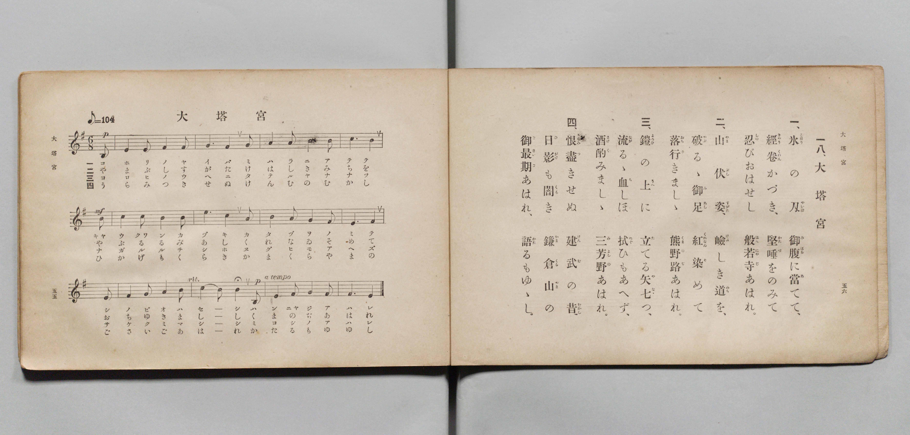

# 大塔宮

> Re:Shōka 使用 AI 協助辨識與重建樂譜，可能會有錯誤。歡迎回報。

- **鋼琴伴奏版**：<br><audio controls src="daitonomiya.mp3"></audio>

- 文部省《尋常小學唱歌 第五學年用》（大正二年五月，索書號 4100）

## 說明

原書資訊與歌詞全文（對應 P031.jpg，原書 pp. 55–56）：
- 調性與拍號：ホ短調（e 小調）6/8 拍，速度 ♪=104


## 歌詞

```text
一八、大塔宮
一、氷（こほり）の刃（やいは）　御腹（みはら）に當（あ）てて、
経巻（きやうくわん）かづき、堅唾（かたづ）をのみて
忍（しの）びおはせし般若寺（はんにやじ）あはれ。
二、山伏姿（やまぶしすがた）、破（やぶ）るゝ御足（みあし）
嶮（けは）しき道（みち）を、紅（くれなゐ）染（そ）めて
落行（おちゆ）きましゝ熊野路（くまのぢ）あはれ。
三、鎧（よろひ）の上（うへ）に　立（た）てる矢（や）七（なな）つ、
流（なが）るゝ血（ち）しほ　拭（ぬぐ）ひもあへず、
酒（さけ）酌（く）みましゝ三芳野（みよしの）あはれ。
四、恨（うらみ）盡（つ）きせぬ　建武（けんむ）の昔（むかし）
日影（ひかげ）も闇（くら）き　鎌倉山（かまくらやま）の
御最期（ごさいご）あはれ、語（かた）るもゆゝし。
```

## ABC

<div class="abc-score" data-abc-src="daitonomiya.abc" aria-label="五線譜載入中"></div>

[下載 ABC 原始檔](daitonomiya.abc)

## TMD 檔案連結

- [主旋律 TMD 檔案](daitonomiya.tmd) [[在 TMD Studio 編輯](https://tmdlang.github.io/Tmd-TS/#tmd=s7IKdvYPcrWy4qpTUCpJTLdSSM7PyUlNLsnMz7PKyszLyo8vzshPT8wuBdHZiUpwdWX5OaW5qVbpRYkpqfGm8SaGBgYIyeL80qLkVKvi5Iz8_Jz4ktSKkqT8_Gx0-fiCxPRUqwADY0OETEFRfllqXmIeUHdBUWZeSWoKWDtCQWpZZkoqSLostSgzLTM1BclJqUXFIHdDTS8pSswrTi7KLAB5BqEqv6gE6KOixIKMSquMzOKS_KLM5MSc-OzEPCTflWSkAj0Hka5EF87NzMksSUQWB5qRnplnlZufl1QKDCdMidTMrEykcNDSUni6ZPnThVOerlunoKXFpWirYGhgwmVvq-DOlZ1aaavgmstlY6ZvYQcy6Nm09pfNK57PaXzc0PV0Q_fTHTuebuh_unbH0ykbn63tUXi-Zs2TXVNA_J1bnk9Z8bih-_2eDqDpz9YufrKrBygIlH02p-P9np7nWxY9m73jxcz5CqDYer-nU4mLS19LwZZagEtBQeFp33yQHZvbX6zoetHRDnTgi5XznrauAHoC5KwNvc_aOxVAUa6XVZAOdBNEvUJBgZ6CqemjhsmmZkB3vd8zC2SWrsKLVfufNSwHmdPdC3Q3UPxx8-zn89cCxYGmpSoAAwLM7ASGlQJQDdDAlw3zn-5apvBo5ipbUJCCzHmyo-Fp6-rHDY3wMIeKAoWebdgONOlx4-THjbsfN3UBjXrcuO5pRzNIsKnlcSMQrQcJNjQ83bfwRetOsOL9QMHHTUBnAhWvfj51G1iwCcxdBkINjSALQOD51p6n23eD5XvB5rU9bux_3AREk8HKux83LgVJAd22oPXplH1glUDB-UBxkIKmSUDngC1cBjPy6X6gN4GqpgNlwGZsftzYBXJQ42yg4IuONS-6lz5dvwusBuhKoMdWg22eAVbcBBbsedzQBA6DXUBW49ONG5_s6X-6HBSmYKX7HjduA1sw83FjD9Ax4ABofL5gC0wB0MdAt3U_bpoLCpVtm2GhAjR9OlAK7tRtQBcCZSZCAxFkZO_LRqDXIcoXQr0INHtLK1gQGDBAC1c9bpoAlHo2H6JyLlhZI1IYvJiw98XCHrAk0OsLHze1gY3vBTt9OtBZz9u6Xrb3vdgOtBZsKkgcGI6LsIXBDpDnXvYtB3sOiICmbIKkgyc7gAkCqB8YaTsgkQ1MB89XgzIYNFSAkd3U_Xw-0FxQwABFnuwAJx2gFxpXgRUsQUoNz7Y2wiSBjoeG4IuFDWBBcGCAQmg30JJn3WvBgmseN4JCAuiix01AZwPRjseNs5CMfNk6CaxwKjCUgQpftkJCpR-sCRjE0PAAevJF12ZgkECDHuhPRAJCDY-ns2eD8kXjCqjXm0AGAdU9nw10IVBkCSyogcltDShf7N71bO0yaDwDk1sT0DugwHs2Ywo4VBrACRo5WTybvvTp3o1gHZvAkkAvAAOj6eV0UBkBTgSQvAXMFw0v-3qeNnQCkygsawB9BFIASagQq-Dpbd_CZ3Mans0BRg1Q7RRwqABVAd2B7MvGF6vmwfMZLBqagGkIGE6gUIEEA-XFIRQoaOlzcbkkZpbk5-XnZlYmWgVkJublO9QY1FSD3W1jaKZlB2ZhK4vBxfuOBmBqV9AwBpV3z9c36MALUIWn25e9XNAITKeaWLQCLQYZW6NQXVCrYBYPLE_BhDmcBYLGIEYNjA-UM4QpAUGwMFQWTKDIGoAkwXb4GNYoPG7aDOQDC2gwuQpM9kFVPm5eAjbocROIBvH7gXg-lAVTsxKiprkbxGtaBBZrg5MgCHYOxEYjkGktINnGfWByG5icDjOtcSbEtMYeKH8-XD1IJVisCWQTyBywjY37wWQTijlINhqDVHaA9fWC1WwCk-vgNoJcCbJxB5S_GmwriLUMw0aIS8ChBCUhIYNiownINHAINHUiuRCmEphDoDaCwhzEXwPEE8HqJ8NtbICqAbkTwgMmfSx-xJ8Gd_UQSoNr8afB3LRaBWOgRSBsBMSglARNcqhJDJwqkRTWIBIdWN5UHVf6W_u4eTnYk6Dgfty0_nEz2M_NoHQJCYvVkLBobgXz1qKIP24Chy5YDqQGHLvgFAxLqThSISTEG9fDwxQSL5AYAZkJUrMQbMMkuDgo1QOLIzAbFP8g908A8-aCZRrBbFi6QUuF0BQD1g1Ju2ASYjLIJpAaiEt2w8XXgEmIHSC_gWyEpHUICUq1wMoF00ZwKoSkdUi6AfkCohfhF5BpkDSK8DtENSR3oqhBybew_ENMKgRWY6BUaII7FXbjTYWwdGUGpUEpDJS6ahCFGjxNgiCo5IQmUJAyRPmJLfXCIChZwiBy8twO8i40QYGy5-MmUDSCeMDCsAkUUWBVdUjaYcZCSklQqoSUsd2PmxeDTQBHGrioRFUGimx0Q5DcA062XSAd0IQJLmSgUQeKGEjyAScjrO6BxSdSHAKbV2ASkS5AOQLkJUgJjNMx4BQ9FawDkpPAeQOcc4h0DDSTQQpnaMKHOIlkx4AT-xSwDoiTIEkVJAIxD8kk7I6BlvCQkh-aO8E5DBzIYDVgFiyPYndMLReXrp0CUrsh2scwVgFdyAhTyBhTyAQspMwFAA)]
- [鋼琴伴奏 TMD 檔案](daitonomiya_piano.tmd) [[在 TMD Studio 編輯](https://tmdlang.github.io/Tmd-TS/#tmd=s7IKdvYPcrWy4qpTUCpJTLdSSM7PyUlNLsnMz7PKyszLyo8vzshPT8wuBdHZiUpwdWX5OaW5qVbpRYkpqfGm8SaGBgYIyeL80qLkVKvi5Iz8_Jz4ktSKkqT8_Gx0-fiCxPRUqwADY0OETEFRfllqXmIeUHdBUWZeSWoKWDtCQWpZZkoqSDoxOTk_tyAxLzM3NQ9Jviy1qBjkeKgVJUWJecXJRZkFIB8hVOUXlQC9VZRYkFFplZFZXJJflJmcmBOfnZiH5MXEIqDm9FSQ-VYFmYl5-fE47CzJACqCmlOJLpybmZNZkogsDrQsPTPPKjc_L6kUGKqYEqmZWZlIoaalpfB0yfKnC6c8Xbfu_Z6Ol917nk_Y8mTPlqdL-593drzf06mgpcWlaKtgaGDCZW-r4M6VnVppq-Cay2Vjpm9hBzL92bT2l80rns9pfNzQ9XRD99MdO55u6H-6dsfTKRufre1ReL5mzZNdU0D8nVueT1nxuKEbaA3QymdrFz_Z1QMUBMo-mwO0qef5lkXPZu94MXO-AijCgVYrcXG5JGaW5Ofl52ZWJloFgIIpyMOhxqCmmksBCGwMzbTswCx9LQVbdAC2eUfDi4U9ChrGCkA3PV_foKMAShF6WQXpCk-3L3u5oPHJji5NLFq19MHG1ihUF9QqmMUr6EIIczgLBI1BjBoYHyhnCFMCgmBhqCyYQJE1AEmC7fAxrFF43LQZyH_cPBtMrgKTfVCVj5uXgA163ASiQfx-IJ4PZcHUrISoae4G8ZoWgcXa4CQIgp0DsdEIZFoLSLZxH5jcBianw0xrnAkxrbEHyp8PVw9SCRZrAtkEMgdsY-N-MNmEYg6SjcYglR1gfb1gNZvA5Dq4jSBXgmzcAeWvBtsKYi3DsBHiEnAoQUlIyKDYaAIyDRwCTZ1ILoSpfNwIcgdIDSjMQfw1QDwRrH4y3MYGqBqQOyG8x40Q_6L6EX8a3NVDKA2uxZ8Gc9NqFYyBFoGwERCDUhI0yaEmMXCqRFJYg0h0YHlTdVzpb-3j5uVgT4KC-3HT-sfNYD83g9IlJCxWQ8KiuRXMW4si_rgJHLpgOZAacOyCUzAspeJIhZAQb1wPD1NIvEBiBGQmSM1CsA2T4OKgVP-4CZQ2IfEPcv8EMG8uWKYRzIalG7RUCE0xYN2QtAsmISaDbAKpgbhkN1x8DZiE2AHyG8hGSFqHkKBU-7hxFqaN4FQISeuQdAPyBUQvwi8g0yBpFOF3iGpI7kRRg5JvYfmHmFS4oxOcCk1wp8JuvKkQlq7MoDQohYFSVw2iUIOnSRAElZzQBApShig_saVeGAQlSxhETp7bQd6FJihQ9nzcBIpGEA9YGDaBIgqsqg5JO8xYSCkJSpWQMrb7cfNisAngSAMXlajKQJGNbgiSe8DJtgukA5owwYUMNOpAEQNJPuBkhNU9sPhEisPHjeASG5yaIGpAOQLkJUgJjNMx4BQ9FawDkpPAeQOcc4h0DDSTQQpnaMKHOIlkx4AT-xSwDoiTIEkVJAIxD8kk7I6BlvCQkh-aO8E5DBzIYDVgFiyPYndMLZZmgw9ys8EC0Wp41rTp6eL1T1vXPm1d_ay7F9LwQSR6s3hgrR6vDazpISQ6H1OFMZBvHh8fr22EoLGrAhbGQGmQGmCyhwQhpkKgbpN4bWAegZDEuAhNC9FWYZqEphWJiWko3oBAUoqs0AAKwVGma6eAFGvRPoaxCuhCRphCxphCJmAhZS4A)]

## 分析

```text
================================================================================
📊 TMD Song Profile: [ 大塔宮 ]
================================================================================
⏱  Duration:       1:09 (69.2s), 40 measures total
🎼 Key & Tempo:    首調基準 G, != 104.0 BPM, <6/8>
   - 分析範圍：      由實際發聲的音符與和弦推測調性；播放脈絡另行呈現
🎤 人聲音域:    B3 (MIDI 59) – E5 (MIDI 76) [跨度: 17 個半音 / 1.4 個八度, 難度: challenging]
   - 最低音:  B3 in [Daitonomiya[L1] #1 @ m.1, 0:01]
   - 最高音: E5 in [Daitonomiya[L1] #1 @ m.7, 0:10]
   - 適合: soprano, mezzo-soprano, contralto, tenor, baritone, bass
🏛  結構:      Daitonomiya[L1] (17.3s) -> Daitonomiya[L2] (17.3s) -> Daitonomiya[L3] (17.3s) -> Daitonomiya[L4] (17.3s)
⚡ 編曲密度:        Peak 1 軌道同時演奏
🗝  調性診斷：       E 小調（純淨自然小調，未偵測到可信轉調）
   - 風格氣質:    純淨自然小調（陰鬱抒情、旋律集中，無明顯調外色彩）
   - 轉調歷程:    全曲維持單一推測調性（未偵測到可信轉調）
   - 核心骨幹音:  E, F#, G, B, A
   - 調性數值:    E 小調 [相關度: 0.76, 穩定度: High, 自然音純度: 96.4%]
   - 候選調性 (K-S): E 小調 (0.76), E 大調 (0.58), B 大調 (0.54)
   - 五度圈歷程:   +4 -> +4 -> +4 -> +4
   - 各段落調性細節:
     • [Daitonomiya[L1] #1]: E 小調 (r: 0.76, 自然音純度: 96.4%, 調外音: D#)
     • [Daitonomiya[L2] #1]: E 小調 (r: 0.76, 自然音純度: 96.4%, 調外音: D#)
     • [Daitonomiya[L3] #1]: E 小調 (r: 0.76, 自然音純度: 96.4%, 調外音: D#)
     • [Daitonomiya[L4] #1]: E 小調 (r: 0.76, 自然音純度: 96.4%, 調外音: D#)

  [ 五度圈游移軌跡 ]
               C  
         F            G  
      Bb               D  
      Eb               A  
         Ab          [E ]*
            Db       B  
               F# 
     (* = active key center)

  [ 十二半音累積音高分佈 ]
     C  :                            0.0%
     C# :                            0.0%
     D  :                            0.0%
     D# : ███                        3.6%
     E  : ████████████████████████  31.8%
     F  :                            0.0%
     F# : █████████████████████     28.2%
     G  : ████████████              16.4%
     G# :                            0.0%
     A  : ███                        4.5%
     A# :                            0.0%
     B  : ████████████              15.5%
--------------------------------------------------------------------------------
Assignment 軌道音域：
  - Piano         : B3 – E5 (17 個半音 / 1.4 個八度, 172 個音符)
================================================================================
```


## 原書掃描頁




