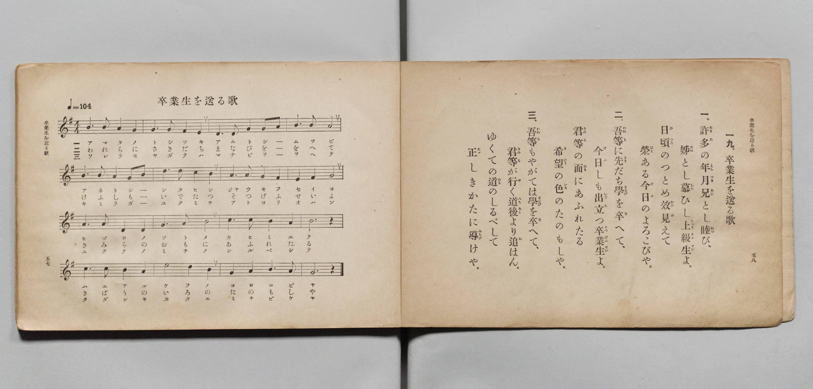

# 卒業生を送る歌

> Re:Shōka 使用 AI 協助辨識與重建樂譜，可能會有錯誤。歡迎回報。

- **鋼琴伴奏版**：<br><audio controls src="sotsugyosei_wo_okuru_uta.mp3"></audio>

- 文部省《尋常小學唱歌 第五學年用》（大正二年五月，索書號 4100）

## 說明

原書資訊與歌詞全文（對應 P032.jpg，原書 pp. 57–58）：
- 調性與拍號：ト長調（G 大調）4/4 拍，速度 ♩=104


## 歌詞

```text
一九、卒業生を送る歌
一、許多（あまた）の年月（としつき）兄（あに）とし睦（むつ）び、
姉（あね）とし慕（した）ひし上級生（じやうきふせい）よ。
日頃（ひごろ）のつとめ效（かひ）見（み）えて
榮（はえ）ある今日（けふ）のよろこびや。
二、吾等（われら）に先（さき）だち學（まなび）を卒（を）へて、
今日（けふ）しも出立（いでた）つ卒業生（そつぎふせい）よ。
君等（きみら）の面（おもて）にあふれたる
希望（きばう）の色（いろ）のたのもしや。
三、吾等（われら）もやがては學（まなび）を卒（を）へて、
君等（きみら）が行（ゆ）く道後（みちあと）より追（お）はん。
ゆくての道（みち）のしるべして
正（ただ）しきかたに導（みちび）けや。
```

## ABC

<div class="abc-score" data-abc-src="sotsugyosei_wo_okuru_uta.abc" aria-label="五線譜載入中"></div>

[下載 ABC 原始檔](sotsugyosei_wo_okuru_uta.abc)

## TMD 檔案連結

- [主旋律 TMD 檔案](sotsugyosei_wo_okuru_uta.tmd) [[在 TMD Studio 編輯](https://tmdlang.github.io/Tmd-TS/#tmd=s7IKdvYPcrWy4qpTUCpJTLdSSM7PyUlNLsnMz7PKyszLyo8vzshPT8wuBdHZiUpwdWX5OaW5qVbpRYkpqfGm8SaGBgYIyeL80qLkVKvi5Iz8_Jz4ktSKkqT8_Gx0-fiCxPRUqwADYyOETEFRfllqXmIeUHdBUWZeSWoKWDtCQWpZZkoqSLostSgzLTM1BclJqUXFIHdDTS8pSswrTi7KLAB5BqEqv6gE6KOixIKMSquMzOKS_KLM5MSc-OzEPCTflWSkAj0HcT-6aHJqUWpufl4lspGZ6Zl5VkDBpFJgMGFKpGZmZSIFg5aWwtPeSc-Wrn0-Zf7jpkkvGxofN3U_W9ujoKXFpWirYGhgwmVvq-DOZWOib2IHMuzZtPaXzSuez2l83ND1dEP30x07nm7of7p2x9MpG0Hanq9Z82TXFBB_55bnU1Y8buh-v6fj6ZLlz9YufrKrBygIlH02p-P9np7nWxY9m73jxcz5CqAIe7-nU4mLS19LwZZagEtBQeFp33yQHZvbX6zoetHRDnTgi5XznrauAHoC5KwNvc_aOxVAsa6XVZAOdBNEvUJBgZ6CqfmjhsmmFkB3vd8zC2SWrsKLVfufNSwHmdPdC3Q3UPxxc8fLqduB4kDT3BWA3gQzO4FhpQBUAzTwZcP8p7uWKTyaudIWFJQgc57saHiyc-7jhkas4Q5VAZR-sWLj0yWzgAY_bmx63LjvcSPQws7HjeuAYQgOQKD4iseN0x83LnncCLSq82lrC0zxarBKkOzzuctAgk0NQGVgwc1Ak0F2gMDT5UC_QXSshet41joVLAg0GGLhJiD7yY6u51tmAZ0KlprxuKnlcWMb0NrHjVsfN85-3Ai0ufNxU8fjhiaY2c-mL325oBmsHGjAlMdNICcCXQ927orHTY3PpkL80A1UAJR6sQyUUB43goLvcSOQsQxu0rJ1YJn1QGGwZBMwpJ7s7gLaABafCHQE1GygC5qAbpoM8ibQiRDXAJMdKLAn7Hu-Fuzdpv7HTT2Pm4BsoJ7VT1shzpgKCcTHjQseNy4EJl-wIDDQVwHNAntuEjC6wNqBJFDZDqALkYISm3umP25qetq-6_lqiM-AQbYcFqZL4HEPlpoLDpU-3KH5dMJsqOtBYb4f5vp1L-cuAgt2Aa0COgjiJXCEbgV5shGYtLrhZuzoeTZnNsyMDcAIhJjxohMY_mD3IeJoPjg0gcYA_QAPxx2dOMMRqBSUJIA2LgNGFOnBh8N_PS8W9oA1QZza_7Jx8tN9YBGgmsaFYI-ugAZWU9eL_XshgQFWvP5x02SkEASaATQA7L51QGPgZsB8DPQoMCXuBKd7RNJbuxisEBgcC6BRCnIfUCFQZPXTDX1ITgF7Exj58PCivASDAgUtfS6u4PyS4tL0yvzi1MzwfP_s0qLS0JJEq4DMxLx8hxqDmmqwk20stOzADGzlKLho3tEADFIFDRMFYKH9fH2DDrzwU3i6fdnLBY2aWPQBrQeZWaNgDCwDdRWMFAyBpFk8kKhRMAVRID5MrgbMMwKLmAIhSJEZSD0Qg3ggWAM2z8ewBhgri8Aij5vnAdn7waw-sB5gyQriNW0Hi7VAVDWtBcmA9Txu7gaTHXUK8VBlIE0L4MofN09Gtc4IpLUfalAPEHeCWI2rITobp4J5vWASZAqIXgiW2QdmrwKTmyHWTYJoAtPAxAwml6FaZwxyznqo79YA8UowC-R2kMwSsDPWgMXaoKr6wTLzwOwuiBfA1jVvgmoC0Y-bZyBpAlmHP8Z3gTIRuTEOijVdBXMFwzhoFAJjHCxkDI5iUFRDkgVIFCQCkqkBs2CRjSvCe1GiGCSzvQ4sBQpfSEqAhTI4DTTteNy8-HETKJSB6eBxMyi-QMzdYCXg4GxegWknKNYbJ0LjcysQTwfraoIY3QhNWI3LgXg-mAUyCSQzF84DlcxN7cDyEqp2NlwnsNzBtBEU8cCECvHlfFjEg6MaFIeQZPK4aT1YFqSmEepNSLIGhwnUJ4-bV4FlwGmvuf9x82YU6whk9U4KIh6cr8G5HJadIfEMi3Vo9gcxIfkeUgJAoh4GDRCBAop6cHyCvL4FyAYFECKvQzIsxOsLwWqg2RKqBxKUIHFQwIDEYckfkmJQoxuUiUERtR-eyddBdIHrSbAAOBmB8z6wEoFKboVZBSwdQOIgC0GhDyposFgFzuDIsQlyEsJLiLiFiCHKKJCtEC_NRBHH9BLeCH46ezbFZTlyNgZHKTjewSxInMOKdli0IqIcWwTDStcV8NQMjcamjWAeuIyFhAY4hYP0gBNCEyhhI5XY0AKSUARvAGJwqMMjGJIrQfIQMXgsQnjQ2AeVAVB7miAlANbYBRdDIHc1wAshkGtBMuCUAy2mIBUR1J5msA1gn0B8jds_tVxcunYKWCv2aB_DWAXckkb4JI3BkspcAA)]
- [鋼琴伴奏 TMD 檔案](sotsugyosei_wo_okuru_uta_piano.tmd) [[在 TMD Studio 編輯](https://tmdlang.github.io/Tmd-TS/#tmd=s7IKdvYPcrWy4qpTUCpJTLdSSM7PyUlNLsnMz7PKyszLyo8vzshPT8wuBdHZiUpwdWX5OaW5qVbpRYkpqfGm8SaGBgYIyeL80qLkVKvi5Iz8_Jz4ktSKkqT8_Gx0-fiCxPRUqwADYyOETEFRfllqXmIeUHdBUWZeSWoKWDtCQWpZZkoqSDoxOTk_tyAxLzM3NQ9Jviy1qBjkeKgVJUWJecXJRZkFIB8hVOUXlQC9VZRYkFFplZFZXJJflJmcmBOfnZiH5MXEIqDm9FSQ-VYFmYl5-fE47CzJACqC-hZdNDm1KDU3P68S2e7M9Mw8K6BgUikwUDElUjOzMpECTUtL4WnvpGdL1z6fMv9x06SXDY2Pm7qfre15v6fjZfee5xO2PNmz5enS_uedHe_3dCpoaXEp2ioYGphw2dsquHPZmOib2IFseDat_WXziudzGh83dD3d0P10x46nG_qfrt3xdMpGoFkKz9esebJrCoi_c8vzKSseN3QDjX-6ZPmztYuf7OoBCgJln80B2tDzfMuiZ7N3vJg5XwEU50Arlbi4gvNLikvTK_OLUzPD8_2zS4tKQ0sSrQJAYRbk4VBjUFPNpQAENhZadmCGvpaCLToAO2FHw4uFPQoaJgpAxz1f36CjAEodelkF6QpPty97uaBRE4s-LX2wmTUKxgq6QGikYAgkzeKBRI2CKYgC8WFyNWCeEVjEFAhBisxA6oEYxAPBGrB5PoY1Co-bFoFFHjfPA7L3g1l9YD2PmztAvKbtYLEWiKqmtSAZsJ7Hzd1gsqNOIR6qDKRpAVz54-bJqNYZgbT2Qw3qAeJOEKtxNURn41QwrxdMgkwB0QvBMvvA7FVgcjPEukkQTWD6ceMOMLkM1TpjkHPWQ323BohXglkgt4NkloCdsQYs1gZV1Q-WmQdmd0G8ALaueRNUE4h-3DwDSRPIOvwxvquHghgHxZqugrmCYRw0CoExDhYyBkcxKKohyQIkChIBydSAWbDIxhXhvShRDJLZXgeWAoUvJCXAQhmcBpp2PG5e_LgJFMrAdPC4GRRfIOZusBJwcDavwLQTFOuNE6HxuRWIp4N1NUGMboQmrMblQDwfzAKZBJKZC-c9bux73NT-uBEaTY2z4TofN4F8gGYjKOKBCRXiy_mwiAdHNSgOIcnkcdN6sCxITSPUm5BkDQ4TqE8eN68Cy4DTXnP_4-bNKNYRyOqdFEQ8OF-DczksO0PiGRbr0OwPYkLyPaQEgEQ9DBogAgUU9eD4BHl9C5ANCiBEXodkWIjXF4LVQLMlVA8kKEHioIABicOSPyTFoEY3KBODImo_PJOvg-hq7ILEPCSzQvL-40ZYWtgKswpYOoDEQRaCQh9U0GCxCpzBkWMT5CSElxBxCxFDlFEgWyFemokijuklvBH8dPZsisty5GwMjlJwvINZkDiHFe2waEVEObYIhpWuK-CpGRqNTRvBPHAZCwkNcAoH6QEnhCZQwkYqsaEFJKEI3gDE4FCHRzAkV4LkIWLwWITwoLEPKgOg9jRBSgCssQsuhkDuaoAXQiDXgmTAKQdaTEEqIqg9zWAbwD6B-Bq3f2rx1us-yPW6CaJef7Zr9ctlK170db1s7wUmgWfdvU_XToC0UBCxaxivYByvDYxMIMMkXhsYoahiEAZ2MZN4YALQNgQmhXgFI4gY1FSYDIwmYKYR0G51qOUIw0AsA7iRCHFsJpgBZQ3jtY1xORWXqdjUIswCuQs9TJA8i6IbZCYwnnTtFLBGVbSPYawCbkkjfJLGYEllLgA)]

## 分析

```text
================================================================================
📊 TMD Song Profile: [ 卒業生を送る歌 ]
================================================================================
⏱  Duration:       1:50 (110.8s), 48 measures total
🎼 Key & Tempo:    首調基準 G, != 104.0 BPM, <4/4>
   - 分析範圍：      由實際發聲的音符與和弦推測調性；播放脈絡另行呈現
🎤 人聲音域:    D4 (MIDI 62) – G5 (MIDI 79) [跨度: 17 個半音 / 1.4 個八度, 難度: challenging]
   - 最低音:  D4 in [SotsugyoseiWoOkuruUta[L1] #1 @ m.2, 0:02]
   - 最高音: G5 in [SotsugyoseiWoOkuruUta[L1] #1 @ m.5, 0:10]
   - 適合: soprano, mezzo-soprano, tenor, baritone
🏛  結構:      SotsugyoseiWoOkuruUta[L1] (36.9s) -> SotsugyoseiWoOkuruUta[L2] (36.9s) -> SotsugyoseiWoOkuruUta[L3] (36.9s)
⚡ 編曲密度:        Peak 1 軌道同時演奏
🗝  調性診斷：       D 調性不明確（純淨自然大調，未偵測到可信轉調）
   - 風格氣質:    純淨自然大調（陽光明朗、易唱易記，無明顯調外色彩）
   - 轉調歷程:    全曲維持單一推測調性（未偵測到可信轉調）
   - 核心骨幹音:  A, G, D, B, E
   - 調性數值:    D 調性不明確 [相關度: 0.78, 穩定度: Ambiguous, 自然音純度: 100.0%]
   - 候選調性 (K-S): D 大調 (0.78), G 大調 (0.77), E 小調 (0.59)
   - 五度圈歷程:   +2 -> +2 -> +2
   - 各段落調性細節:
     • [SotsugyoseiWoOkuruUta[L1] #1]: D 調性不明確 (r: 0.78, 自然音純度: 100.0%)
     • [SotsugyoseiWoOkuruUta[L2] #1]: D 調性不明確 (r: 0.78, 自然音純度: 100.0%)
     • [SotsugyoseiWoOkuruUta[L3] #1]: D 調性不明確 (r: 0.78, 自然音純度: 100.0%)

  [ 五度圈游移軌跡 ]
               C  
         F            G  
      Bb              [D ]*
      Eb               A  
         Ab           E  
            Db       B  
               F# 
     (* = active key center)

  [ 十二半音累積音高分佈 ]
     C  :                            0.0%
     C# :                            0.0%
     D  : ███████████████████       20.2%
     D# :                            0.0%
     E  : ██████████████            14.5%
     F  :                            0.0%
     F# : █                          0.8%
     G  : ██████████████████████    22.6%
     G# :                            0.0%
     A  : ████████████████████████  25.0%
     A# :                            0.0%
     B  : ████████████████          16.9%
--------------------------------------------------------------------------------
Assignment 軌道音域：
  - Piano         : D4 – G5 (17 個半音 / 1.4 個八度, 162 個音符)
================================================================================
```


## 原書掃描頁




