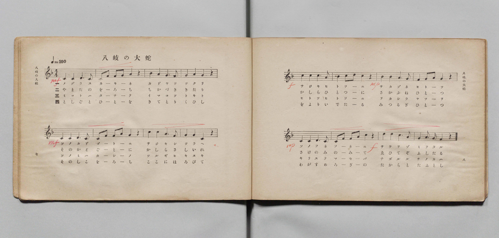
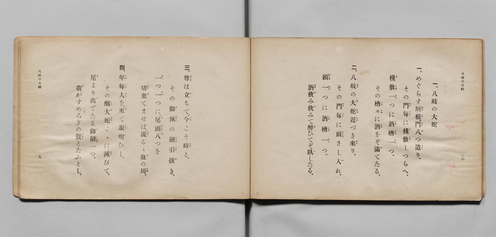

# 八岐の大蛇（八岐大蛇）

> Re:Shōka 使用 AI 協助辨識與重建樂譜，可能會有錯誤。歡迎回報。

- **鋼琴伴奏版**：<br><audio controls src="yamata_no_orochi.mp3"></audio>

- 臺灣教育會公認『新定兒童唱歌』尋常科第三學年用（第二學期・第2首）
- 國立臺灣歷史博物館典藏（典藏號：2020.006.0847.0003）

## 說明


- 出處：臺灣教育會公認、臺北新高堂發行《新定兒童唱歌》尋常科第三學年用（昭和6年／1931年），
第二學期第 2 首〈八岐の大蛇〉（八岐大蛇），原書第 15 頁（掃描檔 P038.jpg）。
- 出處原曲：文部省唱歌（1910年《尋常小學唱歌》第一學年／此處編入第三學年）。
- 調性與拍號：ヘ調（F 大調），4/4 拍，速度 != 100。
- 背景與曲風：敘述日本神話中素戔嗚尊（須佐之男命）設下八門八酒槽誘使八岐大蛇飲酒醉臥、
拔十握劍斬蛇並於蛇尾得天叢雲劍（草薙劍）獻予皇室的故事。
- 版本說明：本檔案為原書單聲部五線譜（附移動 Do 階名片假名）之忠實數位化版本。

### 編曲說明（鋼琴伴奏版）：

1. 前奏 (Intro, 2 小節)：引用第四段莊嚴敘事的結尾樂句作為前導。
2. 主歌伴奏 (YamataNoOrochi, 8 小節 × 4 段)：右手演奏威武古樸的敘事旋律，
左手以穩健的四拍子和弦進行支撐神話史詩氣氛。


## 歌詞

```text
一　めぐらす垣根（かきね）、門（かど）八つ造り
その門毎（かどごと）に棧敷（さじき）しつらへ
棧敷一つに酒槽（さかぶね）一つ
その槽々（ふねぶね）に酒をぞ滿（み）てる

二　八岐（やまた）の大蛇（おろち）近づき來（きた）り
その門毎に頭（かしら）さし入れ
頭一つに酒槽一つ
酒飲み飲みて醉（ゑ）ひてぞ臥（ふ）したる

三　尊（みこと）は立ちて、今こそ時と
その御佩（みはかし）の劍（つるぎ）引拔き
一つ一つに、尾頭（をがしら）八つを
切棄（きりす）てませば流るゝ血の川

四　年毎（としごと）人を、來（き）て取くひし
その醜大蛇（しこおろち）こゝに滅びて
尾（を）より出（い）でたる、御劍（みつるぎ）一つ
我がすめろぎの寶（たから）とたふとし
```

## ABC

<div class="abc-score" data-abc-src="yamata_no_orochi.abc" aria-label="五線譜載入中"></div>

[下載 ABC 原始檔](yamata_no_orochi.abc)

## TMD 檔案連結

- [主旋律 TMD 檔案](yamata_no_orochi.tmd) [[在 TMD Studio 編輯](https://tmdlang.github.io/Tmd-TS/#tmd=s7IKdvYPcrWy4qpTUCpJTLdSSM7PyUlNLsnMz7MqzsjMK0nNjM_KTMmPL87Iz05Ugisry88pzU21Si9KTEmNN443MjAyiDcwMIs3sDAxBzIMjBFKi_NLi5JTrYqTM_Lzc-JLUitKkvLzsxHyBUX5Zal5iXlANQVFIBtTwIoQClLLMlNSQdKpKZkl-UWZiTlI7kgtKga7FWxJfElRYl5xclFmAcgDCFUlGalAx6bl52Tn5BelIsSBhqVn5lnl5ucllQI9iCFRkpgJFAb5vTwxPjcxMy8nMS9FiUtLS-Fp6-qnmyY8blz3dMnyF7Pb3-_pgIjAuJ0KWlpcirYKhgYGXPa2Cm5cNib6JnYg81-073reuPjZ1JkvmjY9m9P8tHXNi1W9jxv6nk3b8HTdrKetk56vXvp0ysZna3seN_Q_3dD9dMeO58snPl-z5smOzqdrdzzdueX5lBVA-0Aiu3qAIs_mzH_cvBvINXq5bBrQZrAvns7pfr66G2rX2u1P-zc97Z31vHPlyyUrnrbueDG9H-xiEOPFzPnv98wCRaAeMAL1QBEIZBgYg03i0tdSsKUW4FJQUHjcMOHZ7E3PZ697sWrVsxl9jxsmgkWbdz9t3_Vi5lSgS3CETyNQ_GnPdGAovVw94-mCpucz97xYCAyiLmzh1o0n3J7NWPt0Uo8ZkP9-T7-hpbEhmNX5fk8PyCUKCsjhCmQrGCkAg_VxAzR-4TH-uAGoBT3SgYY87Zv_bPYOkEZDU4WXCxpBNvY1P-vvf7ZqikKAgbGFXlZBOlDp44YmFJ-D9W0C-v_ZtPaXzSuez2mEeAao39DS0ADoSKBfId56uqEf5CGYX8FebIB4EeilZ2uXAI17vh0Yz0uRfY9i54tV-581LH_R0f6suxeSAB43zwAKAm1zUwB5B8QEeQeYahWAaoCslw3zn-5apgBJ00gmNfc8m7keZNLsTS8XAQN41rOpM17s3_Bs-tJnc9Y8XzrvxcqNT3asfb5lwbOOKU-nz3q6oQtoycsFHU_2Tniys_v5lO1PJ-4F2vVixdonO7qB4flyWgOIbJ30bPneF6tmPNm7HzmQXy7eBJR62db5on0pMFFAouxZ95SnvY3P-hc-7ep9Nm0NUNmTHcueTdsDZDzdsO_pvulPl6x82r_o5exNQAVA21_0dr6YNhPM7nzeu_vJro7ns9qfrlvyfFbLs6mtT3Z1I7z3vLMD6A1IYgX5bc4aYDw-W9jxvGkXJKafTlv3onETMMae7JryfPusF2vngLw3s-X58t1Pu6cquOQrvJzV93RC7_PO9qeN7UAG0E6gv5_uX_B0_bJnU3c82dv7tGcaxBqQtdBMAjEcGMEvVs572roCmCiAQQwMRxBj1bwXa9cDcw4o_W3ofdbeiZyuwAYA08PjhobHTY2PGyc8bup83Djz6bzFzxbsBOp43Nj9uLH3ceNacHpoBIY2THAlUAQY1I8bl7xsWPC4qQvsksa5wBQPVPRsPdD7UHWPG6c8bgTGNNDc1c8WL382dTtYaurjxhlAo8Hi04GmgC3eATIFogjkKKBoIzRuYXqAJm6DOAeiAGEtUNHjhlawuq1AFXB1ECMeN0163Djv2W5Qmn3cCEqujxuXPW7qBukHxTE4lIBR9nx954ut25_O6X2-ERjAjU937wJ6D5TCGieDPd_zbH0_hP2yee-zCWuBioElDLC0gUg9beiGcJ_s6Ho2ZR8opwFFoD6AKYAk1sULQSZMmw9005Ndbc_39YFc2dAEj5RdwNwKStvAxAxyc1PL48Z9jxuBmQ_ockQ98rix63ETMIIWgjLF_omPG5cCA_XJvjawFFAcrB4zdkCBsgAYOpA4mg4MfLC5wACeDiwIHjeBSzegCrRYQIQ5KFst3gQMSQgJDExgLgO7E5jQgCYBBZcBAxyY7yAxAovn-VjCHDnHPtuzA4hezl0A9MzLxj6wT3qedXWB3AIUb9gEDEOgKyBRAAxDoCyIu7ANqACYvF9MnI4W5k-nzX06sQFEztnwZN9-oCufNkx6PnchSOWuNuQA3wFM4Q2QAgfso8mwZLseWDcCQxjko4bGJ7u7wFJzn81sAipABOzTfQuf7AXmCojm9ZCAhcYWuBwBJ3KgIDBrdD7dMxVYDAFjCJb_GpfAgxqU7Dbsg0YPKNn2wGMIkuGAgiBtT4Gl6OIWaEQ3AV01E5qqQelk9uPGDc-2NoIsbJr7YiHQ6HVPt8_FCPkNXaAyd-v2F7tWA8Pq-ZzuZ7umAasEoN-erV38bMb6F53rn60EpqEeUKEJrHlaN7ycNvlla--zji3A4u_p-m1gr_U83dAOyiPQWAAleyAClq3AMhpUFyyYDDJwa-Ozjgkg8UUgBz3btBkp8J_Ong0K_J1bYCXHCnBqgZYcT3btAgUEMPBhCRvi06f90x439oMT23SkFN42Byl7AE0BxhYik4C4TUBlq5_tbn3cuBloCtj-DfsgoQ3OLkBGF9C3YP3AAAbqWQ5JuaCo2QeqN2DRjIhRRNZ41gHMhsA4mwkqUUHWAnPbOmBQgfXMB6ULaG4D-hHIBRZWIM9iRM3OLSDUCcrMTyfMe7l4PjAUgJUfKNhb2581L4T48ekGYL2-BOiXJ7tAeeHpvnmQagxY-ANDB-gJoPqXTYuBOQgY0ZDIAsYCsD4CuhJYz4Fqsg1dLzZted6y8Nn6KZA4BTb8oFEDdBPlDTkoUNDS5-KKTMxNLEn0y_cvyk_OyLQKyEzMy3eoMaipBlfNNiZadmAGtnYkuKkFTD3rtipoGAEjrP_5-gYdeF0GklUwVAA28jSxaAVaDTUWaIIVsKZeqPC4aQOQXglKNU07weRqIH8PkF4LoZt7gaI1YHFQ3d4JxEuAuAXMawGKrwfSq8AtChCAWlGjYBoPQhpm8Qq6QGgar6mqoaurCZTQAAobgniaChqGCkYQlrGCAVDKBEgDPQXSAFYBVm8EFDQCSYMN9jEEuaURmMYnKGgAUxBYMTCRgU0GJioFkLHAnAGigRWfQjzI7UBhYA0MUt8CVb8EpB5IAXE_0LwukDqI-UYg84H-atwHMmc-VP06qPldEPOboOYvhJoPDEegHUD5pVD1vRDze4F4Pqr5xiDx_UA8GaR-BVT9eqj5QPvA7l8IMX8Z1Hy4eyZD1c-FmL8CascKhPkmMPHpIPVToOpXQM3fBDUfaC_Q_KZJUPNBZixDck9TF8R8YNgAtYDMApmPP03u6sGXJo2ITZNNe4HpqQ8pvYHS5BZoWuyA0t3QNLkViHeA0ypI1XZYmgSmZ2DLnOw0aQxhgROdgikQahhjpEkjkEkoibJxLiidQBMhONBXQgMdGAlIgd64GhroU4F4BjSxgtVPhydKYLoGtgJREyXJ5oMSPSgRwDPJVIj50yEJqqkHLVHCzd-PlihhmWo6xPx1UPNB7gQn-j6o-k2IRL8GTKMmSrj5QHPA6ifjz1STYZlkNVT9brD5QGXACguWOQgkyh2d-BKlMdGJEiWhNU8Ck6DECEpssAQJS5KwQnQatPAEqUckXVDBiZooQQnMFOxFcMIDJzATBQ0TBTNIOjSFlo1AMUg6BJeZYGWGIK8hJ1ek5IiRvKDRswIktgQzKYKjchtU7VqI2k1IyWoJWnLESF7UMx-cHEHlDswsAuYDyzFgUwMpaTV1QpJKC0ItpKxDJEeQnqYOkPuByQ9sfgvE_OXwchiUvCHuB5XXS0BqYVmvD5f78SZHYPMOX3I0IbWMbJ4KTl6QRAYMY2h9jVlGbgTyN4ET5j6wWmCd1NwG5AH91QwqZykoJSGp0wwIMRKxEUqC1QSmVhwF5lbkVAHhgwuctZipaCIoFiZB1c-DxMJ-kNplULH58HhDSqswnUDrIKr2Q20C8sE2AYs8pPq2aSIsbmGmQm0Cxh2i-EK3CZxqgaEPTFBAVTOhqpZBbdoHtWk2xKYNUD-tgqZcWMpq6obYtBDZtUAxYGmMln5BdTM4zUNtamqE2AQpRiHFMnJxDYxzcB6E51dwmwAkjhQDQDFYbV_LxaVrp4DaUgVbDxRV5gIA)]
- [鋼琴伴奏 TMD 檔案](yamata_no_orochi_piano.tmd) [[在 TMD Studio 編輯](https://tmdlang.github.io/Tmd-TS/#tmd=s7IKdvYPcrWy4tLSUnjauvrppgmPG9c9XbL8xez293s6ICIQ7uPm3S-79zyfsOXJni1Pl_Y_7-x4v6dTQUuLS9FWwdDAgMveVsGNy8ZE38SOq05B6UX7rueNi59NnfmiadOzOc1PW9e8WNX7uKHv2bQNT9fNeto66fnqpU-nbHy2tudxQ__TDd1Pd-x4vnzi8zVrnuzofLp2x9OdW55PWQF0AUhkVw9Q5Nmc-UAXALlGL5dNA9qsBLLl6Zzu56u7oXat3f60f9PT3lnPO1e-XLLiaeuOF9P7wX4AMV7MnP9-zywjAyMDPQMDMz0DCxNzIMPAGGwSl76Wgi21AJeCgsLjhgnPZm96Pnvdi1Wrns3oe9wwESzavPtp-64XM6cCXYIjfBqB4k97pgND6eXqGU8XND2fuefFQmAQdWELt2484fZsxtqnk3rMgPz3e_oNLY0NwazO93t6QC5RUEAOVyBbwUgBGKyPG6AxDk8DjxuAWlCSAcSQp33zn83eAdJoaKrwckEjyMa-5mf9_c9WTVEIMDC20MsqSAcqfdzQhOJzsL5NQP8_m9b-snnF8zmNMM_A1L1Ytf9Zw_IXHe3Punshkfa4eQZQEGiDmwLICSAmyAnAlKYAVANkvWyY_3TXMgVIOkSY9Hz7CqBdkBgA6sZMvECzIYFhqKfwtLMXKK6g4ZlXUpSvAwyOpxv6n69v0ASqebpnKjBMgX59Onv2s3VbX_R1PZ215dnUGU92dT-f1fJ864SnG_Y9W9H0tH_pk71znjftAhm1ARjnYHcoKBjpKTzZsRvoR4jVChqRibmJJYl--f5F-ckZmToKFlC7FA5PVwB6ad1WsKX9m591dj_bMwWo5emKxmdrlz3tX_JsxQ6gjRCrn03vfrqvGx6fQPB0-zKglie7lz5fufJp41KgSpCDu3ufrp0ATApP9yx72bAJmJieTVn_bNKE50vnvVi5EZhhXqxc-WzD4mcbZkMdTHkGgAIFLX0uLnBwWgVkJublB3k41BjUVIOda2OiZQdm1CiYxoOQhlm8gi4QmsZrqmro6moCJTSAwoYgnqaChqGCMYRlqmAAlDIDQg1TsAawOFi9kYKGsYIRRJkhSBlXLYr9PtjtNwRZHG0YCySROCBbTEAcsAjYlWA21FjUKMTjP2wFCzjv7WgARrSCBiyd6cAzDUgW6H5gRGli0QoMU6ixQBOsgKl8ocLjpg1AeiUozTftBJOrgfw9QHothG7uBXsUJA7KF51AvASIW8C8FqD4eiC9CpaKYFYQHTPQIDeGhBmQBnoKpAGsAhozwIgBBx3IYB9DkFsaFR43TlDQeNzUCVb8uHEm2OTHjd0KIGMfN_aC6MeNaxXiQW4HCj9uXAlS3wJVvwSkHkgBcT_QvC6QOoj5RiDzgf5q3AcyZz5U_Tqo-V0Q85ug5i-Emg8MR6AdQPmlUPW9EPN7gXg-qvnGIPH9QDwZpH4FVP16qPlA-8DuXwgxfxnUfLh7JkPVz4WYvwJqxwqE-SYw8ekg9VOg6ldAzd8ENR9oL9D8pklQ80FmLENyT1MXxHxg2AC1gMwCmY8_Te7qwZcmjYhNk017gempDym9gdLkFmha7IDS3dA0uRWId4DTKkjVdliaBKZnYLFPdpqElhbgRAcsM0xBRQN6mjQCmYSSKBvngtIJNBGCA30lNNCBkYAU6I2roYE-FYhnQBMrWP10eKIEpuvHjTtQEyXJ5oMSPSgRwDPJVIj50yEJqqkHLVHCzd-PlihhmWo6xPx1UPNB7gQn-j6o-k2IRL8GTKMmSrj5QHPA6ifjz1STYZlkNVT9brD5QGWPGzfDMgeBRLmjE1-iNCY6UaIktOZJYBKUGEGJDZYgYUkSVohOgxaeIPWIpAsqOFETJSiBoVdHJgoaJgpmyLWWCUgMkg7BZSZYmSHIa8jJFSk5YiQvaPSsAIktwUyK4KjcBlW7FqJ2E1KyWoKWHDGSF_XMBydHULkDM4uA-cBy7HFjD1LSauqEJJUWhFpIWYdIjiA9TR0g9wOTH9j8Foj5y-HlMCh5Q9wPKq-XgNTCsl4fLvfjTY6QJiDO5GhCahnZPBWcvCCJDBjG0Poas4zcCORvAifMfWC1wDqpuQ3IA_qrGVTOUlBKEmpTwRMsrF2FpcDcipwqIHxwgbMWMxVNBMXCJKj6eZBY2A9SuwwqNh8eb0hpFaYTaB1E1X6oTUA-2CZgkYdU3zZNhMUtzFSoTcC4QxRf6DaBUy0w9IEJCqhqJlTVMqhN-6A2zYbYtAHqp1XQlAtLWU3dEJsWIrsWKAYsjdHSL6huBqd5qE1NjRCbIMUopFhGLq6BcQ7Og_D8Cm4TgMSRYgAoBqvtcTRUsTaEiW2o4kncJLWlo03BEqS1SEi0HFK_Q9jgvABM0Ahx0uod4q2GeZV8b6MXMtQKc0T_RddOAdwzUgAyUJNItA_IKExRI6yixlhFTcCiylwA)]

## 分析

```text
================================================================================
📊 TMD Song Profile: [ 八岐の大蛇（八岐大蛇） ]
================================================================================
⏱  Duration:       0:38 (38.4s), 16 measures total
🎼 Key & Tempo:    首調基準 F, != 100.0 BPM, <4/4>
   - 分析範圍：      由實際發聲的音符與和弦推測調性；播放脈絡另行呈現
🎤 人聲音域:    C4 (MIDI 60) – D5 (MIDI 74) [跨度: 14 個半音 / 1.2 個八度, 難度: moderate]
   - 最低音:  C4 in [YamataNoOrochi #1 @ m.1, 0:00]
   - 最高音: D5 in [YamataNoOrochi #1 @ m.10, 0:22]
   - 適合: soprano, mezzo-soprano, contralto, tenor, baritone, bass
🏛  結構:      YamataNoOrochi (38.4s)
⚡ 編曲密度:        Peak 1 軌道同時演奏
🗝  調性診斷：       C 大調（流行色彩大調，未偵測到可信轉調）
   - 風格氣質:    流行大調（略帶和弦色彩音與裝飾副屬和弦）
   - 轉調歷程:    全曲維持單一推測調性（未偵測到可信轉調）
   - 核心骨幹音:  C, G, A, D, F
   - 調性數值:    C 大調 [相關度: 0.83, 穩定度: Moderate, 自然音純度: 92.0%]
   - 候選調性 (K-S): C 大調 (0.83), F 大調 (0.71), A 小調 (0.60)
   - 五度圈歷程:   +0
   - 各段落調性細節:
     • [YamataNoOrochi #1]: C 大調 (r: 0.83, 自然音純度: 92.0%, 調外音: A#)

  [ 五度圈游移軌跡 ]
              [C ]*
         F            G  
      Bb               D  
      Eb               A  
         Ab           E  
            Db       B  
               F# 
     (* = active key center)

  [ 十二半音累積音高分佈 ]
     C  : ████████████████████████  33.9%
     C# :                            0.0%
     D  : █████████                 12.5%
     D# :                            0.0%
     E  :                            0.0%
     F  : ████████                  10.7%
     F# :                            0.0%
     G  : █████████████             18.3%
     G# :                            0.0%
     A  : ████████████              16.5%
     A# : ██████                     8.0%
     B  :                            0.0%
--------------------------------------------------------------------------------
Assignment 軌道音域：
  - Piano         : C4 – D5 (14 個半音 / 1.2 個八度, 65 個音符)
================================================================================
```


## 原書掃描頁






