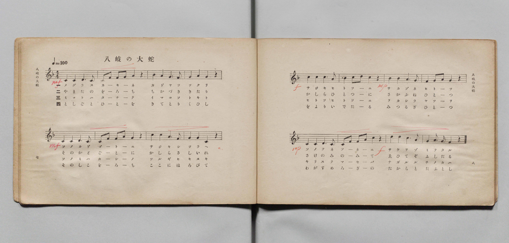
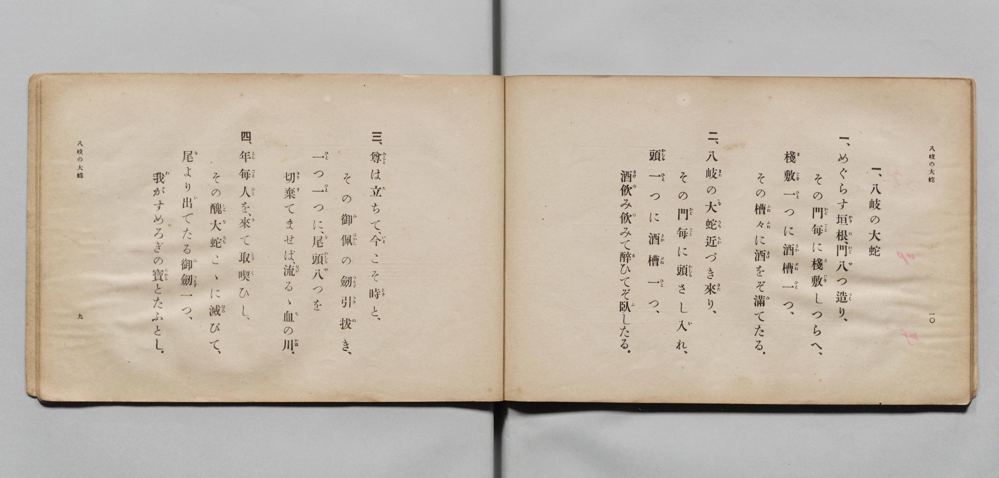

# 八岐の大蛇（八岐大蛇）

> Re:Shōka 使用 AI 協助辨識與重建樂譜，可能會有錯誤。歡迎[回報](https://github.com/TMDLang/reshoka/issues)。

- **鋼琴伴奏版**：<br><audio controls src="yamata_no_orochi.mp3"></audio>
- **NEUTRINO 歌聲合成版**：<br><audio controls src="yamata_no_orochi_neutrino.mp3"></audio>

- 文部省《尋常小學唱歌 第五學年用》（大正二年五月，索書號 4100）
- 國立臺灣歷史博物館典藏（典藏號：2020.006.0847.0003）

## 說明


- 出處：臺灣教育會公認、臺北新高堂發行《新定兒童唱歌》尋常科第三學年用（昭和6年／1931年），
第二學期第 2 首〈八岐の大蛇〉（八岐大蛇），原書第 15 頁（掃描檔 P038.jpg）。
- 出處原曲：文部省唱歌（1910年《尋常小學唱歌》第一學年／此處編入第三學年）。
- 調性與拍號：ヘ調（F 大調），4/4 拍，速度 != 100。
- 背景與曲風：敘述日本神話中素戔嗚尊（須佐之男命）設下八門八酒槽誘使八岐大蛇飲酒醉臥、
拔十握劍斬蛇並於蛇尾得天叢雲劍（草薙劍）獻予皇室的故事。
- 版本說明：本檔案為原書單聲部五線譜（附移動 Do 階名片假名）之忠實數位化版本。

### 編曲說明（鋼琴伴奏版）：

1. 前奏 (Intro, 2 小節)：引用第四段莊嚴敘事的結尾樂句作為前導。
2. 主歌伴奏 (YamataNoOrochi, 8 小節 × 4 段)：右手演奏威武古樸的敘事旋律，
左手以穩健的四拍子和弦進行支撐神話史詩氣氛。


## 歌詞

```text
一　めぐらす垣根（かきね）、門（かど）八つ造り
その門毎（かどごと）に棧敷（さじき）しつらへ
棧敷一つに酒槽（さかぶね）一つ
その槽々（ふねぶね）に酒をぞ滿（み）てる

二　八岐（やまた）の大蛇（おろち）近づき來（きた）り
その門毎に頭（かしら）さし入れ
頭一つに酒槽一つ
酒飲み飲みて醉（ゑ）ひてぞ臥（ふ）したる

三　尊（みこと）は立ちて、今こそ時と
その御佩（みはかし）の劍（つるぎ）引拔き
一つ一つに、尾頭（をがしら）八つを
切棄（きりす）てませば流るゝ血の川

四　年毎（としごと）人を、來（き）て取くひし
その醜大蛇（しこおろち）こゝに滅びて
尾（を）より出（い）でたる、御劍（みつるぎ）一つ
我がすめろぎの寶（たから）とたふとし
```

## ABC

<div class="abc-score" data-abc-src="yamata_no_orochi.abc" aria-label="五線譜載入中"></div>

[下載 ABC 原始檔](yamata_no_orochi.abc)

## TMD 檔案連結

- [主旋律 TMD 檔案](yamata_no_orochi.tmd) [[在 TMD Studio 編輯](https://tmdlang.github.io/Tmd-TS/#tmd=s7IKdvYPcrWy4qpTUCpJTLdSSM7PyUlNLsnMz7PKyszLyo8vzshPT8wuBdHZiUpwdWX5OaW5qVbpRYkpqfGm8SaGBgYIyeL80qLkVKvi5Iz8_Jz4ktSKkqT8_GyEfEFRfllqXmIeUE1BUWZeSWoKWBFCQWpZZkoqSDo1JbMkvygzMQfJ5tSiYpDzIJbElxQl5hUnF2UWgNyMUFWSkQp0Xlp-TnZOflEqQhxoWHpmnlVufl5SKdBLGBIliZlAYZBvyxPjcxMz83IS81KQVZUAw6MosSCj0iojsxjktuTEnPjsxDyksIG6rCAxPdUqwMDAXBdIWChxaWkpPG1d_XTThMeN654uWf5idvv7PR0QERi3U0FLi0vRVgEYmlz2tgpuXDYm-iZ2IIOfTWt_2bzi-ZzGxw1dTzd0P92x4-mG_qdrdzydsvHZ2h6F52vWPNk1BcTfueX5lBWPG7pBZi9Z_mzt4ie7eoCCQNlnczre7-l5vmXRs9k7XsycrwCKM6CVYHc_ndP9fHX3i_ZdzxsXP1u7_Wn_pqe9s553rny5ZMXT1h0vpveDnQpiAHW-3zPLyMDIQM_AwEzPwMLEHMgwMAabxKWvpWBLLcCloKDwuGHCs9mbns9e92LVqmcz-h43TASLNu9-2r7rxcypQJdA3Tx15oumTc_mND9tXfNiVe_jhkag-NOe6c-mbXi5esbTBU3PZ-55sbAHGHhAkafrZj1tnfR89VJI4AEDCxKiz5dPBIXjjk54OAJ9_WzG2qeTesyA_Pd7-g0tjQ3BrE5gSIJcogAJ-R6gjmdz5gPZCkYKL5dNe9wAjVh4VD9uAGpBj22gIU_75gOjA6TR0FTh5YJGkI19zc_6-5-tmqIQYGBsoZdVkA5U-rihCcXnYH2bgP6HJwyIZ4D6DS0NDYCOxJpQgH4Fe7EB4kWgl56tXQI07vl2YDwvRfY9ip0vVu1_1rD8RUf7s-5eSAJ43DwDKAi0zU0B5B0QE-QdYHJVAKoBsl42zH-6a5kCJDEjmdTc82zmepBJsze9XAQM4FnPps54sX_Ds-lLn81Z83zpvBcrNz7Zsfb5lgXPOqY8nT7r6YYuoCUvF3Q82Tvhyc7u51O2P524F2jXixVrn-zoBobny2kNILJ10rPle1-smvFk737kQH65eBNQ6mVb54v2pcBEAYmyZ91TnvY2Putf-LSr99m0NUBlT3YsezZtD5DxdMO-p_umP12y8mn_opezNwEVAG1_0dv5YtpMMLvzee_uJ7s6ns9qf7puyfNZLc-mtj7Z1Y3w3vPODqA3IIkV5Lc5a4Dx-Gxhx_OmXZCYfjpt3YvGTcAYA2bI59tnvVg7B-S9mS3Pl-9-2j1VwSVf4eWsvqcTep93tj9tbAcygHYC_f10_4Kn65c9m7rjyd7epz3TINaArIVmEojhwAh-sXLe09YVwEQBDGJgOIIYq-a9WLsemHNA6W9D77P2TuR0BTYAmB4eNzQ8bmp83DjhcVPn48aZT-ctfrZgJ1DH48bux429jxvXgtNDIzC0YYIrgSLAoH7cuORlw4LHTV1glzTOBaZ4oKJn64Heh6p73DjlcSMwpoHmrn62ePmzqdvBUlMfN84AGg0Wnw40BWzxDpApEEUgRwFFG6FxC9MDNHEbxDkQBQhrgYoeN7SC1W0FqoCrgxjxuGnS48Z5z3aD0uzjRlByfdy47HFTN0g_KI7BoQSMsufrO19s3f50Tu_zjcAAbny6exfQe6AU1jgZ7PmeZ-v7IeyXzXufTVgLVAwsYYClDUTqaUM3hPtkR9ezKftAOQ0oAvUBTAEksS5eCDJh2nygm57sanu-rw_kyoYmeKTsAuZWUNoGJmaQm5taHjfue9wIzHxAlyMqkMeNXY-bgBG0EJQp9k983LgUGKhP9rWBpYDiYPWYsQMKlAXA0IHE0XRg4IPNBQbwdGBB8LgJXLoBVaDFAiLMQdlq8SZgSEJIYGACcxnYncCEBjQJKLgMGODAfAeJEVg8z8cS5sg59tmeHUD0cu4CoGdeNvaBfdLzrKsL5BageMMmYBgCXQGJAmAYAmVB3IVtQAXA5P1i4nS0MH86be7TiQ0gcs6GJ_v2A135tGHS87kLQSp3tSEH-A5gCm-AFDhgH02GJdv1wLoRGMIgHzU0PtndBZaa-2xmE1ABImCf7lv4ZC8wV0A0r4cELDS2wOUIOJEDBYFZo_PpnqnAYggYQ7D817gEHtSgZLdhHzR6QMm2Bx5DkAwHFARpewosRRe3QCO6CeiqmdBUDUonsx83bni2tRFkYdPcFwuBRq97un0uRshv6AKVuVu3v9i1GtQ4mNP9bNc0YJUA9Buw6fBsxvoXneufrQSmoR5QoQmseVo3vJw2-WVr77OOLcDi7-n6bWCv9Tzd0A7KI9BYACV7IAKWrcAyGlQXLJgMMnBr47OOCSDxRSAHPdu0GSnwn86eDQr8nVtgJccKcGqBlhxPdu0CBQQw8GEJG-LTp_3THjf2gxPbdKQU3jYHKXsATQHGFiKTgLhNQGWrn-1ufdy4GWgK2P4N-yChDc4uQEYX0Ldg_cAABupZDkm5oKjZB6o3YNGMiFFE1njWAcyGwDibCSpRQdYCc9s6YFCB9cwHpQtobgP6EcgFFlYgz2JEzc4tINQJysxPJ8x7uXg-MBSAlR8o2FvbnzUvhPjx6QZgvb4E6Jcnu0B54em-eZBqDFj4A0MH6Amg-pdNi4E5CBjRkMgCxgKwPgK6EljPgWqyDV0vNm153rLw2fopkDgFNvygUQN0E-UNOShQ0NLn4opMzE0sSfTL9y_KT87ItArITMzLd6gxqKkGV802Jlp2YAa2diS4qQVMPeu2KmgYASOs__n6Bh14XQaSVTBUADbyNLFoBVoNNRZoghWwpl6o8LhpA5BeCUo1TTvB5Gogfw-QXguhm3uBojVgcVDd3gnES4C4BcxrAYqvB9KrwC0KEIBaUaNgGg9CGmbxCrpAaBqvqaqhq6sJlNAAChuCeJoKGoYKRhCWsYIBUMoESAM9BdIAVgFWbwQUNAJJgw32MQS5pRGYxicoaABTEFgxMJGBTQYmKgWQscCcAaKBFZ9CPMjtQGFgDQxS3wJVvwSkHkgBcT_QvC6QOoj5RiDzgf5q3AcyZz5U_Tqo-V0Q85ug5i-Emg8MR6AdQPmlUPW9EPN7gXg-qvnGIPH9QDwZpH4FVP16qPlA-8DuXwgxfxnUfLh7JkPVz4WYvwJqxwqE-SYw8ekg9VOg6ldAzd8ENR9oL9D8pklQ80FmLENyT1MXxHxg2AC1gMwCmY8_Te7qwZcmjYhNk017gempDym9gdLkFmha7IDS3dA0uRWId4DTKkjVdliaBKZnYMuc7DRpDGGBE52CKRBqGGOkSSOQSSiJsnEuKJ1AEyE40FdCAx0YCUiB3rgaGuhTgXgGNLGC1U-HJ0pguga2AlETJcnmgxI9KBHAM8lUiPnTIQmqqQctUcLN34-WKGGZajrE_HVQ80HuBCf6Pqj6TYhEvwZMoyZKuPlAc8DqJ-PPVJNhmWQ1VP1usPlAZcAKC5Y5CCTKHZ34EqUx0YkSJaE1TwKToMQISmywBAlLkrBCdBq08ASpRyRdUMGJmihBCcwU7EVwwgMnMBMFDRMFM0g6NIWWjUAxSDoEl5lgZYYgryEnV6TkiJG8oNGzAiS2BDMpgqNyG1TtWojaTUjJaglacsRIXtQzH5wcQeUOzCwC5gPLMWBTAylpNXVCkkoLQi2krEMkR5Cepg6Q-4HJD2x-C8T85fByGJS8Ie4HlddLQGphWa8Pl_vxJkdg8w5fcjQhtYxsngpOXpBEBgxjaH2NWUZuBPI3gRPmPrBaYJ3U3AbkAf3VDCpnKSglIanTDAgxErERSoLVBKZWHAXmVuRUAeGDC5y1mKloIigWJkHVz4PEwn6Q2mVQsfnweENKqzCdQOsgqvZDbQLywTYBizyk-rZpIixuYaZCbQLGHaL4QrcJnGqBoQ9MUEBVM6GqlkFt2ge1aTbEpg1QP62CplxYymrqhti0ENm1QDFgaYyWfkF1MzjNQ21qaoTYBClGIcUycnENjHNwHoTnV3CbACSOFANAMVhtX8vFpWungNpSBVsPFFXmAgA)]
- [鋼琴伴奏 TMD 檔案](yamata_no_orochi_piano.tmd) [[在 TMD Studio 編輯](https://tmdlang.github.io/Tmd-TS/#tmd=s7IKdvYPcrWy4qpTUCpJTLdSyC8qychPL0osyKi0ysgsLskvykxOzInPTsxLVIIrKs4vLUpOjS9ITE-1CjAwMNcFEhZKXFpaCk9bVz_dNOFx47qnS5a_mN3-fk8HRATCfdy8-2X3nucTtjzZs-Xp0v7nnR3v93QqaGlxKdoqGBoYcNnbKrhx2Zjom9iBrHrRvut54-JnU2e-aNr0bE7z09Y1L1b1Pm7oezZtw9N1s562Tnq-eunTKRufre153ND_dEP30x07ni-f-HzNmic7Op-u3fF055bnU1YAXQAS2dUDFHk2Zz7QBUCu0ctl04A2gz30dE7389XdULvWbn_av-lp76znnStfLlnxtHXHi-n9YD-AGC9mzn-_Z5aRgZGBnoGBmZ6BhYk5kGFgDDaJS19LwZZagEtBQeFxw4Rnszc9n73uxapVz2b0PW6YCBZt3v20fdeLmVOBLsERPo1A8ac904Gh9HL1jKcLmp7P3PNiITCIurCFWzeecHs2Y-3TST1mQP77Pf2GlsaGYFbn-z09IJcoKCCHK5CtYKQADNbHDdAYh6eBxw1ALSjJAGLI0775z2bvAGk0NFV4uaARZGNf87P-_merpigEGBhb6GUVpAOVPm5oQvE5WN8moP-fTWt_2bzi-ZxGmGdg6l6s2v-sYfmLjvZn3b2QSHvcPAMoCLTBTQHkBBAT5ARgSlMAqgGyXjbMf7prmQIkHSJMer59BdAuSAwAdWMmXqDZkMAw1FN42tkLFFfQ8MwrKcrXAQbH0w39z9c3aALVPN0zFRimQL8-nT372bqtL_q6ns7a8mzqjCe7up_Panm-dcLTDfuerWh62r_0yd45z5t2gYzaAIxzsDsUFIz0FJ7s2A30I8RqBY3IxNzEkkS_fP-i_OSMTB0FC6hdCoenKwC9tG4r2NL-zc86u5_tmQLU8nRF47O1y572L3m2YgfQRojVz6Z3P93XDY9PIHi6fRlQy5PdS5-vXPm0cSlQJcjB3b1P104AJoWne5a9bNgETEzPpqx_NmnC86XzXqzcCMwwL1aufLZh8bMNs6EOpjwDQIGClj4XFzg4rQIyE_PygzwcagxqqsHOtTHRsgMzahRM40FIwyxeQRcITeM1VTV0dTWBEhpAYUMQT1NBw1DBGMIyVTAASpkBoYYpWANYHKzeSEHDWMEIoswQpIyrFsV-H-z2G4IsjjaMBZJIHJAtJiAOWATsSjAbaixqFOLxH7aCBZz3djQAI1pBA5bOdOCZBiQLdD8wojSxaAWGKdRYoAlWwFS-UOFx0wYgvRKU5pt2gsnVQP4eIL0WQjf3gj0KEgfli04gXgLELWBeC1B8PZBeBUtFMCuIjhlokBtDwgxIAz0F0gBWAY0ZYMSAgw5ksI8hyC2NCo8bJyhoPG7qBCt-3DgTbPLjxm4FkLGPG3tB9OPGtQrxILcDhR83rgSpb4GqXwJSD6SAuB9oXhdIHcR8I5D5QH817gOZMx-qfh3U_C6I-U1Q8xdCzQeGI9AOoPxSqPpeiPm9QDwf1XxjkPh-IJ4MUr8Cqn491HygfWD3L4SYvwxqPtw9k6Hq50LMXwG1YwXCfBOY-HSQ-ilQ9Sug5m-Cmg-0F2h-0ySo-SAzliG5p6kLYj4wbIBaQGaBzMefJnf14EuTRsSmyaa9wPTUh5TeQGlyCzQtdkDpbmia3ArEO8BpFaRqOyxNAtMzsNgnO01CSwtwogOWGaagogE9TRqBTEJJlI1zQekEmgjBgb4SGujASEAK9MbV0ECfCsQzoIkVrH46PFEC0_Xjxh2oiZJk80GJHpQI4JlkKsT86ZAE1dSDlijh5u9HS5SwTDUdYv46qPkgd4ITfR9U_SZEol8DplETJdx8oDlg9ZPxZ6rJsEyyGqp-N9h8oLLHjZthmYNAotzRiS9RGhOdKFESWvMkMAlKjKDEBkuQsCQJK0SnQQtPkHpE0gUVnKiJEpTA0KsjEwUNEwUz5FrLBCQGSYfgMhOszBDkNeTkipQcMZIXNHpWgMSWYCZFcFRug6pdC1G7CSlZLUFLjhjJi3rmg5MjqNyBmUXAfGA59rixBylpNXVCkkoLQi2krEMkR5Cepg6Q-4HJD2x-C8T85fByGJS8Ie4HlddLQGphWa8Pl_vxJkdIExBncjQhtYxsngpOXpBEBgxjaH2NWUZuBPI3gRPmPrBaYJ3U3AbkAf3VDCpnKSglCbWp4AkW1q7CUmBuRU4VED64wFmLmYomgmJhElT9PEgs7AepXQYVmw-PN6S0CtMJtA6iaj_UJiAfbBOwyEOqb5smwuIWZirUJmDcIYovdJvAqRYY-sAEBVQ1E6pqGdSmfVCbZkNs2gD10ypoyoWlrKZuiE0LkV0LFAOWxmjpF1Q3g9M81KamRohNkGIUUiwjF9fAOAfnQXh-BbcJQOJIMQAUg9X2OBqqWBvCxDZU8SRuktrS0aZgCdJaJCRaDqnfIWxwXgAmaIQ4afUO8VbDvEq-t9ELGWqFOaL_omunAO4ZKQAZqEkk2gdkFKaoEVZRY6yiJmBRZS4A)]

## 分析

```text
================================================================================
📊 TMD Song Profile: [ 八岐の大蛇（八岐大蛇） ]
================================================================================
⏱  Duration:       0:38 (38.4s), 16 measures total
🎼 Key & Tempo:    首調基準 F, != 100.0 BPM, <4/4>
   - 分析範圍：      由實際發聲的音符與和弦推測調性；播放脈絡另行呈現
🎤 人聲音域:    C4 (MIDI 60) – D5 (MIDI 74) [跨度: 14 個半音 / 1.2 個八度, 難度: moderate]
   - 最低音:  C4 in [YamataNoOrochi #1 @ m.1, 0:00]
   - 最高音: D5 in [YamataNoOrochi #1 @ m.10, 0:22]
   - 適合: soprano, mezzo-soprano, contralto, tenor, baritone, bass
🏛  結構:      YamataNoOrochi (38.4s)
⚡ 編曲密度:        Peak 1 軌道同時演奏
🗝  調性診斷：       C 大調（流行色彩大調，未偵測到可信轉調）
   - 風格氣質:    流行大調（略帶和弦色彩音與裝飾副屬和弦）
   - 轉調歷程:    全曲維持單一推測調性（未偵測到可信轉調）
   - 核心骨幹音:  C, G, A, D, F
   - 調性數值:    C 大調 [相關度: 0.83, 穩定度: Moderate, 自然音純度: 92.0%]
   - 候選調性 (K-S): C 大調 (0.83), F 大調 (0.71), A 小調 (0.60)
   - 五度圈歷程:   +0
   - 各段落調性細節:
     • [YamataNoOrochi #1]: C 大調 (r: 0.83, 自然音純度: 92.0%, 調外音: A#)

  [ 五度圈游移軌跡 ]
              [C ]*
         F            G  
      Bb               D  
      Eb               A  
         Ab           E  
            Db       B  
               F# 
     (* = active key center)

  [ 十二半音累積音高分佈 ]
     C  : ████████████████████████  33.9%
     C# :                            0.0%
     D  : █████████                 12.5%
     D# :                            0.0%
     E  :                            0.0%
     F  : ████████                  10.7%
     F# :                            0.0%
     G  : █████████████             18.3%
     G# :                            0.0%
     A  : ████████████              16.5%
     A# : ██████                     8.0%
     B  :                            0.0%
--------------------------------------------------------------------------------
Assignment 軌道音域：
  - Piano         : C4 – D5 (14 個半音 / 1.2 個八度, 65 個音符)
================================================================================
```


## 原書掃描頁






