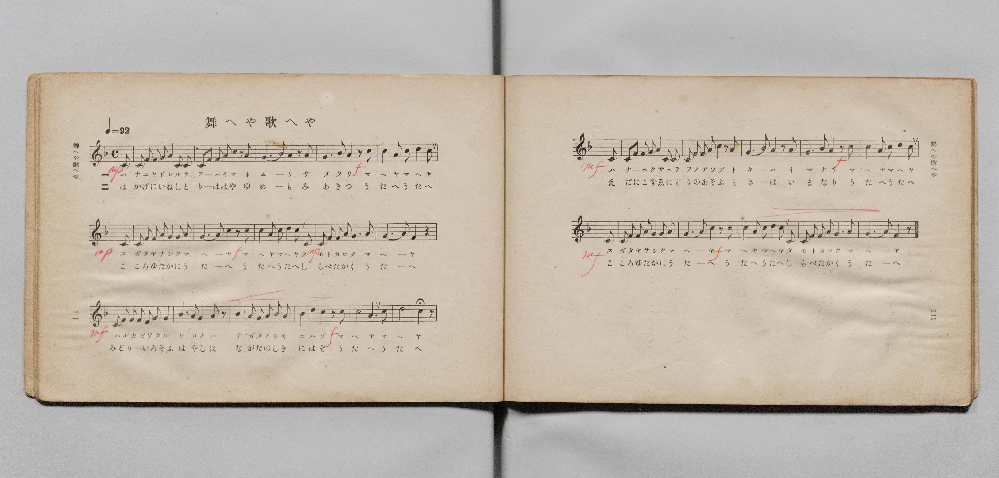
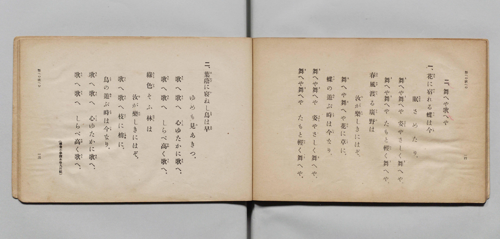

# 舞へや歌へや

> Re:Shōka 使用 AI 協助辨識與重建樂譜，可能會有錯誤。歡迎回報。

- **鋼琴伴奏版**：<br><audio controls src="maeya_utaeya.mp3"></audio>

- 文部省《尋常小學唱歌 第五學年用》（大正二年五月，索書號 4100）

## 說明

原書資訊與歌詞全文（對應 P009.jpg–P010.jpg，原書 pp. 11–14）：
- 調性與拍號：ヘ長調（F 大調）4/4 拍，速度 ♩=92
- 備註：原書歌詞末註「（尋常小學讀本卷九所載）」


## 歌詞

```text
二、舞へや歌へや
一、花（はな）に宿（やど）れる蝶（てふ）は今（いま）
眠（ねむり）さめたり。
舞（ま）へや舞（ま）へや　姿（すがた）やさしく舞（ま）へや。
舞（ま）へや舞（ま）へや　たもと輕（かろ）く舞（ま）へや。
春風（はるかぜ）渡（わた）る廣野（ひろの）は
汝（な）が樂（たの）しきにはぞ。
舞（ま）へや舞（ま）へや花（はな）に草（くさ）に。
蝶（てふ）の遊（あそ）ぶ時（とき）は今（いま）なり。
舞（ま）へや舞（ま）へや　姿（すがた）やさしく舞（ま）へや。
舞（ま）へや舞（ま）へや　たもと輕（かろ）く舞（ま）へや。
二、葉蔭（はかげ）に寢（い）ねし鳥（とり）は早（はや）
ゆめも見（み）あきつ。
歌（うた）へ歌（うた）へ　心（こころ）ゆたかに歌（うた）へ。
歌（うた）へ歌（うた）へ　しらべ高（たか）く歌（うた）へ。
緑色（みどりいろ）そふ林（はやし）は
汝（な）が樂（たの）しきにはぞ。
歌（うた）へ歌（うた）へ枝（えだ）に梢（こずゑ）に。
鳥（とり）の遊（あそ）ぶ時（とき）は今（いま）なり。
歌（うた）へ歌（うた）へ　心（こころ）ゆたかに歌（うた）へ。
歌（うた）へ歌（うた）へ　しらべ高（たか）く歌（うた）へ。
```

## ABC

<div class="abc-score" data-abc-src="maeya_utaeya.abc" aria-label="五線譜載入中"></div>

[下載 ABC 原始檔](maeya_utaeya.abc)

## TMD 檔案連結

- [主旋律 TMD 檔案](maeya_utaeya.tmd) [[在 TMD Studio 編輯](https://tmdlang.github.io/Tmd-TS/#tmd=s7IKdvYPcrWy4qpTUCpJTLdSSM7PyUlNLsnMz7PKyszLyo8vzshPT8wuBdHZiUpwdWX5OaW5qVbpRYkpqfGm8SaGBgYIyeL80qLkVKvi5Iz8_Jz4ktSKkqT8_Gx0-fiCxPRUqwADA0uETEFRfllqXmIeUHdBUWZeSWoKWDtCQWpZZkoqSLostSgzLTM1BclJqUXFIHdDTS8pSswrTi7KLAB5BqEqv6gE6KOixIKMSquMzOKS_KLM5MSc-OzEPCTflWSkAj2Xl1hSWpSKLlqcmlicn1eMbGJmemaeVW5-XlIpMJQwJVIzszKRQkFLS-FFx7zHjTseN7U8W9sDYShoaXEp2ipYGnHZ2yq4cdmY6JvYgQx6Nq39ZfOK53MaHzd0Pd3Q_XTHjqcb-p-u3fF0ykagXoXna9Y82TUFxN-55fmUFY8but_v6Xi6ZPmztYuf7OoBCgJln83peL-n5_mWRc9m73gxc74CKK7e7-lU4uLS11KwpRbgUlBQeNo3H2TH5vYXK7pedLQDHfhi5bynrSuAngA5a0Pvs_ZOBVCE62UVpD9qmBxgYGgAYgKdB9GqUFCgp2BoCJQyNAE68f2eWSBjdRVerNr_rGE5yMjuXqAXgOKPm2e8nLodKA402E0B6GMwsxMYbApANUADXzbMf7prmcKjmSttgYEKNuVp08wXK3YDNUMsgzjv2ZzVQMHHDT1gFyIC-MW6hmdz1jzt3f5k59xnnQ0vQK7pfNzQywUyCxi2jxsaMWMRLLejASTXtRFo4OPG9Y8bV4E0Nq5-ug7kVqCix40rQSJNPY-bul_M3QZWtuxx41awsvVPdneBRYDK9gFFQCaCwPM5C8DCax83NTxuAioBqp36uKnxceN8IPdxQxNMIdBRYIUgzRBHYYo8bmh4uhzsmsaZjxuBbgeGKNBBQCunPm6c_rixH5sWUm0Au6zpceOKF3umgmW7HzcBIwaoAL_xz2YsfbloBTTwmrpB-hrnABU-27EQHH79MOd2P929-GV7H1jlJqDZjxvXQYIQbtLGuWBJSAT0PFvRBObOhykE-hSoaTU4kuaR6EHM-H3RC0whQBGg-4D-BYkgG4kez-teNkLiGRhCQFcCRbY9mwlx3wqgs7CmBaBVwyiuoXloYueLKWthQQmM6knQ3LJ-EcTrYO5aoFNfbl4KDR5o8l__bDowI0GSCUgZzM2Pm9pAGaOp6cUyUGn4uBFUMIADGhjbS5BT2lpQpn_c2AYNlEZQkYAmAgq-_c1gwckgBPEW0AZQMgI6dzU2LaTaAIqIJiB758vVM2BJFOh0UPDhNf759okvOjdB_AgsVUCJA5hWoCE_F5jUns2bDg8hoCXUyR7EeOrZPIjZQAQst0AR-mwRJEKBoTjrcdNEjByCEb1UySFDOoopr5ShQEFLn4vLNzG1MjG0BERaBWQm5uU71BjUVIO9YWOhZQdmYGsQgNsYOxpeLOxR0Hi6Z-OLrdsVtBVMFYC15PP1DTrw6lzh6fZlLxc0PtnRpYnFDKADQObXKBgA62EErM4tqFUwjQeKGwKhWTyIbahgpGCsYAIUMwWqMAWyjYC0AUwZSBtMyAgoYgwWMQUrNlCoTgOaBxQ1A6syhdJwa8CO8DGsUYhHccbj5n6gnsfNXUDcDcRLgLgTiNcA8WogbgPiqUAVMLWPm0Aq5gF58UC6F6x3AdysVRDxpq1g8YUQ0ab9CBmgTpDMDLBqiElIvKadMHcaYbizcT1IZyPQjY2TgBjotsYWIF4LxNOBeAVQdxfMnUC1YAxsW0Lc0wbS29QIM6upCSLeuB9sJogH0tULxEugMmAdjfPB4jvAfGTeZKA78aeaXT3gVIMnsazFm1hAicIInBxAcakLTRKQmCUQ26CkAdEOUQxKJjXgZKMLFgdpB4rAE8TjJmBkgyMJFAVbgXg7EAODDxzNsOiCRDA0eAhEIzhYmxcBcQeQB0pGwGgCmgiSx2Um3EXAqAcFMLAsAkccKNgh0Q6K8jaIbnBUQCJtB1ERNh2cAIAJu3Enkon9YHlcZoJcRKBo6ARHshnuSO7GG8nVucBYBGZ9ZASKN5B7IJnbCBxfQGEDUFyD3IRVIQxD0gVQEhLfkCIDAiEKQekBlFSACkF2oxQM4OwNyvSgGGvaA2SDshAoXayGxtkkaIwBY7O5D8zqB4YTpPgAZStYOuqDpqG1UH3dULUgNfuwpiBkd0LSCLIcSD2wmEJKH0BbGleCsnwdOPKBJQEouYArfmhsglIbyD5QITEdHKvrIW5tBBVFwEofmg7WQQuQXqg-kF8huoFVP9a0heJWcOpBlgOp7yCUcp7Ono2zeOjfTERdgr3OAEGq1BmYSQMS0KAqAlQygEoJcHXRBhIGyU-FRjsw0zftBbKnQaMNGBTQhACrQSAl8hJ4RINEQbUP6TUEsIEFLRaAxUXjLKDsRCh_BdRZwCoBEsNNoMQBxNugMbQCHHegOIdVGBDxFrA4KI2CRFeBTaBShTCFUIzjLyvIqxBG6wLq1QW1XFy6dgpIbcloH8NYBXQhI7CQMhcA)]
- [鋼琴伴奏 TMD 檔案](maeya_utaeya_piano.tmd) [[在 TMD Studio 編輯](https://tmdlang.github.io/Tmd-TS/#tmd=s7IKdvYPcrWy4qpTUCpJTLdSSM7PyUlNLsnMz7PKyszLyo8vzshPT8wuBdHZiUpwdWX5OaW5qVbpRYkpqfGm8SaGBgYIyeL80qLkVKvi5Iz8_Jz4ktSKkqT8_Gx0-fiCxPRUqwADA0uETEFRfllqXmIeUHdBUWZeSWoKWDtCQWpZZkoqSDoxOTk_tyAxLzM3NQ9Jviy1qBjkeKgVJUWJecXJRZkFIB8hVOUXlQC9VZRYkFFplZFZXJJflJmcmBOfnZiH5MXEIqDm9FSQ-VYFmYl5-fE47CzJACqyykssKS1KRRctTk0szs8rRrY6Mz0zzyo3Py-pFBimmBKpmVmZSGGmpaXwomPe48Ydj5tanq3tgTDe7-l42b3n-YQtT_Zsebq0_3lnx_s9nQpaWlyKtgqWRlz2tgpuXDYm-iZ2INOfTWt_2bzi-ZzGxw1dTzd0P92x4-mG_qdrdzydshFooMLzNWue7JoC4u_c8nzKiscN3UDTny5Z_mzt4ie7eoCCQNlnc4AW9DzfsujZ7B0vZs5XAEU30EYlLi7fxNTKxNASEGkVAAqkIA-HGoOaai4FILCx0LIDM_S1FGzRAdjiHQ0vFvYoaDzds_HF1u0K2gqmCkC3PV_foKMAShd6WQXpCk-3L3u5oPHJji5NLGZo6YPNr1EwUNBFgtW5BbUKpvFAcUMgNIsHsQ0VjBSMFUyAYqZAFaZAthGQNoApA2mDCRkBRYzBIqZgxQYK1WlA84CiZmBVplAabg3YET6GNQrxKM543NwP1PO4uQuIu4F4CRB3AvEaIF4NxG1APBWoAqb2cRNIxTwgLx5I94L1LoCbtQoi3rQVLL4QItq0HyED1AmSmQFWDTEJide0E-ZOIwx3Nq4H6WwEurFxEhAD3dbYAsRrgXg6EK8A6u6CuROoFoybWqDuaQPpbWqEmdXUBBFv3A82E8QD6eoF4iVQGbCOxvlg8R1gPjJvMtCd-FPNrh5wqsGTWNbiTSygRGEETg6guNSFJglIzBKIbVDSgGiHKAYlkxpwstEFi4O0A0XgCeJxEzCywZEEioKtQLwdiIHBB45mWHRBIhgaPASiERyszYuAuAPIAyUjYDQBTQTJ4zIT7iJg1IMC-HETMDqAEQcKdki0g6K8DaIbHBWQSNtBVIRNBycAYMJu3IlkYj9YHpeZIBcRKBo6wZFshjuSu_FGcnUuMBaBWR8ZgeIN5B5I5jYCxxdQ2AAU1yA3YVUIw5B0AZSExDekyIBAiEJQegAlFaBCkN0oBQM4e4MyPSjGmvYA2aAsBEoXq6FxNgkaY8DYbO4Ds_qB4QQpPkDZCpaO-qBpaC1UXzdULUjNPqwpCNmdkDSCLAdSDyymkNIH0JbGlaAsXweOfGBJAEoujXMfN26FxiYotYHsAxUS08Gxuh7i1kZQUfS4sQeaDtZBC5BeqD6QXyG6HzdCizm0tIXiVnDqQZYDqe8glHKezp6Ns3jo30xEXYK9zgBBqtQZmEkDEtCgKgJUMoBKCXB10QYSBslPhUY7MNM37QWyp0GjDRgU0IQAq0EgJfISeESDREG1D-k1xOPGBdBiAVhcNM4Cyk6E8ldAnQWsEiAx3ARKHEC8DRpDK8BxB4pzWIUBEW8Bi4PSKEh0FdgEKlUIUwjFOP6ygrwKYbQuoF5dUIulKemD3JQ0QTQlX-yZ-nT_amA2f9bd-3TtBEgbGLkpCIHAyIlXMI7XBuVjGANJzDQ-XsGIKEEk3Sag2kHbEE5DgpKATfj0Y1WFcIVhvLYxuH6C2mMGlIGIGcUDDdEG10ZAnmm8trk6yEyYNEGlCBYwycIUYHM9SV4dYoEKTHW6dgpICS_axzBWAV3ICCykzAUA)]

## 分析

```text
================================================================================
📊 TMD Song Profile: [ 舞へや歌へや ]
================================================================================
⏱  Duration:       2:20 (140.9s), 54 measures total
🎼 Key & Tempo:    首調基準 F, != 92.0 BPM, <4/4>
   - 分析範圍：      由實際發聲的音符與和弦推測調性；播放脈絡另行呈現
🎤 人聲音域:    C4 (MIDI 60) – D5 (MIDI 74) [跨度: 14 個半音 / 1.2 個八度, 難度: moderate]
   - 最低音:  C4 in [MaeyaUtaeya[L1] #1 @ m.1, 0:02]
   - 最高音: D5 in [MaeyaUtaeya[L1] #1 @ m.6, 0:13]
   - 適合: soprano, mezzo-soprano, contralto, tenor, baritone, bass
🏛  結構:      MaeyaUtaeya[L1] (70.4s) -> MaeyaUtaeya[L2] (70.4s)
⚡ 編曲密度:        Peak 1 軌道同時演奏
🗝  調性診斷：       F 大調（純淨自然大調，未偵測到可信轉調）
   - 風格氣質:    純淨自然大調（陽光明朗、易唱易記，無明顯調外色彩）
   - 轉調歷程:    全曲維持單一推測調性（未偵測到可信轉調）
   - 核心骨幹音:  C, A, F, G, D
   - 調性數值:    F 大調 [相關度: 0.79, 穩定度: Moderate, 自然音純度: 100.0%]
   - 候選調性 (K-S): F 大調 (0.79), C 大調 (0.76), A 小調 (0.69)
   - 五度圈歷程:   -1 -> -1
   - 各段落調性細節:
     • [MaeyaUtaeya[L1] #1]: F 大調 (r: 0.79, 自然音純度: 100.0%)
     • [MaeyaUtaeya[L2] #1]: F 大調 (r: 0.79, 自然音純度: 100.0%)

  [ 五度圈游移軌跡 ]
               C  
        [F ]*          G  
      Bb               D  
      Eb               A  
         Ab           E  
            Db       B  
               F# 
     (* = active key center)

  [ 十二半音累積音高分佈 ]
     C  : ████████████████████████  24.7%
     C# :                            0.0%
     D  : ████████████████          16.5%
     D# :                            0.0%
     E  :                            0.0%
     F  : ██████████████████        18.6%
     F# :                            0.0%
     G  : █████████████████         17.0%
     G# :                            0.0%
     A  : ██████████████████████    22.2%
     A# : █                          1.0%
     B  :                            0.0%
--------------------------------------------------------------------------------
Assignment 軌道音域：
  - Piano         : C4 – D5 (14 個半音 / 1.2 個八度, 270 個音符)
================================================================================
```


## 原書掃描頁






