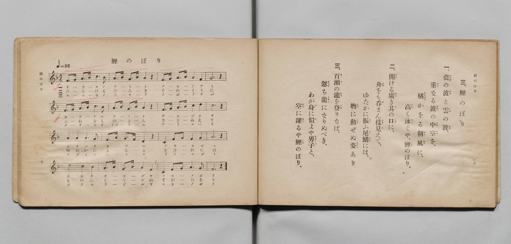

# こひのぼり

> Re:Shōka 使用 AI 協助辨識與重建樂譜，可能會有錯誤。歡迎回報。

- **鋼琴伴奏版**：<br><audio controls src="koinobori.mp3"></audio>

- 詞：文部省唱歌
- 曲：弘田龍太郎
- 臺灣總督府《公學校唱歌》第五學年用（昭和十一年，索書號 523.37 4322-4）

## 說明

原書資訊與歌詞全文（對應 P012.jpg–P013.jpg，原書 pp. 8–9）：
調性與拍號：ヘ長調（F 大調，1 降記號）4/4 拍，速度 ♩=96


## 歌詞

```text
一
いらかの波と雲の波、
かさなる波の中空（なかぞら）を、
たちばなかをる朝風に、
高くおよぐや、こひのぼり。

二
開ける廣きその口に、
舟をものまんさま見えて、
ゆたかにふるふ尾びれには、
物に動ぜぬ姿あり。

三
もゝせのたきをのぼりなば、
たちまち龍（りゅう）になりぬべき、
我が身にによや男子（をのこご）と、
空にをどるや、こひのぼり。
```

## ABC

<div class="abc-score" data-abc-src="koinobori.abc" aria-label="五線譜載入中"></div>

[下載 ABC 原始檔](koinobori.abc)

## TMD 檔案連結

- [主旋律 TMD 檔案](koinobori.tmd) [[在 TMD Studio 編輯](https://tmdlang.github.io/Tmd-TS/#tmd=s7IKdvYPcrWy4qpTUCpJTLdSSM7PyUlNLsnMz7PKyszLyo8vzshPT8wuBdHZiUpwdWX5OaW5qVbpRYkpqfGm8SaGBgYIyeL80qLkVKvi5Iz8_Jz4ktSKkqT8_Gx0-fiCxPRUqwADQyOETEFRfllqXmIeUHdBUWZeSWoKWDtCQWpZZkoqSLo4OTEvviy1KDMtMzUFyV2pRcUgx0OtKClKzCtOLsosAPkIoSq_qAToraLEgoxKq4zM4pL8oszkxJz47MQ8JC-WZKQCfZiWWlySWZaYU4wuUZyaWJyfhyQMNCQ9M88qNz8vqRQYWhgSJYmZQGFQQJYnxucmZublJOYBXa6lpfC4cfLjxk2PG9c9btzzuKlLQUuLS9FWwdKMy95WwY3LxkTfxA5k2IuV897vmfVsWvvL5hXP5zQ-nbLx2doesDXPZm8CyjzdM-P5lA0v9_U-XbLqZXMfWOZF-67njYuf79j7fO7ip7vmPG7oetq65unaHc8WLITof9zQ_XzNmie7pgAFn-7c8nzKivd7Op7NWPt0Us_T3sYnOxqAgu_39DzfsujZ7B0vZs5XMDUy1jM2VzAxNjLSNXm_p1OJi0tfS8GWWoBLQUHhad98kGWb21-s6HrR0Q50JdDrT1tXAL0OdNzTDb3P2jsVQAlHL6sg_VHDZCDTGMQEuhOiVaGgQE_BAihjCXQgMGRAhr5Ytf9Zw3KQcd29QH8ARR83z3g5dTtQHGiom8LTJcvBzB5DhZcze1-smAFW1AkMfAWgDqD4y4b5T3ctU3g0c6UtMGpARgJDB0Q9bmx53NT5uLEbGIPPNi963Lji5WxQbILYDY0QFUC5qY8bVz1u6garWPdkx9rnK3cBLQYJgmTnAY0AWve4aRJcz_zHjQsfN26AqgBKADXPmfty0YrHjauhil6unvG4sf9xY9fjJqBJEx43tQAl0JLT44YmiGt39YC1TAPaNhFo1tPdix839j5unAtU-bQfyIYZ-qJjPti2JrAR-x43AY0DOn7fi2VAnUBrlsFc2NQGdiRQdPXjxq1AI4Hk0w37HjduftzUAxZcD1X6vHMlkP-0G2jMnMeNa54u3_-4sQnZbTs6ISYCBYHumQ22GWh0L8ghcI-AAmIDWvAAbVsITPKgkASqaGp93NgGCkaQ5cDQBupZ87hxJ8ggiLZnHRMfN_a82AWUBiNgsDW1PJ-y_enaCWAjILYBPTwFbMoKmPtX7gKrBkqvBPkTVzgDlVKeBaBAQUufi8s7PzMvPwlYglgFZCbm5TvUGNRUg2xRsDE007IDs7DlPgVQnt7R8GJhj4KGicLTDf3P1zfowLOMJhYNQMtAhtUoVOem1SoYKugCoZGCMZg2UTAF0xAIEquByxhBaQhfV8EAStdgmAFTAREHqYDoxYRwM8BO8jGsASaMJWCRx80rgezVUHYfEHch6XvcPB9s7uPmDgi_aT2QvQiL6ni4GyB6QGpXA_FWqNouIIbYAuGhq8aEcBMhbjYCqm3cBDW5E8ieCGV3w8Whpjf1QkxuBNFAfuNcIF4HZfcD8UJMNzdCQ6BxKxCvhZozCZR9YKZCTYCo3kecm41B_oOF1iKgabuhbGDINe1HcTPITpBqqA_BYTsHyl6FI5wnQPXuB7IboWrnwdlgnY-blyI0NC0j6Gz86X9XDznpnxZJH2aGGVwFsqnIEEvSBwYuJHiAiRKW9Jv2gbMCUpSAowIUapCIAgUrPMiRdKJGCSz6QEkfGvHALIBQ-7hpD5LqbhxuxpL0myZD9DdOhSe_x43AiG-EZEyo6Y2gGAapboPy54NqSigb6CZg8sZwMzADQeRB7pwEZW8GsnvgpsJcD0r664lzMzjpQ00GZ_5VUHYPEM9EdjM86UNMfty0BlGEAE1AhBJyOK-Ayi9BzTJNm-GmbkFSjRxG2N1MoNzvJK_cL6iFJ2V0GgRByR2WtI2hid9QwQzmKkTqN4UJgdSC1MFKfFh5D8tCmBBbyQ8reZCTJXK0Pm4CRRZSMDdtAAc1hA1MGs2QZIIaJZBMBYoISLkFKblQXVODw5XYkzxm2YtIihAeKMOCEiUsuc8B4jVQ9kwghiVh5JIeVt8A20swFrCHQKY7Qcm8aS_MHHgBgpq14UVJcyeUD8yKdAtPvEn76ezZZCVtYIsGVvTCIKwANoG7DVexjmivgJtGGKkbVx7BhPhSNwxiS-UgdbACaQU4fUPYwOIEUYTAY4W2qRvuTiypHJReIWkKlMZB6RvCBhaRwPQNUw1L5bRN3XB3YknlyFUfsG0GbenRIzxrubh07RTgjXoFIEeZCwA)]
- [鋼琴伴奏 TMD 檔案](koinobori_piano.tmd) [[在 TMD Studio 編輯](https://tmdlang.github.io/Tmd-TS/#tmd=s7IKdvYPcrWy4tLSUnjcOPlx46bHjeseN-553NT1fk_Hy-49zydsebJny9Ol_c87O97v6VTQ0uJStFWwNOOyt1Vw47Ix0Tex46pTUHqxct77PbOeTWt_2bzi-ZzGp1M2PlvbowSSeTZ7E1Dm6Z4Zz6dseLmv9-mSVS-b-8AyL9p3PW9c_HzH3udzFz_dNedxQ9fT1jVP1-54tmAhRP_jhu7na9Y82TUFKPh055bnU1YA3fRsxtqnk3qe9jY-2dEAFHy_p-f5lkXPZu94MXO-gqmRsZ6xuYKJsZGRrgnQtUpcXJ55JUX5VgGZiXn5QR4ONQY11VwKQGBjaKZlB2bVKFTnptUqGCroAqGRgjGYNlEwBdMQCBKrgcsYQWkIXxeqE6TCNB5JCKQMpgRiNEgJTDE6NIAZwlWL4mYfZDeboDk5XiHaMBZGAc0GMkzj0QSgCkDiyAIGEJu88zPz8pPyizJpGkJwz2GYgRmGEL34AgjkJB_DGoXHTUvAIo-bVwLZq6HsPiDuQtL3uHk-2NzHzR0QftN6IHsRFtWwyAOpBekBqV0NxFuharuAGGILhIeuGhPCTYS42QiotnET1OROIHsilN0NF4ea3tQLMbkRRAP5jXOBeB2U3Q_ECzHd3AgNgcatQLwWas4kIG6CmQo1AaJ6H3FuNgb5DxZai4Cm7YaygSHXtB_FzSA7QaqhPgSH7RwoexWOcJ4A1bsfyG6Eqp0HZ4N1Pm5eitDQtIygs6FJlhapFWaGGVwFsqnIEEtqBYYHxEfAdARLrU37wKkXKRTBoQfyKCRsQSEBDyUknaihCAtxUGqFxhUw1SLUPm7ag6S6G4ebsaTWpskQ_Y1T4SnmcSMwrhoheQlqeiMoUkCq26D8-UAMsQWUKkEpEsPNwDQPkQe5cxKUvRnI7oGbCnM9KLWuJ87N4NQKNRmcX1dB2T1APBPZzfDUCjH5cdMaRK4HmoAIJeRwXgGVX4Kayps2w03dgqQaOYywuxleuhbUwlMfOg2CyFWHMTS9GiqYwQxCJFiMCghWrsJKVViqx4TYyldY_kZOScgx8bgJFL5IIdO0ARw6EDYwNpshMYsaipB8AAo7SOkAKR9QXVODw5XYUylmCYdIPRAeKI-B0hEshc4B4jVQ9kwghqU65PIUVqo_boSb34Rcs5DkTlDKbNoLMwee51FzIzz3N3dC-cDcQ7fwhKVGYFUPK-BgEFbMmcCNI9wYArcZqNIiwkyQMIgtYYLUwbL9CnCShLCBmRaRUeEBSdsECXcnloQJSmKQZABKlqAkCWEDCyJgkoSphiVM2iZIuDuxJEzkCgbYaIE2gegRnpjtUzJbw8DGLoa0aTxUHsQAtYahzQaiTTHBbFAjFee4zDHBMAdbyxyRE4HqQTahKkRp5KN7HkdLX9dOAdytUAAy4KEa7QNUgypghC5gDBZQ5gIA)]

## 分析

```text
================================================================================
📊 TMD Song Profile: [ こひのぼり ]
================================================================================
⏱  Duration:       0:40 (40.0s), 16 measures total
🎼 Key & Tempo:    首調基準 F, != 96.0 BPM, <4/4>
   - 分析範圍：      由實際發聲的音符與和弦推測調性；播放脈絡另行呈現
🎤 人聲音域:    C4 (MIDI 60) – D5 (MIDI 74) [跨度: 14 個半音 / 1.2 個八度, 難度: moderate]
   - 最低音:  C4 in [Koinobori #1 @ m.11, 0:25]
   - 最高音: D5 in [Koinobori #1 @ m.7, 0:16]
   - 適合: soprano, mezzo-soprano, contralto, tenor, baritone, bass
🏛  結構:      Koinobori (40.0s)
⚡ 編曲密度:        Peak 1 軌道同時演奏
🗝  調性診斷：       F 調性不明確（純淨自然大調，未偵測到可信轉調）
   - 風格氣質:    純淨自然大調（陽光明朗、易唱易記，無明顯調外色彩）
   - 轉調歷程:    全曲維持單一推測調性（未偵測到可信轉調）
   - 核心骨幹音:  A, F, C, G, D
   - 調性數值:    F 調性不明確 [相關度: 0.76, 穩定度: Ambiguous, 自然音純度: 100.0%]
   - 候選調性 (K-S): F 大調 (0.76), A 小調 (0.73), C 大調 (0.57)
   - 五度圈歷程:   -1
   - 各段落調性細節:
     • [Koinobori #1]: F 調性不明確 (r: 0.76, 自然音純度: 100.0%)

  [ 五度圈游移軌跡 ]
               C  
        [F ]*          G  
      Bb               D  
      Eb               A  
         Ab           E  
            Db       B  
               F# 
     (* = active key center)

  [ 十二半音累積音高分佈 ]
     C  : █████████████             17.5%
     C# :                            0.0%
     D  : █████                      7.0%
     D# :                            0.0%
     E  :                            0.0%
     F  : ██████████████            19.3%
     F# :                            0.0%
     G  : █████████████             17.5%
     G# :                            0.0%
     A  : ████████████████████████  32.5%
     A# : █████                      6.1%
     B  :                            0.0%
--------------------------------------------------------------------------------
Assignment 軌道音域：
  - Piano         : C4 – D5 (14 個半音 / 1.2 個八度, 66 個音符)
================================================================================
```


## 原書掃描頁




