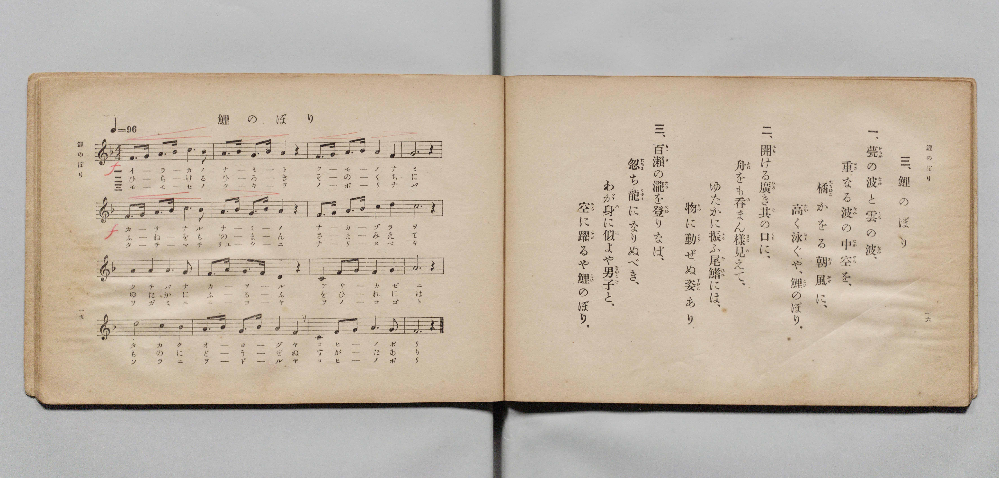

# こひのぼり

> Re:Shōka 使用 AI 協助辨識與重建樂譜，可能會有錯誤。歡迎[回報](https://github.com/TMDLang/reshoka/issues)。

- **鋼琴伴奏版**：<br><audio controls src="koinobori.mp3"></audio>
- **NEUTRINO 歌聲合成版**：<br><audio controls src="koinobori_neutrino.mp3"></audio>

- 詞：文部省唱歌
- 曲：弘田龍太郎
- 文部省《尋常小學唱歌 第五學年用》（大正二年五月，索書號 4100）

## 說明

原書資訊與歌詞全文（對應 P012.jpg–P013.jpg，原書 pp. 8–9）：
調性與拍號：ヘ長調（F 大調，1 降記號）4/4 拍，速度 ♩=96


## 歌詞

```text
一
いらかの波と雲の波、
かさなる波の中空（なかぞら）を、
たちばなかをる朝風に、
高くおよぐや、こひのぼり。

二
開ける廣きその口に、
舟をものまんさま見えて、
ゆたかにふるふ尾びれには、
物に動ぜぬ姿あり。

三
もゝせのたきをのぼりなば、
たちまち龍（りゅう）になりぬべき、
我が身にによや男子（をのこご）と、
空にをどるや、こひのぼり。
```

## ABC

<div class="abc-score" data-abc-src="koinobori.abc" aria-label="五線譜載入中"></div>

[下載 ABC 原始檔](koinobori.abc)

## TMD 檔案連結

- [主旋律 TMD 檔案](koinobori.tmd) [[在 TMD Studio 編輯](https://tmdlang.github.io/Tmd-TS/#tmd=s7IKdvYPcrWy4qpTUCpJTLdSSM7PyUlNLsnMz7PKyszLyo8vzshPT8wuBdHZiUpwdWX5OaW5qVbpRYkpqfGm8SaGBgYIyeL80qLkVKvi5Iz8_Jz4ktSKkqT8_Gx0-fiCxPRUqwADQyOETEFRfllqXmIeUHdBUWZeSWoKWDtCQWpZZkoqSLo4OTEvviy1KDMtMzUFyV2pRcUgx0OtKClKzCtOLsosAPkIoSq_qAToraLEgoxKq4zM4pL8oszkxJz47MQ8JC-WZKQCfZiWWlySWZaYU4wuUZyaWJyfhyQMNCQ9M88qNz8vqRQYWhgSJYmZQGFQQJYnxucmZublJOYBXa6lpfC4cfLjxk2PG9c9btzzuKlLQUuLS9FWwdKMy95WwY3LxkTfxA5k2IuV897vmfVsWvvL5hXP5zQ-nbLx2doesDXPZm8CyjzdM-P5lA0v9_U-XbLqZXMfRAam-nFD19MN3U937Hi6of_p2h0QzQrP16x5smsKiL9zy_MpKx43dL_f0_F0yfJnaxc_2dUDFATKPpvT8X5Pz_Mti57N3vFi5nwFUFy_39OpxMWlr6VgSy3ApaCg8LRvPsiOze0vVnS96GgHOhDo5aetK4CeADlrQ--z9k4FUILRyypIf9QwGcg0BjGBzoNoVSgo0FOwAMpYAh0IDBGQoS9W7X_WsBxkXHcv0PlA0cfNM15O3Q4UBxrqpgD0LZjZY6jwcmbvixUzwIo6gYGuANQBFH_ZMP_prmUKj2autAVGCcjIJzsaQNTjxpbHTZ2PG7uBMfds86LHjStezgbFIojd0AhRAZSb-rhx1eOmbrCKdU92rH2-chfQYpAgSHYe0AigdY-bJsH1zH_cuPBx4waoCqAEUPOcuS8XrXjcuBqq6OXqGY8b-x83dj1uApo04XFTC1ACLRk9bmiCuHZXD1jLNKBtE4FmPd29-HFj7-PGuUCVT_uBbJihLzrmg21rAhux73ET0Dig4_e9WAbUCbRmGcyFTW1gRwJFVz9u3Ao0Ekg-3bDvcePmx009YMH1UKXPO1cC-U-7gcbMedy45uny_Y8bm5DdtqMTYiJQEOie2WCbgUb3ghwC9wgoIDagBQ_QtoXApA4KSaCKptbHjW2gYARZDgxtoJ41jxt3ggyCaHvWMfFxY8-LXUBpMAIGW1PL8ynbn66dADYCYhvQw1PApgBzAsT9K3eBVQOlV4L8iSucgUopzwJQoKClz8XlnZ-Zl58ELDmsAjIT8_IdagxqqkG2KNgYmmnZgVnYch84Q-9oeLGwR0HDRAGY1Z-vb9CBZxlNLBqAloEMq1Gozk2rVTBU0AVCIwVjMG2iYAqmIRAkVgOXMYLSEL6uggGUrsEwA6YCIg5SAdGLCeFmgJ3kY1gDTBhLwCKPm1cC2auh7D4g7kLS97h5Ptjcx80dEH7TeiB7ERbV8XA3QPSA1K4G4q1QtV1ADLEFwkNXjQnhJkLcbARU27gJanInkD0Ryu6Gi0NNb-qFmNwIooH8xrlAvA7K7gfihZhuboSGQONWIF4LNWcSKPvATIWaAFG9jzg3G4P8BwutRUDTdkPZwJBr2o_iZpCdINVQH4LDdg6UvQpHOE-A6t0PZDdC1c6Ds8E6HzcvRWhoWkbQ2fjT_64ectI_LZI-zAwzuApkU5EhlqQPDFxI8AATJSzpN-0DZwWkKAFHBSjUIBEFClZ4kCPpRI0SWPSBkj404oFZAKH2cdMeJNXdONyMJek3TYbob5wKT36PG4ER3wjJmFDTG0ExDFLdBuXPB9WUUDbQTcDkjeFmYAaCyIPcOQnK3gxk98BNhbkelPTXE-dmcNKHmgzO_Kug7B4gnonsZnjSh5j8uGkNoggBmoAIJeRwXgGVX4KaZZo2w03dgqQaOYywu5lAud9JXrlfUAtPyug0CIKSOyxpG0MTv6GCGcxViNRvChMCqQWpg5X4sPIeloUwIbaSH1byICdL5Gh93ASKLKRgbtoADmoIG5g0miHJBDVKIJkKFBGQcgtScqG6pgaHK7EnecyyF5EUITxQhgUlSlhynwPEa6DsmUAMS8LIJT2svgG2l2AsYM-ATHeCknnTXpg58AIENWvDi5LmTigfmBXpFp54k_bT2bPJStrAFg2s6IVBWAFsAncbrmId0V4BN40wUjeuPIIJ8aVuGMSWykHqYAXSCnD6hrCBxQmiCIHHCm1TN9ydWFI5KL1C0hQojYPSN4QNLCKB6RumGpbKaZu64e7EksqRqz5g2wza0qNHeNZycenaKcAb9QpAjjIXAA)]
- [鋼琴伴奏 TMD 檔案](koinobori_piano.tmd) [[在 TMD Studio 編輯](https://tmdlang.github.io/Tmd-TS/#tmd=s7IKdvYPcrWy4qpTUCpJTLdSyC8qychPL0osyKi0ysgsLskvykxOzInPTsxLVIIrKs4vLUpOjS9ITE-1CjAwNFTi0tJSeNw4-XHjpseN6x437nnc1PV-T8fL7j3PJ2x5smfL06X9zzs73u_pVNDS4lK0VbA047K3VXDjsjHRN7EDmfpi5bz3e2Y9m9b-snnF8zmNT6dsfLa2B2zfs9mbgDJP98x4PmXDy329T5esetncB5Z50b7reePi5zv2Pp-7-OmuOY8bup62rnm6dsezBQsh-h83dD9fs-bJrilAwac7tzyfsgLopmcz1j6d1PO0t_HJjgag4Ps9Pc-3LHo2e8eLmfMVTI2M9YzNFUyMjYx0TYCuVeLi8swrKcq3CshMzMsP8nCoMaip5lIAAhtDMy07MKtGoTo3rVbBUEEXCI0UjMG0iYIpmIZAkFgNXMYISkP4ulCdIBWm8UhCIGUwJRCjQUpgitGhAcwQrloUN_sgu9kEzcnxCtGGsTAKaDaQYRqPJgBVABJHFjCA2OSdn5mXnwRMIjQNIbjnMMzADEOIXnwBBHKSj2GNwuOmJWCRx80rgezVUHYfEHch6XvcPB9s7uPmDgi_aT2QvQiLaljkgdSC9IDUrgbirVC1XUAMsQXCQ1eNCeEmQtxsBFTbuAlqcieQPRHK7oaLQ01v6oWY3AiigfzGuUC8DsruB-KFmG5uhIZA41YgXgs1ZxIQN8FMhZoAUb2PODcbg_wHC61FQNN2Q9nAkGvaj-JmkJ0g1VAfgsN2DpS9Ckc4T4Dq3Q9kN0LVzoOzwTofNy9FaGhaRtDZ0CRLi9QKM8MMrgLZVGSIJbUCwwPiI2A6gqXWpn3g1IsUiuDQA3kUEragkICHEpJO1FCEhTgotULjCphqEWofN-1BUt2Nw81YUmvTZIj-xqnwFPO4ERhXjZC8BDW9ERQpINVtUP58IIbYAkqVoBSJ4WZgmofIg9w5CcreDGT3wE2FuR6UWtcT52ZwaoWaDM6vq6DsHiCeiexmeGqFmPy4aQ0i1wNNQIQScjivgMovQU3lTZvhpm5BUo0cRtjdDC9dC2rhqQ-dBkHkqsMYml4NFcxgBiESLEYFBCtXYaUqLNVjQmzlKyx_I6ck5Jh43AQKX6SQadoADh0IGxibzZCYRQ1FSD4AhR2kdICUD6iuqcHhSuypFLOEQ6QeCA-Ux0DpCJZC5wDxGih7JhDDUh1yeQor1R83ws1vQq5ZSHInKGU27YWZA8_zqLkRnvubO6F8YO6hW3jCUiOwqocVcDAIK-ZM4MYRbgyB2wxUaRFhJkgYxJYwQepg2X4FOElC2MBMi8io8ICkbYKEuxNLwgQlMUgyACVLUJKEsIEFETBJwlTDEiZtEyTcnVgSJnIFA2y0QJtA9AhPzPYpma1hYGMXQ9o0HioPYoBaw9BmA9GmmGA2qJGKc1zmmGCYg61ljsiJQPUgm1AVojTy0T2Po6Wva6cA7lYoABnwUI32AapBFTBCFzAGCyhzAQA)]

## 分析

```text
================================================================================
📊 TMD Song Profile: [ こひのぼり ]
================================================================================
⏱  Duration:       0:40 (40.0s), 16 measures total
🎼 Key & Tempo:    首調基準 F, != 96.0 BPM, <4/4>
   - 分析範圍：      由實際發聲的音符與和弦推測調性；播放脈絡另行呈現
🎤 人聲音域:    C4 (MIDI 60) – D5 (MIDI 74) [跨度: 14 個半音 / 1.2 個八度, 難度: moderate]
   - 最低音:  C4 in [Koinobori #1 @ m.11, 0:25]
   - 最高音: D5 in [Koinobori #1 @ m.7, 0:16]
   - 適合: soprano, mezzo-soprano, contralto, tenor, baritone, bass
🏛  結構:      Koinobori (40.0s)
⚡ 編曲密度:        Peak 1 軌道同時演奏
🗝  調性診斷：       F 調性不明確（純淨自然大調，未偵測到可信轉調）
   - 風格氣質:    純淨自然大調（陽光明朗、易唱易記，無明顯調外色彩）
   - 轉調歷程:    全曲維持單一推測調性（未偵測到可信轉調）
   - 核心骨幹音:  A, F, C, G, D
   - 調性數值:    F 調性不明確 [相關度: 0.76, 穩定度: Ambiguous, 自然音純度: 100.0%]
   - 候選調性 (K-S): F 大調 (0.76), A 小調 (0.73), C 大調 (0.57)
   - 五度圈歷程:   -1
   - 各段落調性細節:
     • [Koinobori #1]: F 調性不明確 (r: 0.76, 自然音純度: 100.0%)

  [ 五度圈游移軌跡 ]
               C  
        [F ]*          G  
      Bb               D  
      Eb               A  
         Ab           E  
            Db       B  
               F# 
     (* = active key center)

  [ 十二半音累積音高分佈 ]
     C  : █████████████             17.5%
     C# :                            0.0%
     D  : █████                      7.0%
     D# :                            0.0%
     E  :                            0.0%
     F  : ██████████████            19.3%
     F# :                            0.0%
     G  : █████████████             17.5%
     G# :                            0.0%
     A  : ████████████████████████  32.5%
     A# : █████                      6.1%
     B  :                            0.0%
--------------------------------------------------------------------------------
Assignment 軌道音域：
  - Piano         : C4 – D5 (14 個半音 / 1.2 個八度, 66 個音符)
================================================================================
```


## 原書掃描頁




