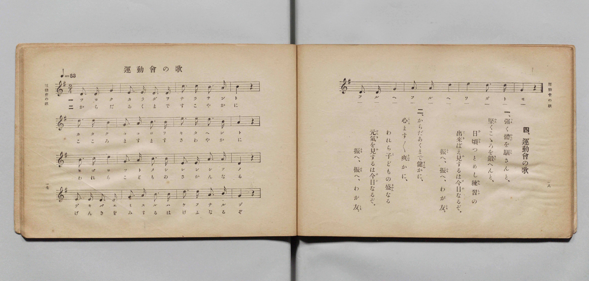

# 運動會の歌

> Re:Shōka 使用 AI 協助辨識與重建樂譜，可能會有錯誤。歡迎回報。

- **鋼琴伴奏版**：<br><audio controls src="undokai_no_uta.mp3"></audio>

- 文部省《尋常小學唱歌 第五學年用》（大正二年五月，索書號 4100）

## 說明

原書資訊與歌詞全文（對應 P012.jpg，原書 pp. 17–18）：
- 調性與拍號：ト長調（G 大調）2/4 拍，速度 ♩=88


## 歌詞

```text
四、運動會の歌
一、強（つよ）く體（からだ）を馴（なら）さんと、
堅（かた）くこゝろを鍛（きた）へんと、
日頃（ひごろ）つとめし練習（れんしふ）の
出來（でき）ばえ見（み）するは今日（けふ）なるぞ。
振（ふる）へ、振（ふる）へ、わが友（とも）。
二、からだあくまで健（すこや）かに、
心（こころ）ます〳〵爽（さわや）かに、
われら子（こ）どもの盛（さかん）なる
元氣（げんき）を見（み）するは今日（けふ）なるぞ。
振（ふる）へ、振（ふる）へ、わが友（とも）。
```

## ABC

<div class="abc-score" data-abc-src="undokai_no_uta.abc" aria-label="五線譜載入中"></div>

[下載 ABC 原始檔](undokai_no_uta.abc)

## TMD 檔案連結

- [主旋律 TMD 檔案](undokai_no_uta.tmd) [[在 TMD Studio 編輯](https://tmdlang.github.io/Tmd-TS/#tmd=s7IKdvYPcrWy4qpTUCpJTLdSSM7PyUlNLsnMz7PKyszLyo8vzshPT8wuBdHZiUpwdWX5OaW5qVbpRYkpqfGm8SaGBgYIyeL80qLkVKvi5Iz8_Jz4ktSKkqT8_Gx0-fiCxPRUqwADQyOETEFRfllqXmIeUHdBUWZeSWoKWDtCQWpZZkoqSLostSgzLTM1BclJqUXFIHdDTS8pSswrTi7KLAB5BqEqv6gE6KOixIKMSquMzOKS_KLM5MSc-OzEPCTflWSkAj0HcT-GaAHQiGJkAzPTM_OscvPzkkqBgYQpkZqZlYkUCFpaCi8bu592T302p_lx47pna3sUtLS4FG0VLCy47G0V3LlsjPRN7ECmPJvW_rJ5xfM5jY8bup5u6H66Y8fTDf1P1-54OmUjSNfzNWue7JoC4u_c8nzKiscN3e_3dDxdsvzZ2sVPdvUABYGyz-Z0vN_T83zLomezd7yYOV8BFE_v93QqcXHpaynYUgtwKSgoPO2bD7Jjc_uLFV0vOtqBDnyxct7T1hVAT4CctaH3WXunAiiy9bIK0oFugqhXKCjQUzA0f9Qw2dAC6K73e2aBzNJVeLFq_7OG5SBzunuB7gaKP27ueDl1O1AcaJq7AtCbYGYnMKwUgGqABr5smP901zKFRzNX2gJDEuyk2bMfNzSiBTZI4smOBqDE0z3bgWY9blzyuAkYSJ2PG_tfrp4CFul-3ATkLgAJNk16uWwLWHAVUBCsbOrjpsmPG4Hh3QgyCwSeLmiF6msEOhVk0uPGyY-b5j5u6gUZ0DsbLNsLk92BYcCz6UtfLmgGq9r0uHEKUB9Y4RKQqqbGx43Tn2_f8nz_JJCCph6w7umPG7eC1ayDO6J915N9bWAzlgMtA0tueNzY8WIZKF08bgSF1uPGmY-bgK5c_2R3F9BOsPhEmElADwKl5j1uaII7q2c9WMlWoAzU5Q2NWAUfNwG93PO0H2IV0NFNICmIScDECFIBC9XHjU3gANoHdOfTRogbZoLDqwVsHNANq5HDdj8kXIB-BiqBeAuodebjhs2PG7Y-79gLlgXGST8OA8AywEDrfLp2AsQksKqVQDcCQ-_5bEjkTAW7DyIFCgi49a3NzzYsBiuZBA54sAuaJg14qFKea6FAQUufiys0LwVYvGf65YeWJFoFZCbm5TvUGNRUg51sY2imZQdmYSszwMXQjoYXC3sUNEwUgAXU8_UNOvCMrvB0-7KXCxo1segDWgsys0bBNB6Y4XVBlCGYoQsUMwKSIJ45SA7EASoDqQFiY7ASQ6giEDSAaQMb6GNYo_C4uQUs8rh5BTD-18ONfdy0Giy6Ekw2gMlNEJnmLoRM01ao7s1gmQ6ofog74fYYAeUauyEqmzqB7AUIexqbQKKN_WByH5hcDpWZCeZNBuuCuhJoCkgG5DZUe_CH-q4eSkIdEugKZihhDsIm8CCHhz5EMZBbA48jLIEODlyQt_ajBfpmsCiYbF6LHOhNYB5QPUhsBtGBDgo8SCACSwSkQIcENCSAEWyQzFSwPeDooDDQd3RSEOiQtGsMpZETOogGiUICGITNQC4CMeA5BHtKnwQN9C3QwIUGBjgHQILxcfNCsIrtUJk10GCGiT1uBgUPSKYPd6CDAw-kowec2hGBDk7JjZB8A0n165ADHZxDgCUnmL0KItMEyTVEBzqwIqe0fAGHJphlDCKgoqDgBYU6OSVMO9hfkOQ8AcxeAQ3F-WDeTrAMpLwBhR3I3xvhoQ0pbyAqQDKg5IoruYNiGBaCoOQOrH6gIQzOOJAEDw5TYB0ElZkI5oHKMUioQ1SAZOaRFvbARiTOsO_fTHzYg8sSRJoHhTKkVAGJwAohkAgkLvAUM9Dwg4QspNCAhDtIHCKDKg4rih43QVI-KE-AxBfhCXNwyEHDdAfCLLA4RAZFHJo7QKp7wCQ0LYBzBKodtVxcunYKyBVutI9hrAKGmBFYTJkLAA)]
- [鋼琴伴奏 TMD 檔案](undokai_no_uta_piano.tmd) [[在 TMD Studio 編輯](https://tmdlang.github.io/Tmd-TS/#tmd=s7IKdvYPcrWy4qpTUCpJTLdSSM7PyUlNLsnMz7PKyszLyo8vzshPT8wuBdHZiUpwdWX5OaW5qVbpRYkpqfGm8SaGBgYIyeL80qLkVKvi5Iz8_Jz4ktSKkqT8_Gx0-fiCxPRUqwADQyOETEFRfllqXmIeUHdBUWZeSWoKWDtCQWpZZkoqSDoxOTk_tyAxLzM3NQ9Jviy1qBjkeKgVJUWJecXJRZkFIB8hVOUXlQC9VZRYkFFplZFZXJJflJmcmBOfnZiH5MXEIqDm9FSQ-VYFmYl5-fE47CzJACqC-hZDtABoVzGyzZnpmXlWufl5SaXAIMWUSM3MykQKMi0thZeN3U-7pz6b0_y4cd2ztT3v93S87N7zfMKWJ3u2PF3a_7yz4_2eTgUtLS5FWwULCy57WwV3LhsjfRM7kNHPprW_bF7xfE7j44aupxu6n-7Y8XRD_9O1O55O2Qg0SuH5mjVPdk0B8XdueT5lxeOGbqDpT5csf7Z28ZNdPUBBoOyzOUALep5vWfRs9o4XM-crgKIaaKMSF1doXgowTWT65YeWJFoFgEIoyMOhxqCmmksBCGwMzbTswCx9LQVbdAC2ekfDi4U9ChomCkBHPV_foKMASgx6WQXpCk-3L3u5oFETiz4tfbCZNQqm8Qq6QAikDMEMXaCYEZAE8cxBciAOUBlIDRAbg5UYQhWBoAFMG9hAH8MahcfNLWCRx80rFB43rYcb-7hpNVh0JZhsAJObIDLNXQiZpq1Q3ZvBMh1Q_RB3wu0xAso1dkNUNnUC2QsQ9jQ2gUQb-8HkPjC5HCozE8ybDNYFdSXQFJAMyG2o9uAP9V09lIQ6JNAVzFDCHIRN4EEOD32IYiC3Bh5HWAIdHLggb-1HC_TNYFEw2bwWOdCbwDygepDYDKIDHRR4kEB83NSLFOiQgIYEMIINkpkKtgccHRQG-o5OCgIdknaNoTRyQgfRIFFIAIOwGchFIAY8h2BP6ZOggb4FGrjQwADnAEgwPm5eCFaxHSqzBhrMMLHHzaDgAcn04Q50cOCBdPSAUzsi0MEpuRGSbyCpfh1yoINzyOMmiKpVEJkmSK4hOtCfzp5NafkCDk0wyxhEQEVBwQsKdXJKmHawvyDJeQKYvQIaivPBvJ1gGUh5Awo7kL83wkMbUt5AVIBkQMkVV3IHxTAsBEHJ_XETSAQkA844kAQPDtPHjaBsB5KZCOaByjFIqENUgGTmkRb2wIoDZ9j3byY-7MFlCSLNg0IZUqqARGCFEEgEEhd4ihlo-EFCFlJoQMIdJA6RQRWHFUWPmyApH5QnQOKL8IQ5OOSgYboDYRZYHCKDIg7NHSDVPWASmhbAOQLVjlps9a0Pcn1rgqhun2_a93zpvGdd055N3g0s75919z5dO-FlwyZglDybvQnScECEtmE8MHVrA8McFPDxCkZQNpqwAdSjYAmTeG1g9ADjBMFE04qiHJvxZkC2Ybw2MF9hMR-mAcgk6BxkQ5HZJvEgrjbQiXAHAQNR104BORyjfQxjFTDEjMBiylwA)]

## 分析

```text
================================================================================
📊 TMD Song Profile: [ 運動會の歌 ]
================================================================================
⏱  Duration:       0:54 (54.5s), 40 measures total
🎼 Key & Tempo:    首調基準 G, != 88.0 BPM, <2/4>
   - 分析範圍：      由實際發聲的音符與和弦推測調性；播放脈絡另行呈現
🎤 人聲音域:    B3 (MIDI 59) – E5 (MIDI 76) [跨度: 17 個半音 / 1.4 個八度, 難度: challenging]
   - 最低音:  B3 in [UndokaiNoUta[L1] #1 @ m.13, 0:17]
   - 最高音: E5 in [UndokaiNoUta[L1] #1 @ m.5, 0:06]
   - 適合: soprano, mezzo-soprano, contralto, tenor, baritone, bass
🏛  結構:      UndokaiNoUta[L1] (27.3s) -> UndokaiNoUta[L2] (27.3s)
⚡ 編曲密度:        Peak 1 軌道同時演奏
🗝  調性診斷：       D 大調（純淨自然大調，未偵測到可信轉調）
   - 風格氣質:    純淨自然大調（陽光明朗、易唱易記，無明顯調外色彩）
   - 轉調歷程:    全曲維持單一推測調性（未偵測到可信轉調）
   - 核心骨幹音:  D, A, G, B, E
   - 調性數值:    D 大調 [相關度: 0.92, 穩定度: High, 自然音純度: 98.6%]
   - 候選調性 (K-S): D 大調 (0.92), G 大調 (0.77), B 小調 (0.64)
   - 五度圈歷程:   +2 -> +2
   - 各段落調性細節:
     • [UndokaiNoUta[L1] #1]: D 大調 (r: 0.92, 自然音純度: 98.6%, 調外音: C)
     • [UndokaiNoUta[L2] #1]: D 大調 (r: 0.92, 自然音純度: 98.6%, 調外音: C)

  [ 五度圈游移軌跡 ]
               C  
         F            G  
      Bb              [D ]*
      Eb               A  
         Ab           E  
            Db       B  
               F# 
     (* = active key center)

  [ 十二半音累積音高分佈 ]
     C  : █                          1.4%
     C# :                            0.0%
     D  : ████████████████████████  26.4%
     D# :                            0.0%
     E  : █████████                 10.0%
     F  :                            0.0%
     F# : ██████                     6.4%
     G  : █████████████████         18.6%
     G# :                            0.0%
     A  : ████████████████████      22.1%
     A# :                            0.0%
     B  : ██████████████            15.0%
--------------------------------------------------------------------------------
Assignment 軌道音域：
  - Piano         : B3 – E5 (17 個半音 / 1.4 個八度, 118 個音符)
================================================================================
```


## 原書掃描頁




