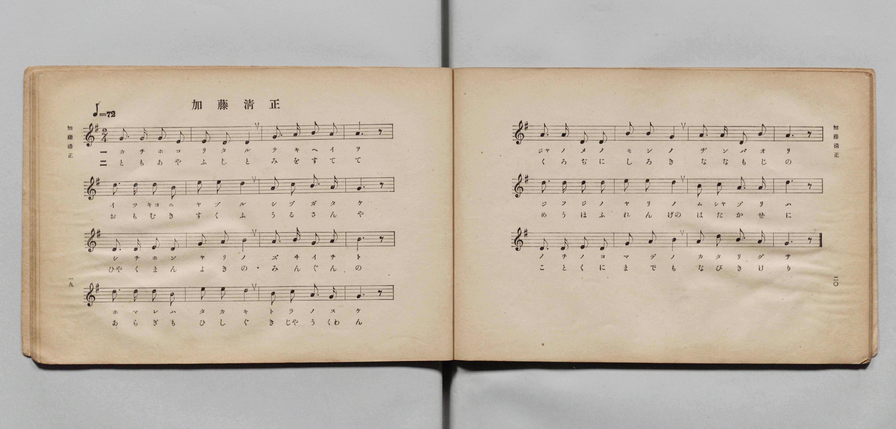
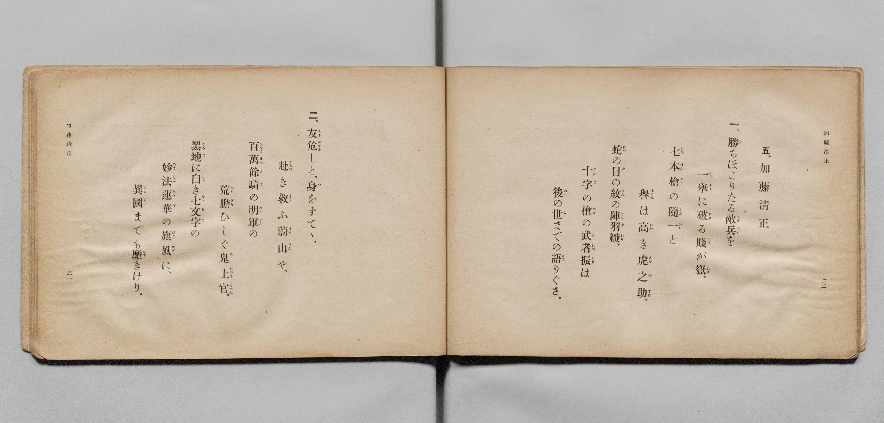

# 加藤清正

> Re:Shōka 使用 AI 協助辨識與重建樂譜，可能會有錯誤。歡迎回報。

- **鋼琴伴奏版**：<br><audio controls src="kato_kiyomasa.mp3"></audio>

- 文部省《尋常小學唱歌 第五學年用》（大正二年五月，索書號 4100）

## 說明

原書資訊與歌詞全文（對應 P013.jpg–P014.jpg，原書 pp. 19–22）：
- 調性與拍號：ト長調（G 大調）2/4 拍，速度 ♩=72


## 歌詞

```text
五、加藤清正
一、勝（か）ちほこりたる敵兵（てきへい）を
一擧（いつきよ）に破（やぶ）る賤が嶽（しつがたけ）、
七本槍（しちほんやり）の隨一（ずゐいち）と
譽（ほまれ）は高（たか）き虎之助（とらのすけ）。
蛇（じや）の目（め）の紋（もん）の陣羽織（ぢんばおり）、
十字（じふじ）の槍（やり）の武者振（むしやぶり）は
後（のち）の世（よ）までの語（かた）りぐさ。
二、友（とも）危（あやふ）しと、身（み）をすてゝ、
赴（おもむ）き救（すく）ふ蔚山（うるさん）や、
百萬餘騎（ひやくまんよき）の明軍（みんぐん）の
荒膽（あらぎも）ひしぐ鬼上官（きじやうくわん）。
黒地（くろぢ）に白（しろ）き七文字（ななもじ）の
妙法蓮華（めうほふれんげ）の旗風（はたかぜ）に、
異國（ことくに）までも靡（なび）きけり。
```

## ABC

<div class="abc-score" data-abc-src="kato_kiyomasa.abc" aria-label="五線譜載入中"></div>

[下載 ABC 原始檔](kato_kiyomasa.abc)

## TMD 檔案連結

- [主旋律 TMD 檔案](kato_kiyomasa.tmd) [[在 TMD Studio 編輯](https://tmdlang.github.io/Tmd-TS/#tmd=s7IKdvYPcrWy4qpTUCpJTLdSSM7PyUlNLsnMz7PKyszLyo8vzshPT8wuBdHZiUpwdWX5OaW5qVbpRYkpqfGm8SaGBgYIyeL80qLkVKvi5Iz8_Jz4ktSKkqT8_Gx0-fiCxPRUqwADQ2OETEFRfllqXmIeUHdBUWZeSWoKWDtCQWpZZkoqSLostSgzLTM1BclJqUXFIHdDTS8pSswrTi7KLAB5BqEqv6gE6KOixIKMSquMzOKS_KLM5MSc-OzEPCTflWSkAj0Hka5EF87NzMksSUQWB5qRnplnlZufl1QKDCdMidTMrEykcNDSUnjateDF9CXPdrQ-W7tYQUuLS9FWwdyIy95WwZ3LxkjfxA5kxLNp7S-bVzyf0_i4oevphu6nO3Y83dD_dO2Op1M2Plvbo_B8zZonu6aA-Du3PJ-y4nFD9_s9HU-XLAea-GRXD1AQKPtsTsf7PT3Ptyx6NnvHi5nzFUDx9H5PpxIXl76Wgi21AJeCgsLTvvkgOza3v1jR9aKjHejAFyvnPW1dAfQEyFkbep-1dyqAIlsvqyD9UcNkINMExAQ6D6JVoaBAT8HQEihlZAR04vs9s0DG6iq8WLX_WcNykJHdvUAvAMUfN3e8nLodKA402F0B6GMwsxMYbApANUADXzbMf7prmcKjmSttgYEKMgYYFI8bGpEDHSy6owEk2j0XaNDjRmDwdT5uXPi4cffjxsmPm7oeN85_3NT9bOrWp61bwQqWPW7sfdy443FjC0hl0ySQESAANObZ5OVgJS2PG5eAVDUBgx1o2OrnC7aAxJuA4tvAmrpfbAYq6Hm6bS9Y_XSw-h6QVY0TQQoaGhGmNj-bs-bZcqCHIArBLmsCuqwF6Diw8etezloBtBysYNbjpglg-xeCpVbAjHmxFmIT0FP7Hjf1gCXXv1w9AywItBXia2DI9j3Z2f20ayVYfMXjJpDxjxtnwpzVBDdvNig-HzfOALoD4ojns9eB_dgI5W4BpcPHTU1At0JdOXPx8317n--cAta4COSHxg2PG7ug3kB4-Wlv49O106HGN24FkhADoIGA5PFna5e9aGh91rMeLN4ACh9wGMMUrIcbuQ_oZaB5QL9AAmbdkx3TwJogMbTvceNyoOCLVfMgaQAYJuB4AsY-MDinQj0OzE-ghNIP9hkodJqAip72bgRzgR4FWg1MIkDjgNEEzIiNL3atBkuBkiUwoYDDcdnjprlIfn2xFZwyQKEANAAYh6BYeDYVGNpAQaDyfrDI1hdTZj3dCLGnDZh6QE6CBCvQToRhz2fuezFhzcslM16u6AOr3QR2Uz84zoEpBigCDEFwwM3oe7EbkqT2gyNiAjya4C7rnfSiDZJogC4DyvRB_AsyFeTBCS_X7Hmyo-vpOkgaAmYJUFoAuQ9oYRMQgc1DpJiXuyc9nbMBrBYoCVS-CJo3ZsLyQBPEcb2gJD-tHZYEVoEQMHBgqQAepctmPts89cXkdS_6IdHfCLYbmMC3AhM42FOToJ6dPv3lohVgw9ZDEvvjxjkQy5EDb-qGp3MgMQvUugIcbMDogyWOpqaXc4FJB-KgzRCHAnMFKIlA_Eh5-QkFClr6XFzeiSX53pmV-bmJxYlWAZmJefkONQY11WDH2hiaadmBWdhKb3CFsKPhxcIeBQ0TBWBV8Xx9gw68yFV4un3ZywWNmlj0Aa0FmVmjYBoPLG91FcziISxjEAEVBYrpKhiCpUFiRmDaGEyDRGEiEGgAEgGb6WNYo_C4aTVY9HFzIxDPBrGaNoP1PG5eBebtB8tCVEHE2yA6mtYC2TPArCVQmU1I9oDdB7HHCCjXuAKqqwnIbgKzWiC6GreCeI3TwSREFUQcZDNI3SQgeyZYdhlUBkSj2oM_4Hf1UBDwxkjBCWIDAx3KMoM7FiSCqgYWHdiCHBRcoEBtAQXi4-blYE43NAxBko-bp6GHetN2qKZWIHsNOFxA4QOS2Ygn1LsQod7UAA7DXmgYQkK0H0yCYgAW6rDY7Qayp4JZk6H2gOKLlFDf0UlBqIPTNCK5g7mQUIWFMa7EDtWJPehhoQhP7c2w1A4Jd3Cab-5DCvddUB0boBEH0gvR0YEn3EFlPEQjMIiBhRVKQII0QiICWA4iBT0swU8Gsicg64CrIjLon86eTUlJA7bGFBzIIDYwSKEs9GAHRg0s_PGmeHBQg4JuHhCDE28zKOGBwgJcvIALIVCBAg8LaOA-bl4Jj47HTTsJJndQwQJS2Qlkg3SBEj4kBEFFE6yQAYUtLMxBsQASA1WTiNQPrizBtoFigJREv2sKzpDv30wo5CGBaaRgDrIJnO4hYqBwh5XhsIA2hCR0kHANRAOuNL_jcfNiaGj2AfFCKAsSzovAPFAmQEn2zdCQBMo8boakRVDWgFULuMIfFKsgtb1ANtjkRlDMgmTAIQ8Uh6V8WPhDTAPRkLgCxgRUhtQ037qWgpCHpXlYSocU-6CQhhcn0MoWJAbJB6YEatYd0CCcCmUjAh1HWdO8ABxI2yHxBakEIApBkpCwxRruTaAiCRR2bUC8G8wCFekgmR6wkaBUDGx5oRY368GC88EkqPYB0XPAMrB6h9hEv6OZgqCHBjAwCYNZ0GSPvaRHFEJGBEocaJkBLujBJUEzqGkBkpkH5rWjBz60DII0d6CpsmkDWAZWPWJL8ZDyAdRwgVWmsBQPLvMbwZU7OGUjp3hgYxVMQnICsMUKtgdSWSPbU8vFpWungNzsjPYxjFXAEDMCiylzAQA)]
- [鋼琴伴奏 TMD 檔案](kato_kiyomasa_piano.tmd) [[在 TMD Studio 編輯](https://tmdlang.github.io/Tmd-TS/#tmd=s7IKdvYPcrWy4qpTUCpJTLdSSM7PyUlNLsnMz7PKyszLyo8vzshPT8wuBdHZiUpwdWX5OaW5qVbpRYkpqfGm8SaGBgYIyeL80qLkVKvi5Iz8_Jz4ktSKkqT8_Gx0-fiCxPRUqwADQ2OETEFRfllqXmIeUHdBUWZeSWoKWDtCQWpZZkoqSDoxOTk_tyAxLzM3NQ9Jviy1qBjkeKgVJUWJecXJRZkFIB8hVOUXlQC9VZRYkFFplZFZXJJflJmcmBOfnZiH5MXEIqDm9FSQ-VYFmYl5-fE47CzJACqCmlOJLpybmZNZkogsDrQsPTPPKjc_L6kUGKqYEqmZWZlIoaalpfC0a8GL6Uue7Wh9tnbx-z0dL7v3PJ-w5cmeLU-X9j_v7Hi_p1NBS4tL0VbB3IjL3lbBncvGSN_EDmTus2ntL5tXPJ_T-Lih6-mG7qc7djzd0P907Y6nUzY-W9uj8HzNmie7poD4O7c8n7LicUM30PSnS5YDrXmyqwcoCJR9NgdoQc_zLYuezd7xYuZ8BVBUA21U4uLyTizJ986szM9NLE60CgCFUJCHQ41BTTWXAhDYGJpp2YFZ-loKtugAbPWOhhcLexQ0TBSAjnq-vkFHAZQY9LIK0hWebl_2ckGjJhZ9WvpgM2sUTOMVdIHQLB7CMgYRUFGgmK6CIVgaJGYEpo3BNEgUJgKBBiARsJk-hjUKj5tWg0UfNzcC8WwQq2kzWM_j5lVg3n6wLEQVRLwNoqNpLZA9A8xaApXZhGQP2H0Qe4yAco0roLqagOwmMKsFoqtxK4jXOB1MQlRBxEE2g9RNArJngmWXQWVANKo9-AN-Vw8FAW-MFJwgNjDQoSwzuGNBIqhqYNGBLchBwQUK1BZQID5uXg7mdEPDECT5uHkaeqg3bYdqagWy14DDBRQ-IJmNeEK9CxHqTQ3gMOyFhiEkRPvBJCgGYKEOi91uIHsqmDUZag8ovkgJ9R2dFIQ6OE0jkjuYCwlVWBjjSuxQndiDHhaK8NTeDEvtkHAHp_nmPqRw3wXVsQEacSC9EB0deMJ9Eyy4QEH8uHEfSkCCNEIi4nHjOqSghyX4yUD2BGQdcFVEBv3T2bMpKWnA1piCAxnEBgYplIUe7MCogYU_3hQPDmpQ0M0DYnDibQYlPFBYgIsXcCEEKlDgYQEN3MfNK-HR8bhpJ8HkDipYQCo7gWyQLlDCh4QgqGiCFTKgsIWFOSgWQGIzQBEGT_2N_Y-b-sG2gWKAlES_awrOkO_fTCjkIYFppGAOsgmc7iFioHCHleGwgDaEJHSQcA1EA640v-Nx82JoaPYB8UIoCxLOi8A8UCZASfbN0JAEyjxuhqRFUNaAVQu4wh8UqyC1vUA22ORGUMyCZMAhDxSHpXxY-ENMA9GQuALGBFSG1DTfupaCkIeleVhKhxT7oJCGFyfQyhYkBskHpgRq1h3QIJwKZSMCHUdZ07wAHEjbIfEFqQQgCkGSkLDFGu5NoCIJFHZtQLwbzAIV6SCZHrCRoFT8uHESanGzHiw4H0yCah8QPQcsA6t3iE30O5opCHpoAAOTMJgFTfbYS3pEIWREoMSBlhnggh5cEjSDmhYgmXlgXjt64EPLIEhzB5oqmzaAZWDVI7YUDykfQA0XWGUKS_HgMr8RXLmDUzZyin_cCM5x8NJnItgeSGWNbE8ttlanD3Kr0wTR6HzaOfvZ-tan_UteLloBbPI86-59unYCpNWMCG3DeGDTURsYyChMo3gFk3htYPiDEjmwUIcIY9WCRR2SCnicxgMFtYGNVBTtyHqQlGDaY4LQjtceZEk0haT6B7szifcPktuAsaZrp4AccdE-hrEKGGJGYDFlLgA)]

## 分析

```text
================================================================================
📊 TMD Song Profile: [ 加藤清正 ]
================================================================================
⏱  Duration:       1:33 (93.3s), 56 measures total
🎼 Key & Tempo:    首調基準 G, != 72.0 BPM, <2/4>
   - 分析範圍：      由實際發聲的音符與和弦推測調性；播放脈絡另行呈現
🎤 人聲音域:    B3 (MIDI 59) – E5 (MIDI 76) [跨度: 17 個半音 / 1.4 個八度, 難度: challenging]
   - 最低音:  B3 in [KatoKiyomasa[L1] #1 @ m.1, 0:01]
   - 最高音: E5 in [KatoKiyomasa[L1] #1 @ m.6, 0:09]
   - 適合: soprano, mezzo-soprano, contralto, tenor, baritone, bass
🏛  結構:      KatoKiyomasa[L1] (46.7s) -> KatoKiyomasa[L2] (46.7s)
⚡ 編曲密度:        Peak 1 軌道同時演奏
🗝  調性診斷：       D 大調（純淨自然大調，未偵測到可信轉調）
   - 風格氣質:    純淨自然大調（陽光明朗、易唱易記，無明顯調外色彩）
   - 轉調歷程:    全曲維持單一推測調性（未偵測到可信轉調）
   - 核心骨幹音:  A, B, D, G, E
   - 調性數值:    D 大調 [相關度: 0.78, 穩定度: Moderate, 自然音純度: 100.0%]
   - 候選調性 (K-S): D 大調 (0.78), G 大調 (0.70), E 小調 (0.62)
   - 五度圈歷程:   +2 -> +2
   - 各段落調性細節:
     • [KatoKiyomasa[L1] #1]: D 大調 (r: 0.78, 自然音純度: 100.0%)
     • [KatoKiyomasa[L2] #1]: D 大調 (r: 0.78, 自然音純度: 100.0%)

  [ 五度圈游移軌跡 ]
               C  
         F            G  
      Bb              [D ]*
      Eb               A  
         Ab           E  
            Db       B  
               F# 
     (* = active key center)

  [ 十二半音累積音高分佈 ]
     C  :                            0.0%
     C# :                            0.0%
     D  : ██████████████████        18.1%
     D# :                            0.0%
     E  : ████████████████          16.2%
     F  :                            0.0%
     F# : ████                       4.3%
     G  : ██████████████████        18.1%
     G# :                            0.0%
     A  : ████████████████████████  24.3%
     A# :                            0.0%
     B  : ███████████████████       19.0%
--------------------------------------------------------------------------------
Assignment 軌道音域：
  - Piano         : B3 – E5 (17 個半音 / 1.4 個八度, 168 個音符)
================================================================================
```


## 原書掃描頁






