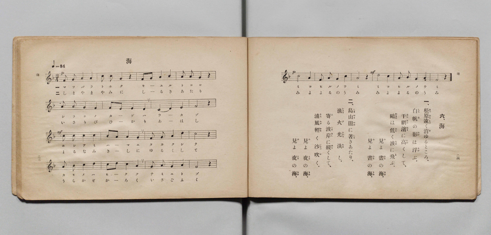

# 海

> Re:Shōka 使用 AI 協助辨識與重建樂譜，可能會有錯誤。歡迎回報。

- **鋼琴伴奏版**：<br><audio controls src="umi.mp3"></audio>

- 文部省《尋常小學唱歌 第五學年用》（大正二年五月，索書號 4100）

## 說明

原書資訊與歌詞全文（對應 P015.jpg，原書 pp. 23–24）：
- 調性與拍號：ヘ長調（F 大調）3/4 拍，速度 ♩=84


## 歌詞

```text
六、海
一、松原（まつばら）遠（とほ）く消（き）ゆるところ、
白帆（しらほ）の影（かげ）は浮（うか）ぶ。
干網（ほしあみ）濱（はま）に高（たか）くして、
鷗（かもめ）は低（ひく）く波（なみ）に飛（と）ぶ。
見（み）よ、晝（ひる）の海（うみ）。
見（み）よ、晝（ひる）の海（うみ）。
二、島山（しまやま）闇（やみ）に著（しる）きあたり、
漁火（いさりび）光（ひかり）淡（あは）し。
寄（よ）る波（なみ）岸（きし）に緩（ゆる）くして、
浦風（うらかぜ）輕（かる）く沙（いさご）吹（ふ）く。
見（み）よ、夜（よる）の海（うみ）。
見（み）よ、夜（よる）の海（うみ）。
```

## ABC

<div class="abc-score" data-abc-src="umi.abc" aria-label="五線譜載入中"></div>

[下載 ABC 原始檔](umi.abc)

## TMD 檔案連結

- [主旋律 TMD 檔案](umi.tmd) [[在 TMD Studio 編輯](https://tmdlang.github.io/Tmd-TS/#tmd=s7IKdvYPcrWy4qpTUCpJTLdSSM7PyUlNLsnMz7PKyszLyo8vzshPT8wuBdHZiUpwdWX5OaW5qVbpRYkpqfGm8SaGBgYIyeL80qLkVKvi5Iz8_Jz4ktSKkqT8_Gx0-fiCxPRUqwADQ1OETEFRfllqXmIeUHdBUWZeSWoKWDtCQWpZZkoqSLostSgzLTM1BclJqUXFIHdDTS8pSswrTi7KLAB5BqEqv6gE6KOixIKMSquMzOKS_KLM5MSc-OzEPCTflWSkAj2Xl1hSWpSKLlqeWJJahGxeZnpmnlVufl5SKTCMMCVSM7MykcJAS0vh2dbtClpaXIq2ChYmXPa2Cm5cNsb6JnYgnc-mtb9sXvF8TuPjhq6nG7qf7tjxdEP_07U7nk7Z-Gxtj8LzNWue7JoC4u_c8nzKiscN3e_3dDxdsvzZ2sVPdvUABYGyz-Z0vN_T83zLomezd7yYOV8BFDXv93QqcXHpaynYUgtwKSgoPO2bD7Jjc_uLFV0vOtqBDnyxct7T1hVAT4CctaH3WXunAih-9bIK0oFugqhXKCjQUzAyftQw2cgE6K73e2aBzNJVeLFq_7OG5SBzunuB7gaKP26e8XLqdqA40DQ3BaA3wcxOYFgpANUADXzZMP_prmUKj2autAWGJNhJrWsfNzQCAxjEebKjAcSZuw9oMdCIx437Hjcuedy44XET0NbOl40LwIIrHjfuBnIfN_Y_2wYMOaAI0OjOx01tj5u6wbKTHzf1As0BmQgCz2fufbqjDaxwOtAkmO51T_duBAsCNU0Ci6x_tnUdWKQNKAgW2fa4oQlmzNOdm55v2wSW3w0yqbHpcSPId8_2Q4xZD3QuWNPql6tngEXmw4zpB6tfhuSml9unQ-1uanrc1Aix_snePrDgJqAOqAc3LwKLrIJYBTJ78WxIIGC478UyUNqCKmzqAAXkzLlQ85og7lgHDGeYB8HKqKEbmI6Bqp9u3vZ0IyQggF7d97ipBRIcL6eDkhaYC_XBi4kQrwPjAmJuLzgo5z9u6kIKoGd7Gp83rgYrBGqdCpJs3AxU_rQVmBQgYQQMuy5Q-G9fCBYBmrEebN505Ehb3wK2HphOgN7qRgvPp5t2QNIPUBPEcc-3rwSrB6UlHFH3bOuyl4uAwQ8OCFByAqafOUC1L_ZMhUUpVOuzTTMRHmicArJwwk6wyFao2fjC_-kSoKkgp5MVe8TqprxggQIFLX0urtDcTKuAzMS8fIcag5pqsOtsLLTswAxshRm4fNzR8GJhj4KGiQKw5Hy-vkEHXgIpPN2-7OWCRk0s-oCWgcysUaguqFUwVDBSMAYWSCBco2AKhEZAlgGYB5MzA_OMgRAuBzbBx7BG4XHzPCBuAeIJQPHHzSvBah83dwDxbIXHTeuB_HiIWNPaOiDzcfMysMLVCIVNm4H0WphCiNFGQLnG6UC8DyjfAtIBZEGMAVrWuB-IQSZAjW6cDja6qRussBcq2ATE84GiXXCj8Qfmrh4KAhMWPIbQoDOPByFg4EGcaApng0VBKnTBEC04m7aDAxEUeKBQ6oP6eTXEf5vAgv1QwWV1UI8B5aGhOQ1qKnpIgsJsKjQogIUBNIA2gU1tBIcaWAocanBTG0GRB4kHZFMJpMhOSlJkblotOBGaAm0C4Rpg4oPwTLAkSZA4ljAEJzxgODYtAgfXfGjY9EOS3zywIMjPoDAEJiRg4EHSKUgTRGkb9mBsAiXWbmCArAIHz35o8PRCghEUSpBUCVLaBlUKiiyIHEgpKO0TGZJPZ8-mKDmagIMHFlCgYITlclAQgpIqhIcrIQJDpXkREC9ETnPNkyAJERJc0PTR3AUOZUiggnI0_rQICplOWLJrnAMNmW7kHAy1DZZsG6eARbdCRUGyxCbHXVPAgWiGJRD7NxNTQMLSGCywIEEHSZsgMXjQQRIvKLxBEKbAhHBIgxMoCD5uXgELZXABCcn-wHwOFYWpgxZ65OlDighQ-gXrB6ZrSKKFpe914PAG5QJkdbDClix9XLVcXLp2CsBaLtrHMFYBxjQCM5W5AA)]
- [鋼琴伴奏 TMD 檔案](umi_piano.tmd) [[在 TMD Studio 編輯](https://tmdlang.github.io/Tmd-TS/#tmd=s7IKdvYPcrWy4qpTUCpJTLdSSM7PyUlNLsnMz7PKyszLyo8vzshPT8wuBdHZiUpwdWX5OaW5qVbpRYkpqfGm8SaGBgYIyeL80qLkVKvi5Iz8_Jz4ktSKkqT8_Gx0-fiCxPRUqwADQ1OETEFRfllqXmIeUHdBUWZeSWoKWDtCQWpZZkoqSDoxOTk_tyAxLzM3NQ9Jviy1qBjkeKgVJUWJecXJRZkFIB8hVOUXlQC9VZRYkFFplZFZXJJflJmcmBOfnZiH5MXEIqDm9FSQ-VYFmYl5-fE47CzJACqyykssKS1KRRctTyxJLUK2ODM9M88qNz8vqRQYopgSqZlZmUghpqWl8Gzr9vd7Ol5273k-YcuTPVueLu1_3tnxfk-ngpYWl6KtgoUJl72tghuXjbG-iR3IuGfT2l82r3g-p_FxQ9fTDd1Pd-x4uqH_6dodT6dsfLa2R-H5mjVPdk0B8XdueT5lxeOGbqDpT5csf7Z28ZNdPUBBoOyzOUALep5vWfRs9o4XM-crgGIXaKMSF1dobqZVACgsgjwcagxqqrkUgMDGQssOzNDXUrBFB2ALdzS8WNijoGGiAHTK8_UNOgqgWNfLKkhXeLp92csFjZpY9Gnpg82sUaguqFUwVDBSMFbQBeMaBVMgNAKyDMA8mJwZmGcMhHA5sAk-hjUKj5vnAXELEE8Aij9uXglW-7i5A4hnKzxuWg_kx0PEmtbWAZmPm5eBFa5GKGzaDKTXwhRCjDYCyjVOB-J9QPkWkA4gC2IM0LLG_UAMMgFqdON0sNFN3WCFvVDBJiCeDxTtghuNPzB39VAQmLDgMYQGnXk8CAEDD-JEUzgbLApSoQuGaMHZtB0ciKDAA4VSH9TPqyH-2wQW7IcKLquDegwoDw3NaVBT0UMSFGZToUHxuHEzNIA2gU1tBIcaWAocanBTG0GRB4kHZFMJpMhOSlJkblotOBGaAm0C4Rpg4oPwTLAkSZA4ljAEJzxgODYtAgfXfGjY9EOS3zywIMjPoDAEJiRg4EHSKUgTRGkb9mBsAiXWbmCArAIHz35o8PRCghEUSpBUCVLaBlUKiiyIHEgpKO0TGZJPZ8-mKDmagIMHFlCgYITlclAQgpIqhIcrIQJDpXkREC9ETnPNkyAJERJc0PTR3AUOZUiggnI0_rQICplOWLJrnAMNmW7kHAy1DZZsG6eARbdCRUGyxCbHXVPAgWiGJRD7NxNTQMLSGCywIEEHSZsgMXjQQRIvKLxBEKbAhHBIgxMoCD5uXgELZXABCcn-wHwOFYWpgxZ65OlDighQ-gXrB6ZrSKKFpe914PAG5QJkdbDClix9XLVIlZwPciVngqjknraser6v79nmRc-2rgKWJM-6e5-unQCpmxGxYhivYByvDSxQISSobI1XMAKzDZClTeK1gQUumjRhMzC1QUgkTXjMMYkHlvLahnBTMFyDzxAMNZiuI8Ut-HXBnWoYr21MhCXA-NO1UwBGYbSPYawCjGkEZipzAQA)]

## 分析

```text
================================================================================
📊 TMD Song Profile: [ 海 ]
================================================================================
⏱  Duration:       1:34 (94.3s), 44 measures total
🎼 Key & Tempo:    首調基準 F, != 84.0 BPM, <3/4>
   - 分析範圍：      由實際發聲的音符與和弦推測調性；播放脈絡另行呈現
🎤 人聲音域:    C4 (MIDI 60) – D5 (MIDI 74) [跨度: 14 個半音 / 1.2 個八度, 難度: moderate]
   - 最低音:  C4 in [Umi[L1] #1 @ m.7, 0:12]
   - 最高音: D5 in [Umi[L1] #1 @ m.3, 0:05]
   - 適合: soprano, mezzo-soprano, contralto, tenor, baritone, bass
🏛  結構:      Umi[L1] (47.1s) -> Umi[L2] (47.1s)
⚡ 編曲密度:        Peak 1 軌道同時演奏
🗝  調性診斷：       F 調性不明確（純淨自然大調，未偵測到可信轉調）
   - 風格氣質:    純淨自然大調（陽光明朗、易唱易記，無明顯調外色彩）
   - 轉調歷程:    全曲維持單一推測調性（未偵測到可信轉調）
   - 核心骨幹音:  C, A, F, D, G
   - 調性數值:    F 調性不明確 [相關度: 0.80, 穩定度: Ambiguous, 自然音純度: 100.0%]
   - 候選調性 (K-S): F 大調 (0.80), A 小調 (0.80), C 大調 (0.78)
   - 五度圈歷程:   -1 -> -1
   - 各段落調性細節:
     • [Umi[L1] #1]: F 調性不明確 (r: 0.80, 自然音純度: 100.0%)
     • [Umi[L2] #1]: F 調性不明確 (r: 0.80, 自然音純度: 100.0%)

  [ 五度圈游移軌跡 ]
               C  
        [F ]*          G  
      Bb               D  
      Eb               A  
         Ab           E  
            Db       B  
               F# 
     (* = active key center)

  [ 十二半音累積音高分佈 ]
     C  : ████████████████████████  25.4%
     C# :                            0.0%
     D  : █████████████             13.6%
     D# :                            0.0%
     E  : ████                       4.2%
     F  : ███████████████           16.1%
     F# :                            0.0%
     G  : █████████████             13.6%
     G# :                            0.0%
     A  : ██████████████████████    23.7%
     A# : ███                        3.4%
     B  :                            0.0%
--------------------------------------------------------------------------------
Assignment 軌道音域：
  - Piano         : C4 – D5 (14 個半音 / 1.2 個八度, 132 個音符)
================================================================================
```


## 原書掃描頁




