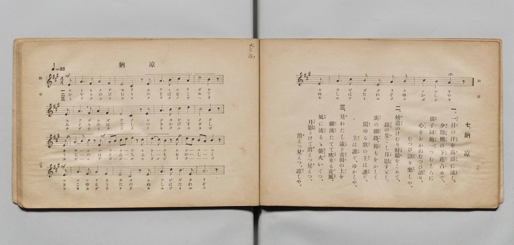

# 納涼

> Re:Shōka 使用 AI 協助辨識與重建樂譜，可能會有錯誤。歡迎回報。

- **鋼琴伴奏版**：<br><audio controls src="noryo.mp3"></audio>
- **NEUTRINO 歌聲合成版**：<br><audio controls src="noryo_neutrino.mp3"></audio>

- 詞：文部省（尋常小學唱歌）
- 曲：文部省（尋常小學唱歌）
- 文部省《尋常小學唱歌 第五學年用》（大正二年五月，索書號 4100）

## 說明

原書資訊與歌詞全文（對應 P016.jpg，原書 pp. 25–26，第 7 首）：
調性與拍號：イ長調（A 大調）4/4 拍（弱起半拍），♩= 92


## 歌詞

```text
一、一日（ひとひ）の汗（あせ）を湯浴（ゆあみ）に流（なが）し、
夕顔棚（ゆふがほだな）の下蔭（したかげ）占（し）めて、
親子（おやこ）同胞（はらから）一（ひと）つむしろに
心（こゝろ）をおかぬむつび語（がた）り、
むつび語（がた）り樂（たの）しや。

二、蚊遣（かやり）のけむり軒端（のきば）をこめて、
綠（みどり）の葉（は）ごし月影（つきかげ）すゞし。
裏（うら）の細路（ほそみち）、節（ふし）もをかしく
聞（きこ）ゆる歌（うた）の主（ぬし）は誰（たれ）ぞ。
主（ぬし）は誰（たれ）ぞ、ゆかしや。

三、見（み）わたし遠（とほ）き青田（あをた）の上（うへ）を
細波（さゞなみ）たてて吹（ふ）き來（く）る夜風（よかぜ）。
風（かぜ）に流（なが）るゝ螢火（ほたるび）いくつ、
月影（つきかげ）うけて消（き）えつ見（み）えつ。
消（き）えつ見（み）えつ、涼（すゞ）しや。
```

## ABC

<div class="abc-score" data-abc-src="noryo.abc" aria-label="五線譜載入中"></div>

[下載 ABC 原始檔](noryo.abc)

## TMD 檔案連結

- [主旋律 TMD 檔案](noryo.tmd) [[在 TMD Studio 編輯](https://tmdlang.github.io/Tmd-TS/#tmd=s7IKdvYPcrWy4qpTUCpJTLdSSM7PyUlNLsnMz7PKyszLyo8vzshPT8wuBdHZiUpwdWX5OaW5qVbpRYkpqfGm8SaGBgYIyeL80qLkVKvi5Iz8_Jz4ktSKkqT8_Gx0-fiCxPRUqwADQzOETEFRfllqXmIeUHdBUWZeSWoKWDtCQWpZZkoqSLo4OTEvviy1KDMtMzUFIZ9fVAJ0cFFiQUalVUZmcUl-UWZyYk58dmIesuNTi4pBPoS6o6QoMa84uSizAORthKqSjFSgD4tTE4vz84qRbchMz8yzys3PSyoFBooSl5aWwvMtvc-27VHQ0uJStFWwNOKyt1Vw5LIx0TexA2l7sXLe-z2znk1rf9m84vmcxvd7Op5u6H66Y8fTDf1P1-54OmXjs7U97_d0gq14NnsT8Wphqh43dGGqUni-Zs2TXVNA_J1bnk9Z8bihG2TakuXP1i5-sqsHKAiUfTan4_2enudbFj2bvePFzPkKoHgEG8-lr6VgSy3ApaCg8LRvPsiOze0vVnS96GgHOhAYLE9bVwA9AfZk77P2TgVQYtDLKkgHugmiXqGgQE_ByPRRw2QjM5BD16xRMFd4uWwa0I3AYAKZ-2LV_mcNy0EmdvcCfQAUfdy05OXU7UBxoLmOCkAPg5mdwNhQAKoBWbZn44ut25_2doG5QIN6Hs1cCY43kIFPdjQ8bmgEks-mLwUqfty46XHjCiAJVPm4cd2zjdPBgk2PG2eDRJomPdu5_tnWLSDBpjawOMiyx42rn20Fxd7jxlWPG0Ex9rhxOtBYcEgsmfpy4ZRni2fB9GwFqnjcuPtx4wKgaog1T3Z0v5iyFqx_-uPG-Y8bux83TgJKPe1dABEE2934uHEZ1NAXy1Y9XTsBLNf1uKnlceNkkOoJPS-agWkPKLj-cRPQ3G4gCRQHeg7uM7B9Sx43NYBsauoFOhzsxv3NYBWTHzfNBYpCfAoyGuSQNWDVSx43bn6xCmI60PnAkAeq6YI6B4-KZyuawCJAT62DhgvQvQ1NkMDf1QM04cWsrpeNi8GqgC5uAWqChMrjxokgg5u6Xuye9Hz1erACoCDQ0RtgLgQ6GClUnm-DBNf-x40r4aa8mAgMA1CQgLlTgA4A5oKnezeCBYFuBhoHDe3HjTMfN80Dx1wTOJAX94MVtUGCEWjW8y0bXmyHOAQYf3PBNi0ESTU0Pl8PCWRg7EJiqwnsQKDRwBjtBxvXCAkboIWg2AKlhaZucP4G2wEJMFBa2A0WWQM1qHH9i1VA_4KDsAmStOZBHUic0kZwqgM7BCnkd4Ac_WIZqJCApuGmfnAsTX_ZCAlFYC4AGg80o_fl3EnPp0AMhvgK7lRgGEMcvwMSI-BY2LLh2eZFYImp4PAEZglIJgGavgyInk7YCQkqiOlP9rWBucDABhrR_XTJnJeLgOkUmFnACaJxDjiAwR6GSsBFMbNdEzAFzX0xb9HzxtWwaAKGBVD9ZrB6YE4B-nIJNL3gTghAH00EuvTZNmB5CYoysCBIGUqIgUWgTiNOaSOw3gALglIaSnYAGkF5yQsFClr6XFx--UWV-VYBmYl5-Q41uoY11SArFGwstOzADGwFPrgO2dHwYmGPggak1FTQVjBRAFYzwNStAy-uFZ5uX_ZyQaMmFgOAFoMMr1EwUNAFQwhdnZtWq2AaDxQ3BPPN4sEMIKULFANKQBQbgxgGyAqNFIyBJIhdA3QIRJURXBHYLh_DGgWYARD6cfMkoPLHzR1w3uPmPhCraRHYoMdNu6HqHzdvAut63LwMLA6SB4nOB-JuMKsLqmMNTEfTdoQOiP1GGPY3doP1tEB1dAFF1oHFJ0JNa4CbBjIfaBpQHije2AvVvwEoMwnMmgzV0QjT0bgMqmM_zH5jTP_PB_t_PdSO_VBXQ0IEJDMbbv9aiGlAn4PEQaEB1QENMZBtIJkZ6CHWtBVoP_6UtKsHnJLIS0BkJRRQEqkBJxAQBMkYKFQXQJIePLE8bp4K9eYaaFA8bgZFCEgGFB0Qb4K8D_LmdnDw74fqWA3EoACABChIx0K4jjaojlVICQNYEUF1IhIBKFpAMlPgUTodGqVLUBJBNxBDEsFMqI5ZGDrakBLB46ZtUJcA7QImAUhEQlwJchuKK4FhANIBin6QuvVAkdVg-RUQHUCfwpLIHqi_VhOM8B2dFEc4JB6BsYZUYoDETBRMweLG8ILAGFoQgOIXIgoSAalG0Y8U7UvgXtoMDYR-cOCAogjiYQgbJINcgoDEQXkZJL4AHDiQ3AQKPEg5AQqezcjR3tQJjypQpIOiajc4CueCxUDRAmw5QGWAOQkapRDXNUFNBLsBmAxgEQ6su6A6elGiHRRBEFdC3QJMALAyCxatIBIkMxs5OQNFHzeDShiQbeDEB0wI6D5uIRTtT2fPpl8-h8S6LrIQBKLVCJA4hsQSpMwCZUy0pN3cgxyrYB-DRCfDy3tQSIFkQDphEKoeKYuDQhCktg2IIbEFymQgGVAmRE0Fa5DiGlQUwNQA22tgmXmoNoHUI8U0LLsiiiFo-dy0Ee4nWDG0FiwOys6Q2IQUCSA9K5B8C7cJpJ5QeT4FHM9GWOK5fzNx8QyKPmA8gXJpDTing2ITUk4D_YGUV1HjAlIjrYLHB6RuguRCUK4GJxukGEENX1DYgkIWFENoOQpcRyPpBocyapiB-GB2005wiO7CanctF5eunQK4zRXtYxirgOAYIXOMwRxlLgA)]
- [鋼琴伴奏 TMD 檔案](noryo_piano.tmd) [[在 TMD Studio 編輯](https://tmdlang.github.io/Tmd-TS/#tmd=s7IKdvYPcrWy4tLSUni-pffZtj3v93S87N7zfMKWJ3u2PF3a_7yz4_2eTgUtLS5FWwVLIy57WwVHLhsTfRM7rjoFpWfT2l82r3g-p_FxQ9fTDd1Pd-x4uqH_6dodT6dsfLa2R-H5mjVPdk0B8XdueT5lxeOGbqDpT5csf7Z28ZNdPUBBoOyzOUALep5vWfRs9o4XM-crmBgaGABtVOLi8ssvqsy3CshMzMsP8nCo0TWsqeZSAAIbCy07MENfS8EWHYDt3NHwYmGPgsbTPRtfbN2uoK1gogB01vP1DToKAQaGZnpZBekKT7cve7mgUROLAVr6YMNrFAwUdMEQQlfnptUqmMYDxQ3BfLN4MANI6QLFgBIQxcYghgGyQiMFYyAJYtcAHQJRZQRXBLbLx7BGAWYAhH7cPAmo_HFzB5z3uLkPxGpaBDbocdNuqPrHzZvAuh43LwOLg-RBovOBuBvM6oLqWAPT0bQdoQNivxGG_Y3dYD0tUB1dQJF1YPGJUNMa4KaBzAeaBpQHijf2QvVvAMpMArMmQ3U0wnQ0LoPq2A-z3xjT__PB_l8PtWM_1NWQEAHJzIbbvxZiGtDnIHFQaEB1QEMMZBtIZgZ6iDVtBdqPPyXt6gGnJPISEFkJBZREasAJBARBMgYK1QWQpAdPLI-bp0K9uQYaFI-bQRECkgFFB8SbIO-DvLkdHPz7oTpWAzEoACABCtKxEK6jDapjFVLCeNy4EqoTkQhA0QKSmQKP0unQKF2Ckgi6gRiSCGZCdczC0NGGlAgeN22DugRoFzAJQCIS4kqQ21BcCQwDkA5Q9IPUrQeKrAbLr4DoAPoUlkT2QP21mmCE7-ikOMIh8QiMNaQSAyRmomAKFjeGFwTG0IIAFL8QUZAISDWKfqRoXwL30mZoIPSDAwcURRAPQ9ggGeQSBCQOyssg8QXgwIHkJlDgQcoJUPBsRo72pk54VIEiHRRVu8FROBcsBoqWx42gpAOSAeYkaJRCXNcENRHsBmAygEX448Z-qI5elGgHRRDElVC3ABMArMyCRSuIBMnMRk7OQNHHzaASBmQbOPEBEwK6j1sIRfvT2bPpl88hsa6LLASBaDUCJI4hsQQps0AZEy1pN_cgxyrYxyDRyfDyHhRSIBmQThiEqkfK4qAQBKltA2JIbIEyGUgGlAlRU8EapLgGFQUwNY-besAy81BtAqlHimlYdkUUQ9DyuWkj3E-wYmgtWByUnSGxCSkSQHpWIPkWbhNIPaHyfAo4no2wxHP_ZuLiGRR9wHgC5dIacE4HxSaknAb6AymvosYFpEZaBY8PSN0EyYWgXA1ONkgxghq-oLAFhSwohtByFLiORtINDmXUMAPxweymneAQ3YXV7lqUJpcPSpPLBNHkArYRn3fsfTlt0svGlU92dj9d0v90yRxgBnrW3ft07QRgdnnW2Q1pOyI3pSCwBlKoGcYrmABDMB6YWcB5IF4h2jAWRIFUAClToDBIKtosPjcWVBsCmUZAFkgcqAQWHUSaAtQNyo9AadN4mDzUCFDBC1UJ1QdzH1QUJATUDzIGxgXpQRWCGUaM12DawG5Bk0f4C6YKaBTcK1A1wFjStVMAR1S0D1ArgmOEzDEGc5S5AA)]

## 分析

```text
================================================================================
📊 TMD Song Profile: [ 納涼 ]
================================================================================
⏱  Duration:       2:20 (140.9s), 54 measures total
🎼 Key & Tempo:    首調基準 A, != 92.0 BPM, <4/4>
   - 分析範圍：      由實際發聲的音符與和弦推測調性；播放脈絡另行呈現
🎤 人聲音域:    C#4 (MIDI 61) – E5 (MIDI 76) [跨度: 15 個半音 / 1.2 個八度, 難度: moderate]
   - 最低音:  C#4 in [Noryo[L1] #1 @ m.3, 0:06]
   - 最高音: E5 in [Noryo[L1] #1 @ m.11, 0:27]
   - 適合: soprano, mezzo-soprano, contralto, tenor, baritone, bass
🏛  結構:      Noryo[L1] (47.0s) -> Noryo[L2] (47.0s) -> Noryo[L3] (47.0s)
⚡ 編曲密度:        Peak 1 軌道同時演奏
🗝  調性診斷：       A 大調（純淨自然大調，未偵測到可信轉調）
   - 風格氣質:    純淨自然大調（陽光明朗、易唱易記，無明顯調外色彩）
   - 轉調歷程:    全曲維持單一推測調性（未偵測到可信轉調）
   - 核心骨幹音:  A, E, B, C#, D
   - 調性數值:    A 大調 [相關度: 0.95, 穩定度: High, 自然音純度: 100.0%]
   - 候選調性 (K-S): A 大調 (0.95), E 大調 (0.61), F# 小調 (0.58)
   - 五度圈歷程:   +3 -> +3 -> +3
   - 各段落調性細節:
     • [Noryo[L1] #1]: A 大調 (r: 0.96, 自然音純度: 100.0%)
     • [Noryo[L2] #1]: A 大調 (r: 0.95, 自然音純度: 100.0%)
     • [Noryo[L3] #1]: A 大調 (r: 0.95, 自然音純度: 100.0%)

  [ 五度圈游移軌跡 ]
               C  
         F            G  
      Bb               D  
      Eb              [A ]*
         Ab           E  
            Db       B  
               F# 
     (* = active key center)

  [ 十二半音累積音高分佈 ]
     C  :                            0.0%
     C# : ███████████               15.8%
     D  : ██████                     8.3%
     D# :                            0.0%
     E  : █████████████             18.8%
     F  :                            0.0%
     F# : █████                      6.8%
     G  :                            0.0%
     G# :                            0.0%
     A  : ████████████████████████  33.8%
     A# :                            0.0%
     B  : ████████████              16.5%
--------------------------------------------------------------------------------
Assignment 軌道音域：
  - Piano         : C#4 – E5 (15 個半音 / 1.2 個八度, 213 個音符)
================================================================================
```


## 原書掃描頁




