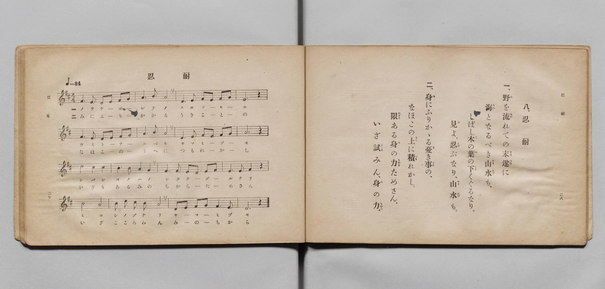

# 忍耐

> Re:Shōka 使用 AI 協助辨識與重建樂譜，可能會有錯誤。歡迎回報。

- **鋼琴伴奏版**：<br><audio controls src="nintai.mp3"></audio>

- 文部省《尋常小學唱歌 第五學年用》（大正二年五月，索書號 4100）

## 說明

原書資訊與歌詞全文（對應 P017.jpg，原書 pp. 27–28）：
- 調性與拍號：ニ長調（D 大調）4/4 拍，速度 ♩=84


## 歌詞

```text
八、忍耐
一、野（の）を流（なが）れての末遂（すゑつひ）に
海（うみ）となるべき山水（やまみづ）も、
しばし木（こ）の葉（は）の下（した）くぐるなり。
見（み）よ、忍（しの）ぶなり、山水（やまみづ）も。
二、身（み）にふりかゝる憂（う）き事（こと）の、
なほこの上（うへ）に積（つも）れかし。
限（かぎり）ある身（み）の力（ちから）ためさん。
いざ試（こころ）みん、身（み）の力（ちから）。
```

## ABC

<div class="abc-score" data-abc-src="nintai.abc" aria-label="五線譜載入中"></div>

[下載 ABC 原始檔](nintai.abc)

## TMD 檔案連結

- [主旋律 TMD 檔案](nintai.tmd) [[在 TMD Studio 編輯](https://tmdlang.github.io/Tmd-TS/#tmd=s7IKdvYPcrWy4qpTUCpJTLdSSM7PyUlNLsnMz7PKyszLyo8vzshPT8wuBdHZiUpwdWX5OaW5qVbpRYkpqfGm8SaGBgYIyeL80qLkVKvi5Iz8_Jz4ktSKkqT8_Gx0-fiCxPRUqwADQ3OETEFRfllqXmIeUHdBUWZeSWoKWDtCQWpZZkoqSLostSgzLTM1BclJqUXFIHdDTS8pSswrTi7KLAB5BqEqv6gE6KOixIKMSquMzOKS_KLM5MSc-OzEPCTflWSkAj2Xm1-UmIMumJdYUlqUimxeZnpmHlBtXlIpMIwwJVIzszKRwkBLS-Hp_t4XDRMUtLS4FG0VLEy47G0VXLhsTPRN7ECan01rf9m84vmcxscNXU83dD_dsePphv6na3c8nbLx2doehedr1jzZNQXE37nl-ZQVjxu63-_peLpk-bO1i5_s6gEKAmWfzel4v6fn-ZZFz2bveDFzvgIodt7v6VTi4tLXUrClFuBSUFB42jcfZMfm9hcrul50tAMd-GLlvKetK4CeADlrQ--z9k4FUBTrZRWkA90EUa9QUKCnYGT-qGGykQXQXe_3zAKZpavwYtX-Zw3LQeZ09wLdDRR_3Nz9cup2oDjQNBcFoDfBzE5gWCkA1QANfNkw_-muZQqPZq60BYYk2Emtqx83NELCGMR_sqMByH_Z3gc04nHjOqDux02Tnm1tBHNXPW7sAYv0PG5cBpR9Nmf1y8YmsNTMx00THzcuedy4CaSgcTXILBB4tnU7WL7tcSPIKY8bV4CMaep-3LjzcWPv040bn23YAlLQ1PK4cR9QzePGpWAbmoCugJnxuHH648YNQPLZnBVgwyaDTVr3YiIwMIDc9RDukx2gyAUrBgYGUKT_ceMEsFVAC7seNzTBzHuxDKIQ7KCmDoj_YVrBXm7cBtPUiNeJYCOBCQmo7sWu1QhDG1c_btwK0t_Y_bhpLtANz9ogwdQGlu19sgvigsnA8IA4HsW7wHDeDZYE-qkLFnw7IAY_Xwlx6hKgA2BxAfTidCT_vZw5AawEKNwHdARYXxPQEahOXPe0azaYuxDsSmBQAgXnP25qfNw49XHTZCTzHjcCfT7txcplMDdPftwEdARQ-X6wQjS_YzMYYhjluQgKFLT0ubj8gCVeYqZVQGZiXr5DjUFNNdi9NhZadmAGtswLLg92NLxY2KOgYaIALCmer2_Qgec4hafbl71c0KiJRR_QPpCZNQrGwIynq2CkYAjExgomQBFTsIgZlNYFihhC1RjD1RhB5UDQAKQGbJqPYY3C4-Y-sOjj5k1A3FWnEK_wuGkNiALJrYHKtcHVgcx_3LQTIt60AijeAtbTPAmmpxvJrniEXUZAucb9EH2Nq4F4K8QusJUgOYg-EA1MKgi7Gtug4r1APBmsp3EFTM86DLvwB_2uHroHPUwOS9A3LYMG73wg7oAEIyw4mldD5WYC1a1FBEfzEqj4PJA-iJ5WmJ5FeIJ-FTQYdyOCcR0sGGFBvAMcNYigh9rV1ATEPRA93TA900kM-h2dFAS9YRzUJnMorgGGOiLsTcAikPgBhTwkhmDJHsTGDPvtUBMfN08A-xHEB4lvhor2AXE_lAWRgeh43LQfiNdDEu8G9NjqAmJQSKOHPixBA0tEsBld0BBugpoJTPTgzAFJ0iCZhVD1oOzQCQl7cHSDXNIIlZsKZE8mLvyfzp5NQfhDAlsXKaGbgeLEHC3tQ9I8LJ_AcgPWtA9M87DwXwE3ARTGkJCfhhSW8JQPSe3zIBREPzDxE0z5LfCwn4YwrXEyBDeBihVQjILCESa3Hyl_IMcEyIWdGDbVcnHp2ilAaoNoH8NYBSSeEZinzAUA)]
- [鋼琴伴奏 TMD 檔案](nintai_piano.tmd) [[在 TMD Studio 編輯](https://tmdlang.github.io/Tmd-TS/#tmd=s7IKdvYPcrWy4qpTUCpJTLdSSM7PyUlNLsnMz7PKyszLyo8vzshPT8wuBdHZiUpwdWX5OaW5qVbpRYkpqfGm8SaGBgYIyeL80qLkVKvi5Iz8_Jz4ktSKkqT8_Gx0-fiCxPRUqwADQ3OETEFRfllqXmIeUHdBUWZeSWoKWDtCQWpZZkoqSDoxOTk_tyAxLzM3NQ9Jviy1qBjkeKgVJUWJecXJRZkFIB8hVOUXlQC9VZRYkFFplZFZXJJflJmcmBOfnZiH5MXEIqDm9FSQ-VYFmYl5-fE47CzJACqyys0vSsxBF8xLLCktSkW2ODM9Mw-oNi-pFBiimBKpmVmZSCGmpaXwdH_vi4YJ7_d0vOze83zClid7tjxd2v-8s-P9nk4FLS0uRVsFCxMue1sFFy4bE30TO5CJz6a1v2xe8XxO4-OGrqcbup_u2PF0Q__TtTueTtn4bG2PwvM1a57smgLi79zyfMqKxw3dQNOfLln-bO3iJ7t6gIJA2WdzgBb0PN-y6NnsHS9mzlcARTDQRiUuLj9gtCRmWgWAQiTIw6HGoKaaSwEIbCy07MAMfS0FW3QAtnNHw4uFPQoaJgpA1zxf36CjAIp7vayCdIWn25e9XNCoiUWflj7YzBoFYwVdIDRSMARiYwUToIgpWMQMSusCRQyhaozhaoygciBoAFIDNs3HsEbhcXMfWPRx8yYg7qpTiFd43LQGRIHk1kDl2uDqQOY_btoJEW9aARRvAetpngTT041kVzzCLiOgXON-iL7G1UC8FWIX2EqQHEQfiH7cBDMDJN4GFe8F4slgPY0rYHrWYdiFP-h39dA96GFyWIK-aRk0eOcDcQckGGHB0bwaKjcTqG4tIjial0DF54H0QfS0wvQswhP0q6DBuBsRjOtgwQgL4h3gqEEEPdSupiYg7oHo6YbpmU5i0O_opCDoDeOgNplDcQ0w1BFhbwIWgcQPKOQhMQRL9iA2Zthvh5r4uHkC2I8gPkh8M1S0D4j7oSyIDETH46b9QLwekng3oMdWFxCDQho99GEJ-nEjyDRgqoeGcBPUTGCiB2cOSJIGySyEqgdlh05I2IOjG-SSRqjcVCB7MnHh_3T2bArCHxLYukgJ3QwUJ-ZoaR-S5mH5BJYbsKZ9YJqHhf8KuAmgMIaE_DSksISnfEhqnwehIPqBiZ9gym-Bh_00hGmNkyG4CVSsgGIUFI4wuf1I-QM5JkAu7MSwqRa1MvBBrgxMEJXB0wWtz9a3PtvU-XzlSmBsPOvufbp2AqQaQ0ro8QrG8dqm8QgGATGzeJC4tjFI0BTINgKLglgG0EAgw1CjeAUT9XhtM3yGmoDs1jZEkscuRsClQGlMM5HchEcIqy1Q84BxomunAImWaB_DWAUknhGYp8wFAA)]

## 分析

```text
================================================================================
📊 TMD Song Profile: [ 忍耐 ]
================================================================================
⏱  Duration:       1:31 (91.4s), 32 measures total
🎼 Key & Tempo:    首調基準 D, != 84.0 BPM, <4/4>
   - 分析範圍：      由實際發聲的音符與和弦推測調性；播放脈絡另行呈現
🎤 人聲音域:    D4 (MIDI 62) – D5 (MIDI 74) [跨度: 12 個半音 / 1.0 個八度, 難度: easy]
   - 最低音:  D4 in [Nintai[L1] #1 @ m.1, 0:01]
   - 最高音: D5 in [Nintai[L1] #1 @ m.9, 0:22]
   - 適合: soprano, mezzo-soprano, contralto, tenor, baritone, bass
🏛  結構:      Nintai[L1] (45.7s) -> Nintai[L2] (45.7s)
⚡ 編曲密度:        Peak 1 軌道同時演奏
🗝  調性診斷：       A 調性不明確（流行色彩大調，未偵測到可信轉調）
   - 風格氣質:    流行大調（略帶和弦色彩音與裝飾副屬和弦）
   - 轉調歷程:    全曲維持單一推測調性（未偵測到可信轉調）
   - 核心骨幹音:  A, F#, E, D, B
   - 調性數值:    A 調性不明確 [相關度: 0.84, 穩定度: Ambiguous, 自然音純度: 94.2%]
   - 候選調性 (K-S): A 大調 (0.84), D 大調 (0.84), F# 小調 (0.70)
   - 五度圈歷程:   +3 -> +3
   - 各段落調性細節:
     • [Nintai[L1] #1]: A 調性不明確 (r: 0.84, 自然音純度: 94.2%, 調外音: G)
     • [Nintai[L2] #1]: A 調性不明確 (r: 0.84, 自然音純度: 94.2%, 調外音: G)

  [ 五度圈游移軌跡 ]
               C  
         F            G  
      Bb               D  
      Eb              [A ]*
         Ab           E  
            Db       B  
               F# 
     (* = active key center)

  [ 十二半音累積音高分佈 ]
     C  :                            0.0%
     C# : ████                       4.2%
     D  : █████████████████         17.5%
     D# :                            0.0%
     E  : ██████████████████        18.3%
     F  :                            0.0%
     F# : ██████████████████        19.2%
     G  : ██████                     5.8%
     G# :                            0.0%
     A  : ████████████████████████  25.0%
     A# :                            0.0%
     B  : ██████████                10.0%
--------------------------------------------------------------------------------
Assignment 軌道音域：
  - Piano         : D4 – D5 (12 個半音 / 1.0 個八度, 124 個音符)
================================================================================
```


## 原書掃描頁




