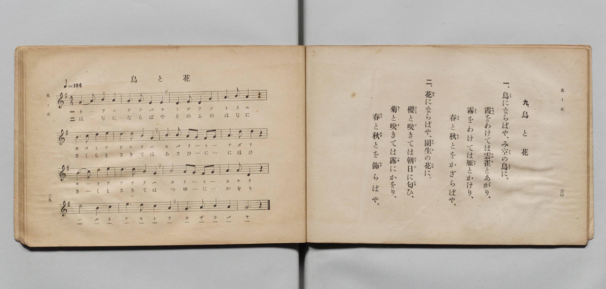

# 鳥と花

> Re:Shōka 使用 AI 協助辨識與重建樂譜，可能會有錯誤。歡迎回報。

- **鋼琴伴奏版**：<br><audio controls src="tori_to_hana.mp3"></audio>

- 文部省《尋常小學唱歌 第五學年用》（大正二年五月，索書號 4100）

## 說明

原書資訊與歌詞全文（對應 P018.jpg，原書 pp. 29–30）：
- 調性與拍號：ト長調（G 大調）4/4 拍，速度 ♩=104


## 歌詞

```text
九、鳥と花
一、鳥（とり）ならばや、み空（そら）の鳥（とり）に。
霞（かすみ）をわけては雲雀（ひばり）とあがり、
霧（きり）をわけては雁（かり）とかけり、
春（はる）と秋（あき）とをかざらばや。
二、花（はな）ならばや、園生（そのふ）の花（はな）に。
櫻（さくら）と咲（さ）きては朝日（あさひ）に匂（にほ）ひ、
菊（きく）と咲（さ）きては露（つゆ）にかをり、
春（はる）と秋（あき）とを飾（かざ）らばや。
```

## ABC

<div class="abc-score" data-abc-src="tori_to_hana.abc" aria-label="五線譜載入中"></div>

[下載 ABC 原始檔](tori_to_hana.abc)

## TMD 檔案連結

- [主旋律 TMD 檔案](tori_to_hana.tmd) [[在 TMD Studio 編輯](https://tmdlang.github.io/Tmd-TS/#tmd=s7IKdvYPcrWy4qpTUCpJTLdSSM7PyUlNLsnMz7PKyszLyo8vzshPT8wuBdHZiUpwdWX5OaW5qVbpRYkpqfGm8SaGBgYIyeL80qLkVKvi5Iz8_Jz4ktSKkqT8_Gx0-fiCxPRUqwADQwuETEFRfllqXmIeUHdBUWZeSWoKWDtCQWpZZkoqSLostSgzLTM1BclJqUXFIHdDTS8pSswrTi7KLAB5BqEqv6gE6KOixIKMSquMzOKS_KLM5MSc-OzEPCTflWSkAj2Xl1hSWpSKLlqcmlicn1eMbGJmemaeVW5-XlIpMJQwJVIzszKRQkFLS-Hl5qWPG1e86NqooKXFpWirYGhgwmVvq-DOZWOib2IHMuDZtPaXzSuez2l83ND1dEP30x07nm7of7p2x9MpG5-t7VF4vmbNk11TQPydW55PWfG4ofv9no6nS5Y_W7v4ya4eoCBQ9tmcjvd7ep5vWfRs9o4XM-crgOLo_Z5OJS4ufS0FW2oBLgUFhad980F2bG5_saLrRUc70IEvVs572roC6AmQszb0PmvvVABFtF5WQTrQTRD1CgUFegpGlo8aJhuD3PV-zyyQWboKL1btf9awHGROdy_Q3UDxx80dL6duB4oDTXNXAHoTzOwEhpUCUA3QwJcN85_uWqbwaOZKW1BQgsx5snPu44ZGeECDhXY0QISAxgBFHzd1AQ153LjqcROQ3PC4qQUo-7hx__OVu8AK5gLFwQrWYWhZ_bihCWQiCLycMw8s2f24cSZQN0i-adLjpv7HjRMfNy573Lj-5exNL2c3gNVsAtsDMWPF48amx409QC7QWoRhy8EKe6Gq0E1qhFqFMANo7URUM57NgLh2_eMmYKoAqXq-HJQ8wPYBQwusD2gwSOs0JL-DfQRMPUCjgAEGNaJxFWYYPZ0z6fkUYLyAw6hx3ePGrZBgwtCFHEzPVu8GS0593NgPC9gVTydtggiCub0QXz6bM_fZdIgXgA4GqgeqARn2tKcJLLj6cSPQKKDIJiRPv-gHhgg44Br78Zj9cg5EcMnjpjaoE0GhCQxlMkLw5eJ9sJifBo4s1KCkPG9BgYKWPhdXCLA0Ccn3ABZTVgGZiXn5DjUGNdVgB9tYaNmBGdiyNbik2NHwYmGPgoaJArAMeb6-QQeeFxWebl_2ckGjJhZ9QDtBZtYoGAKzpK6CkYIxmNSFipjFAwlTEAHi1YBlQNgUiEEqISIgNog2AImAzfMxrFEAZuc6sGQ8kLkKSD9u7gZredzcBeatBJMTwOQSqMx8EK9pL5J8H1SmA2wWyCSIOSBHQS0zAso3rodb1gi2rHE1RCOE19QJFtsAZrdAZeaCxdaBya1wNtgwiGVAvRBzIJbhD_5dPRQEPyhAQcFqBiTNwY4AsUAioGBGBD4kioyAIkZAEZAcTBda4DeBnA3y7E5YqDZvgoYk1HNNG4HsNrBMP1RmEjSMJ4DCuQ4cccA4jAfJNS2C6loDjU308J8KDbJ-eGCvgAYmTKYXiJeBWSAXgGSaoDJTgXgT2L7G1VD7wMEOktsNkiMyCnZ0UhwFZuDgx4wCRJ6ARIIhKG8YwmPFFJJL0CNhLXoOIBgH0HgDp3S0GIDFKEgPthjoReQAkGHERAAo20EMbUMLflAWA4lPAmJQdiUi-J_Onk1x8EOKFUR6hxU0EBFwcQQul6BSiBgBQfTyBxQKkKAEBR2kCIElZWDcwMXg0QIO4sdN28BiiOIJZBYspCAhjFb0wEMRFGqIcAclb1Cow8RAoQmRgaibBhZDlEwgF4DKJlR7arm4dO0UEBVDtI9hrAKaiBFYRJkLAA)]
- [鋼琴伴奏 TMD 檔案](tori_to_hana_piano.tmd) [[在 TMD Studio 編輯](https://tmdlang.github.io/Tmd-TS/#tmd=s7IKdvYPcrWy4qpTUCpJTLdSSM7PyUlNLsnMz7PKyszLyo8vzshPT8wuBdHZiUpwdWX5OaW5qVbpRYkpqfGm8SaGBgYIyeL80qLkVKvi5Iz8_Jz4ktSKkqT8_Gx0-fiCxPRUqwADQwuETEFRfllqXmIeUHdBUWZeSWoKWDtCQWpZZkoqSDoxOTk_tyAxLzM3NQ9Jviy1qBjkeKgVJUWJecXJRZkFIB8hVOUXlQC9VZRYkFFplZFZXJJflJmcmBOfnZiH5MXEIqDm9FSQ-VYFmYl5-fE47CzJACqyykssKS1KRRctTk0szs8rRrY6Mz0zzyo3Py-pFBimmBKpmVmZSGGmpaXwcvPSx40rXnRtfL-n42X3nucTtjzZs-Xp0v7nnR3v93QqaGlxKdoqGBqYcNnbKrhz2Zjom9iBTH02rf1l84rncxofN3Q93dD9dMeOpxv6n67d8XTKxmdrexSer1nzZNcUEH_nludTVjxu6AYa_3TJ8mdrFz_Z1QMUBMo-mwO0oef5lkXPZu94MXO-AiiagVYqcXGFAJ0bku8BDDCrAFDYBHk41BjUVHMpAIGNhZYdmKGvpWCLDsD27mh4sbBHQcNEAeii5-sbdBRAqUAvqyBd4en2ZS8XNGpi0aelDzazRsFQQRcIjRSMwaQuVMQsHkiYgggQrwYsA8KmQAxSCREBsUG0AUgEbJ6PYY3C4-aOOrBkPJC5Ckg_bu4Ga3nc3AXmrQSTE8DkEqjMfBCvaS-SfB9UpgNsFsgkiDkgR0EtMwLKN66HW9YItqxxNUQjhNfUCRbbAGa3QGXmgsXWgcmtcDbYMIhlQL0QcyCW4Q_-XT0UBD8oQEHBagYkzcGOALFAIqBgRgQ-JIqMgCJGQBGQHEwXWuA3gZwN8uxOWKg2b4KGJNRzTRuB7DawTD9UZhI0jCeAwrkOHHHAOIwHyTUtgupaA41N9PCfCg2yfnhgr4AGJkymF4iXgVkgF4BkmqAyU4F4E9i-xtVQ-8DBDpLbDZIjMgp2dFIcBWbg4MeMAkSegESCIShvGMJjxRSSS9AjYS16DiAYB9B4A6d0tBiAxShID7YY6EXkAJBhxEQAKNtBDG1DC35QFgOJTwJiUHYlIvifzp5NcfBDihVEeocVNBARcHEELpegUogYAUH08gcUCpCgBAUdpAiBJWVg3MDF4NECDuLHTdvAYojiCWQWLKQgIYxW9MBDERRqiHAHJW9QqMPEQKEJkYGomwYWQ5RMIBeAyiZUe2ox6wUf5HrBBFEvPJvR92zO9Kctq57v6wPGxrPu3qdrJ0CqNaSSPl7BOF4bmFyBDCMwA0nMNB4krm0MEgSxIQrg0siCIJYBNBzQTIAZaxIPjDJtQ9z6Mew3QzEUu2IkU7Hqx3Q_DqdidRaSIMwiIA2U1zZCsQnIABkJjB1dOwVEBEX7GMYqoIkYgUWUuQA)]

## 分析

```text
================================================================================
📊 TMD Song Profile: [ 鳥と花 ]
================================================================================
⏱  Duration:       1:13 (73.8s), 32 measures total
🎼 Key & Tempo:    首調基準 G, != 104.0 BPM, <4/4>
   - 分析範圍：      由實際發聲的音符與和弦推測調性；播放脈絡另行呈現
🎤 人聲音域:    D4 (MIDI 62) – F#5 (MIDI 78) [跨度: 16 個半音 / 1.3 個八度, 難度: moderate]
   - 最低音:  D4 in [ToriToHana[L1] #1 @ m.2, 0:03]
   - 最高音: F#5 in [ToriToHana[L1] #1 @ m.5, 0:10]
   - 適合: soprano, mezzo-soprano, tenor, baritone
🏛  結構:      ToriToHana[L1] (36.9s) -> ToriToHana[L2] (36.9s)
⚡ 編曲密度:        Peak 1 軌道同時演奏
🗝  調性診斷：       D 調性不明確（純淨自然大調，未偵測到可信轉調）
   - 風格氣質:    純淨自然大調（陽光明朗、易唱易記，無明顯調外色彩）
   - 轉調歷程:    全曲維持單一推測調性（未偵測到可信轉調）
   - 核心骨幹音:  G, A, D, E, B
   - 調性數值:    D 調性不明確 [相關度: 0.83, 穩定度: Ambiguous, 自然音純度: 100.0%]
   - 候選調性 (K-S): D 大調 (0.83), G 大調 (0.80), E 小調 (0.62)
   - 五度圈歷程:   +2 -> +2
   - 各段落調性細節:
     • [ToriToHana[L1] #1]: D 調性不明確 (r: 0.83, 自然音純度: 100.0%)
     • [ToriToHana[L2] #1]: D 調性不明確 (r: 0.83, 自然音純度: 100.0%)

  [ 五度圈游移軌跡 ]
               C  
         F            G  
      Bb              [D ]*
      Eb               A  
         Ab           E  
            Db       B  
               F# 
     (* = active key center)

  [ 十二半音累積音高分佈 ]
     C  :                            0.0%
     C# :                            0.0%
     D  : █████████████████████     20.8%
     D# :                            0.0%
     E  : ███████████████           15.0%
     F  :                            0.0%
     F# : █████                      5.0%
     G  : ████████████████████████  23.3%
     G# :                            0.0%
     A  : ██████████████████████    21.7%
     A# :                            0.0%
     B  : ███████████████           14.2%
--------------------------------------------------------------------------------
Assignment 軌道音域：
  - Piano         : D4 – F#5 (16 個半音 / 1.3 個八度, 120 個音符)
================================================================================
```


## 原書掃描頁




