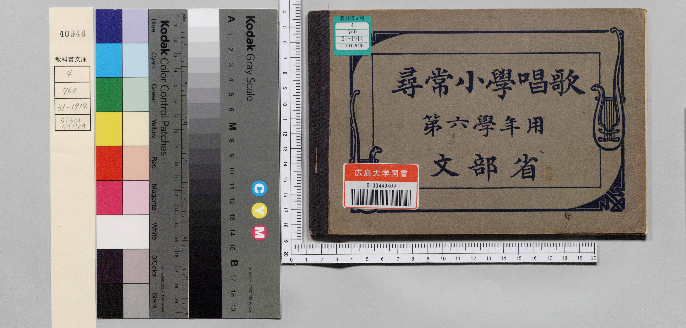
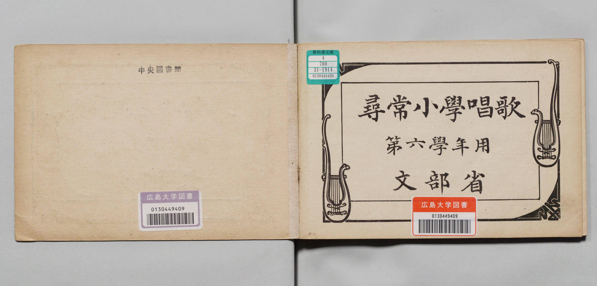
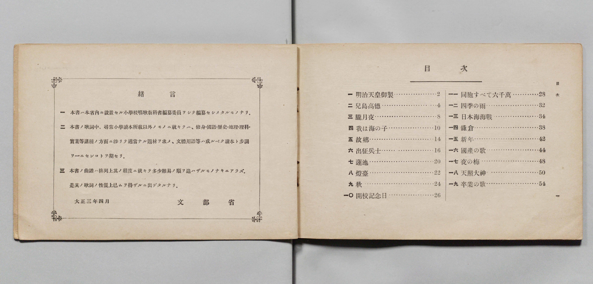
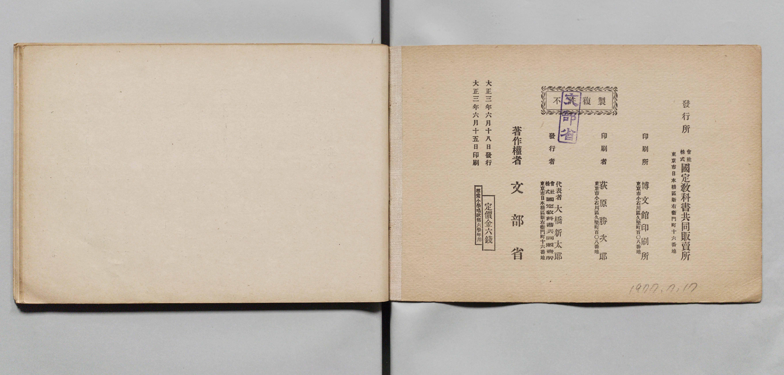

# 書訊與卷首／卷末掃描頁 — jinjo_shogaku_shoka 尋常科 第六學年用（國臺圖 523.37 4322-4）

本頁收錄本冊之封面、扉頁、目次（もくろく）、樂典大要、版權頁與封底等原書掃描圖檔（共 5 頁）。

### P001.jpg

本冊封面（右頁），題「公學校唱歌　第六學年用　臺灣總督府」，下方繪有臺灣鳳梨與烏秋（大卷尾）飛翔圖案，左貼國立臺灣圖書館條碼籤「3 1111 019458106」，書脊下方貼索書號籤「TJ 523.37」。

### P002.jpg

封面裏（見返頁），右側有原持有者毛筆署名「六仁 劉継耀」。

### P003.jpg

扉頁，題「公學校唱歌　第六學年用　臺灣總督府」，左上鉛筆標註索書號「TJ 523.37 4322-4 1940 v.6」，右下蓋有「國立臺灣圖書館藏書章」。

### P032.jpg

### P033.jpg

