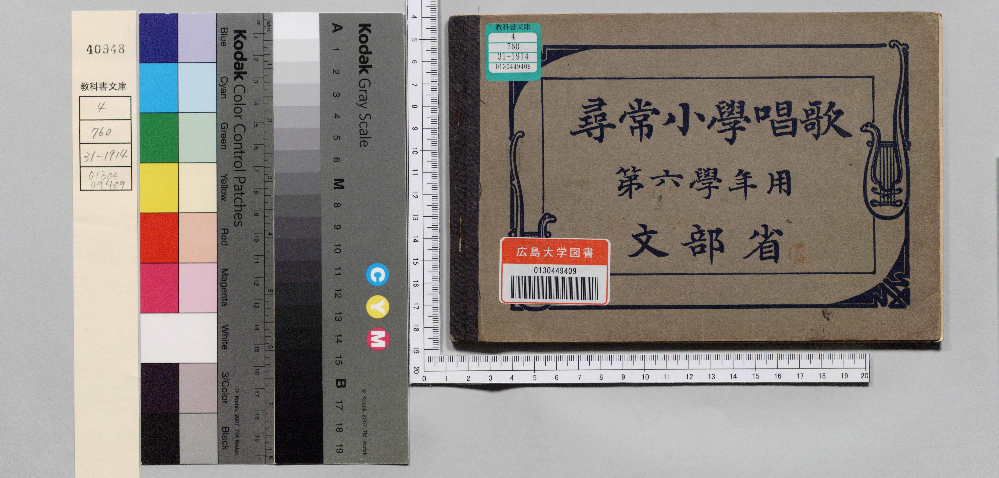
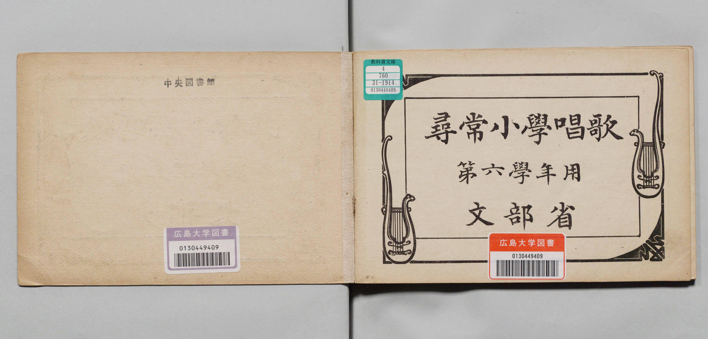
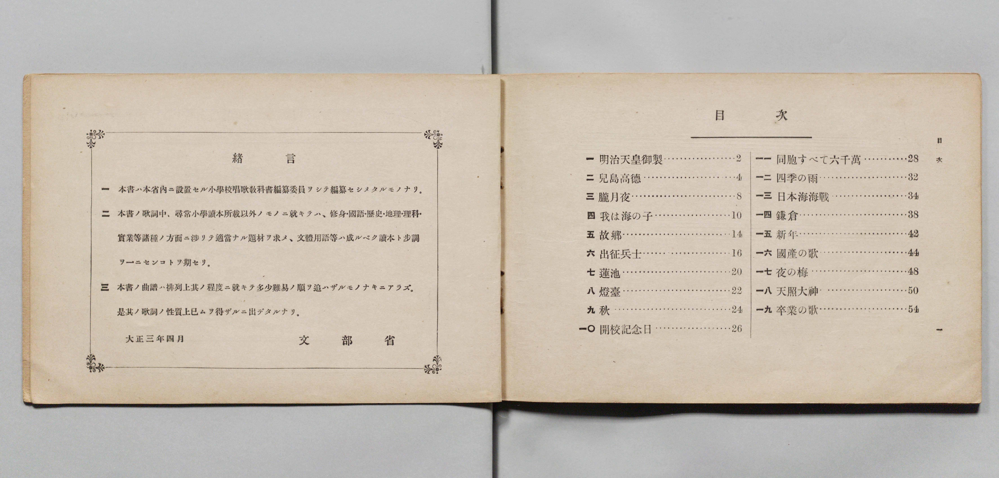
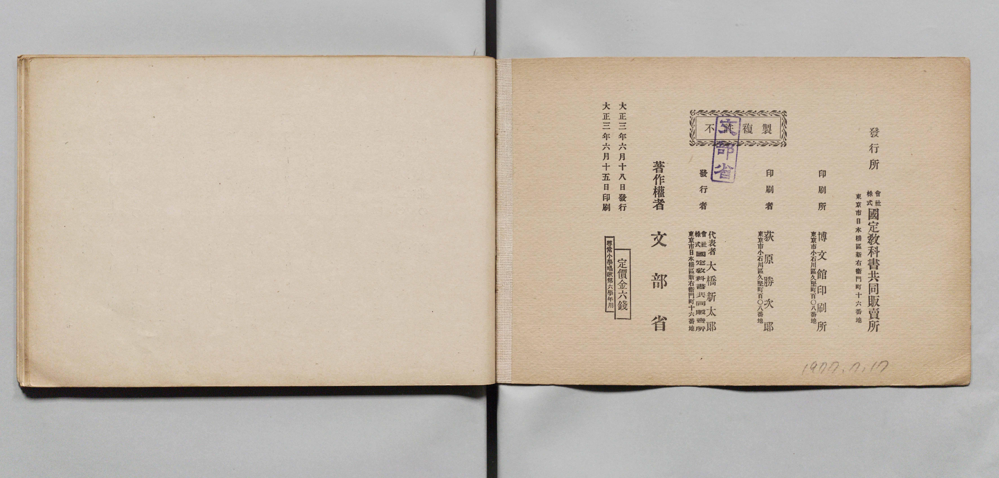
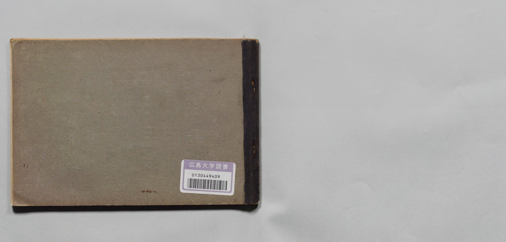

# 書訊與卷首／卷末掃描頁 — 《尋常小學唱歌》 第六學年用（廣島大學圖書館 ID 4078，大正3年／1914）

本頁收錄本冊之封面、扉頁、目次（もくろく）、樂典大要、版權頁與封底等原書掃描圖檔（共 5 頁）。

### P001.jpg

本冊封面（右頁），題「尋常小學唱歌　第六學年用　文部省」。

### P002.jpg

目次頁（「もくろく」）：列出「一　明治天皇御製」至「十九　卒業の歌」共 19 首曲名與頁碼。

### P003.jpg

卷首儀式歌〈君が代〉、〈勅語奉答〉、〈一月一日〉、〈紀元節〉、〈天長節〉歌詞與五線譜對照。

### P032.jpg

版權頁：標明「大正三年五月二十五日印刷、大正三年五月二十八日發行」、「著作權所有　著作兼發行者 文部省」。

### P033.jpg

封底外頁。

