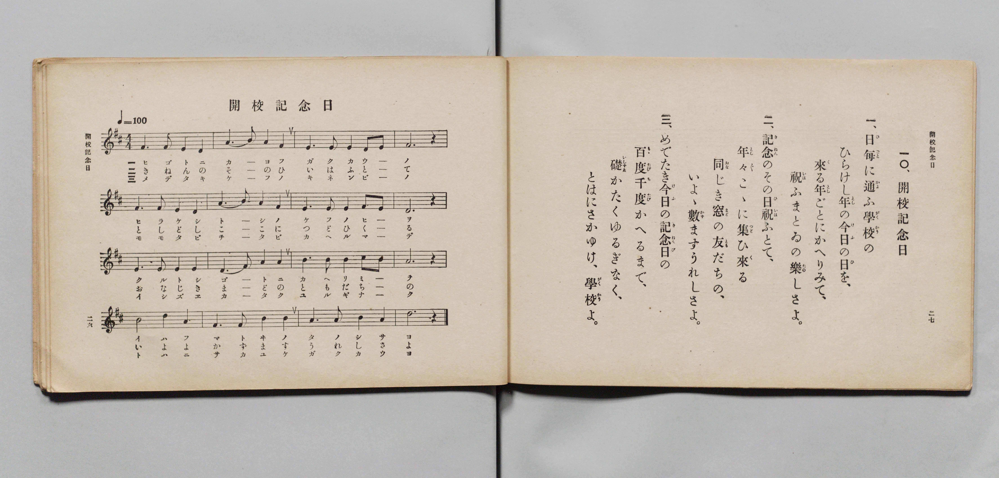

# 開校記念日

> Re:Shōka 使用 AI 協助辨識與重建樂譜，可能會有錯誤。歡迎回報。

- **鋼琴伴奏版**：<br><audio controls src="kaiko_kinenbi.mp3"></audio>

- 詞：文部省
- 曲：文部省
- 文部省《尋常小學唱歌 第六學年用》（大正三年，索書號 4078）

## 說明

原書資訊與歌詞全文（對應 P016.jpg，原書 pp. 26–27，第 10 首）：
調性與拍號：ニ長調（D 大調）4/4 拍，速度 ♩=100


## 歌詞

```text
一、
日毎（ひごと）に通（かよ）ふ學校（がくかう）の
ひらけし年（とし）の今日（けふ）の日（ひ）を、
來（く）る年（とし）ごとにかへりみて、
祝（いは）ふまとゐの樂（たの）しさよ。

二、
記念（きねん）のその日（ひ）祝（いは）ふとて、
年々（とし〲）こゝに集（つど）ひ來（く）る
同（おな）じき窓（まど）の友（とも）だちの、
いよ〳〵數（かず）ますうれしさよ。

三、
めでたき今日（けふ）の記念日（きねんび）の
百度（もゝたび）千度（ちたび）かへるまで、
礎（いしずゑ）かたくゆるぎなく、
とはにさかゆけ、學校（がくかう）よ。
```

## ABC

<div class="abc-score" data-abc-src="kaiko_kinenbi.abc" aria-label="五線譜載入中"></div>

[下載 ABC 原始檔](kaiko_kinenbi.abc)

## TMD 檔案連結

- [主旋律 TMD 檔案](kaiko_kinenbi.tmd) [[在 TMD Studio 編輯](https://tmdlang.github.io/Tmd-TS/#tmd=s7IKdvYPcrWy4qpTUCpJTLdSSM7PyUlNLsnMz7PKyszLyo8vzshPT8wuBdHZiUpwdWX5OaW5qVbpRYkpqfFm8SYG5hYIyeL80qLkVKvi5Iz8_Jz4ktSKkqT8_Gx0-fiCxPRUqwADQzOETEFRfllqXmIeUHdBUWZeSWoKWDtCQWpZZkoqSLostSgzLTM1BYtUcXJiXjymPFCkGOQvqO0lRYl5xclFmQUgzyJU5ReVAH1clFiQUWmVkVlckl-UmZyYE5-dmIfk-5KMVKDnof7LyUxLRZdKSy0uySxLzEEXT04tSs3Nz8tElgHakJ6ZZwUUTioFhrISl5aWwstp3c8WLHyxYsbT_VufTV-qoKXFpWirYGhgwGVvq-DCZWOib2IHMuDFynnv98x6Nq39ZfOK53MawYY-m70JUwzGe9zQ9XRD99MdO55u6H-6dsfTKRufre1ReL5mzdPWtSD-zi3Pp6x43ND9fk_H0yXLn61d_GRHJ1Dw_Z6e51sWPZu948XM-QqgyH6_p1OJi0tfS8GWWoBLQUHhad98kB2b21-s6HrR0Q50GtCDT1tXAJ0PctCG3mftnQqgFKOXVZAOdBNEvUJBgZ6CkdmjhslG5iCHrlkDDCmFl8umAR0JDAmQwS9W7X_WsBxkZHcv0AtA0cfN3S-nbgeKAw12UQD6FczsBAasAlAN0JiXDfOf7lqm8GjmSltQuINMebKj4XFDI4gFjJNn6_uAWh83bnrcOOVx4wqg3seNq182zAILdj9u6gCLbAUGKjAmwYI9jxv7QVKNbWCpdSCDQPqbgJyJjxung8MZqG4FkA1R8WR3F9AmsCBQwVaIIEwEGMudj5smQV30ZB_QVKBoP1i0G8MskBuBDgTbv-NxU9fjxv2PG5dBNT9fOhesuuVx43qIsx837gNpaJoAsnBFE1h2PpANlp3-uHEq0IOPG5ogwbKrB2oOJMGCFfc-blz7uGkyxMmPG-eiORybjUD3wRwEdP7jhla4Dx43gD3bOPlxE9Cg1S9nQ_y65HHjSrD4JjTfg42Y0AMWAvp0FVjRDKCjnq8CuggoCPQcROe6p_2gtA72K9CXQJEFjxsXgpwMcQjIhSCfbn7csPXZ1B3QyG0ExjJQKdCUmcDYfNwEjFn0MNnRCTOhqfFx43Jw6PVijU94LkcOt8eNmxGJ5PnMfcCkCJJuagKHANAskPTT3maoOMjJUEFYDANJoPuWw2J4CSS1AsMb6NJZj5smwpQCtfU_bgJ6AsjuA4YViAvzOzDs14MTzVRwkm4DObuhEWeShngfqJPy0gAKFLT0ubi8EzOz870z81LzkjKtAjIT8_IdagxqqkEWKdhYaNmBGdiKIlC5BsyzLxb2KGiYKABLvOfrG3Tg5YcmFg1A60CG1SgYK-gCobGCEZA0BOIaBVOwiBmYBsnWgOV0gSREjRFcFwQagNSATfMxrFF43DwJLPq4aQuQ3QFiNXeDTXnctBqq43HzCjA5FSq-BqpjPVTN46ZlEJnmPiR74hH2GAHlGnshuhrXAtVPBrPWQXQ1zoXZAxYB5hqoeAtUFGhP41YwC-QOkAzIPiz2GIPcsBDq5nagPfvBrlsLdfdGuH9APoG4FiQOkgfxe4F4M5gFch92_-CP01099IhTkMoasEoCcdq8Eurrx03boT4CxTAk9kAiiDCAhA0oZCBiEDNAOkCxgStOQfEBipfpQLwSyoLEECgEIXKQuAalE5D4Eqgo0GXgeAbmU6gLQKkOV5wugrpuESxO4THUCPcPijg07T5ungHE4DTaPA-qox3DHgL5tJOcOEWOLxCGxZcxOE5BuAYYv5BYBtHmQBIW71jjFJjbID5aDcunsDgF5lxYusaWfyFhsArMmg8NgzbsYQ2O0y6IrsZVQDwDzOqF6GrcB7MHGtew_AtNBU1NQPYCsAwoD4JkQCpwxGkTNCUAffG4aRfYdaA0iFLuQPMvyOcgV0NyPTgEmsAlRTPIrYiwITpOn86eTU6cQuILmEfjgAQkCmFZFyQFwrAoNAXzIGrAynHFKiQUQH4B5QN4GQtOrZAYfdy8AcyC5VRQmED40DzcBCobQXog8YA9ViFlKUg1JO2ASJA4JNcBa15o_AJbDlAZSBoBtiGguRpY2UJdACtDsOVUePkC9Q8sLYLcCDINlHpB8QgpcfDXJpj-qeXi0rVTQK53o30MYxUwxIywiBmDxZS5AA)]
- [鋼琴伴奏 TMD 檔案](kaiko_kinenbi_piano.tmd) [[在 TMD Studio 編輯](https://tmdlang.github.io/Tmd-TS/#tmd=s7IKdvYPcrWy4qpTUCpJTLdSSM7PyUlNLsnMz7PKyszLyo8vzshPT8wuBdHZiUpwdWX5OaW5qVbpRYkpqfFm8SYG5hYIyeL80qLkVKvi5Iz8_Jz4ktSKkqT8_Gx0-fiCxPRUqwADQzOETEFRfllqXmIeUHdBUWZeSWoKWDtCQWpZZkoqSDoxOTk_tyAxLzM3NQ9Jviy1qBjkeKgVJUWJecXJRZkFIB8hVOUXlQC9VZRYkFFplZFZXJJflJmcmBOfnZiH5MXEIqDm9FSQ-VYFmYl5-fE47CzJACqC-TYnMy0VXSottbgksywxB108ObUoNTc_LxNZBuiU9Mw8K6BwUikwzJW4tLQUXk7rfrZg4YsVM57u3_ps-tL3ezpedu95PmHLkz1bni7tf97Z8X5Pp4KWFpeirYKhgQGXva2CC5eNib6JHcjUFyvnvd8z69m09pfNK57PaQTb9Gz2JkwxGO9xQ9fTDd1Pd-x4uqH_6dodT6dsfLa2R-H5mjVPW9eC-Du3PJ-y4nFDN9AZT5csf7Z28ZMdnUDB93t6nm9Z9Gz2jhcz5yuA0gPQUUpcXN6Jmdn53pl5qXlJmVYBoGAM8nCoMaip5lIAAhsLLTswQ19LwRYdgOx8sqPhxcIeBQ0TBaBrnq9v0FEAJRi9rIJ0TSwatPTBhtUoGCvoAqGxghGQNATiGgVTsIgZmAbJ1oDldIEkRI0RXBcEGoDUgE3zMaxReNw8CSz6uGkLkN0BYjV3g0153LQaquNx8wowORUqvgaqYz1UzeOmZRCZ5j4ke-IR9hgB5Rp7Iboa1wLVTwaz1kF0Nc6F2QMWedy4CSreAhUF2tO4FcwCuQMkA7IPiz3GIDcshLq5HWjPfrDr1kLdvRHuH5BPIK4FiYPkQfxeIN4MZoHch90_-ON0Vw894hSksgaskkCcNq-E-vpx03aoj0AxDIk9kAgiDCBhAwoZiBjEDJAOUGzgilNQfIDiZToQr4SyIDEECkGIHCSuQekEJL4EKgp0GTieHzf2Q10ASnW44nQR1HWLYHEKj6FGuH9QxKFp93HzDCAGp9HmeVAd7Rj2EMinneTEKXJ8gTAsvozBcQrCNcD4hcQyiDYHkrB4xxqnwNwG8dFqWD6FxSkw58LSNbb8CwmDVWDWfGgYtGEPa3CcdkF0Na4C4hlgVi9EV-M-mD3QuIblX2gqaGoCsheAZUB5ECQDUoEjTpugKQHoi8dNu8CuA6VBlHIHmn9BPge5GpLrwSHQBC4pmkFuRYQN0XH6dPZscuIUEl_APBoHJCBRCMu6ICkQhkWhKZgHUQNWjitWIaEA8gsoH8DLWHBqhcTo4-YNYBYsp4LCBMKH5uEmUNkI0gOJB-yxCilLQaohaQdEgsQhue5x4yxo_D5unAmVgaSRx0090Fz9uBFW_sPKEGw5FV6-QP0DS4sgN4JMA6VeUDxCShz8tQmmf2qxVbs-yNWuCbTaBQZ7vEK0YayCaTyEhgiYxMLEgTEFkjGNhygBYbgeIGUA9RWp5oAZ2A3Crw5ilgnEbCAFRCh2I8xBqEG4B8iACqPwsTkGGIa6dgrIwRjtA5TFEDPCImYMFlPmAgA)]

## 分析

```text
================================================================================
📊 TMD Song Profile: [ 開校記念日 ]
================================================================================
⏱  Duration:       1:55 (115.2s), 48 measures total
🎼 Key & Tempo:    首調基準 D, != 100.0 BPM, <4/4>
   - 分析範圍：      由實際發聲的音符與和弦推測調性；播放脈絡另行呈現
🎤 人聲音域:    D4 (MIDI 62) – D5 (MIDI 74) [跨度: 12 個半音 / 1.0 個八度, 難度: easy]
   - 最低音:  D4 in [KaikoKinenbi[L1] #1 @ m.1, 0:01]
   - 最高音: D5 in [KaikoKinenbi[L1] #1 @ m.13, 0:30]
   - 適合: soprano, mezzo-soprano, contralto, tenor, baritone, bass
🏛  結構:      KaikoKinenbi[L1] (38.4s) -> KaikoKinenbi[L2] (38.4s) -> KaikoKinenbi[L3] (38.4s)
⚡ 編曲密度:        Peak 1 軌道同時演奏
🗝  調性診斷：       A 大調（純淨自然大調，未偵測到可信轉調）
   - 風格氣質:    純淨自然大調（陽光明朗、易唱易記，無明顯調外色彩）
   - 轉調歷程:    全曲維持單一推測調性（未偵測到可信轉調）
   - 核心骨幹音:  A, E, F#, D, B
   - 調性數值:    A 大調 [相關度: 0.80, 穩定度: Moderate, 自然音純度: 100.0%]
   - 候選調性 (K-S): A 大調 (0.80), D 大調 (0.75), F# 小調 (0.63)
   - 五度圈歷程:   +3 -> +3 -> +3
   - 各段落調性細節:
     • [KaikoKinenbi[L1] #1]: A 大調 (r: 0.80, 自然音純度: 100.0%)
     • [KaikoKinenbi[L2] #1]: A 大調 (r: 0.80, 自然音純度: 100.0%)
     • [KaikoKinenbi[L3] #1]: A 大調 (r: 0.80, 自然音純度: 100.0%)

  [ 五度圈游移軌跡 ]
               C  
         F            G  
      Bb               D  
      Eb              [A ]*
         Ab           E  
            Db       B  
               F# 
     (* = active key center)

  [ 十二半音累積音高分佈 ]
     C  :                            0.0%
     C# : █                          0.8%
     D  : ███████████████████       18.3%
     D# :                            0.0%
     E  : ██████████████████████    21.7%
     F  :                            0.0%
     F# : █████████████████████     20.0%
     G  :                            0.0%
     G# :                            0.0%
     A  : ████████████████████████  23.3%
     A# :                            0.0%
     B  : ████████████████          15.8%
--------------------------------------------------------------------------------
Assignment 軌道音域：
  - Piano         : D4 – D5 (12 個半音 / 1.0 個八度, 162 個音符)
================================================================================
```


## 原書掃描頁




