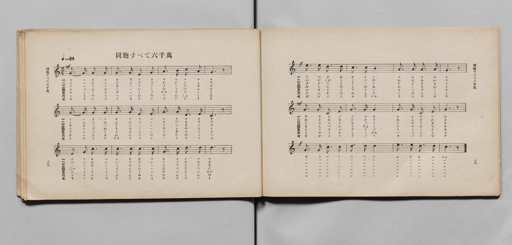
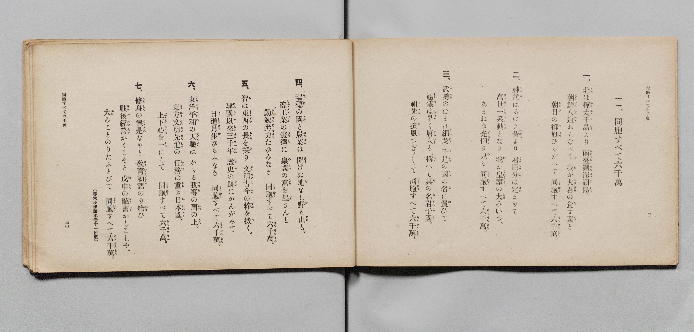

# 同胞すべて六千萬

> Re:Shōka 使用 AI 協助辨識與重建樂譜，可能會有錯誤。歡迎回報。

- **鋼琴伴奏版**：<br><audio controls src="doho_subete_rokusenman.mp3"></audio>

- 詞：文部省（尋常小學讀本卷十一所載）
- 曲：文部省
- 文部省《尋常小學唱歌 第六學年用》（大正三年，索書號 4078）

## 說明

原書資訊與歌詞全文（對應 P017.jpg–P018.jpg，原書 pp. 28–31，第 11 首）：
調性與拍號：ハ長調（C 大調）2/4 拍，速度 ♩=84


## 歌詞

```text
一、
北（きた）は樺太千島（からふとちしま）より　南臺灣澎湖島（みなみたいわんほうこたう）。
朝鮮八道（てうせんはちだう）おしなべて　我（わ）が大君（おほきみ）の食（を）す國（くに）と
朝日（あさひ）の御旗（みはた）ひるがへす　同胞（どうはう）すべて六千萬（ろくせんまん）。

二、
神代（かみよ）はるけき昔（むかし）より　君臣分（くんしんぶん）は定（さだ）まりて
萬世一系（ばんせいいつけい）動（うご）きなき　我（わ）が皇室（くわうしつ）の大（おほ）みいつ。
あまねき光（ひかり）仰（あふ）ぎ見（み）る　同胞（どうはう）すべて六千萬（ろくせんまん）。

三、
武勇（ぶゆう）のほまれ細戈（くはしほこ）　千足（ちたる）の國（くに）の名（な）に負（お）ひて
禮儀（れいぎ）は早（はや）く唐人（からびと）も　稱（たゝ）へし其（そ）の名（な）君子國（くんしこく）。
祖先（そせん）の遺風（ゐふう）つぎ〱て　同胞（どうはう）すべて六千萬（ろくせんまん）。

四、
瑞穗（みづほ）の國（くに）と農業（のうげふ）は　開（ひら）けぬ地（ち）なし野（の）も山（やま）も。
商工業（しやうこうげふ）の發達（はつたつ）に　皇國（みくに）の富（とみ）を起（おこ）さんと
勤勉努力（きんべんどりよく）たゆみなき　同胞（どうはう）すべて六千萬（ろくせんまん）。

五、
智（ち）は東西（とうざい）の長（ちやう）を採（と）り　文明古今（ぶんめいここん）の粹（すゐ）を抜（ぬ）く。
建國以來三千年（けんこくいらいさんぜんねん）　歷史（れきし）の跡（あと）にかんがみて
日進月歩（につしんげつぽ）ゆるみなき　同胞（どうはう）すべて六千萬（ろくせんまん）。

六、
東洋平和（とうやうへいわ）の天職（てんしよく）は　かゝる我等（われら）の肩（かた）の上（うへ）。
東方文明先進（とうはうぶんめいせんしん）の　任務（にんむ）は重（おも）き日本國（にほんこく）、
上下心（しやうかこゝろ）を一（いつ）にして　同胞（どうはう）すべて六千萬（ろくせんまん）。

七、
修身（しゆうしん）の德（とく）是（これ）なりと　敎育勅語（けういくちよくご）のり給（たま）ひ
戰後經營（せんごけいえい）かくこそと　戊申（ぼしん）の詔書（せうしよ）かしこしや。
大（おほ）みことのりたふとびて　同胞（どうはう）すべて六千萬（ろくせんまん）。
（尋常小學讀本卷十一所載）
```

## ABC

<div class="abc-score" data-abc-src="doho_subete_rokusenman.abc" aria-label="五線譜載入中"></div>

[下載 ABC 原始檔](doho_subete_rokusenman.abc)

## TMD 檔案連結

- [主旋律 TMD 檔案](doho_subete_rokusenman.tmd) [[在 TMD Studio 編輯](https://tmdlang.github.io/Tmd-TS/#tmd=s7IKdvYPcrWy4qpTUCpJTLdSSM7PyUlNLsnMz7PKyszLyo8vzshPT8wuBdHZiUpwdWX5OaW5qVbpRYkpqfFm8SYG5hYIyeL80qLkVKvi5Iz8_Jz4ktSKkqT8_Gx0-fiCxPRUqwADQ3NdIIGkvaAovyw1LzEPaERBUWZeSWoK2AyEgtSyzJRUkHRZalFmWmZqChap4uTEvHhMeaBIMchzUCeUFCXmFScXZRaAfIxQlV9UAvR2UWJBRqVVRmZxSX5RZnJiTnx2Yh5SEJRkpIJCIBWqEF0Cog9DODe_KDEH2abM9Mw8oGheUikwiJW4tLQUnk7oedE873HjzMeNOx83LnvauvZpb_OLCWsUtLS4FG0VLEy47G0VnLlsjPRN7EAGvVg57_2eWc-mtb9sXvF8TuP7PR1PN3Q_3bHj6Yb-p2t3vFjX8GzOmqe925_2Nj7Z0fCss-HFns73ezrBbng2exOyVogYjPe4oQvZoKdTNj5b26PwfM0akIuA_J1bnk9Z8bihG2ThkuXP1i5-sqMTKPh-T8_zLYuezd7xYuZ8BVDCAFvGpa-lYEstwKWgoPC0bz7Ijs3tL1Z0vehoBzoNGA5PW1cAnQ8Ogd5n7Z0KoNSll1WQ_qhhMiiNgZhA50G0KhQU6CkYWQCljA1Bbl6zRsHQUOHlsmlA9wIDBWTHi1X7nzUsB5ne3Qv0DVD0cXP_y6nbgeJAO5wVgN4GMzuBUaEAVAM05mXD_Ke7lik8mrnSFhhRIEOAgf64oRHs5J7pQG2PG3sfNwLN6nzcuP7Zil1Pl6wCRu_TzdvAUt2Pm4DiWx83rnjcuPBx4_THjftAKps6Hjd1PW5oeNo7_UX7rueNi5_t63u2cxpM1_7HjavA5PzHjS2Pm_ofN01-3Lj7cWPb40YgAyjYBjKkoQnkiGdz5r5ct-5p6-qXjZPBmpeB1c0G61kPtnUBVENjF9gFQKNB6RBo_bOOiSAtTf1g2R6g959OmA02BKgSaB_QY6DQeNy47uVioA-BKieBuTOfzgGlkseN_Y8bV4NFVkCd8mz6UrBE0-PGqY8bgYkRpPnpvoXPpkOCCugnoJsgobXpcVM30NbHjTtAeQMYGOB8Ala2EuwHoEqIu9FzDtgpQMcBrYf4cx-QhAYJOIp29UCj6PnSeU92L4ZGBdD2pg5IRIGtngj04bMZU8CmNYAVAB2JFDkTZr9oX_y0A-gGsFdBFk0Hk9ug1jWuf7puFlgW6NkFYBGgS4Bhtwyc2iasebJjGjC5PN-8G6xoA1jzbFCcgtASsAtagNqedk8FKwD6GegaoClAvwFjqRczip7Pan-6bgnMQUD_A7UAoxQoAg7oJcvhsQcWAQY32CJIUgFHy77HjWuBRj9tBWYKoNJN4DTaBVT9ZPcGWNRtBWvue7EMEsvgNAAMMKpG0Q4gExxFz9Yue9oNyuPgcAWaCTFwHTgFAnUBS58NzzqA8QZJb0AbgR4GSkFMA2ah5hfbNoNlgUl9PtCd0LBAT6Lrnk4AZmigyCowd_WLTcAYAwUWNDFCIu35snVPWxrArgemTGDg9UFz9vSVYNXAlAOKMaC5T6dMeLJrF1Iu3wzMBuCQagI66_mKjWApoIPmgtUDE_n0p62Q_A0RQXEQMLE9XTsB4WhIYgNld3DMQyLw-dJpT1shITEXEq7Q3Nm46-UioN1AR08AlzaQIAQmsL7HDRsheZ16Ufd09mxY7po47_lKeMZeCkt1mGG_4sW-Tc-WrgULAiMWaPskWCpbD3Tby2kQ9cASAVSVgfPFmqdzIOlxIVgEmB2mv2wHRgbIBEgoP90IDuImYCRBClVguIOD6enUtqfbl8LsA2ZZoApI0Yls8brnM_e8BOU3cKyCAgtYsEIy0mpQBAJzGtQbQL8hpaL1PWBBYIEOyReTXmzdDst1kPiYCg41cJH4tHvJ0-7Op12rnnZBCtZesNxOMLkSVFYASxtIFIOSCtB9kLIflPWpWR5OgWW2mZAUCwnU9c_mbnyxFFT3gf0DtGIapEACpampEF8thAQfxKvP-oAaQYrBXFAhCayen83oe9q_5MluYEaC5OHJj5sawXkH6BIgG5pIn2_aCVYwE5hIoaZ1zQGLAN0PylCw2Nu9CxjwT3YvfbKvDdQCAVamoEYIUN1EsN9AWQJcLQL1AO2ABPYcMLkW5u2GZ2u3P-0HVj-QbAwMGnDJ3rjuxXaIB4CFHNgPwKgG5V6gXqAyYNCDywBgJfayYdOzOR3P1kIyPVARMHlAyn5g-gGy94J90AauRmgRY0CFsBibu_HZlu6nOzc_nQRPeEB7IUkaWKiA2gew0n_li0ZIpC2DVVbwxAXKZmCvzgW6GVipPF8LLv9BbYseWK5b96IJ4l-gpyBV9LonOyCxCrILUQ6B3DRtJzTqWzuAgYWUhEB-Rk0GEB-Cgg9asjc0PNm9-2n3TGjgglQCi1yQK1-2Q4pEYL5ogtSEwMgAtXehWREYE7vhqQDsIHAgAZ35ZEf30_3NqDke6A-g0UAfAw0FJThgXQxWAKoTYbEPLGSpWzw-2dEMc9X-dS92AYsNiJNANRtyKDzdB4krYKiBfPJsxnowF-hgYDyDSzxQSwLYIG94NrXvRdOmp92tL1ZBXAgsHoFGAX0BdAMwf0JKWkjLYR1Q1_Oty6B1D6RgbNwEjrSODU_39TzfNvl5O7gtB3X9FEgr5HEjKFzAqoGhBjQOKAWsY8DWd3Q9nwKpYfcge-DFyinAZjfUKKjfIM0rUEsKbAI4JqDZGkvbBFRKQpwMdiykmQysRqkXIUCLgdLE9J9ASinvyUCBgpY-F5dLfkZ-cGlSaklqUH52aXFqXm5inlVAZmJevkONQU01yEIFG0MzLTswC1t_CtQ5A7rxxcIeBQ0TBaD7n69v0IF3ghSebl_2cgHQE12aWLQCXQAytkahOjetVsFQQRcIjRVMwbQpUNgMyjIGkiDZGqicGZgGidYoGIFFdBUMoHQN2EgfwxqFx01rwSKPm_YrAPtQUPZqoJ7HzSshvOapQNwBZjWCTXvctB0qMw-IV8DMBLJXQdnxqPYYAeUauyF6GoH2NIFMA7HXg02DyUwEmrAHzOqF2tMAlekG4ulgl4F0gmS6sNtkDHLFNKjrlgHVLYOy-8Dum43k7jVg89ZDXQ7z-XYgew6YtRkqA3IRFptMQH7aD3XfUiDeDWWvA-lqhJrXuBqIQSEEEgeb19gGlZkExFvBrgHZAJIBuQWLTaYgV4BCHqS2HxoXIBcuA4fENihvCdiX4Fh63LwEGkww72-Ca8MbUWYgZ0AiFORQYKaHs0EyO6C8FqAMyIMIT0HtaZoMiihILEHCAI-_zMEpCRRNMO8gEtZmsCtB3gHxOqARhYgUUOSBZLqQ_AISh_kRYRX-PLmrh1CeXIs3T-LPjiBRoJo4sJC5ghGIYY4shjVHNs9H8hyUDcydoNACRStIZj04iCDpASWigQEEUgsPEKg49hwJS_PgSIOzQTKwNAWSAQc8PI1Ohcg0LgDifWA1oJyISALYcyQ09YLLmNVQP4BzJDhaQTxgDoemXqh5QBGInlVA9iSEj5oh-Qd7ftwE1dMJLk0gLl0Ddt1CKA9oGqQkgfsIlIRBepqgyR3iL5DbmrDbBM6PsDIGGN7NULOBsQPSBYoXaExA4wjkL5DMTqieDeAMCWL1QGVw5BBwdoSVjsAQgpWUwMwH0gXSDfMtyBcIP8H0zIfJgEsdRBbGnhc3Qs0DZURoSgO6DBx_sGIeJPC4aQuyt6D5DxK582DGIkUasXlxRyehvNiNNy-Cs5cuiALlMbS8B8qWYE4NWBZWPZqog4Ug2Rd7boSW1-BQAZXxkFhFqjOAqftxM6imguQ2UEjCggRUm4DS8-PmmVA9OFIvOD9ugOoC5TpQTQUqaCGxBiuGgWU8OF0jZGC1yRRorQlK4RAZEA-LTeD8CC0-QXVGEyTlQMsRuJ9AMpAiF5RfQTKw1gDQddDWwCKoDL4aEtRwhDoRWJ80ToayIE6EpBBQNQhLptDqGOhRRAIGsUEVKV7LQJkSloBBmRKcDeHVO7zgXAllP24CVb0g82DZdQ88u4ICDiFDsI6EFJBwPyEVnU2gYg8RVdDGB7y4BbGQiyDsmRLarAD7CSXfwbMrKKrATQywz0Ay0CIWnFch4bAX6icS60fgCBHOPNm_mZg2K7DJagzJg0AKnEOhuRCaW4E8SI2JyIaQ2hQkij9jQquOpjXQDAdp3oH8vxYaZsDUA21DQHwPqx52whI3uJLBHi7wbAlu6YDisQdaZUJEkDPfdHgqhbWHIM1TUKMQ0khEpAJISsSaLaEVN6QknQFmgdpDIBlQ_EHiHlKgQH0Erz5BqQOkFt5CwlWloDRbgY1JcL5CuBuWrkGNdKRKF-4fUNoFNQEQaRfW_MdWScKKmbUw18HTLqjoAPGBLTtoRY-ScsH-ATfQwQ0gPAUnODfC0jsoz4ELYng5AnU3qHKHF4hIOkDxA_YJpGQCyUBiG2teBHcMILGCXrVDcymkDYvSJ4JnRqAmaGaERiq4kY5qFYHG6hRCmRF_YxXcgQS1S2F5DFJHwlqsSFUkaT1IaGQCi1RIpY9oGsBassCEhtwqhTYNQG1BWDSDkjvILEgbCXv9CGmPgdpnwBFCMAsUpSAZaMYGt5GQsgdcB6iCAbcuwUkfZA8s0WHLhtDMBoxUtGgGttwg7gb2iOEta5A4tIoD1qUQNqRWxZNswdkQkiAhFQLI34hMBa1rwaPKSGkSJAXrEIBqHkjJQqDCB-dEaIMQ6DhYToSVE9CgA8k0z0XyEqznCIwicDTCG-bQ0hV7TkSr7kHWIrIWiAY5vRetcEFu3UCKI1D1CJLB0acAV4zQNhaw0Ic6EN45hPaPwYUlUucQVrwijWdAXYYllvBXi61rCeVE_E1VULUIbZoC60FwBUmgWgRLQ1quQCUEOpCd0IAGlkbgBh2iYQrrgsxE8jRIByhOYQ0-RIsDJANr0WPLkNBkiqUVBGrugvjAmhYeiSD7QWkUWositYdAOkCdLiz2gJurdPAPOEPSwT_g3EgH_4BzIx38A64XaeufWi4uXTsFbIOw0T6GsQo45YzwyBnjkTPBI2eKR84Mj5w5WE6ZCwA)]
- [鋼琴伴奏 TMD 檔案](doho_subete_rokusenman_piano.tmd) [[在 TMD Studio 編輯](https://tmdlang.github.io/Tmd-TS/#tmd=s7IKdvYPcrWy4qpTUCpJTLdSSM7PyUlNLsnMz7PKyszLyo8vzshPT8wuBdHZiUpwdWX5OaW5qVbpRYkpqfFm8SYG5hYIyeL80qLkVKvi5Iz8_Jz4ktSKkqT8_Gx0-fiCxPRUqwADQ3NdIIGkvaAovyw1LzEPaERBUWZeSWoK2AyEgtSyzJRUkHRicnJ-bkFiXmZuah6SfFlqUTHIB1B7SooS84qTizILQN5CqMovKgH6rSixIKPSKiOzuCS_KDM5MSc-OzEPyZ-JRUDN6akg860KMhPz8uNx2FmSAVRklZ4KNRFdAmIBhnBuflFiDrKTMtMz84CieUmlwABX4tLSUng6oedF87zHjTMfN-583Ljsaevap73NLyaseb-n42X3nucTtjzZs-Xp0v7nnR3v93QqaGlxKdoqWJhw2dsqOHPZGOmb2IFMf7Fy3vs9s55Na3_ZvOL5nEag3qcbup_u2PF0Q__TtTterGt4NmfN097tT3sbn-xoeNbZ8GJPJ9A0sMOezd6ErBUiBuM9buhCNujplI3P1vYoPF-zBuRMIH_nludTVjxu6AZZuGT5s7WLn-zoBAq-39PzfMuiZ7N3vJg5XwGUdsCWcbnkZ-QHlyallqQG5WeXFqfm5SbmWQWAQj3Iw6HGoKaaSwEIbAzNtOzALH0tBVt0ALIc6IcXC3sUNEwUgM56vr5BRwGUyvSyCtIVnm5f9nIB0JNdmli0aumDja1RqM5Nq1UwVNAFQmMFUzBtChQ2g7KMgSRItgYqZwamQaI1CkZgEV0FAyhdAzbSx7BG4XHTWrDI46b9Co-b-6Hs1UA9j5tXQnjNU4G4A8xqBJv2uGk7VGYeEK-AmQlkr4Ky41HtMQLKNXZD9DQC7WkCmQZirwebBpOZCDRhD5jVC7WnASrTDcTTwS4D6QTJdGG3yRjkimlQ1y0DqlsGZfeB3Tcbyd1rwOath7oc5vPtQPYcMGszVAbkIiw2mYD8tB_qvqVAvBvKXgfS1Qg1r3E1EINCCCQONq-xDSozCYi3gl0DsgEkA3ILFptMQa4AhTxIbT80LkAuXAYOiW1Q3hKwL8Gx9Lh5CTSYYN7fBNeGN6LMQM6ARCjIoY-bWuBskMwOKK8FKAPyIMJTUHuaJoMiChJLkDDA4y9zcEoCRRPMO4iEtRnsSpB3QLwOaEQhIgUUeSCZLiS_gMRhfkRYhT9P7uohlCfX4s2T-LMjSBSoJg4sZK5gBGKYI4thzZHN85E8B2UDcycotEDRCpJZDw4iSHpAiWhgAIHUwgMEKo49R8LSPDjS4GyQDCxNgWTAAQ9Po1MhMo0LgHgfWA0oJyKSAPYcCU294DJmNdQP4BwJjlYQD5jDoakXah5QBKJnFZA9CeGjZkj-wZ4fN0H1dIJLE4hL14BdtxDKA5oGKUngPgIlYZCeJmhyh_gL5LYm7DaB8yOsjAGGdzPUbGDsgHSB4gUaE9A4AvkLJLMTqmcDOEOCWD1QGRw5BJwdYaUjMIRgJSUw84F0gXTDfAvyBcJPMD3zYTLgUgeRhbHnxY1Q80AZEZrSgC4Dxx-smAcJPG7aguwtaP6DRO48mLFIkUZsXtzRSSgvduPNi-DspQuiQHkMLe-BsiWYUwOWhVWPJupgIUj2xZ4boeU1OFRAZTwkVpHqDGDqftwMqqkguQ0UkrAgAdUmoPT8uHkmVA-O1AvOjxugukC5DlRTgQpaSKzBimFgGQ9O1wgZWG0yBVprglI4RAbEw2ITOD9Ci09QndEESTnQcgTuJ5AMpMgF5VeQDKw1AHQdtDWwCCqDr4YEVgaIOuRx42QoC-JESAoBVYOwZAqtjoEeRSRgEBtUkeK1DJQpYQkYlCnB2RBevcMLzpVQ9uMmUNULMg-WXffAsyso4BAyBOtISAEJ9xNS0dkEKvYQUQVtfMCLWxALuQjCnimhzQqwn1DyHTy7gqIK3MQA-wwkAy1iwXkVEg57oX4isX58Ons2zjzZv5mYNiuwyWoMyYNACpxDobkQmluBPEiNiciGkNoUJIo_Y0KrjqY10AwHad6B_L8WGmbA1ANtQ0B8D6sedsISN7iSwR4u8GwJbumA4rEHWmVCRJAz33R4KoW1hyDNU1CjENJIRKQCSErEmi2hFTekJJ0BZoHaQyAZUPxB4h5SoEB9BK8-QakDpBbeQsJVpaA0W4GNSXC-Qrgblq5BjXSkShfuH1DaBTUBEGkX1vzHVknCipm1MNfB0y6o6ADxgS07aEWPknLB_gE30MENIDwFJzg3wtI7KM-BC2J4OQJ1N6hyhxeISDpA8QP2CaRkAslAYhtrXgR3DCCxgl61Q3MppA2L0ieCZ0agJmhmhEYquJGOahWBxuoUQpkRf2MV3IEEtUtheQxSR8JarEhVJGk9SGhkAotUSKWPaBrAWrLAhIbcKoU2DUBtQVg0g5I7yCxIGwl7_Qhpj4HaZ48b14JZoCgFyUAzNriNhJQ94DpAFQy4dQlO-iB7YIkOWzaEZjZgpKJFM7DlBnE3sEcMb1mDxKFVHLAuhbAhtSqeZAvOhpAECakQQP5GZCpoXdvUBepKIdIkSArWIQDVPJCShUCFD86J0AYh0HGwnAgrJ6BBB5JpnovkJVjPERhF4GiEN8yhpSv2nIhW3YOsRWQtEA1yei9a4YLcuoEUR6DqESSDo08BrhihbSxgoQ91ILxzCO0fgwtLpM4hrHhFGs-AugxLLOGvFlvXEsqJ-JuqoGoR2jQF1oPgCpJAtQiWhrRcgUoIdCA7oQENLI3ADTpEwxTWBZmJ5GmQDlCcwhp8iBYHSAbWoseWIaHJFEsrCNTcBfGBNS08EkH2g9IotBZFag-BdIA6XVjsATdX6eAfcIakg3_AuZEO_gHnRjr4B1wv0tY_tfjGYH2Qx2BNoEOwwOwRrxBtGAtkmMAYcBHT-HhgpoE4H5tCkHy0aTxUD0Ilqni0CYhhBGQYETAUrJAY20lTiOlMYDjp2ilgC6poH6BenHJAD-CUM8YjB3QGTjlTPHJmeOTMwXLKXAA)]

## 分析

```text
================================================================================
📊 TMD Song Profile: [ 同胞すべて六千萬 ]
================================================================================
⏱  Duration:       3:59 (240.0s), 168 measures total
🎼 Key & Tempo:    首調基準 C, != 84.0 BPM, <2/4>
   - 分析範圍：      由實際發聲的音符與和弦推測調性；播放脈絡另行呈現
🎤 人聲音域:    C4 (MIDI 60) – E5 (MIDI 76) [跨度: 16 個半音 / 1.3 個八度, 難度: moderate]
   - 最低音:  C4 in [DohoSubeteRokusenman[L1] #1 @ m.1, 0:00]
   - 最高音: E5 in [DohoSubeteRokusenman[L1] #1 @ m.13, 0:17]
   - 適合: soprano, mezzo-soprano, contralto, tenor, baritone, bass
🏛  結構:      DohoSubeteRokusenman[L1] (34.3s) -> DohoSubeteRokusenman[L2] (34.3s) -> DohoSubeteRokusenman[L3] (34.3s) -> DohoSubeteRokusenman[L4] (34.3s) -> DohoSubeteRokusenman[L5] (34.3s) -> DohoSubeteRokusenman[L6] (34.3s) -> DohoSubeteRokusenman[L7] (34.3s)
⚡ 編曲密度:        Peak 1 軌道同時演奏
🗝  調性診斷：       G 大調（純淨自然大調，未偵測到可信轉調）
   - 風格氣質:    純淨自然大調（陽光明朗、易唱易記，無明顯調外色彩）
   - 轉調歷程:    全曲維持單一推測調性（未偵測到可信轉調）
   - 核心骨幹音:  G, C, A, D, E
   - 調性數值:    G 大調 [相關度: 0.87, 穩定度: Moderate, 自然音純度: 100.0%]
   - 候選調性 (K-S): G 大調 (0.87), C 大調 (0.83), E 小調 (0.64)
   - 五度圈歷程:   +1 -> +1 -> +1 -> +1 -> +1 -> +1 -> +1
   - 各段落調性細節:
     • [DohoSubeteRokusenman[L1] #1]: G 大調 (r: 0.87, 自然音純度: 100.0%)
     • [DohoSubeteRokusenman[L2] #1]: G 大調 (r: 0.87, 自然音純度: 100.0%)
     • [DohoSubeteRokusenman[L3] #1]: G 大調 (r: 0.87, 自然音純度: 100.0%)
     • [DohoSubeteRokusenman[L4] #1]: G 大調 (r: 0.87, 自然音純度: 100.0%)
     • [DohoSubeteRokusenman[L5] #1]: G 大調 (r: 0.87, 自然音純度: 100.0%)
     • [DohoSubeteRokusenman[L6] #1]: G 大調 (r: 0.87, 自然音純度: 100.0%)
     • [DohoSubeteRokusenman[L7] #1]: G 大調 (r: 0.87, 自然音純度: 100.0%)

  [ 五度圈游移軌跡 ]
               C  
         F           [G ]*
      Bb               D  
      Eb               A  
         Ab           E  
            Db       B  
               F# 
     (* = active key center)

  [ 十二半音累積音高分佈 ]
     C  : ███████████████████       22.0%
     C# :                            0.0%
     D  : █████████████             14.3%
     D# :                            0.0%
     E  : ███████████               12.5%
     F  :                            0.0%
     F# : █                          1.2%
     G  : ████████████████████████  27.4%
     G# :                            0.0%
     A  : ██████████████            15.5%
     A# :                            0.0%
     B  : ██████                     7.1%
--------------------------------------------------------------------------------
Assignment 軌道音域：
  - Piano         : C4 – E5 (16 個半音 / 1.3 個八度, 532 個音符)
================================================================================
```


## 原書掃描頁






