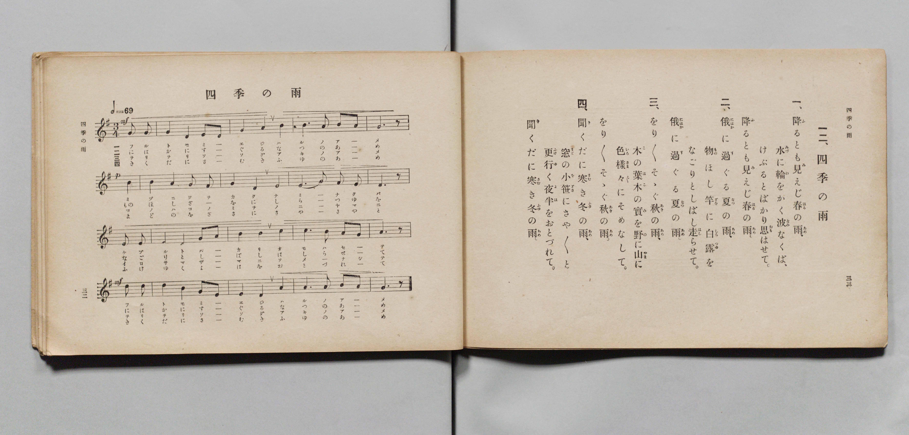

# 四季の雨

> Re:Shōka 使用 AI 協助辨識與重建樂譜，可能會有錯誤。歡迎回報。

- **鋼琴伴奏版**：<br><audio controls src="shiki_no_ame.mp3"></audio>

- 詞：文部省
- 曲：文部省
- 文部省《尋常小學唱歌 第六學年用》（大正三年，索書號 4078）

## 說明

原書資訊與歌詞全文（對應 P019.jpg，原書 pp. 32–33，第 12 首）：
調性與拍號：ト調（G 大調 / E 羽調式）3/4 拍，速度 ♩=69


## 歌詞

```text
一、
降（ふ）るとも見（み）えじ春（はる）の雨（あめ）、
水（みづ）に輪（わ）をかく波（なみ）なくば、
けぶるとばかり思（おも）はせて、
降（ふ）るとも見（み）えじ春（はる）の雨（あめ）。

二、
俄（にはか）に過（す）ぐる夏（なつ）の雨（あめ）、
物（もの）ほし竿（ざを）に白露（しらつゆ）を
なごりとしばし走（はし）らせて、
俄（にはか）に過（す）ぐる夏（なつ）の雨（あめ）。

三、
をり〳〵そゝぐ秋（あき）の雨（あめ）、
木（こ）の葉（は）木（こ）の實（み）を野（の）に山（やま）に
色樣々（いろさま〴〵）にそめなして、
をり〳〵そゝぐ秋（あき）の雨（あめ）。

四、
聞（き）くだに寒（さむ）き冬（ふゆ）の雨（あめ）、
窓（まど）の小笹（をざゝ）にさや〳〵と
更行（ふけゆ）く夜半（よは）をおとづれて、
聞（き）くだに寒（さむ）き冬（ふゆ）の雨（あめ）。
```

## ABC

<div class="abc-score" data-abc-src="shiki_no_ame.abc" aria-label="五線譜載入中"></div>

[下載 ABC 原始檔](shiki_no_ame.abc)

## TMD 檔案連結

- [主旋律 TMD 檔案](shiki_no_ame.tmd) [[在 TMD Studio 編輯](https://tmdlang.github.io/Tmd-TS/#tmd=s7IKdvYPcrWy4qpTUCpJTLdSSM7PyUlNLsnMz7PKyszLyo8vzshPT8wuBdHZiUpwdWX5OaW5qVbpRYkpqfFm8SYG5hYIyeL80qLkVKvi5Iz8_Jz4ktSKkqT8_Gx0-fiCxPRUqwADQ0uETEFRfllqXmIeUHdBUWZeSWoKWDtCQWpZZkoqSLostSgzLTM1BYtUcXJiXjymPFCkGOQvqO0lRYl5xclFmQUgzyJU5ReVAH1clFiQUWmVkVlckl-UmZyYE5-dmIfk-5KMVKDni1MTi_PzitGFy1MTgYwidOG8xJLSolRkizLTM_OscvPzkkqBgavEpaWl8HT27KdrFz9uXPdy9goFLS0uRVsFM0sue1sFdy4bY30TO5DmFyvnvd8z69m09pfNK57PaQQb-Gz2JkwxGO9xQ9fTDd1Pd-x4uqH_6dodT6dsfLa2R-H5mjVPW9eC-Du3PJ-y4nFD9_s9HU-XLH-2dvGTHZ1Awfd7ep5vWfRs9o4XM-crgOL3_Z5OJS4ufS0FW2oBLgUFhad980F2bG5_saLrRUc70GlADz5tXQF0PshBG3qftXcqgBKJXlZBOtBNEPUKBQV6CsZGjxomGxuDHLpmjYKhkcLLZdOAjgSGBMjgF6v2P2tYDjKyuxfoBaDo4-YOoCDQVHcFoEeBTAV9BVeF5_v2AplP9_QDtQLDWAGoHGjiy4b5T3ctU3g0c6UtMAZA5j3Z0fC4oRHEejkTqKLjceNWoI7HTd2PG1c8bmp6sQwUgI8bgeZ3Pm4EMmY8m7EULLIeqAYsCIpVsEjT46ZGkAjEuGcbgGEN0vm4EagBqG71iz2rQCJNICc9bpr0uBFoR_-zzYvAylbB7AAy-h83boCa8rhx4uPGbVDnAEWBepq6njXMBevpAjoQrGf948bZjxuXUd0jTZAg2tUDNfnJ_hawgtVgKyG6Vr9s7AMLzgRzJwBNe7oE6EWIn5bgC6LnnSvBAdIEVAFWt_tx4_Tnq0Fx-bhxGjCIIBY8n7n35RxgTgAKTn_cBBRZ8ripDRKGkCAC2jMFGCzgIJoODqXpL7ZugHqucTpYKVAbUhBRzyPQINoB8xMoYoFOadj8uGHr48a5j5vmAo16vhwS-ECPAqMGT5qZAxGdDFH0YiIw1YM8AeSiST1dvwwRnU2TXrZDnA4JxtVPN24EB2zL48Z9EBFw1unc9GzF4scNrWClLY-beh83TgWqeNywBehYiDqwkxvBPgaGJCy4yPUUJHCAxR_UnBeNwEIOqACiHpjMF4Acux4Yz0DBqY-bGsDivU_b1kASMDSecaafVcDQAIrue9wITEjgYNnQ_3zNTrDfgfkLmISAGQXiLaDpLTAPrACH9ewtLxb2QO0B5jKoVf1Pl8x52tsFNgIa9GCzIKlr6eOmHkSwUM87TSDjKC95oUBBS5-LKzgjMzvTL98RWEcFZCbm5TvUGNRUg6xRsLHQsgMzsBX6oBoEWCYCg0ZB4-mejS-2blfQVjBRAAXs-gYdeJGtiUUn0FaQqTUKBgq6YFydm1arYAiENUCsq2AaDyTM4kE0RMAIiI2BuAZMgvjGQAyRA5lQXVALFDFWqAGb62NYowAyAYQfN08F4tVAtcDSH8xfBCbng0173LQCxGvaARbrh4gBVYNMfdzcB5QBqQaJLQSLxYN1Pm5uhdlkhGRT42ogXg9S3dgN5YPImRATGieAbYLIrIKKLYHY1LgOiJugLmqE2dTUBJaB2mSM7KdNQLwK7K5NYD7IvMdNe6EmgOjHTRvAJNT9TWvx-alpM1gGapMJsp96gbgf7NYFSH6aCjW1AaoGRG6FirXh81PjPiBeCbQJf7La1QNOViSmJlDaAKUUQwVzWMKBpSSQM8AUVBbIroFIgpIPkAcSgCeex83gaGpeDw1siCfAXm-CiHVBgxCUjCB8iAxIDBTRkGDdCORNQ0oqwHoLHDTTweQ0qLmTkAIWJAMS64QG4hJogMLUQQJxFRBPQUoYkKQLikZIFCPcBksgMDGQv0B8oLnN81DEQO4Fia5FSgagSASZC3Eh1L3gyEdPCC1Q9wIzG5gNUgfKWhD3bgW1TghG-o5OciIdHKvgmDQEFwmgRADCJmBXgEgQ3whctoASB7i4ABU3pkCIHOVgD0HLCFAUwqMcmrugeRZcfkBKi8dNoOgEiUHSPKh0gJY2iChvAiUVSGDAo7cRnDehyQCabMA8kD2dQPZsqNgyeBBCyxZElDeB8hskEh83bYO6A8yDJF5YaQDN5ZAkuh3DvdCSBBHl4OQGyvMgM0ChAXIHONFDkwE06UOjF1jTAWV6MNwLLTfwRzmwvicnyk2hUWwIycaIFACKX1gso1cRoGoGObqpURmAyxWk3E2NYh_JTHDOpkYBj2QmOFdToyiHmFnLxaVrp4BoQUT7GMYqoIkYYYgYY4iYgEWUuQA)]
- [鋼琴伴奏 TMD 檔案](shiki_no_ame_piano.tmd) [[在 TMD Studio 編輯](https://tmdlang.github.io/Tmd-TS/#tmd=s7IKdvYPcrWy4qpTUCpJTLdSSM7PyUlNLsnMz7PKyszLyo8vzshPT8wuBdHZiUpwdWX5OaW5qVbpRYkpqfFm8SYG5hYIyeL80qLkVKvi5Iz8_Jz4ktSKkqT8_Gx0-fiCxPRUqwADQ0uETEFRfllqXmIeUHdBUWZeSWoKWDtCQWpZZkoqSDoxOTk_tyAxLzM3NQ9Jviy1qBjkeKgVJUWJecXJRZkFIB8hVOUXlQC9VZRYkFFplZFZXJJflJmcmBOfnZiH5MXEIqDm9FSQ-VYFmYl5-fE47CzJACqyKk5NLM7PK0YXLk9NBDKK0IXzEktKi1KRXZSZnplnlZufl1QKDGolLi0thaezZz9du_hx47qXs1e839PxsnvP8wlbnuzZ8nRp__POjvd7OhW0tLgUbRXMLLnsbRXcuWyM9U3sQCa-WDnv_Z5Zz6a1v2xe8XxOI9iWZ7M3YYrBeI8bup5u6H66Y8fTDf1P1-54OmXjs7U9Cs_XrHnauhbE37nl-ZQVjxu6ga54umT5s7WLn-zoBAq-39PzfMuiZ7N3vJg5XwGUBIBuUuLiCs7IzM70y3cEejMAFG5BHg41uoY11VwKQGBjoWUHZuhrKdiiA5CVT3Y0vFjYo6DxdM_GF1u3K2grmCgAXfV8fYOOAiit6GUVpGti0amlDza1RsFAQReMq3PTahUMgbAGiHUVTOOBhFk8iIYIGAGxMRDXgEkQ3xiIIXIgE6oLaoEixgo1YHN9DGsUQCaA8OPmqUC8Gqj2cXMHmL8ITM4Hm_a4aQWI17QDLNYPEQOqBpn6uLkPKANSDRJbCBaLB-t83NwKs8kIyabG1UC8HqS6sRvKB5EzISY0TgDbBJFZBRVbArGpcR0QN0Fd1AizqakJLAO1yRjZT5uAeBXYXZvAfJB5j5v2Qk0A0Y-bNoBJqPub1uLzU9NmsAzUJhNkP_UCcT_YrQuQ_DQVamoDVA2I3AoVa8Pnp8Z9QLwSaBP-ZLWrB5ysSExNoLQBSimGCuawhANLSSBngCmoLJBdA5EEJR8gDyQATzyPm8HR1LweGtgQT4C93gQR64IGISgZQfgQGZAYKKIhwboRyJuGlFQeN-4GB810MDkNau4kpIAFyYDEOqGBuAQaoDB1kEBcBcRTkBIGJOmCohESxQi3wRIITAzkLxAfaG7zPBQxkHtBomuRkgEoEkHmQlwIdS848tETQgvUvcDMBmaD1IGyFsS9W4F4IsFI39FJTqSDYxUck4bgIgGUCEDYBOwKEAniG4HLFlDiABcXoOLGFAiRoxzsIWgZAYpCeJRDcxc0z4LLD0hp8bgJFJ0gMUiaB5UO0NIGEeVNoKQCCQx49DaC8yY0GUCTDZgHsqcTyJ4NFVsGD0Jo2YKI8iZQfoNE4uOmbVB3gHmQxAsrDaC5HJJEt2O4F1qSIKIcnNxAeR5kBig0QO4AJ3poMoAmfWj0Pm5cCpTpwXAvtNzAH-XASpOcKDeFRrEhJBsjUgAofmGxjF5FgKoZ5OimRmUALleQcjc1in0kM8E5mxoFPJKZ4FxNjaIcYmYtZgvCB6UFYQJtQYDqemjGMwDFSrxCtGEsGEM4pvHIPJAUSATOA1XwQH1Qo7BrMAFrMIkHckHMaCMw3xTEBylGaAcrQbEdrB2iG4kD1wpzNpL1CAvBqhAOhmtC9QBINzCwdO0UEOEV7QOUQBMxwhAxxhABOg4ooswFAA)]

## 分析

```text
================================================================================
📊 TMD Song Profile: [ 四季の雨 ]
================================================================================
⏱  Duration:       2:57 (177.4s), 68 measures total
🎼 Key & Tempo:    首調基準 G, != 69.0 BPM, <3/4>
   - 分析範圍：      由實際發聲的音符與和弦推測調性；播放脈絡另行呈現
🎤 人聲音域:    D4 (MIDI 62) – D5 (MIDI 74) [跨度: 12 個半音 / 1.0 個八度, 難度: easy]
   - 最低音:  D4 in [ShikiNoAme[L1] #1 @ m.2, 0:03]
   - 最高音: D5 in [ShikiNoAme[L1] #1 @ m.13, 0:33]
   - 適合: soprano, mezzo-soprano, contralto, tenor, baritone, bass
🏛  結構:      ShikiNoAme[L1] (44.3s) -> ShikiNoAme[L2] (44.3s) -> ShikiNoAme[L3] (44.3s) -> ShikiNoAme[L4] (44.3s)
⚡ 編曲密度:        Peak 1 軌道同時演奏
🗝  調性診斷：       G 大調（純淨自然大調，未偵測到可信轉調）
   - 風格氣質:    純淨自然大調（陽光明朗、易唱易記，無明顯調外色彩）
   - 轉調歷程:    全曲維持單一推測調性（未偵測到可信轉調）
   - 核心骨幹音:  G, A, B, D, E
   - 調性數值:    G 大調 [相關度: 0.83, 穩定度: Moderate, 自然音純度: 100.0%]
   - 候選調性 (K-S): G 大調 (0.83), D 大調 (0.71), E 小調 (0.71)
   - 五度圈歷程:   +1 -> +1 -> +1 -> +1
   - 各段落調性細節:
     • [ShikiNoAme[L1] #1]: G 大調 (r: 0.83, 自然音純度: 100.0%)
     • [ShikiNoAme[L2] #1]: G 大調 (r: 0.83, 自然音純度: 100.0%)
     • [ShikiNoAme[L3] #1]: G 大調 (r: 0.83, 自然音純度: 100.0%)
     • [ShikiNoAme[L4] #1]: G 大調 (r: 0.83, 自然音純度: 100.0%)

  [ 五度圈游移軌跡 ]
               C  
         F           [G ]*
      Bb               D  
      Eb               A  
         Ab           E  
            Db       B  
               F# 
     (* = active key center)

  [ 十二半音累積音高分佈 ]
     C  : ██████                     5.4%
     C# :                            0.0%
     D  : ████████████████████      17.4%
     D# :                            0.0%
     E  : ██████████████████        15.2%
     F  :                            0.0%
     F# : ███                        2.2%
     G  : ████████████████████████  20.7%
     G# :                            0.0%
     A  : ███████████████████████   19.6%
     A# :                            0.0%
     B  : ███████████████████████   19.6%
--------------------------------------------------------------------------------
Assignment 軌道音域：
  - Piano         : D4 – D5 (12 個半音 / 1.0 個八度, 224 個音符)
================================================================================
```


## 原書掃描頁




