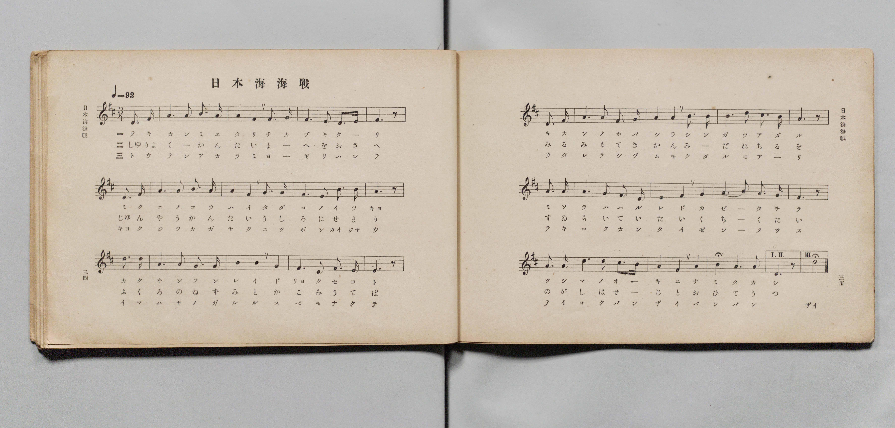
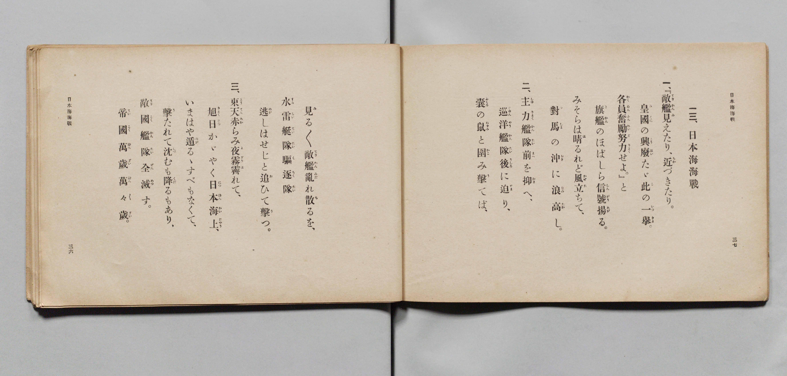

# 日本海海戰

> Re:Shōka 使用 AI 協助辨識與重建樂譜，可能會有錯誤。歡迎回報。

- **鋼琴伴奏版**：<br><audio controls src="nihonkai_kaisen.mp3"></audio>

- 文部省
- 臺灣教育會公認《新定兒童唱歌》尋常科第六學年用（2020.006.0847.0006）

## 說明

原書資訊與歌詞全文（對應 P028.jpg – P029.jpg，書頁 pp. 5–6，第一學期第 5 首）：
調性與拍號：に長調四分之三拍子（D 大調 3/4 拍，弱起 1 拍），「勇壯ニ」（♩=92）
結束小節說明：原譜末小節設有反覆括號「I. II.」（第一、二節結於低音 D4 附點四分音符）
與「III.」（第三節結於高八度 D5 二分音符加延長記號，唱「ザイ」）。


## 歌詞

```text
一　『敵艦見えたり近づきたり
皇國（みくに）の興廢（こうはい）、ただ此の一舉（いつきよ）
各員奮勵（ふんれい）努力（どりよく）せよ』と
旗艦のほばしら、信號揚（あ）がる
みそらは晴るれど、風立ちて
對島の沖に、浪高し

二　主力艦隊、前を抑（おさ）へ
巡洋艦隊、後（うしろ）に迫（せま）り
袋（ふくろ）の鼠（ねずみ）と、圍（かこ）み擊（う）てば
見る／＼敵艦、亂れ散るを
水雷艇隊（すゐらいていたい）、驅逐隊（くちくたい）
逃（のが）しはせじと、追ひて擊（う）つ

三　東天（とうてん）赤らみ、夜霧霽（よぎりは）れて
旭日（きよくじつ）かがやく、日本海上
いまはや遁（のが）るゝ、すべもなくて
擊たれて沈むも、降るもあり
敵國艦隊、全滅（ぜんめつ）す
帝國萬歲、萬々歲
```

## ABC

<div class="abc-score" data-abc-src="nihonkai_kaisen.abc" aria-label="五線譜載入中"></div>

[下載 ABC 原始檔](nihonkai_kaisen.abc)

## TMD 檔案連結

- [主旋律 TMD 檔案](nihonkai_kaisen.tmd) [[在 TMD Studio 編輯](https://tmdlang.github.io/Tmd-TS/#tmd=s7IKdvYPcrWy4qpTUCpJTLdSSM7PyUlNLsnMz7MqzsjMK0nNjM_KTMmPL87Iz05Ugisry88pzU21Si9KTEmNN4s3MjAyiDcwMIs3sDAxBzIMzBBKi_NLi5JTrYqTM_Lzc-JLUitKkvLzs9Hl4wsS01OtAgyMLBAyBUX5Zal5iXlA3QVFILekgLUjFKSWZaakgqSLkxPz4stSizLTMlNTkFyZWlQM9gnEipKixLzi5KLMApD3EKryi0oy8oE-KciotMrILC7JL8pMTsyJz07MQ_JwSUYq0L-5mTmZJYlFlejiBTmJyanIJmamZ-ZZ5ebnJZUCA06JS0tL4dn0pc_mrHm2dTsIdWxQ0NLiUrRVsDTisrdVcOGyMdY3sQPpfzat_WXziudzGsGmvWjf9bxx8bOpM180bXo2p_lp65oXq3ofN3Q9m7bh6bpZT1snPV-99OmUjc_W9jxu6H66ofvpjh3Pl098vmbN09a1T9fueLpzy_MpK97v6QDFjx4wVvRA8QNkGJi939OpxMWlr6VgSy3ApaCg8LRv_rPZO15sbn-xoutFRzvQXS9WznvaugLoK6Arnm7ofdbeqQCKZL2sgnSFRw2TQRxLEOf9nh6gzpcLGhUKCvQUTIFSQCf2AH3yZEcD0CfP5swHshVMFV4umwZ0-vs9s0DWvVi1_1nDcpBF3b0vZs4Hij5uXP1y6nag-NPZs592tD3Z2f1kRydQ9unaCUAHuCg8XbIcKKkADG0FoCjQhqd7Nr7Yul3BEMIFGgwMyZ6n3e1PF69_3Nz9uAEo2PFo5kpbSyOgLMjO51snPJs7_-mG_ufrG16sWvVsRh_QWqC_X6yd82zOaqj4irXP5nQ-7e99saztWfcaoNOAhnrqKXh66kFMhPjrcUPjk109QPUgM6ftebK37-X8zQouJgovZ7a83D0P4gWg0PM1y6CWA70KMgnVnE64CS9Xz3jauvrprmUKLqYKQKPh2p92LXi6exsoZFbMAAdUDzDVAE163LTtcdMSsFmdjxuauEB2gB0GRH3Ppm590bnsxbLux40djxvnP27qerF_4uPGpY8beyFccHDMan86pxvolMeN-x839gPDH2RU47oXHR1Pdy8Ci09-3Nj2uHH948YWsC2NIM2NC56tXQJUBrTsRQcw1IHKWh43AkV6Hzd1QD37dELL08kLny5d97R7K1jF1sdNkx839UAMetq16mnXbLD4SqBbgNqA1oPtng1iNwCdsgJkyrPp04G-AFr1uHH348YNjxunP24CueLJ_oXAkHjWPwtsRBNYJzA8ukF6wH6ZC1LXuP7ZzC1AUbC1K4HaXi5a8Xw1MEQWPm5cBnbkht6nm7cBjX-2aRrQ80AVz7auAsYD0B5IaO4CJqiGJzt2Ax0LdMfLWV1AJU87gd6c9KxrItjurseNU8HW7wAbuH3hsy3dCKX7esCKgCEIdDg4nhpXv9gPDGWg4OzHjftAIpCoeLEIEg9bQfEAVbru5Z4FYMG1jxuBmWM_WHAFyNw5oPTzuBHolclgwf3PJndBbAJzgSG2AWwoMPqbgOYCg3YPJEGAU20TMECeTV0MDplJ4GDesOXl7O0vOtuBzgYbM_Nx0wRwCALjFWgYkATGOjQFvFzZ-rJhAkwlMKaAoQkkoQpAxr1saAbLAWMN6H-gKdPBKQjoYWDIgtz_Yv_ex42bgEajOnsJNAkDbWl4Nnfj0yUrwZIrwAG4DJh-gKpebF0Cdth-UDAsmfNyzvKXc_aClIGSUB8oLTWuB4cqMMrBcfxs-lpg6Q02CJQ8wW4FOmMJ2EZgAAKTDdB7_aC4hxXyT3aAowTs730gpze1vGxsRPESKOjmgrPDzMeNOx83NT1uXAU2GmLnZKAzgJkM5IZnm4BuawCpAAbdTKATgDqBqoFxALYEGC3ALIhIMcDidncr2Ko54AwDtAHi1Jng9LVjLkj1hDXP1m4CheOENY8bWoFskBzllQAUKGjpc3H5ZWbk52UnZnonZhan5lkFZCbm5TvU6BrWVIPsUrAxNNOyA7Ow1UIKkCLyxcIeBQ3kMlpBW8EEmOlApawOvCbRxKIf6AKQ2TUKBgq6YAijDcGkMVDGFCoCgiC2GZSFkDFGoU2AMjAREDSCm2aEJgOyC24P2B0-hjUK8VBZGP24uQ1CN60F6n_ctBrJhMfNm8HkfKiKFWAV--Gyq-CsRqiK1SAVza3IZgDNBZEQXY-b94BVwHTCXIKwYz3MrUZY3AoqfmDOBZW2ILMa-1FcvAesrhuqaDJYBcRskHgLnLUP2T2NO1BcPAmsoguqciqGCrCLgbkP7hagNRBHG2ML4A6oqmVgr0P0oARw0yKoCkjwrYTLwh3evALZuU3rUMwABebjZkgwPG5eg2EL2LlNa-GGgMMYf6Lf1QNO9CSmcuLTsgmUxJKW48BMIFUD1Q-B4NSMkIOnZ2ADCSUw-sA-BAUrIshhKQTYzICzYOmxARygEPWoZkDUPm5uAauABx9ymEIyC2qiBZayyIY1gmKCmAQJTUuN08HW9aKYAbIHWPFAefvAKiDJE8k1jVuh8v1IqfFxE0rSBnoG2d2QtIIIlPVwdVD3QjzfPBfFDEiahZmxBOyaHUBjQMGNHkKwQJxHMMnt6KRGkkMkLFjigdEQGV20JAcqICF8UPEJSoAwiL34RCQhpLBongrngUJrDUwWkdyaO-G2A_MralKCBPvjpt1QpeBSFlpoIAflWqhqYCGBlNh6kU1qBBUMwHYWlDcLnNjg5XUjzFZYcgQ7p3Eyigkg1YjECM4_jRvQ3QI1E9gIQE5q8HwG8QfI85C8hEhqsNoFidW0E-GW5pkoJoCKxcfN0HIYlMmwFmyQRAfK0QSSGLAvQ40khqiHYTIwGpLUzNBKLnCpZQ6XQjYOlMYgfGAhiVSkYSmOmqG5v3kCOL9th8vCawuoGDQVAgMcyQxwICHqGdTIgAclvBLei5zE4AkIIgdKOqCEAeY19oITCCw5gco3KAuWRKAV7AIUM3rAKhbCTQS5F1TporimEZIYgE14lESG4i9wckD4vBXsL5hdkAQEMQNSskGLexSfQ5MZLGxwNlCQmkmEKs8plCYzUFkFSWaGSKUSauUJyjDIekBJDsJHr1ZxpTJYyoH4G5R5Ea0ISEsEXpLByy9EAxEUZ6DGFsIEcNMLXrE2Ys-u4BoIEmfIxRjMfLAcuFZEpDFwHYS1zoQVOCB5SGpCcQtUHqQXpAK5XoakMEg7CtgXQqkxUXIftHCG1nbQvAUvUpEaFLCwwMy_YLc0Q1M7tDkBK_QQ4QJLX8D6lEAx1roWM32Bx6_wpi9o4wkCcZRJsFQD4yMKMvRCEGgekggohcG6NsgpbB5KOECaVZCcBWvJroXLwssQaIEPCUl4rMPDHMIDxQdyOQgLR1irG7n8mo6ssxEcn7C2FLR0mgGXRVSRSK5o3AQXRW7hQKpJkDxymwCLK3ClKmBZDnEFJFVtg8si2g0QFaipCiEK0w0JC9AwGk6H1HJx6dopoHaHFYAiylwA)]
- [鋼琴伴奏 TMD 檔案](nihonkai_kaisen_piano.tmd) [[在 TMD Studio 編輯](https://tmdlang.github.io/Tmd-TS/#tmd=s7IKdvYPcrWy4tLSUng2femzOWuebd0OQh0b3u_peNm95_mELU_2bHm6tP95Z8f7PZ0KWlpcirYKlkZc9rYKLlw2xvomdlx1CkrPprW_bF7xfE6jEoj3on3X88bFz6bOfNG06dmc5qeta16s6n3c0PVs2oan62Y9bZ30fPXSp1M2Plvb87ih--mG7qc7djxfPvH5mjVPW9c-Xbvj6c4tz6esANpvZGBkoGdgYKZnYGFiDmQYmAGdoMTF5ZlXUpRvFZCZmJcf5OFQY1BTzaUABDaGZlp2YFaNgoGCLhjC6OrctFoFUzDTFChtGAcVB0EwxxzMNAPKQVTpKhjDtMJ16gJlzaAsmAiMDTQTSQRkLczqGq5aFCf7IDvZBMnFIAg0Jl4h2jBWwTQ-HsEBUjUKJvFgwWjT-FiIDFg9yHC_zIz8vOzETO_EzOLUPETA6BpihIy-loItOlAAhvyTHQ0vFvYoaAQYGFnoZRWka2JRpqWPL3Ah3jdGCkBY0ECCDBTs6EELoU2AMjAREDQCxQmUhSoDshAUHXC7wA7yMaxRiIeqgNGPm9sgdNNaoBmPm1YjmfK4eTOYnA9VsQKsYj9cdhWc1QhVsRqkorkV2QyguSASoutx8x6wCphOmEsQdqyHudUIi1sbpz9ugjm363FTB8isxn4UF-8Bq-uGKpoMVgExGyTeAmftQ3ZP4w4UF08Cq-iCqpyKoQLs4sYZCLcArYE42hhbAHdAVS0Dex2iByWAmxZBVUCCbyVcFu7w5hXIzm1ah2IGKDAfN0OC4XHzGgxbwM5tWgs3BBzG-BP5rh7iEznxqdgESmJJxZBiBkghCg4QBKVjJDl4Kn7cDIlhWBD0gf0FCkxEQMPSxeOmJXAWLBU2gIMRoh7VDIjax80tYBXwQEMOSUgWQU2qj5tgSQss1wgKf2KSITQFNU4HW9eLYgbInseNs6G8fWAVkESJ5JrGrVD5fqQ0-LgJJUEDPYPsbkgKQQTKerg6qHshnm-ei2IGJKXCzFgCds0OoDGg4EYPIVggziOY0HZ0kp_QEMkJlmRgNEQGVNcgJzRQYQjhg4pLULKDQXBxiVI2I1IaPPUgBUPzVDgPFFBrYLKIlNbcCXcCMIOipiJIiD9u2g1VCi5WoaUEciiuhaoGlgpI6awX2aRGUEnwuBGqsnEWOJ3BC-hGmK2wlAh2TuNkFBNAqhHpEJx1GjeguwVq5uOmbuRUBs9iEH-APA_JRohUBqtOkFhNOxFuaZ6JYgKoHHzcDC14QfkLa0kGSW-gzEwgdT2dPZv81IWocmEyMBpUsUJSGqgVhFxc4WgggSA8icHbVkiFGZaCqBma75sngHPadrgsvHaAikETITC8kcwAhxGiXkGNC3hIwivdvcgpDJ5-IHKglANKF2BeYy84fcBSE6hkg7JgKQRaoS5AMaMHrGIh3ESQe0GVLIprGiFp4XET0MdIaQzFX-DUgPB5K9hfMLsg6QdiBqRMgxb0KD6HpjJY2OBskCA1iwhVllPIS2WgUgqSygyRyiPUyhKUS5D1gFIbhI9ejYISGLa0BUsvEN-CciyirQBpb8CLL3ihhWgGgmIK1KRCmABuYMEr0kbseRRc40BiCrnsgpkPlgPXgoiUBa5zsNaRsFIGJA9JQyhugcqD9IJUINfDkHQFaS09buxBqSFR8hy0RIbWbtAcBS9HkRoQsLDAzLVgtzRD0zi0-QAr6RDhAktVwPqTQNnVuhaWqiwJpir69tIQaWseSghAGlCQnARrqa6Fy8LLDGj5DglDeHzDQxvCA8UEcrkHC0FYqxq5vJqOrLMRHJOwVhO0NJoBl0XUiEiuaNwEF0Vuy0BqRZA8chMAiytwpSdg2Q1xBSQ9bYPLIpoJEBWo6QkhCtMNCYttqG0RVIfg6N2C-tCI3i3OTjQIY-fAu9eQTjQ0vWFRaAJTCNIB7Ydj1QVRCCKjTYA9dDCB2oEHmUDYOrAhQO343Qg3EMiAOxHFNCyaSBlT0LVTAI9ZKAAZqDEQ7QPUjUXUCKuoMVhUmQsA)]

## 分析

```text
================================================================================
📊 TMD Song Profile: [ 日本海海戰 ]
================================================================================
⏱  Duration:       0:46 (47.0s), 24 measures total
🎼 Key & Tempo:    首調基準 D, != 92.0 BPM, <3/4>
   - 分析範圍：      由實際發聲的音符與和弦推測調性；播放脈絡另行呈現
🎤 人聲音域:    D4 (MIDI 62) – D5 (MIDI 74) [跨度: 12 個半音 / 1.0 個八度, 難度: easy]
   - 最低音:  D4 in [NihonkaiKaisen #1 @ m.1, 0:01]
   - 最高音: D5 in [NihonkaiKaisen #1 @ m.8, 0:15]
   - 適合: soprano, mezzo-soprano, contralto, tenor, baritone, bass
🏛  結構:      NihonkaiKaisen (47.0s)
⚡ 編曲密度:        Peak 1 軌道同時演奏
🗝  調性診斷：       D 大調（純淨自然大調，未偵測到可信轉調）
   - 風格氣質:    純淨自然大調（陽光明朗、易唱易記，無明顯調外色彩）
   - 轉調歷程:    全曲維持單一推測調性（未偵測到可信轉調）
   - 核心骨幹音:  A, F#, D, B, G
   - 調性數值:    D 大調 [相關度: 0.78, 穩定度: Moderate, 自然音純度: 100.0%]
   - 候選調性 (K-S): D 大調 (0.78), F# 小調 (0.75), A 大調 (0.72)
   - 五度圈歷程:   +6
   - 各段落調性細節:
     • [NihonkaiKaisen #1]: F# 調性不明確 (r: 0.75, 自然音純度: 92.2%, 調外音: G)

  [ 五度圈游移軌跡 ]
               C  
         F            G  
      Bb               D  
      Eb               A  
         Ab           E  
            Db       B  
              [F#]*
     (* = active key center)

  [ 十二半音累積音高分佈 ]
     C  :                            0.0%
     C# : ██                         2.2%
     D  : ██████████                14.1%
     D# :                            0.0%
     E  : ████                       5.8%
     F  :                            0.0%
     F# : ███████████████           22.1%
     G  : █████                      7.6%
     G# :                            0.0%
     A  : ████████████████████████  34.4%
     A# :                            0.0%
     B  : ██████████                13.8%
--------------------------------------------------------------------------------
Assignment 軌道音域：
  - Piano         : D4 – D5 (12 個半音 / 1.0 個八度, 86 個音符)
================================================================================
```


## 原書掃描頁






