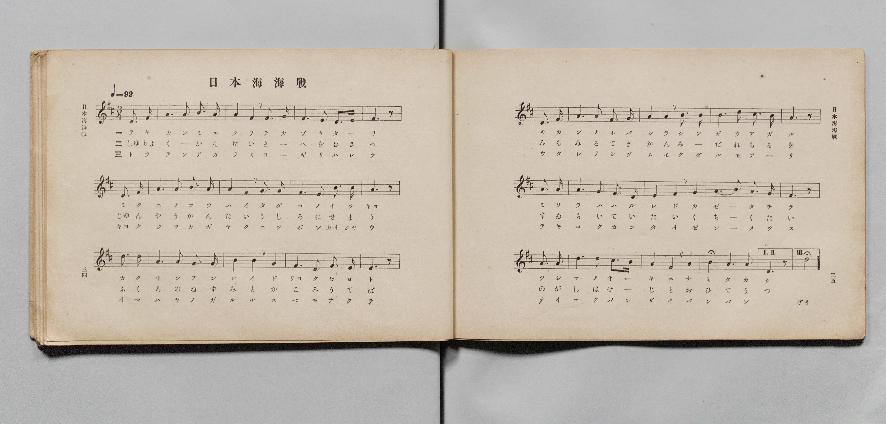
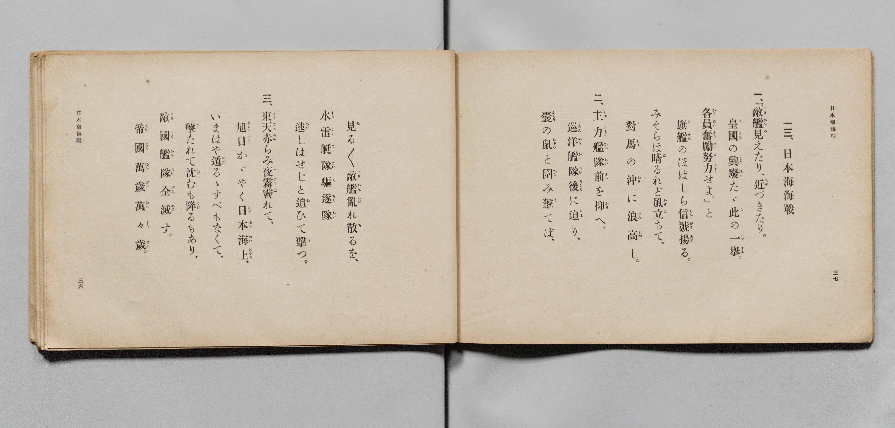

# 日本海海戰

> Re:Shōka 使用 AI 協助辨識與重建樂譜，可能會有錯誤。歡迎[回報](https://github.com/TMDLang/reshoka/issues)。

- **鋼琴伴奏版**：<br><audio controls src="nihonkai_kaisen.mp3"></audio>
- **NEUTRINO 歌聲合成版**：<br><audio controls src="nihonkai_kaisen_neutrino.mp3"></audio>

- 文部省
- 文部省《尋常小學唱歌 第六學年用》（大正三年，索書號 4078）

## 說明

原書資訊與歌詞全文（對應 P028.jpg – P029.jpg，書頁 pp. 5–6，第一學期第 5 首）：
調性與拍號：に長調四分之三拍子（D 大調 3/4 拍，弱起 1 拍），「勇壯ニ」（♩=92）
結束小節說明：原譜末小節設有反覆括號「I. II.」（第一、二節結於低音 D4 附點四分音符）
與「III.」（第三節結於高八度 D5 二分音符加延長記號，唱「ザイ」）。


## 歌詞

```text
一　『敵艦見えたり近づきたり
皇國（みくに）の興廢（こうはい）、ただ此の一舉（いつきよ）
各員奮勵（ふんれい）努力（どりよく）せよ』と
旗艦のほばしら、信號揚（あ）がる
みそらは晴るれど、風立ちて
對島の沖に、浪高し

二　主力艦隊、前を抑（おさ）へ
巡洋艦隊、後（うしろ）に迫（せま）り
袋（ふくろ）の鼠（ねずみ）と、圍（かこ）み擊（う）てば
見る／＼敵艦、亂れ散るを
水雷艇隊（すゐらいていたい）、驅逐隊（くちくたい）
逃（のが）しはせじと、追ひて擊（う）つ

三　東天（とうてん）赤らみ、夜霧霽（よぎりは）れて
旭日（きよくじつ）かがやく、日本海上
いまはや遁（のが）るゝ、すべもなくて
擊たれて沈むも、降るもあり
敵國艦隊、全滅（ぜんめつ）す
帝國萬歲、萬々歲
```

## ABC

<div class="abc-score" data-abc-src="nihonkai_kaisen.abc" aria-label="五線譜載入中"></div>

[下載 ABC 原始檔](nihonkai_kaisen.abc)

## TMD 檔案連結

- [主旋律 TMD 檔案](nihonkai_kaisen.tmd) [[在 TMD Studio 編輯](https://tmdlang.github.io/Tmd-TS/#tmd=s7IKdvYPcrWy4qpTUCpJTLdSSM7PyUlNLsnMz7PKyszLyo8vzshPT8wuBdHZiUpwdWX5OaW5qVbpRYkpqfFm8SYG5hYIyeL80qLkVKvi5Iz8_Jz4ktSKkqT8_Gx0-fiCxPRUqwADIySdBUX5Zal5iXlA3QVFmXklqSlg7QgFqWWZKakg6eLkxLz4stSizLTM1BQkd6UWFYMcD7WipCgxrzi5KLMA5COEqvyiEqC3ihILMiqtMjKLS_KLMpMTc-KzE_OQvFiSkQr0YW5mTmZJYlElunhBTmJyKrKJmemZeVa5-XlJpcCgUuLS0lJ4Nn3pszlrnm3dDkIdGxS0tLgUbRUsjbjsbRVcuGyM9U3sQPqfTWt_2bzi-ZxGsGlw3uOGrqcbup_u2PF0Q__TtTueTtn4bG2PwvM1a562rgXxd255PmXF44bu93s6ni5Z_mzt4ic7OoGC7_f0PN-y6NnsHS9mzlcARcv7PZ1KXFz6Wgq21AJcCgoKT_vmg-zY3P5iRdeLjnag016snPe0dQXQ-SAHbeh91t6pAIpbvayCdIVHDZNBHEsQB-hAoM6XCxoVCgr0FEyBUmYgN69Z82RHA9Bfz-bMB7IVTBVeLpsGdPr7PbNA1r1Ytf9Zw3KQRd29QI8BRR83rn45dTtQ_Ons2U872p7s7Ab6Hyj7dO0EoANcFIBhApRUAAayAlAUaMPTPRtfbN2uYAjhAg3uedzQ87S7_eni9Y-bux83AAU7Hs1caWtpBJQF2fl864Rnc-cDQ__5-oYXq1Y9m9EHtBbo7xdr5zybsxoqvmLtszmdT_t7Xyxre9a9Bug0oKGeegqennoQEyH-etzQ-GRXD1A9yMxpe57s7Xs5f7OCi4nCy5ktL3fPg3gBKPR8zTKo5UCvgkxCNacTbsLL1TOetq5-umuZgoupAtBouPanXQue7t4GCpkVM8AB1QNMOECTHjdte9y0BGxW5-OGJi6QHWCHAVHfs6lbX3Que7Gs-3Fjx-PG-Y-bul7sn_i4cenjxl4IFxwcs9qfzgGltseN-x839gPDH2RU47oXHR1Pdy8Ci09-3Nj2uHH948YWsC2NIM2NC56tXQJUBrTsRQcw1IHKWh43AkV6Hzd1QD37dELL08kLny5d97R7K1jF1sdNkx839UAMetq16mnXbLD4SqBbgNqA1oPtng1iNwCdsgJkyrPp04G-AFr1uHH348YNjxunP24CueLJ_oXAkHjWPwtsRBNYJzA8ukF6wH6ZC1LXuP7ZzC1AUbC1K4HaXi5a8Xw1MEQWPm5cBnbkht6nm7cBjX-2aRrQ80AVz7auAsYD0B5IaO4CJqiGJzt2Ax0LdMfLWV1AJU87gd6c9KxrItjurseNU8HW7wAbuH3hsy3dCKX7esCKgCEIdDg4nhpXv9gPDGWg4OzHjftAIpCoeLEIEg9bQfEAVbru5Z4FYMG1jxuBmWM_WBBYPjQ-nQNKP48bgV6ZDBbc_2xyF8QmMBcYYhvAhgKjvwloLjBo90ASBDjVNgED5NnUxeCQmQQO5g1bXs7e_qKzHehssDEzHzdNAIcgMF6BhgFJYKxDU8DLla0vGybAVAJjChiaQBKqAGTcy4ZmsBww1oD-B5oyHZyCgB4GhizI_S_2733cuAloNKqzl0CTMNCWhmdzNz5dshIsuQIcgMuA6Qeo6sXWJWCH7QcFw5I5L-csfzlnL0gZKAn1gdJS43pwqAKjHBzHz6avBRbaYINAyRPsVqAzloBtBAYgMNkAvdcPintY2f5kBzhKwP7eB3J6U8vLxkYUL4GCbi44O8x83LjzcVPT48ZVYKMhdk4GOgOYyUBueLYJ6LYGkApg0M0EOgGoE6gaGAdgS4DRAsyCiBQDLG53t4KtmgPOMEAbIE6dCU5fO-aCVE9Y82ztJlA4TljzuKEVyAbJUV4JQIGClj4Xl19mRn5edmKmd2JmcWqeVUBmYl6-Q42uYU01yC4FG0MzLTswC1stBKrSQIXDwh4FDeQyWkFbwQSY6UClrA68JtHEoh_oApDZNQoGCrpgCKMNwaQxUMYUKgKCILYZlIWQMUahTYAyMBEQNIKbZoQmA7ILbg_YHT6GNQrxUFkY_bi5DUI3rQXqf9y0GsmEx82bweR8qIoVYBX74bKr4KxGqIrVIBXNrchmAM0FkRBdj5v3gFXAdMJcgrBjPcytRljcCip-YM4FlbYgsxr7UVy8B6yuG6poMlgFxGyQeAuctQ_ZPY07UFw8CayiC6pyKoYKsIuBuQ_uFqA1EEcbYwvgDqiqZWCvQ_SgBHDTIqgKSPCthMvCHd68Atm5TetQzAAF5uNmSDA8bl6DYQvYuU1r4YaAwxh_ot_VA070JKZy4tOyCZTEkpbjwEwgVQPVD4Hg1IyQg6dnYAMJJTD6wD4EBSsiyGEpBNjMgLNg6bEBHKAQ9ahmQNQ-bm4Bq4AHH3KYQjILaqIFlrLIhjWCYoKYBAlNS43Twdb1opgBsgdY8UB5-8AqIMkTyTWNW6Hy_Uip8XETStIGegbZ3ZC0ggiU9XB1UPdCPN88F8UMSJqFmbEE7JodQGNAwY0eQrBAnEcwye3opEaSQyQsWOKB0RAZXbQkByogIXxQ8QlKgDCIvfhEJCGksGieCueBQmsNTBaR3Jo74bYD8ytqUoIE--Om3VCl4FIWWmggB-VaqGpgIYGU2HqRTWoEFQzAdhaUNwuc2ODldSPMVlhyBDuncTKKCSDViMQIzj-NG9DdAjUT2AhATmrwfAbxB8jzkLyESGqw2gWJ1bQT4ZbmmSgmgIrFx83QchiUybAWbJBEB8rRBJIYsC9DjSSGqIdhMjAaktTM0EoucKllDpdCNg6UxiB8YCGJVKRhKY6aobm_eQI4v22Hy8JrC6gYNBUCAxzJDHAgIeoZ1MiAByW8Et6LnMTgCQgiB0o6oIQB5jX2ghMILDmByjcoC5ZEoBXsAhQzesAqFsJNBLkXVOmiuKYRkhiATXiURIbiL3ByQPi8FewvmF2QBAQxA1KyQYt7FJ9DkxksbHA2UJCaSYQqzymUJjNQWQVJZoZIpRJq5QnKMMh6QEkOwkevVnGlMljKgfgblHkRrQhISwReksHLL0QDERRnoMYWwgRw0wtesTZiz67gGggSZ8jFGMx8sBy4VkSkMXAdhLXOhBU4IHlIakJxC1QepBekArlehqQwSDsK2BdCqTFRch-0cIbWdtC8BS9SkRoUsLDAzL9gtzRDUzu0OQEr9BDhAktfwPqUQDHWuhYzfYHHr_CmL2jjCQJxlEmwVAPjIwoy9EIQaB6SCCiFwbo2yClsHko4QJpVkJwFa8muhcvCyxBogQ8JSXisw8McwgPFB3I5CAtHWKsbufyajqyzERyfsLYUtHSaAZdFVJFIrmjcBBdFbuFAqkmQPHKbAIsrcKUqYFkOcQUkVW2DyyLaDRAVqKkKIQrTDQkL0DAaTofUcnHp2imgdocVgCLKXAA)]
- [鋼琴伴奏 TMD 檔案](nihonkai_kaisen_piano.tmd) [[在 TMD Studio 編輯](https://tmdlang.github.io/Tmd-TS/#tmd=s7IKdvYPcrWy4qpTUCpJTLdSyC8qychPL0osyKi0ysgsLskvykxOzInPTsxLVIIrKs4vLUpOjS9ITE-1CjAwMtAFEoZKXFpaCs-mL302Z82zrdtBqGPD-z0dL7v3PJ-w5cmeLU-X9j_v7Hi_p1NBS4tL0VbB0ojL3lbBhcvGWN_EDmT0s2ntL5tXPJ_TCLboRfuu542Ln02d-aJp07M5zU9b17xY1fu4oevZtA1P18162jrp-eqlT6dsfLa253FD99MN3U937Hi-fOLzNWuetq59unbH051bnk9ZAbTfCOg-PQMDMz0DCxNzIMPADOgEJS4uz7ySonyrgMzEvPwgD4cag5pqLgUgsDE007IDs2oUDBR0wRBGV-em1SqYgpmmQGnDOKg4CII55mCmGVAOokpXwRimFa5TFyhrBmXBRGBsoJlIIiBrYVbXcNWiONkH2ckmSC4GQaAx8QrRhrEKpvHxCA6QqlEwiQcLRpvGx0JkwOpBhvtlZuTnZSdmeidmFqfmIQJG1xAjZPS1FGzRgQIw5J_saHixsEdBA5gaLPSyCtI1sSjT0scXuBDvGyMFICxoIEEGCnb0oIXQJkAZmAgIGoHiBMpClQFZCIoOuF1gB_kY1ijEQ1XA6MfNbRC6aS3QjMdNq5FMedy8GUzOh6pYAVaxHy67Cs5qhKpYDVLR3IpsBtBcEAnR9bh5D1gFTCfMJQg71sPcaoTFrY3THzfBnNv1uKkDZFZjP4qL94DVdUMVTQargJgNEm-Bs_Yhu6dxB4qLJ4FVdEFVTsVQAXZx4wyEW4DWQBxtjC2AO6CqloG9DtGDEsBNi6AqIMG3Ei4Ld3jzCmTnNq1DMQMUmI-bIcHwuHkNhi1g5zathRsCDmP8iXxXD_GJnPhUbAIlsaRiSDEDpBAFBwiC0jGSHDwVP26GxDAsCPrA_gIFJiKgYenicdMSOAuWChvAwQhRj2oGRO3j5hawCnigIYckJIugJtXHTbCkBZZrBIU_MckQmoIap4Ot60UxA2TP48bZUN4-sApIokRyTeNWqHw_Uhp83ISSoIGeQXY3JIUgAmU9XB3UvRDPN89FMQOSUmFmLAG7ZgfQGFBwo4cQLBDnEUxoOzrJT2iI5ARLMjAaIgOqa5ATGqgwhPBBxSUo2cEguLhEKZsRKQ2eepCCoXkqnAcKqDUwWURKa-6EOwGYQVFTESTEHzfthioFF6vQUgI5FNdCVQNLBaR01otsUiOoJHjcCFXZOAuczuAFdCPMVlhKBDuncTKKCSDViHQIzjqNG9DdAjXzcVM3ciqDZzGIP0Ceh2QjRCqDVSdIrKadCLc0z0QxAVQOPm6GFryg_IW1JIOkN1BmJpC6ns6eTX7qQlS5MBkYDapYISkN1ApCLq5wNJBAEJ7E4G0rpMIMS0HUDM33zRPAOW07XBZeO0DFoIkQGN5IZoDDCFGvoMYFPCThle5e5BQGTz8QOVDKAaULMK-xF5w-YKkJVLJBWbAUAq1QF6CY0QNWsRBuIsi9oEoWxTWNkLTwuAnoY6Q0huIvcGpA-LwV7C-YXZD0AzEDUqZBC3oUn0NTGSxscDZIkJpFhCrLKeSlMlApBUllhkjlEWplCcolyHpAqQ3CR69GQQkMW9qCpReIb0E5FtFWgLQ34MUXvNBCNANBMQVqUiFMADew4BVpI_Y8Cq5xIDGFXHbBzAfLgWtBRMoC1zlY60hYKQOSh6QhFLdA5UF6QSqQ62FIuoK0lh439qDUkCh5DloiQ2s3aI6Cl6NIDQhYWGDmWrBbmqFpHNp8gJV0iHCBpSpg_Umg7GpdC0tVlgRTFX17aYi0NQ8lBCANKEhOgrVU18Jl4WUGtHyHhCE8vuGhDeGBYgK53IOFIKxVjVxeTUfW2QiOSVirCVoazYDLImpEJFc0boKLIrdlILUiSB65CYDFFbjSE7DshrgCkp62wWURzQSICtT0hBCF6YaExTbUtgiqQ3D0bkF9aETvFmcnGoSxc-Dda0gnGpresCg0gSkE6YD2w7HqgigEkdEmwB46mEDtwINMIGwd2BCgdvxuhBsIZMCdiGIaFk2kjCno2imAxywUgAzUGIj2AerGImqEVdQYLKrMBQA)]

## 分析

```text
================================================================================
📊 TMD Song Profile: [ 日本海海戰 ]
================================================================================
⏱  Duration:       0:46 (47.0s), 24 measures total
🎼 Key & Tempo:    首調基準 D, != 92.0 BPM, <3/4>
   - 分析範圍：      由實際發聲的音符與和弦推測調性；播放脈絡另行呈現
🎤 人聲音域:    D4 (MIDI 62) – D5 (MIDI 74) [跨度: 12 個半音 / 1.0 個八度, 難度: easy]
   - 最低音:  D4 in [NihonkaiKaisen #1 @ m.1, 0:01]
   - 最高音: D5 in [NihonkaiKaisen #1 @ m.8, 0:15]
   - 適合: soprano, mezzo-soprano, contralto, tenor, baritone, bass
🏛  結構:      NihonkaiKaisen (47.0s)
⚡ 編曲密度:        Peak 1 軌道同時演奏
🗝  調性診斷：       D 大調（純淨自然大調，未偵測到可信轉調）
   - 風格氣質:    純淨自然大調（陽光明朗、易唱易記，無明顯調外色彩）
   - 轉調歷程:    全曲維持單一推測調性（未偵測到可信轉調）
   - 核心骨幹音:  A, F#, D, B, G
   - 調性數值:    D 大調 [相關度: 0.78, 穩定度: Moderate, 自然音純度: 100.0%]
   - 候選調性 (K-S): D 大調 (0.78), F# 小調 (0.75), A 大調 (0.72)
   - 五度圈歷程:   +6
   - 各段落調性細節:
     • [NihonkaiKaisen #1]: F# 調性不明確 (r: 0.75, 自然音純度: 92.2%, 調外音: G)

  [ 五度圈游移軌跡 ]
               C  
         F            G  
      Bb               D  
      Eb               A  
         Ab           E  
            Db       B  
              [F#]*
     (* = active key center)

  [ 十二半音累積音高分佈 ]
     C  :                            0.0%
     C# : ██                         2.2%
     D  : ██████████                14.1%
     D# :                            0.0%
     E  : ████                       5.8%
     F  :                            0.0%
     F# : ███████████████           22.1%
     G  : █████                      7.6%
     G# :                            0.0%
     A  : ████████████████████████  34.4%
     A# :                            0.0%
     B  : ██████████                13.8%
--------------------------------------------------------------------------------
Assignment 軌道音域：
  - Piano         : D4 – D5 (12 個半音 / 1.0 個八度, 86 個音符)
================================================================================
```


## 原書掃描頁






