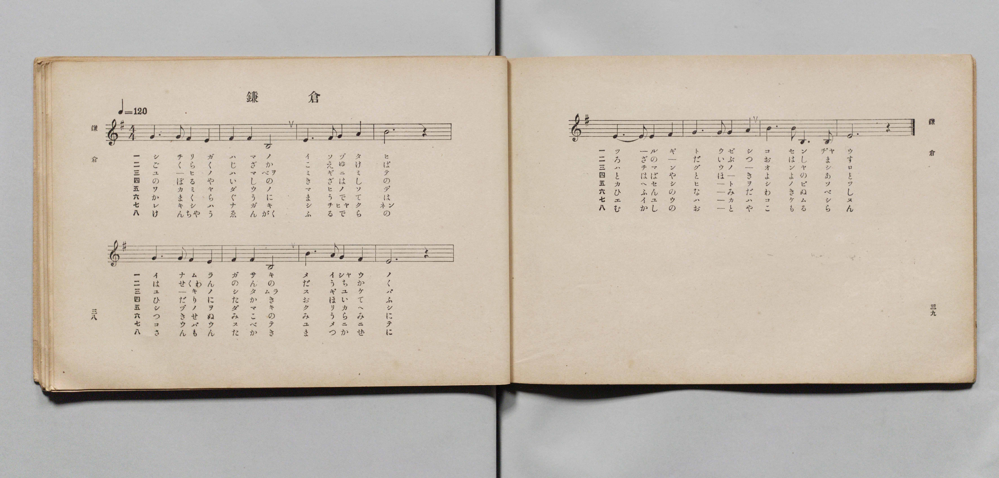
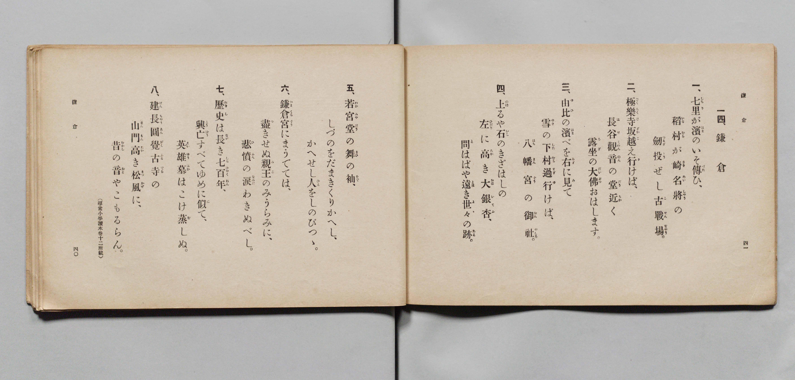

# 鎌倉

> Re:Shōka 使用 AI 協助辨識與重建樂譜，可能會有錯誤。歡迎回報。

- **鋼琴伴奏版**：<br><audio controls src="kamakura.mp3"></audio>

- 詞：文部省（尋常小學讀本卷十二所載）
- 曲：文部省
- 文部省《尋常小學唱歌 第六學年用》（大正三年，索書號 4078）

## 說明

原書資訊與歌詞全文（對應 P022.jpg–P023.jpg，原書 pp. 38–41，第 14 首）：
調性與拍號：ト調（G 大調 / E 羽調式）4/4 拍，速度 ♩=120


## 歌詞

```text
一、
七里（しちり）が濱（はま）のいそ傳（づた）ひ、
稻村（いなむら）が崎（さき）名將（めいしやう）の
劍（つるぎ）投（とう）ぜし古戰場（こせんじやう）。

二、
極樂寺坂（ごくらくじざか）越（こ）え行（ゆ）けば、
長谷觀音（はせくわんのん）の堂（だう）近（ちか）く
露坐（ろざ）の大佛（だいぶつ）おはします。

三、
由比（ゆひ）の濱（はま）べを右（みぎ）に見（み）て
雪（ゆき）の下村（したむら）過行（すぎゆ）けば、
八幡宮（はちまんぐう）の御社（おんやしろ）。

四、
上（のぼ）るや石（いし）のきざはしの
左（ひだり）に高（たか）き大銀杏（おほいてふ）、
問（と）はばや遠（とほ）き世々（よゝ）の跡（あと）。

五、
若宮堂（わかみやだう）の舞（まひ）の袖（そで）、
しづのをだまきくりかへし、
かへせし人（ひと）をしのびつゝ。

六、
鎌倉宮（かまくらぐう）にまうでては、
盡（つ）きせぬ親王（みこ）のみうらみに、
悲憤（ひふん）の涙（なみだ）わきぬべし。

七、
歷史（れきし）は長（なが）き七百年（しちひやくねん）、
興亡（こうぼう）すべてゆめに似（に）て、
英雄（えいゆう）墓（はか）はこけ蒸（む）しぬ。

八、
建長圓覺（けんちやうゑんがく）古寺（ふるでら）の
山門（さんもん）高（たか）き松風（まつかぜ）に、
昔（むかし）の音（おと）やこもるらん。
（尋常小學讀本卷十二所載）
```

## ABC

<div class="abc-score" data-abc-src="kamakura.abc" aria-label="五線譜載入中"></div>

[下載 ABC 原始檔](kamakura.abc)

## TMD 檔案連結

- [主旋律 TMD 檔案](kamakura.tmd) [[在 TMD Studio 編輯](https://tmdlang.github.io/Tmd-TS/#tmd=s7IKdvYPcrWy4qpTUCpJTLdSSM7PyUlNLsnMz7PKyszLyo8vzshPT8wuBdHZiUpwdWX5OaW5qVbpRYkpqfFm8SYG5hYIyeL80qLkVKvi5Iz8_Jz4ktSKkqT8_Gx0-fiCxPRUqwADIyNdIGGMkC4oyi9LzUvMAxpRUJSZV5KaAjYDoSC1LDMlFSRdllqUmZaZmoJFqjg5MS8eUx4oUgzyHNQJJUWJecXJRZkFIB8jVOUXlQC9XZRYkFFplZFZXJJflJmcmBOfnZiHFAQlGanAEIBIV6ILF-QkJqeiC6anQg1FtikzPTPPKjc_L6kUGMRKXFpaCi_7ep42dCpoaXEp2ioYGhlw2dsquHPZmOib2IH0vVg57_2eWc-mtb9sXvF8TuP7PR1PN3Q_3bHj6Yb-p2t3vFjX8GzOmqe925_2Nj7Z1fOss-HFns73ezrBVj6bvQlZK0QMxnvc0IVs0NMpG5-t7VF4vmbN09a1IP7OLc-nrHjc0A2ycMnyZ2sXP9nRCRR8v6fn-ZZFz2bveDFzvgIoHYAt49LXUrClFuBSUFB42jcfZMfm9hcrul50tAOdBgyHp60rgM4Hh0Dvs_ZOBVBi0ssqSH_UMBmUpEBMoPMgWhUKCvQUjC2AUiaGIDevWaNgaKLwctk0oHuBgQKy48Wq_c8aloNM7-4F-gYo-ri5AygItMBdAehnIFNBX8FV4fm-vUDm0z39QK3AWFEAKgea-LJh_tNdyxQezVxpC4o0kIFPdjQ8bmiEsJpftvcADXrcOP1x48LHTV1AvY8be57t3wgWXP-4cR9YZN3jxpbHjXOfNm0Giy993Ah0B1B8E9Sg5yt2P5s7ESwHVLfqcVPD4yZQ_ALNerqlDyw-9XEj0D2dTyf0Pt0ACpzHTY1gxdMfNwHJNog14DDtAqoDaljyuKn7cSNQc-ezrqlgkRUwdXOA2p72L3nWseHpAmBUA6UmP26c_bgJSM5AGNfQBPHurh6oK58t3fpsRdPT9buezm0C65ryuLEf6FAQCdTYOO1xIzAddb7YBgwGkJlguzpeLASHUBPE6omPGzdAjXs5dfuLDdtfLG94OR8SLMDgmg02EYiATlkHJCHeeroAYt8CiMte7IcE1UKIfUAtYOPmbHo6dwLYql6gW6A6lyx_snc2TDPQZ9uAAQOW6gLbB4y2fY8bZ8L9ugPobUiMADPK-ikQhwPjCWIaRrzufNw06Wk_xPX7IYH9uHH1i2Wg7AQUAXOXgR03exXMLFAsAs16sqMbFuVAR8yHR_nLxj5oiAGd1diHJdyetq5-unPh03XrYG4BhsM-cIhNgCeEp_sWPl8CdCNQQRdIChSpwJQCthvq16ezZ8OTMSTCgKl0D0gBMN00tTyHRgpIIywNg8IVFmyQtLZ9GVjRJlDwQlP_6perZ4AF58OipxcYCy-7Gp7NBWYtsIMad4PNXfa4cSvYQRBvTYVIrwDrAVqyAeiKl40LYEl3N8SsJzumPW5oBQcmEM2FOO3F9oVgZU1Q7fCkOwVq-IvupcAAg6YjYPpqBGaN_eBQgaYpkCEdwCIYaAgwQUDj-8UiYDICisx93Lgc4VCw94FZGJg-J4H1AzUAQwaYaIE-A5q7A6QAphTCBybr6U927YKFFdiNIM2gcHzcuBmcWefCI6Z1LSyHgOsMWEwDjQLaBMlw8JheDRYEJqvl4PBcD0u-syEBAknrQNcBXbDmxbJVz_ugSROWPYHWA9ltYEOBjNWwrN606VkbUDPEvVvhOfHZtplgwVVg1cC4AfoDGJpAC9aAcgPI47Cc1Awzau32p_3AAAWGew9YJSQ5rQdmf5hRwOQOidrm5zP3gWsfWIkKtB0USUAr1kLdAI3Pjo4nuyBeBKZ7oPf3wAIEmGmA7lgGymqgEnL1kz3ANA1UthqSGeHpYePL2S1gCXAaB2VMkP6ni4CWQHIVJO0CGUALJr6YtAPsgwawINBpaxCxBQuzp7t3Af30dM7kF8sgMT0RnCmB1QKoRH3cBOECwwBUwwCLX2BBClYGDF1g1C6HlfiQjLVx48tpQMvABT8o_zZBvI-Zt57N3fdyETBBQRLuEnAymQNNGtAImAEpxxrActDMDCtzgUkWkhqBboRYA8z8QO5kkP-AmolsiICUUt4kgAIFLX0uLu_EXGALtSjRKiAzMS_focagphpkiYKNhZYdmIGtLQJq2ACrZ2ABqqBhogB08vP1DTrwBgSouHq5oBFY3Gli0Qq0FGRsjYJZvIIuEAIpQyBlBMQ1CsZgISOYHEgIJAESAkmZgkXMoHIgaAASARvoY1ij8LhpO1j0cXMjEK8CsZrWgPU8bu6HyswD4j646Y-blkDEm_YCxVvBrP1QHZOQ7AG5B2qPEVCucQpEV2M_UH0nlAXW1TgDKjMNVCoh7GmcDBXvAOpoA7MmQmU2YLfHGOSGZVBXT4K6GuIPkMw8qMxMIN6EsKd5PtQ_64BskP0QEZAMyFYs9piA3LAO6ro9QJ1gXU0tUNeBaJDMdLgqiHgvkj_XQ1VAZGCq0OwxBbkBpBJk-mqoux43g8IfJNMAlVmGGj9wf8JDABhTEJl27PaYgdwACXlgXoXGDCSWQDIToDJtQLwayT_7kMSXg1mgsAfJQNyMYY85yA2g1AUyfS007SHipwsqswYsi0hv20GJE-olkO8fN4FDrxkUniB9m7HbZgFyCSjFgMycDGSDyjuogyEGI0uCSj8kv22FSnXD_AYPDcy4wp_pd_UQyvTd-DM92CYzcE4G5WhY_jZGzvKg8gCW5UFsmCIIRM_y0AwMDPDHzQvArJXQEIFFzlbUKGheCBUHBT4wOkAGgNIdRBKW9tDCH5zroam3cTYoVQFrZGh4IwclJPyRMwrITbCEBbIZkjhBMrAoQrMKOeODEhY02YOSF8hXoOIJ5MsFUJ_CEtZOqA5Qxgfpfty0EeolSJLHsAec8SFFB8iVwHYVmAXKFCAZaEECdC0ss0PEoQm7cTe0cEBkFEgyw7AHlPHhBXMrvCAD2YyU8UEFM0pGgQY2sBgHFRcgFqhoRZiFYQ8440NTA9DFoGgCsaAVQCM03IAFMWr8wMSB8QMtyqEVALx4QLMHlPGbINkUUlzNgbJQ4gFcMMOKXOSifCG8YIamA1wFMzjLT4XaA3R1UxOUhT9-YAUZMHWDUxqwnYLTPwRq-E6cmb1_M_E1vCE4-yJX8KbgcgCEa8AlASj_g-QhmR1eEoAgWm5vhlZHzcAKBJjSQawOaLjDcgyoCoOlEOSYAqZXcOH6uGkHvNaBasIIelBub4IEKqSGA1sFzsrIdeI2eIJDzRrrgRhUG0IiAyQzE7s94KwOa5mA2iyg2g7iTJALIC0DjDqxCdSygaiDlV7QwqF5LXZ7wFl9BZLrQCYj6niYDChLIyWlJlDQgtQB2yzQEAAlQYQODHvAWR2SzEDZFRToyK6DtKhAUYbSZoEXDn1ADErekGhGRDeGPeCsDiu6QMU7WBfYjSAZaPgAMzKs-IXYAw1pcOEAKhaAfRioDlBsYbEHnNWhoQOqLqAFK6yugJoHbs0g1bfwJLcRViXBQ6AHuz2grN4ELQjBGRqSemD-gaWrFdA4g6U3aJsSWDDAWm3Qeh0cHqj21HJx6dopwJr7CkC2MhcA)]
- [鋼琴伴奏 TMD 檔案](kamakura_piano.tmd) [[在 TMD Studio 編輯](https://tmdlang.github.io/Tmd-TS/#tmd=s7IKdvYPcrWy4qpTUCpJTLdSSM7PyUlNLsnMz7PKyszLyo8vzshPT8wuBdHZiUpwdWX5OaW5qVbpRYkpqfFm8SYG5hYIyeL80qLkVKvi5Iz8_Jz4ktSKkqT8_Gx0-fiCxPRUqwADIyNdIGGMkC4oyi9LzUvMAxpRUJSZV5KaAjYDoSC1LDMlFSSdmJycn1uQmJeZm5qHJF-WWlQM8gHUnpKixLzi5KLMApC3EKryi0qAfitKLMiotMrILC7JL8pMTsyJz07MQ_JnYhFQc3oqyHyrgszEvPx4HHaWZAAVQc2pRBcuyElMTkUXTE-F2o7spMz0zDyr3Py8pFJggCtxaWkpvOzredrQ-X5Px8vuPc8nbHmyZ8vTpf3POzve7-lU0NLiUrRVMDQy4LK3VXDnsjHRN7EDGfZi5bz3e2Y9m9b-snnF8zmNQM1PN3Q_3bHj6Yb-p2t3vFjX8GzOmqe925_2Nj7Z1fOss-HFHqAFnWB3PJu9CVkrRAzGe9zQhWzQ0ykbn63tUXi-Zs3T1rUg_s4tz6eseNzQDbJwyfJnaxc_2dEJFHy_p-f5lkXPZu94MXO-AiipgC3j8k7MBaasokSrAFDABnk41BjUVHMpAIGNhZYdmKGvpWCLDkD2PdnR8GJhj4KGiQLQJc_XN-gogNKRXlZBusLT7cteLmh8sqNLE4tWLX2wsTUKZvEKukAIpAyBlBEQ1ygYg4WMYHIgIZAESAgkZQoWMYPKgaABSARsoI9hjcLjpu1g0cfNjUC8CsRqWgPW87i5HyozD4j74KY_bloCEW_aCxRvBbP2Q3VMQrIH5B6oPUZAucYpEF2N_UD1nVAWWFfjDKjMNCDuRtjTOBkq3gHU0QZmTYTKbMBujzHIDcugrp4EdTXEHyCZeVCZmUC8CWFP83yof9YB2SD7ISIgGZCtWOwxAblhHdR1e4A6wbqaWqCuA9EgmelwVRDxXiR_roeqgMjAVKHZYwpyA0glyPTVUHc9bgaFP0imASqzDDV-4P6EhwAwpiAy7djtMQO5ARLyjxv3QWMGEksgmQlQmTYgXo3kn31I4svBLFDYg2QgbsawxxzkBlDqApm-Fpr2EPHTBZVZA5ZFpLftoMQJ9RLI94-bwKHXDApPkL7N2G2zALkElGJAZk4GshdCogjkYIjByJI9EF_D_LYVKtUN8xs8NDDjCn-m39VDKNN348_0YJvMwDkZlKNh-dsYOcuDygNYlgexYYogED3LQzMwMMAfNy8As1ZCQwQWOVtRo6B5IVQcFPjA6AAZAEp3EElY2kMLf3Cuh6bextmgVPW4CZKwQBkbKQuBwx85o4DcBEtYIJshiRMkA4siNKuQMz4oYUGTPSh5gXwFKp5AvlwA9SksYe2E6gBlfJDux00boV6CJHkMe8AZH1J0gFz5uAmUZCGZAiQDLUiAroVldog4NGE37oYWDoiMAklmGPaAMj68YG6FF2Qgm5EyPqhgRsko0MAGFuOg4gLEAhWtCLMw7AFnfGhqALoYFE0gFrQCaISGG7AgRo0fmDgwfqBFObQCgBcPaPaAMn4TJJtCiqs5UBZKPIALZliRi1yUL4QXzNB0gKtgBmf5qVB7gK5uaoKy8McPrCADpm5wSnvcCHIfdv8QqOE7cWb2_s3E1_CG4OyLXMGbgssBEK4BlwSg_A-Sh2R2eEkAgmi5vRlaHTUDKxBgSgexOqDhDssxoCoMlkKQYwqYXsGF6-OmHfBaB6oJI-hBub0JEqiQGg5sFTgrI9eJ2-AJDjVrrAdiUG0IiQyQzEzs9oCzOqxlAmqzgGo7iDNBLoC0DDDqxCZQywaiDlZ6QQuH5rXY7QFn9RVIrgOZjKjjYTKgLI2UlJpAQQtSB2yzQEMAlAQROjDsAWd1SDIDZVdQoCO7DtKiAkUZSpsFXjj0ATEoeUOiGRHdGPaAszqs6AIV72BdYDeCZKDhA8zIsOIXYg80pMGFA6hYeNwIyqwgHaDYwmIPOKtDQwdUXUALVlhdATUP3JpBqm_hSW4jrEqCh0APdntAWb0JWhCCMzQk9cD8A0tXK6BxBktv0DYlsGCAtdqg9To4PFDtqUVv7fsgt_ZNoK19UO6LV4g2i8-NVTAEMoyANDDXgsSMQWIIWWClDJUHy5rGg4QQ0iCWAdR7yOKmcKMQBiAbCrLUEGomkEYoAtLYzINJ43Ikwj6QSrCJmI4Eho2unQIseKJ9gMpQ-EZofGM0vgka3xSNb4bGN0fjW4D5ylwA)]

## 分析

```text
================================================================================
📊 TMD Song Profile: [ 鎌倉 ]
================================================================================
⏱  Duration:       0:24 (24.0s), 12 measures total
🎼 Key & Tempo:    首調基準 G, != 120.0 BPM, <4/4>
   - 分析範圍：      由實際發聲的音符與和弦推測調性；播放脈絡另行呈現
🎤 人聲音域:    E4 (MIDI 64) – E5 (MIDI 76) [跨度: 12 個半音 / 1.0 個八度, 難度: easy]
   - 最低音:  E4 in [Kamakura #1 @ m.1, 0:00]
   - 最高音: E5 in [Kamakura #1 @ m.4, 0:06]
   - 適合: soprano, mezzo-soprano, contralto, tenor, baritone, bass
🏛  結構:      Kamakura (24.0s)
⚡ 編曲密度:        Peak 1 軌道同時演奏
🗝  調性診斷：       E 小調（純淨自然小調，未偵測到可信轉調）
   - 風格氣質:    純淨自然小調（陰鬱抒情、旋律集中，無明顯調外色彩）
   - 轉調歷程:    全曲維持單一推測調性（未偵測到可信轉調）
   - 核心骨幹音:  E, A, B, G, D
   - 調性數值:    E 小調 [相關度: 0.76, 穩定度: Moderate, 自然音純度: 100.0%]
   - 候選調性 (K-S): E 小調 (0.76), A 大調 (0.71), E 大調 (0.71)
   - 五度圈歷程:   +4
   - 各段落調性細節:
     • [Kamakura #1]: E 小調 (r: 0.76, 自然音純度: 100.0%)

  [ 五度圈游移軌跡 ]
               C  
         F            G  
      Bb               D  
      Eb               A  
         Ab          [E ]*
            Db       B  
               F# 
     (* = active key center)

  [ 十二半音累積音高分佈 ]
     C  :                            0.0%
     C# :                            0.0%
     D  : █████                      8.9%
     D# :                            0.0%
     E  : ████████████████████████  38.9%
     F  :                            0.0%
     F# :                            0.0%
     G  : ███████                   11.1%
     G# :                            0.0%
     A  : ████████████████          25.6%
     A# :                            0.0%
     B  : ██████████                15.6%
--------------------------------------------------------------------------------
Assignment 軌道音域：
  - Piano         : E4 – E5 (12 個半音 / 1.0 個八度, 37 個音符)
================================================================================
```


## 原書掃描頁






