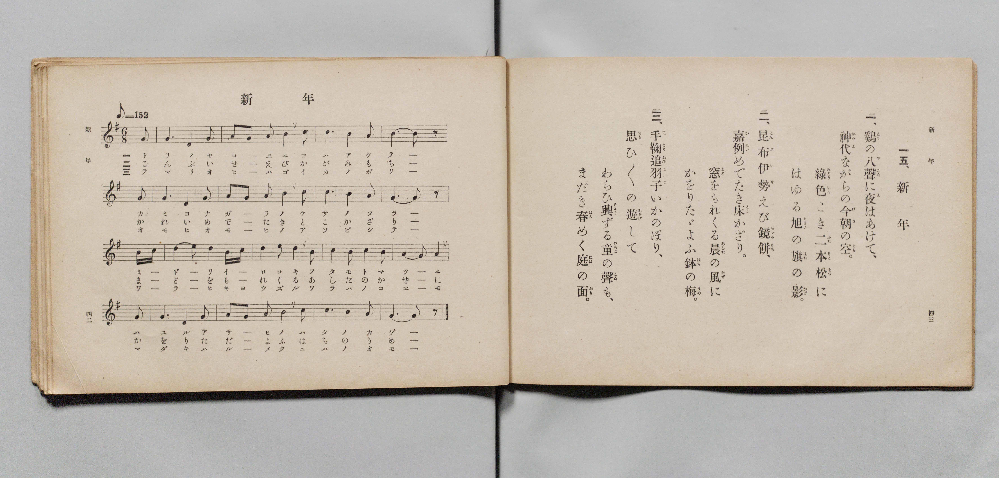

# 新年

> Re:Shōka 使用 AI 協助辨識與重建樂譜，可能會有錯誤。歡迎回報。

- **鋼琴伴奏版**：<br><audio controls src="shinnen.mp3"></audio>

- 詞：文部省
- 曲：文部省
- 文部省《尋常小學唱歌 第六學年用》（大正三年，索書號 4078）

## 說明

原書資訊與歌詞全文（對應 P024.jpg，原書 pp. 42–43，第 15 首）：
調性與拍號：ト長調（G 大調）6/8 拍，速度 ♪=152（換算四分音符 != 76）


## 歌詞

```text
一、
鶏（とり）の八聲（やこゑ）に夜（よ）はあけて、
神代（かみよ）ながらの今朝（けさ）の空（そら）。
綠色（みどりいろ）こき二本松（ふたもとまつ）に
はゆる旭（あさひ）の旗（はた）の影（かげ）。

二、
昆布（こんぶ）伊勢（いせ）えび鏡餅（かゞみもち）、
嘉例（かれい）めでたき床（とこ）かざり。
窓（まど）をもれくる晨（あした）の風（かぜ）に
かをりたゞよふ鉢（はち）の梅（うめ）。

三、
手鞠（てまり）追羽子（おひばね）いかのぼり、
思（おも）ひ〱の遊（あそび）して
わらひ興（きよう）ずる童（わらべ）の聲（こゑ）も、
まだき春（はる）めく庭（には）の面（おも）。
```

## ABC

<div class="abc-score" data-abc-src="shinnen.abc" aria-label="五線譜載入中"></div>

[下載 ABC 原始檔](shinnen.abc)

## TMD 檔案連結

- [主旋律 TMD 檔案](shinnen.tmd) [[在 TMD Studio 編輯](https://tmdlang.github.io/Tmd-TS/#tmd=s7IKdvYPcrWy4qpTUCpJTLdSSM7PyUlNLsnMz7PKyszLyo8vzshPT8wuBdHZiUpwdWX5OaW5qVbpRYkpqfFm8SYG5hYIyeL80qLkVKvi5Iz8_Jz4ktSKkqT8_Gx0-fiCxPRUqwADIxOETEFRfllqXmIeUHdBUWZeSWoKWDtCQWpZZkoqSLostSgzLTM1BYtUcXJiXjymPFCkGOQvqO0lRYl5xclFmQUgzyJU5ReVAH1clFiQUWmVkVlckl-UmZyYE5-dmIfk-5KMVKDn01KLSzLLEnPQxYtTE4vz84qRzcxMz8yzys3PSyoFhqMSl5aWwrNpG57u3KKgpcWlaKtgbsZlb6vgzmVjpm9hB9L2YuW893tmPZvW_rJ5xfM5jWCjns3ehCkG4z1u6Hq6ofvpjh1PN_Q_Xbvj6ZSNz9b2KDxfs-Zp61oQf-eW51NWPG7ofr-n4-mS5c_WLn6yoxMo-H5Pz_Mti57N3vFi5nwFUCS-39OpxMWlr6VgSy3ApaCg8LRvPsiOze0vVnS96GgHOg3owaetK4DOBzloQ--z9k4FUErQyypIB7oJol6hoEBPwcToUcNkE2OQQ9esUTA0VXi5bBrQkcCQABn8YtX-Zw3LQUZ29wK9ABR93Nzxcup2oDjQYHcFoF_BzE5gwCoA1QCNedkw_-muZQqPZq6yNTQ1Aqp61j_7-brpT2fPftrR9nL-5udrlimAowSoiwtkx5MdDY8bGkGsl9v6geofN6543NQFlH3cuO5p6-oXjcBo6Xjc1PK4cfLjpolg8dVPl8wBC3aAuesfNzY9bpz4uHEZ1KDnS-c92b0YbFb348b9MHWrHjf2PG4Cmftkd9ezOXPBCoDapkIse75yF1hkLlANSKShCWzWtgUvOsFOABrUuBLotMeNLY-bgF4F6pn8uLH3ya6eZ3PWPJu7D6xm6-PG-Y-bgM5Z8bhx3-PGJRD3ggwCubOp7XFT97Ppa8FKgYqmPgb5DmT5s-nTwYJAvwCDGez3vRthPpgEdQ44uHb1QH35bEbb0x3NYDXAkAE6ZRtQ2ZM9XU-7F4EFgSE2G2wUkL35Zf_Cl0taoQY2zQOHCtABC8Emg417OqPzyT5QAgar6AHqB8k1NT5uXA7yU2Pv013AWAFHT-NksLlAl00DhQc0oFYBRYHSQF-vBOucBLIBZFA_yNMzV8A8PR3uxZeLIIJAg4DxiQgooP1AzcCABgblPGDsAYP1ZSfEU8DwAbsZGGKLIN4BBmkjcvjsgHnoWWf3y3kLwGqWgZwFTlQv9u99vm_v07UTwOJAKzY9btzwuBEYI0AzgSEGdMq6x417wN6CmNIASSddQN-AFW163LAR5PZGSGgAPTQXGL5gKaDPloF90AT0Mkjpiw5gygMq6gV7og2saBYwNJ6vXgpOvxBlOyEegqZ0eDIHhh7ECeAwXQA05dkMsDZQQgJGFCRy-p_ugiSn1UBxaLDOhYQVzMmQ-KG8qIECBS19Lq7gjMy8vNQ8q4DMxLx8hxqDmmqQHQo2Flp2YAa2Ig5UXgJz-4uFPQoaJgrAkvT5-gYdeLmkiUUD0CaQYTUKxgq6QGwIJE3jgVxDBSMg1xQsWAOlQZJGUKUglq6CgUINWLuPYY0CsNwCijxuXgXEfWDWEqDax02bweyNQNwNZq0AiTb3g9hNi4B4I9g0kFgbmAWCQBdAzDUCijdOBqudDGRtA7EaW0CqG2eD2R1ADLahsRss2gNm7weqb4KZ27gQ01xjmH2Pm-eB3QyyYRXYFZPAohOAuBcsCvHFarBoHxDPgbsXpAthLv5I2dVD9UgBRYApWAkoUkCKdMEkSqRAHT4fHPAgVhfYO2vA7JWwqAJGAkh0K8yTTXvhnlyJI1LAkdnUA44OEKsRHNTLwcEPtK0RHHiN4MiGRCBQB7A0g5nb1IU9UoCRAHIDMGFAIgIaKYvAopPg7l0ENgPkysfNwITRtB1HIiKQUzrJiRRQHBgpmMeDowMURyawOALyzOCRYgiNIpBiMA8pp8wHO7wTTII8DPLMEjBvLSzHNK0Fe2cqmA1Mz9Ag6ACLzgOzQQEPooEpHyli9oEDGxRtwDIeajYoL0AiC5LvIHkFLNo4HRxhINY6sCg4YhshqRxY5qHkmPXQZAOJDIjZa6Epq2kZEO8CSwE1ISl-3DwTmq6QiwOI04HxiD-OgK0acuIIPacYKpjFg_IQJFpA0WMKjRycOQdYRD1uXgb1DyLNQfIIPCUCVYFE90N9CMlvkIDZhJnCoTkHEjGQPAAKfJDoArAIqDgD29C4Hl50gSIGWLXBzW3ENBccOaCCrAGadOAug7i9eSFQFBIf4KiHFL9g90IKMVgeQ5hby8Wla6cArYQUgExlLgA)]
- [鋼琴伴奏 TMD 檔案](shinnen_piano.tmd) [[在 TMD Studio 編輯](https://tmdlang.github.io/Tmd-TS/#tmd=s7IKdvYPcrWy4qpTUCpJTLdSSM7PyUlNLsnMz7PKyszLyo8vzshPT8wuBdHZiUpwdWX5OaW5qVbpRYkpqfFm8SYG5hYIyeL80qLkVKvi5Iz8_Jz4ktSKkqT8_Gx0-fiCxPRUqwADIxOETEFRfllqXmIeUHdBUWZeSWoKWDtCQWpZZkoqSDoxOTk_tyAxLzM3NQ9Jviy1qBjkeKgVJUWJecXJRZkFIB8hVOUXlQC9VZRYkFFplZFZXJJflJmcmBOfnZiH5MXEIqDm9FSQ-VYFmYl5-fE47CzJACqySkstLsksS8xBFy9OTSzOzytGtjwzPTPPKjc_L6kUGKpKXFpaCs-mbXi6c8v7PR0vu_c8n7DlyZ4tT5f2P-_seL-nU0FLi0vRVsHcjMveVsGdy8ZM38IOZNaLlfPe75n1bFr7y-YVz-c0gs1_NnsTphiM97ih6-mG7qc7djzd0P907Y6nUzY-W9uj8HzNmqeta0H8nVueT1nxuKEb6IqnS5Y_W7v4yY5OsKN6nm9Z9Gz2jhcz5yuA4hnoJiUuruCMzLy81DyrAFDIBHk41BjUVHMpAIGNhZYdmKGvpWCLDkDWPdnR8GJhj4KGiQLQIc_XN-gogNKAXlZBuiYWDVr6YMNqFIwVdIHYEEiaxgO5hgpGQK4pWLAGSoMkjaBKQSxdBQOFGrB2H8MahcfNHUCRx82rgLgPzFoCVPu4aTOYvRGIu8GsFSDR5n4Qu2kREG8EmwYSawOzQBDoAoi5RkDxxslgtZOBrG0gVmMLSHXjbDC7A4jBNjR2g0V7wOz9QPVNMHMbF2Kaawyz73HzPLCbQTasArtiElh0AhD3gkUhvlgNFu0D4jlw94J0IczFHym7eqgeKaAIMAUrAUUKSJEumESJFKjD54MDHsTqAntnDZi9EhZVwEgAiW6FebJpL9yTK3FECjgym3rA0QFiNYKDejk4-IG2NYIDrxEc2ZAIBOp43DgNZm5TF_ZIAUYCyA3AhAGJCGikLAKLToK7dxHYDJArHzcDE0bTdhyJiEBO6SQnUkBxYKRgHg-ODlAcmcDiCMgzg0eKITSKQIrBPKScMh_s8E4wCfIwyDNLwLy1sBzTtBbsnalgNjA9Q4OgAyw6D8wGBTyIBqZ8pIjZBw5sULQ9bgIFIchsUF6ARBYk30HyCli0cTo4wkCsdWBRcMQ2QlL548bVKDlmPTTZQCIDYvZaaMpqWgbEu8BSQE1Iih83z4SmK-TiAOJ0YDzij6Ons2eTE0foOcVQwSwelIcg0QKKHlNo5ODMOcAi6nHzMqh_EGkOkkfgKRGoCiS6H-pDSH6DBMwmzBQOzTmQiIHkAVDgg0QXgEVAxRnYhsb18KILFDGPGyHpGmRuI6a54MgBFWQN0KQDdxnE7c0LgaKQ-ABHPaT4BbsXUojB8hjC3Fq0OsgHWx0EDDxQmAJDD0IR5pvGQ1gGYAhxPvG6YDRcBaoxOJXBDTIhZDAOB-E0GaeLgOGna6cADcJoH8NYBWSuESrXGMxV5gIA)]

## 分析

```text
================================================================================
📊 TMD Song Profile: [ 新年 ]
================================================================================
⏱  Duration:       0:37 (37.9s), 16 measures total
🎼 Key & Tempo:    首調基準 G, != 76.0 BPM, <6/8>
   - 分析範圍：      由實際發聲的音符與和弦推測調性；播放脈絡另行呈現
🎤 人聲音域:    D4 (MIDI 62) – E5 (MIDI 76) [跨度: 14 個半音 / 1.2 個八度, 難度: moderate]
   - 最低音:  D4 in [Shinnen #1 @ m.1, 0:01]
   - 最高音: E5 in [Shinnen #1 @ m.11, 0:23]
   - 適合: soprano, mezzo-soprano, contralto, tenor, baritone, bass
🏛  結構:      Shinnen (37.9s)
⚡ 編曲密度:        Peak 1 軌道同時演奏
🗝  調性診斷：       G 大調（純淨自然大調，未偵測到可信轉調）
   - 風格氣質:    純淨自然大調（陽光明朗、易唱易記，無明顯調外色彩）
   - 轉調歷程:    全曲維持單一推測調性（未偵測到可信轉調）
   - 核心骨幹音:  B, G, A, D, E
   - 調性數值:    G 大調 [相關度: 0.80, 穩定度: Moderate, 自然音純度: 100.0%]
   - 候選調性 (K-S): G 大調 (0.80), B 小調 (0.67), D 大調 (0.62)
   - 五度圈歷程:   +1
   - 各段落調性細節:
     • [Shinnen #1]: G 大調 (r: 0.80, 自然音純度: 100.0%)

  [ 五度圈游移軌跡 ]
               C  
         F           [G ]*
      Bb               D  
      Eb               A  
         Ab           E  
            Db       B  
               F# 
     (* = active key center)

  [ 十二半音累積音高分佈 ]
     C  : █                          1.1%
     C# :                            0.0%
     D  : ██████████████            17.2%
     D# :                            0.0%
     E  : ███                        3.2%
     F  :                            0.0%
     F# : █                          1.1%
     G  : ███████████████████████   28.0%
     G# :                            0.0%
     A  : █████████████████         20.4%
     A# :                            0.0%
     B  : ████████████████████████  29.0%
--------------------------------------------------------------------------------
Assignment 軌道音域：
  - Piano         : D4 – E5 (14 個半音 / 1.2 個八度, 65 個音符)
================================================================================
```


## 原書掃描頁




