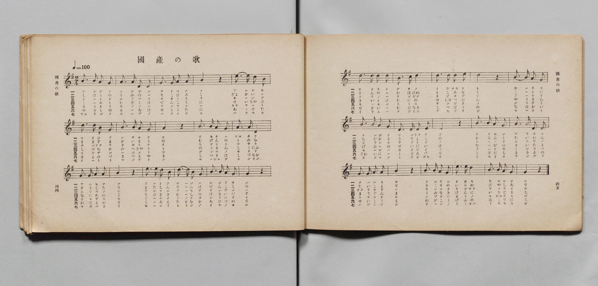
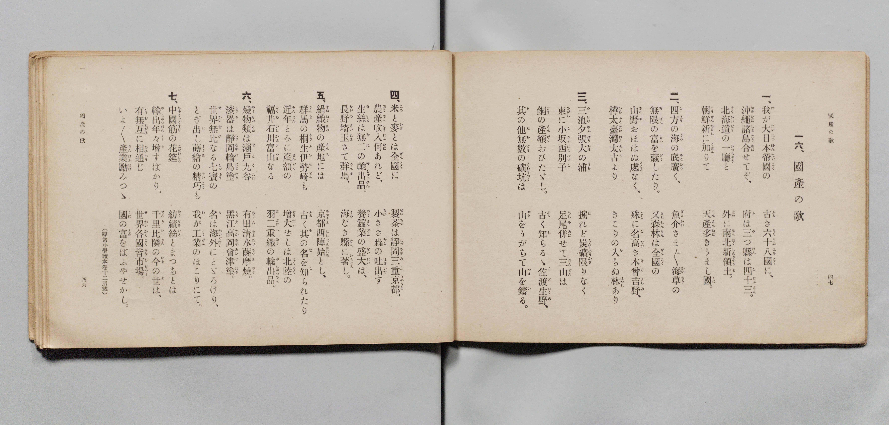

# 國産の歌

> Re:Shōka 使用 AI 協助辨識與重建樂譜，可能會有錯誤。歡迎回報。

- **鋼琴伴奏版**：<br><audio controls src="kokusan_no_uta.mp3"></audio>

- 詞：文部省（尋常小學讀本卷十二所載）
- 曲：文部省
- 文部省《尋常小學唱歌 第六學年用》（大正三年，索書號 4078）

## 說明

原書資訊與歌詞全文（對應 P025.jpg–P026.jpg，原書 pp. 44–47，第 16 首）：
調性與拍號：ト長調（G 大調）2/4 拍，速度 ♩=100
排版說明：原書 P025.jpg 為跨頁連排（左頁與右頁同行連續閱讀），且部分樂句收尾小節
於同小節線內附記下一句之 1 拍弱起音；轉錄時依標準 2/4 拍小節長度對齊。


## 歌詞

```text
一、
我（わ）が大日本帝國（だいにっぽんていこく）の　古（ふる）き六十八國（ろくじふはちこく）に、
沖縄諸島（おきなはしよたう）合（あは）せてぞ、　府（ふ）は三（み）つ縣（けん）は四十三（しじふさん）。
北海道（ほくかいだう）の一廳（いつちやう）と　朝鮮（てうせん）新（あらた）に加（くは）りて
外（ほか）に南北新領土（なんぼくしんりやうど）。　天産（てんさん）多（おほ）きうまし國（くに）。

二、
四方（しはう）の海（うみ）の底（そこ）廣（ひろ）く、　無盡（むじん）の富（とみ）を藏（ぞう）したり。
魚介（ぎよかい）さま〴〵海草（かいさう）の　又森林（またしんりん）は全國（ぜんこく）の
山野（さんや）おほはぬ處（ところ）なく、　殊（こと）に名高（なだか）き木曾吉野（きそよしの）、
樺太臺灣（からふとたいわん）太古（たいこ）より　きこりの入（い）らぬ林（はやし）あり。

三、
三池夕張大（みいけゆふばりおほ）の浦（うら）　掘（ほ）れど炭礦（たんくわう）限（かぎ）りなく
東（ひがし）に小坂（こさか）西（にし）別子（べつし）　足尾（あしを）併（あは）せて三山（さんざん）は
銅（どう）の産額（さんがく）おびたゞし。　古（ふる）く知（し）らるゝ佐渡生野（さどいくの）、
其（そ）の他（た）無數（むすう）の礦坑（くわうかう）は　山（やま）をうがちて山（やま）を鑄（い）る。

四、
米（こめ）と麥（むぎ）とは全國（ぜんこく）に　農産收入（のうさんしうにふ）何（なに）あれど、
製茶（せいちや）は靜岡三重京都（しづをかみへきやうと）。　小（ちひ）さき蟲（むし）の吐出（はきいだ）す
生絲（きいと）は無二（むに）の輸出品（ゆしゆつひん）。　養蠶業（やうさんげふ）の盛大（せいだい）は、
長野埼玉（ながのさいたま）さて群馬（ぐんま）、　海（うみ）なき縣（けん）に著（いちじる）し。

五、
絹織物（きぬおりもの）の産地（さんち）には　京都西陣（きやうとにしぢん）始（はじめ）とし、
群馬（ぐんま）の桐生伊勢崎（きりふいせざき）も　古（ふる）く其（そ）の名（な）を知（し）られたり
近年（きんねん）とみに産額（さんがく）の　増大（ぞうだい）せしは北陸（ほくりく）の
福井石川富山（ふくゐいしかはとやま）なる　羽二重織（はぶたへおり）の輸出品（ゆしゆつひん）。

六、
燒物類（やきものるい）は瀨戸九谷（せとくたに）　有田清水薩摩燒（ありたきよみづさつまやき）。
漆器（しつき）は靜岡輪島塗（しづをかわじまぬり）　黑江高岡會津塗（くろえ高岡あひづぬり）。
世界無比（せかいむひ）なる七寶（しつぱう）の　名（な）は海外（かいぐわい）にとゞろけり、
とぎ出（だ）し蒔繪（まきゑ）の精巧（せいこう）も　我（わ）が工業（こうげふ）のほこりにて。

七、
中國筋（ちゆうごくすぢ）の花筵（はなむしろ）　輸出年々（ゆしゆつねん〲）増（ま）すばかり。
紡績絲（ぼうせきいと）とまつちとは　千里比隣（せんりひりん）の今（いま）の世（よ）は、
有無互（うむたがひ）に相通（あひつう）じ　世界各國（せかいかくこく）皆市場（みなしじやう）。
いよ〳〵産業（さんげふ）勵（はげ）みつゝ　國（くに）の富（とみ）をばふやせかし。
（尋常小學讀本卷十二所載）
```

## ABC

<div class="abc-score" data-abc-src="kokusan_no_uta.abc" aria-label="五線譜載入中"></div>

[下載 ABC 原始檔](kokusan_no_uta.abc)

## TMD 檔案連結

- [主旋律 TMD 檔案](kokusan_no_uta.tmd) [[在 TMD Studio 編輯](https://tmdlang.github.io/Tmd-TS/#tmd=s7IKdvYPcrWy4qpTUCpJTLdSSM7PyUlNLsnMz7PKyszLyo8vzshPT8wuBdHZiUpwdWX5OaW5qVbpRYkpqfFm8SYG5hYIyeL80qLkVKvi5Iz8_Jz4ktSKkqT8_Gx0-fiCxPRUqwADI1NdIGGGkC4oyi9LzUvMAxpRUJSZV5KaAjYDoSC1LDMlFSRdllqUmZaZmoJFqjg5MS8eUx4oUgzyHNQJJUWJecXJRZkFIB8jVOUXlQC9XZRYkFFplZFZXJJflJmcmBOfnZiHFAQlGamgEEiFKkSXKM8vQvIy0IT0zDyr3Py8pFJgUCpxaWkpPJ3T_XzK4seN656t7VHQ0uJStFUwNDDgsrdVcOeyMdI3sQPpfrFy3vs9s55Na3_ZvOL5nMb3ezqebuh-umPH0w39T9fueLGu4dmcNU97tz_tbXyyq-dZZ8OLPZ3v93SCLX42exOyVogYjPe4oQvZoKdTNoJc8XzNmqeta0H8nVueT1nxuKEbZOGS5c_WLn6yoxMo-H5Pz_Mti57N3vFi5nwFUKyDLePS11KwpRbgUlBQeNo3H2TH5vYXK7pedLQDnQYMh6etK4DOB4dA77P2TgVQ0tHLKkh_1DAZlIBATKDzIFoVCgr0FExMgFIm5iA3r1mjYGim8HLZNKB7gYECsuPFqv3PGpaDTO_uBfoGKPq4uePl1O1AcaAd7gpAb4OZncCoUACqARrzsmH-013LFB7NXGkLiimgIc_6Jj3v7HixatWzGX1AE6CWw1ym8Lxp14vtK14uaHzZsBioFOT27cuAXKCtT_s3AxlPJ_S8WAg0d_HzXT0vp20ExifYgT1PdkwBxtPTjrZnK5qe9i99NmXb0w37gFH1fH0D2Nppe4A6Ifzn22c9bV3-cmbLixUznuzofrKjAajhyc5uBUOQq5_u2fhi6_aX8ze_3zP7xd7Olz0tz2Y2Pdk399mKmc92TVOA-g1iEtDzQO8BQ_fl3q7HDU1cIJuAxj1uaATb2TER6P7HTf1AFz5u7AGliulLQalvx1xgSgZJNS543NjyuHH140Zgqt77uGny48ZlYBEgA6Jr3eMGoOuWgBVvfdwE1AUU7AUlud7Gp62roeY09QLVP26cAVLTuP5x40IkE1bDXLNp2vMdLS9W73i6eRvYuC6gQY8bV4E1TH_cBBSZ_7ixDajn6YQOsIImoBTYiNlgZ80DGgRyza45ENeApdYDUzmYC4r3x41Lnu9YDOZOBHoGouDp7NmgvAZVNh3myqlQBcBQAyXfnunPgIHeCBQCKtoN9k03OCSAIQRyEzAkQPG0GxgrQAVA8SUgXzYBGRBZYM4DZuy5L9etAysAOrcN5G6wHc-mbYD6pwmoEphuQaHytGsBWBBoEdiTTcDgWAZ2yhJgkoc4AhLaq5_2Tge5b9qGlwtmPJ0D1A-UXQWOrD1g_cDAmwzSD3bN48aVEG-BgmrJSmB5BXUQSD3U00-XzILFwG5IhII17gMaBUsYQGNXQ4MHnKh29UCjERicz6bthIUlMOqgoQMMPrAg0BxIVKx7umsqWGQuMDGALN0NcckmYGoBK-iHxOfzloXPZy8Ep6IGUORA423d0_U9YPUroAY2TXoxHZiigCLzYJYCHTAf5HFIHL5cO-vJbojr-8DJCRSBYHVTQX5r2PK4YSvQlS96ISkBEr1AKagHwAm949nidc_mTQcrAAYHMEHCAxeWnFpXwMJoDjhMEVkFHDwbN75sBxYsQGlQYAPjBCwHCmlwaK15MRMSKkBvAWUhIQHMA9DAeLauCywLNHQFNPIn9L5cPQMa56DUCM2Cz-aseDZ739MJnTDrgHE4F-xtYKgAEyEw6iDZbsWup0tWvWjf9bwREv7d4FQIzAFAFwD91wIsH2CpYhUsp4PFwbEGMhEUwsCoAVoADglg1LQuhWQDsAKgaWtgYbYenAiBbKAgMLkjFUow9wBZzzYueLpk6tM9W4ElEiTvgq0DZllg4gE6bAPYFnjiBCatZdCk1QSqKkHB1AcJEbCCph5gmn_etPb5EogyYJIAxQnIX-C4fTlzAizCgSEFyWmgEAeHztyN0ETZCDQF4u7VoAp2bhMsHoApBBTkL5aCKhlwWQlS9rRj6dO1EHN3ggsDsN6GhhfbNgPLfVjxBUw8wCqk88leYGGFXqCBqueNENvBKaVxGjyNgVNzVytYbiU8gQKz8suFwAQD1wB0MSTlAT20GexvYM6YDs366GV2__P5kEgDOxQYaU3AhDD3yd4Jz3YsfD5lPiLRgmwExgYw8JBS0dNWSJk9F1oU7oaUUaCyDJh_n03dAcu_MxHOXbLs6VxwBQSLC3AUQGTXg5wI8T0owQADDJTBwWqAvgJWH8swZV9OBKY3eKrrhiUtYIEEdeTzjZDSGZhKgc0uUKH8chfYzyCHgaMelObx5GBgVdXwYt8mYECDqm9oIl8HdhUkxIFZC8gGJgFQ5fNkLyQnA9MSuKgEJXhQUoS65sXivS96IKEGjG6gN0DVBcTzL-fOebppITABvGzvfbJrzcvmvbDydCk4FIDBBMwSO0BZDlqmgwsDSMRugBSCwDACNhYhhVvvi_lANsSfkDS87umECU_bd0HzJCjrgqoysNRMcFBNmf98K1gPVA5S2qwHRiawqIeZBfHWuhd7dgDNejoZ1JYF51FgsgaSwEQPLMuhlSjQZS-XdL1YsO3Z0rWweIMHG9BLkNp63XNgZQzN9JBAATVAYCkCHGzAJg0wLT6dv-d5H6ScBgYvMFSBsQD0KFADsGgCpwcQd9nzfUteLlsDVjYBbBNYClKSotdHQHN6MVoHq19MhBRc4PgB1T6Q3ALKRdCKbwosdW3d-XznlOedwOoVEmprQBkPVDMAszU4q4Cz6NM5kMoe4nNgvQZOV-AED4lqYEHycibEGYjohZQrjxsXQYvi5ZD0CYw6oJOgiRnsKohTsHobWFAunACM2Cd7up52L3q6BVYtgMo7YKkKtAkY5NOAIuD8g72QQMvnwMoHEgeQHIhRhAAjBlQBg5P7_ong3gbESqCb1sLCGOhwYGpejbv4Ale9i6bDEgaoekdKGEBHgxoawBbQy5ngYgbSPAP5Cqnefb6s_8muqc_nb366fS6w5QArWYH-BiqdAPY90BRgxgIG6QpEqQJqRwFLkobn-_YC0z0wOwKjGBby28CJDZgLQbFMfE6AFEqta2Fx1Q7sb6x8uRDYKYTkCmDogBIMyF5Y0n_esOJZx44nO-e-2ABJtEA_A0MNWGYCHQBphgEbl53Pp2x4tqP12YYtL6atfDZxJdBkaK0CCgugSqDJkMp0KTh3AF21D2Ij1GGg-m5P29OZwLwOKW2AKiANEGiJ9GLPKmDj_OlCSJZAKo5AxTew2QxsEa2BhgUwu--e-GzjfGDbBKjx2ZzmZ1uWwjQCQxyYPTogUuBaD1i9At0E1wt2ypMd055P7QHVHushQQ70NLhNBip5IEUbKHKe7Gh-uh6SKCEu3ojSYkNOoI3rgZke1nyGNO-A2QPodEgwA3MYMObngR0HLACAbRNwBIGDug9WWELKyOkvJk15vhNoKFAE6GlgwAIrMnAG37Tv6Xbk8guYjsGuAecn9A7X9qXQ0hCsDLkcBCdiSGsK6KxliGZSM7yZtBY02rAWUg4Aqw6gdiCaAk4VwEp2ETRBdm18vhbSuACmWGB4gWoAaLMSWJdBkutOYMsX3JhASbGg_Pm4ARTQwLwH8SmkfgA1wEBxDmtXP9-y8PmOfbDqAtjlAPdsUOoNYAgCgwncJQJXsaCY6W1-2d4DjNuXsyCFHagzBPYwMKvAm9PAlgSkwQvPkMBuFjgCm4B9QKRqAZT8QXUTJMkDW4JAjwKTPLAMgSSV1c9n73jZAOnWQBIc0DWQdDIDVPSCE9vTCS2wmh-W2EAkMEShTYDns9qe7mh6ugBSjgFzErDSAPcY4R09SJCAk2nH44bNwC4FqLUAjWWU2u5pNzxeQG1AsHFLgE0uUNigdbKwdXbAsQAsmCHFNtCV4CoJaDdQHTEDSiCllA_tQIGClj4Xl3d-dmlxYp5ffmhJolVAZmJevkONQU01yCIFG0MzLTswC9vAEmiUCth7frZuq4KGhQJk6EIHacwFLAscVQEOtTxu3g0cZ9HEYgbQCSDzaxRM4xV0gUMlugrGQKyrYAQUAvHMQMJwuRqwLAgbQWmgRrB6oCIorgEb6GNYo_C4eT2Q_7hpDYhsbgCrety0BKjncXM3WKwFTM4Fk5vBpj1uboOqApEgscdNIFNAMn1Qmx43TwWTqxG2GQHlG6eDRBvBdjaCTAHR60A6wTxgGoCKgPTugZjZCLa7cTKY3AS2rRcq0w-zrQnkcmByRdhmDJKHmAb2QeNEqMo2sM6tYLENYJEuFNvAvMbdCHeAXQaUaeqE2QaRbepB2GYC0gl2YVMjWMUKuLtAMqBQgYhB_Q63bQ5YFcRvEBLkJ5AMKORg4QN3BcQ2U5A8KAyANQuYBLkZ4hOQO5uQdKGGJDhOoLYtBJPg-IG6CmIbqGmGbqEZyFiIKNhasBXwqGsCJxRoMKN6bzaSx0EeAxZdGN4DOxccCVDbzEHyoIIf7gxg8Q9V3A_WPBPMXoTFh5CUtQoa9iA2KMWBHAlyOCwFgMUhjBpw9QNUYQbkgPIGKMeA8wiKCCRngXIUCIMgJGfB8hlIHkQj5aymtWCXgUlw_njctAPiFmjeAAdIMzi9gHMRSA8k-EABCnEryCcIsyApFayvafvjZlC4ImUuaMRCIh4S5qAMAJKZBObNQwpQaLCA4wMS-pAABg0gQaWQoxXs4sZ9CAvB-WslWBRiBDT1AtsAUO0QeyCGgDMAJI5h0YPIvOBMDRIHZShYEQFKH5AsgZzFkBMwqEsKV4rI0xDDIdpBSQvkfYjBINdCLAQlS5AOiN9A3VMwA5J4wCGDlNEgIQkxEOI2UMJDhDdEF6jogWR-hB6QaoiFE1B0gIIRFk_gogyRyyCBCc1loIiAx2HjUqSIABe9kOhAyZkQ22BxC1EFKSgw_AbOZRAVkCQKcRuIje5SSHYDFZbwZIGUYmBZDxIZkBwPsRPkLmj-wlk5AituPJXjLtCUA3GVIywXgmtDRHYFsWBVJqQiBGFY1kbNwGCtyDkYXH80LQOT4NIGnPdAMuAaAFoPggMJnKdBeRuSO8FpEVxfPm7aiKg4oVkXTIIKA6g2pApyGlK4IzIgPO1DQxmSdqDxD00z4LQJiTdYTkNJoYiqBjkLQ0yF2IRI4yCZnWAeJIVA0j00O0FtgpQpkMoGWv1DYx8cYEh5FTkHg1MxVC_EVlj6BocHUvUDy0WgigokD676oe6F5A9QAQ93DzRMIH5FylWgPAyp4qEFBMR4WBEACW9ErQZRhajVILUWpAkCsgFefkH9AAkLUNMAORdj-BJeKoLLCWj8grqFcEtgdRSw_wgmIZEK0owowCFOgjgTXGgiZWVIYEFIiPGgqANXpUgykOCBeh4pscBaVqgJBxKkkACDlP3QzIbcxEStGhH5CNIkBbdM4bUjtOWqq2AApZFzG1KeaQYnJFirsgmcMCHtTXAbFZInQRkK0t4EycFaqo2Pm6EeBysCQYg7UPMZorEF8yY0A0MDBeJpRGMQ1rgAxxs8OMGpGxpxWGwC5zBwCkPJiaCKCFFiImyH5hYgD1RhQdwHcwO0BAEnCyw2gfMWxM0LwCSkzAbnA7gMUhKA5x1IOwzkCvSGETQFYbEMnKUgdSqi-QC3DKkigbHBDRUgDcrqIP5qHB7GsAmRmSAtXahNsMyL1EKBtvZgTQlQFgWJdoM8BJaB5YaN2G0C5yFwVECrXUQfBeQniOmQPAnxOcwmWAA2wfIQ3CZI_wbZJgL9xE68_cROoqtCinInjtZsMzhUoDUepEaEZgtoLQepH8EtQnC9CZKBtGNB-Rjaz4TVn83gIhRiGjSvo_cUEY1EWGaFpSJINQWRhyR2aCkJbQKBaGiRDW_LIlcRkAIZqcgGZ1OISRB14JIIXAGAZCBuQBT0cBkwDZKbCsSQtjCsskYuWJAqD6TMCilvkQsbWK5DbuRCyn1olQQ2A5L-kTM7IoMj9X7AqRS5GYvsIkRHAOFzRLWIaALACrzdMP3wJjyyaZBqFRyzSLkWuXCDuAjWSEDuV4CGKVECDpadVsCCFN7ZB3XgYQUApCQDFf7I2RdSt0K8gNp2Qq7LUbvZsCJpFTzyQWNeUEmIHyDlC6RUQGrSwoZVzOCdRMhwDGzYxQQsApPD3uJEqwJhGQbY0YNVhKBWGyipQUrt7WBxYPaBVHKIehCcLqH5CZIfoWkGyoPkN1DQoFeEIHWwAIeUb1DfQyIGmA5B4rD4glV44NBAKvcRMhAxRMsBvTqEVGCgEhVWScHSIUQPuAcJEoTFGkwaEgKIxgikUYSIJkixDGrsoNeLsGwDyqYQ_bBRCEhDCSS-DJQYoR5GlkMeloJ2xqEehqRHkGr0qhFkDsT7sDQFK0ogGRQY1EB_wGyAdfEhvoWo2IbiSkjLGByw8H4XclYDZWCQiulwM2FVMdiNoLodqciA-Q9SlENGXyA5A1xkQFXAfA4KY7RqEhz50HBDKqZgiQnkB5AILNRg1SGkJwGxCVKEw9rTiLEKSJwiVZaoWQox5gmC2NqQkFYHuH5qBpVykEwDzkCIYRUs7UFIwQ4dToMWe8A4glUdWHSBEzOkIkSkSYgPYAUyFl3g9AjxPXTwARqWM5AqFKwNLmjjBKWNBglecG2CSInYmlCQeIFkMFC1DUkHsOyKRRe4PAUPj0IrQ4h_QOkIXJ5iC5ZaLi5dOwXkwfJoH8NYBQwxIyxixljETLCImWIRM8MiZg4WU-YCAA)]
- [鋼琴伴奏 TMD 檔案](kokusan_no_uta_piano.tmd) [[在 TMD Studio 編輯](https://tmdlang.github.io/Tmd-TS/#tmd=s7IKdvYPcrWy4qpTUCpJTLdSSM7PyUlNLsnMz7PKyszLyo8vzshPT8wuBdHZiUpwdWX5OaW5qVbpRYkpqfFm8SYG5hYIyeL80qLkVKvi5Iz8_Jz4ktSKkqT8_Gx0-fiCxPRUqwADI1NdIGGGkC4oyi9LzUvMAxpRUJSZV5KaAjYDoSC1LDMlFSSdmJycn1uQmJeZm5qHJF-WWlQM8gHUnpKixLzi5KLMApC3EKryi0qAfitKLMiotMrILC7JL8pMTsyJz07MQ_JnYhFQc3oqyHyrgszEvPx4HHaWZAAVWaWnQk1ElyjPL0IKAKBV6Zl5Vrn5eUmlwIBV4tLSUng6p_v5lMWPG9c9W9vzfk_Hy-49zydsebJny9Ol_c87O97v6VTQ0uJStFUwNDDgsrdVcOeyMdI3sQMZ-WLlvPd7Zj2b1v6yecXzOY1AzU83dD_dsePphv6na3e8WNfwbM6ap73bn_Y2PtnV86yz4cWeTqBxYNc8m70JWStEDMZ73NCFbNDTKRuBTlN4vmbN09a1IP7OLc-nrHjc0A2ycMnyZ2sXP9nRCRR8v6fn-ZZFz2bveDFzvgIoYYAt4_LOzy4tTszzyw8tSbQKAAVlkIdDjUFNNZcCENgYmmnZgVn6Wgq26ABk6ZMdDc_WbVXQsFAAOuf5-gYdBVDS0csqSIfKvljY83T7ssfNu5_2b9bEYoaWPtj8GgXTeAVdBUMgNgZiXQUjoBCIZwYShsvVgGVB2AhKAzWC1QMVQXEN2EAfwxqFx83rgfzHTWtAZHMDWNXjpiVAPY-bu8FiLWByLpjcDDbtcXMbVBWIBIk9bgKZApLpg9r0uHkqmFyNsM0IKN84HSTaCLazEWQKiF4H0gnmPW7cDxUB6d0DMbMRbHfjZDC5CWxbL1SmH2ZbE8jljxtnIGwzBslDTAP7oHEiVGUbWOdWsNgGsEgXim1gXuNuhDvALgPKNHXCbIPINvUgbDMB6QS7sKkRrGIF3F0gGVCoQMSgfofbNgesCuI3CAnyE0gGFHKw8IG7AmKbKUgeFAaPG8HxBnYzxCcgdzYh6UINSXCcQG1bCCbB8QN1FcS23sdNkABDstAMZCxEFGwt2Ap41DWBEwo0mFG9NxvJ4yCPPW6cj-E9sHPBkQC1zRwkvxAUUzBnPG6cAlXcD9Y8E8xehMWHkJS1Chr2IDYoxYEcCXI4LAWAxSGMGi5o5jIDckB5A5RjwHkERQSSs0A5CoRBEJKzYPkMJA-ikXJW01qwy8AkOH88btoBcQs0b4ADpBmcXsC5CKQHEnygAIW4FeQThFmQlArW17T9cTMoXJEyFzRiIREPCXNQBgDJTALz5iEFKDRYwPEBCX1IAPc9buqASiFHK9jFjfsQFoLz10qwKMQIaOp93ARLwBB7IIaAMwAkjmHRg8i84EwNEgdlKFgRAUofkCyBnMWQE_B0mBWwNAzJ0xDDIdpBSQvkfYjBINdCLAQlS5AOiN-ASQ0p7UJCBimjQUISYiDEbaCEhwhviC5Q0QPJ_Ag9INUQCyeg6AAFIyyewEUZIpdBAhOay0ARAY_DxqVIEQEueiHRgZIzIbbB4haiClJQYPgNnMsgKiBJFOI2EBvdpZDsBios4ckCKcXAsh4kMiA5HmInyF3Q_IWzcgRW7Hgqx109RFeOsFwIrg0R2RXEglWZkIoQhGFZGzUDg7Ui52Bw_dG0DEyCSxtw3gPJgGsAaD0IDiRwngblbUjuBKdFcH35uGkjouKEZl0wCSoMoNqQKshpSOGOyIDwtA8NZUjagcY_NM2A0yYk3mA5DSWFIqoa5CwMMRViEyKNg2R2gnmQFAJJ99DsBLUJUqZAKhto9Q-NfXCAIeVV5BwMTsVQvRBbYekbHB5I1Q8sF4EqKpA8uOqHuheSP0AFPNw90DCB-BUpV4HyMKSKhxYQEONhRQAkvBG1GkQVolaD1FqQJgjIBnj5BfUDJCxATQPkXIzhS3ipCC4noPG7BuYwWKqCZBtItodEKkgzogCHOAniTHChiZSVIYEFISHGg6IOXJUiyUCCB-p5pMQCa1mhJhxIkEICDFL2QzMbchMTtWpE5CNIkxTcMoXXjtCWq66CAZRGzm1IeaYZnJBgrcomcMKEtDfBbVRIngRlKEh7EyQHa6k2Pm6GehysCAQh7kDNZ4jGFsyb0AwMDRSIpxGNQVjjAhxv8OAEp25oxGGxCZzDwCkMJSeCKiJEiYmwHZpbgDxQhQVxH8wN0BIEnCyw2ATOWxA3LwCTkDIbnA_gMkhJAJ53IO0wkCvQG0bQFITFMnCWgtSpiOYD3DKkigTGBjdUgDQoq4P4q3F4GMMmRGaCtHShNsEyL1ILBdragzUlQFkUJNoN8hBYBpYbNmK3CZyHwFEBrXYRfRSQnyCmQ_IkxOcwm2AB2ATLQ3CbIP0bZJsI9BM78fYTO4muCinKnThas83gUIHWeJAaEZotoLUcpH4EtwjB9SZIBtKOBeVjaD8TVn82g4tQiGnQvI7eU0Q0EmGZFZaKINUURB6S2KGlJLQJBKKhRTa8LYtcRUAKZKQiG5xNISZB1IFLInAFAJKBuAFR0MNlwDRIbioQQ9rCsMoauWBBqjyQMiukvEUubGC5DrmRCyn3oVUS2AxI-kfO7IgMjtT7AadS5GYssosQHQGEzxHVIqIJACvwdsP0w5vwyKZBqlVwzCLlWuTCDeIiWCMBuV8xAVIzIgIOlp1WwIIU3tkHdeBhBQCkJAMV_sjZF1K3QryA2nZCrstRu9mwImkVPPJnQOID4QdI-QIpFZCatLBhFTN4JxEyHAMbdjEBi8DksLc40apAWIYBdvRgFSGo1QZKapBSeztYHJh9IJUcoh4Ep0tofoLkR2iagfIg-Q0UNOgVIUgdLMAh5RvU95CIAaZDkDgsvmAVHjg0kMp9hAxEDNFyQK8OIRUYqESFVVKwdAjRA-5BggRhsQaThoQAojECaRQhoglSLIMaO-j1IizbgLIpRD9sFALSUAKJLwMlRqiHkeWQh6WgnXGohyHpEaQavWoEmQPxPixNwYoSSAYFBjXQHzAbYF18iG8hKrahuBLSMgYHLLzfhZzVQBkYpGI63ExYVQx2I6huRyoyYP6DFOWQ0RdIzgAXGVAVMJ-DwhitmgRHPjTckIopWGIC-QEkAgs1WHUI6UlAbIIU4bD2NGKsAhKnSJUlapZCjHmCILY2JKTVAa6fmkGlHCTTgDMQYlgFS3sQUrBDh9OgxR4wjmBVBxZd4MQMqQgRaRLiA1iBjEUXOD1CfA8dfICG5QykCgVrgwvaOEFpo0GCF1ybIFIitiYUJF4gGQxUbUPSASy7YtEFLk_Bw6PQyhDiH1A6Apen2IKlFttYuQ_yWLkJdKgcGIfxCtGGsVgZpvFAlmk8kAlVawKTgTMQSsDakBWDpRCK4EabINuBoRaL5WCmAVwtqgpsLGRXYPceNjfA3Q9igawDhqKunQJyQEb7ANVjiBlhETPGIga0FEPMFIuYGRYxc7CYMhcA)]

## 分析

```text
================================================================================
📊 TMD Song Profile: [ 國産の歌 ]
================================================================================
⏱  Duration:       3:38 (218.4s), 182 measures total
🎼 Key & Tempo:    首調基準 G, != 100.0 BPM, <2/4>
   - 分析範圍：      由實際發聲的音符與和弦推測調性；播放脈絡另行呈現
🎤 人聲音域:    D4 (MIDI 62) – E5 (MIDI 76) [跨度: 14 個半音 / 1.2 個八度, 難度: moderate]
   - 最低音:  D4 in [KokusanNoUta[L1] #1 @ m.1, 0:00]
   - 最高音: E5 in [KokusanNoUta[L1] #1 @ m.5, 0:04]
   - 適合: soprano, mezzo-soprano, contralto, tenor, baritone, bass
🏛  結構:      KokusanNoUta[L1] (31.2s) -> KokusanNoUta[L2] (31.2s) -> KokusanNoUta[L3] (31.2s) -> KokusanNoUta[L4] (31.2s) -> KokusanNoUta[L5] (31.2s) -> KokusanNoUta[L6] (31.2s) -> KokusanNoUta[L7] (31.2s)
⚡ 編曲密度:        Peak 1 軌道同時演奏
🗝  調性診斷：       G 大調（純淨自然大調，未偵測到可信轉調）
   - 風格氣質:    純淨自然大調（陽光明朗、易唱易記，無明顯調外色彩）
   - 轉調歷程:    全曲維持單一推測調性（未偵測到可信轉調）
   - 核心骨幹音:  G, A, B, D, E
   - 調性數值:    G 大調 [相關度: 0.80, 穩定度: Moderate, 自然音純度: 100.0%]
   - 候選調性 (K-S): G 大調 (0.80), D 大調 (0.74), B 小調 (0.63)
   - 五度圈歷程:   +1 -> +1 -> +1 -> +1 -> +1 -> +1 -> +1
   - 各段落調性細節:
     • [KokusanNoUta[L1] #1]: G 大調 (r: 0.80, 自然音純度: 100.0%)
     • [KokusanNoUta[L2] #1]: G 大調 (r: 0.80, 自然音純度: 100.0%)
     • [KokusanNoUta[L3] #1]: G 大調 (r: 0.80, 自然音純度: 100.0%)
     • [KokusanNoUta[L4] #1]: G 大調 (r: 0.80, 自然音純度: 100.0%)
     • [KokusanNoUta[L5] #1]: G 大調 (r: 0.80, 自然音純度: 100.0%)
     • [KokusanNoUta[L6] #1]: G 大調 (r: 0.80, 自然音純度: 100.0%)
     • [KokusanNoUta[L7] #1]: G 大調 (r: 0.80, 自然音純度: 100.0%)

  [ 五度圈游移軌跡 ]
               C  
         F           [G ]*
      Bb               D  
      Eb               A  
         Ab           E  
            Db       B  
               F# 
     (* = active key center)

  [ 十二半音累積音高分佈 ]
     C  : █                          1.0%
     C# :                            0.0%
     D  : █████████████████████     20.5%
     D# :                            0.0%
     E  : ██████████                 9.5%
     F  :                            0.0%
     F# :                            0.0%
     G  : ████████████████████████  23.0%
     G# :                            0.0%
     A  : ████████████████████████  23.0%
     A# :                            0.0%
     B  : ████████████████████████  23.0%
--------------------------------------------------------------------------------
Assignment 軌道音域：
  - Piano         : D4 – E5 (14 個半音 / 1.2 個八度, 665 個音符)
================================================================================
```


## 原書掃描頁






