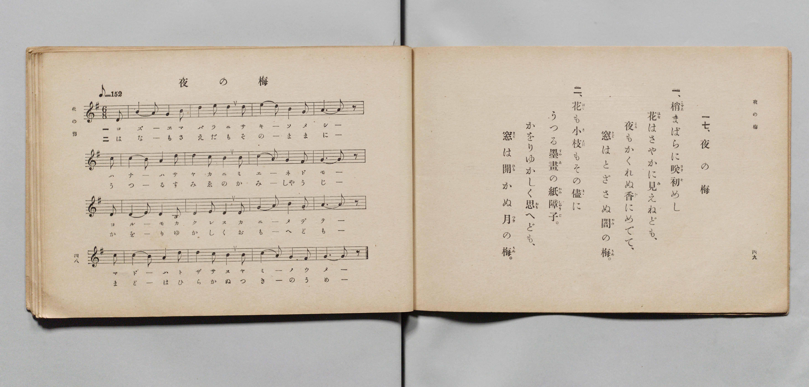

# 夜の梅

> Re:Shōka 使用 AI 協助辨識與重建樂譜，可能會有錯誤。歡迎回報。

- **鋼琴伴奏版**：<br><audio controls src="yoru_no_ume.mp3"></audio>

- 詞：文部省
- 曲：文部省
- 文部省《尋常小學唱歌 第六學年用》（大正三年，索書號 4078）

## 說明

原書資訊與歌詞全文（對應 P027.jpg，原書 pp. 48–49，第 17 首）：
調性與拍號：ト長調（G 大調）6/8 拍（弱起 1 拍），速度 ♪=152（換算四分音符 != 76）


## 歌詞

```text
一、
梢（こずゑ）まばらに咲初（さきそ）めし
花（はな）はさやかに見（み）えねども、
夜（よる）もかくれぬ香（か）にめでて、
窓（まど）はとざさぬ闇（やみ）の梅（うめ）。

二、
花（はな）も小枝（さえだ）もその儘（まゝ）に
うつる墨畫（すみゑ）の紙障子（かみしやうじ）。
かをりゆかしく思（おも）へども、
窓（まど）は開（ひら）かぬ月（つき）の梅（うめ）。
```

## ABC

<div class="abc-score" data-abc-src="yoru_no_ume.abc" aria-label="五線譜載入中"></div>

[下載 ABC 原始檔](yoru_no_ume.abc)

## TMD 檔案連結

- [主旋律 TMD 檔案](yoru_no_ume.tmd) [[在 TMD Studio 編輯](https://tmdlang.github.io/Tmd-TS/#tmd=s7IKdvYPcrWy4qpTUCpJTLdSSM7PyUlNLsnMz7PKyszLyo8vzshPT8wuBdHZiUpwdWX5OaW5qVbpRYkpqfFm8SYG5hYIyeL80qLkVKvi5Iz8_Jz4ktSKkqT8_Gx0-fiCxPRUqwADI3OETEFRfllqXmIeUHdBUWZeSWoKWDtCQWpZZkoqSLostSgzLTM1BYtUcXJiXjymPFCkGOQvqO0lRYl5xclFmQUgzyJU5ReVAH1clFiQUWmVkVlckl-UmZyYE5-dmIfk-5KMVKDnC3IS85CcBhEsycxNjc9Pi09JrESXykssKS1KRbYqMz0zzyo3Py-pFBi8SlxaWgpPl8x53Lju2aJWBS0tLkVbBXMzLntbBXcuGzN9CzuQzhcr573fM-vZtPaXzSuez2kEm_Zs9iZMMRjvcUPX0w3dT3fseLqh_-naHU-nbHy2tkfh-Zo1T1vXgvg7tzyfsuJxQ_f7PR1Plyx_tnbxkx2dQMH3e3qeb1n0bPaOFzPnK4Ci9_2eTiUuLn0tBVtqAS4FBYWnffNBdmxuf7Gi60VHO9BpQA8-bV0BdD7IQRt6n7V3KoDSiF5WQTrQTRD1CgUFegomFo8aJptYghy6Zo2CobnCy2XTgI4EhgTI4Ber9j9rWA4ysrsX6AWg6OPmjpdTtwPFgQa7AwN6OZjZCQxYBaAakG17Nr7Yul3BEMIFGtTzsmH-013LFB7NXGVraGoEVPKsf_bzddOfzp79tKPt5fzNz9csUwBHElA5F8jWJzsaHjc0gljPFi0Cqn_cOPlx46zHTROBCh437nvcuOFxE5Cx-umkTU875oIVTH3c2Pu4EcjufNzU-LhxOtjxXRvBcusfN64C6wQypj5uannc2A3U_GIZKLIeN4Jc_7gRyFj7uHHl46YmqM3AJASSbgIioDqgqU1gbf2Pm3oeN655uWwmWDNYqnE12M7ljxuXQTU_XzUZLA106kqYzSseN04Du3PNy-mgWAE7BGI5KKWC1bcBDQKJNDRBwmFXD9RAdK80NQHT4bN5cL8DyQUwV84FGvi0ZQbUAU3gMGlcDTIFZEHjEqCHni5a8XzqarCKmUBHwEJ23fMtM1_OmvN07QSI50BSjdPBDgVqBJoIdhnYoO7HTZMeN3U9bgJKANVNB4bMswaIc4CCTWDjdqAEKGaYvJwGiYFNwNgEiwANWvNsTgdYcAkwQnEGDtA4yjMOFCho6XNxReYXlfrlhwKLl4DMxLx8hxqDmmqQLQo2Flp2YAa2LAvK_8C0-mJhj4IGNNlrK5goAKPm-foGHXiG08SiE2gpyNQaBQM4NI0Hcg0VdBWMFIyBpCGQZwSmzeKhXJCwEVgJUKgGpEEXCIGUAUgabKCPYY1CPBw-btoMVPe4aRdY4ePmjWByHkiseQKYvRKIu0Gspq1glWshKpv2gmUXgsW2g8V0QeY198PsMUKxp3E9SGXjKqjuJhDZOBUs1gFmL4CLzgWLroOobNwHJUFiqxH2NLYB7cEf7rt6wOFOYnAjgtAYFIJg2gwUiFA5U3CYg-RAakDBbgDiwcP2cXMXNCz7EaHWvATMXg0Ly-b54HBbAVXZCyY7wSoXIYXlCqSwBCZ4aNiBTWicCQ6R_WCRidDwAmYQuCiIB8qZYAYwsIDkDKTgAyokEHw7OskJPkiAwYIPKXmiJV4TqCyID0zZKAEIiWZIUIACDRRU68Eia4C4ByEKDkxIMgSR7WCxNqQABCZkRAA2TYIGICiCgOUSOEwggTkdiMHR1dgFtg2UEEG8HWByJZIYJPSAyRF_6AGrLnJCD5LQkDM3JCwRudkQmkCRk58BSuh1Iie_5g6w27dBkyI09IDJEaRyPlRlH1h2GVgMFJIQXwKtREp8K6EhAo6Hxk1gU0E2gUIQWCiDWWBTG0GJGcSDJEhwKDc1ophay8Wla6cAL1GjfQxjFVAFjMACylwA)]
- [鋼琴伴奏 TMD 檔案](yoru_no_ume_piano.tmd) [[在 TMD Studio 編輯](https://tmdlang.github.io/Tmd-TS/#tmd=s7IKdvYPcrWy4qpTUCpJTLdSSM7PyUlNLsnMz7PKyszLyo8vzshPT8wuBdHZiUpwdWX5OaW5qVbpRYkpqfFm8SYG5hYIyeL80qLkVKvi5Iz8_Jz4ktSKkqT8_Gx0-fiCxPRUqwADI3OETEFRfllqXmIeUHdBUWZeSWoKWDtCQWpZZkoqSDoxOTk_tyAxLzM3NQ9Jviy1qBjkeKgVJUWJecXJRZkFIB8hVOUXlQC9VZRYkFFplZFZXJJflJmcmBOfnZiH5MXEIqDm9FSQ-VYFmYl5-fE47CzJACqyKshJxBQsASqNz0-LT0msRJfKSywpLUpFdlNmemaeVW5-XlIpMLCVuLS0FJ4umfO4cd2zRa3v93S87N7zfMKWJ3u2PF3a_7yz4_2eTgUtLS5FWwVzMy57WwV3LhszfQs7kHEvVs57v2fWs2ntL5tXPJ_TCLbi2exNmGIw3uOGrqcbup_u2PF0Q__TtTueTtn4bG2PwvM1a562rgXxd255PmXF44ZuoCueLln-bO3iJzs6gYLv9_Q837Lo2ewdL2bOVwClAKCblLi4IvOLSv3yQ4FeDACFWpCHQ41BTTWXAhDYWGjZgRn6Wgq26ABk4ZMdDS8W9ihoPN2z8cXW7QraCiYKQDc9X9-gowBKKHpZBemaWHRq6YNNrVEwgEPTeCDXUEFXwUjBGEgaAnlGYNosHsoFCRuBlQCFakAadIEQSBmApMEG-hjWKMTD4eOmzUB1j5t2gRU-bt4IJueBxJongNkrgbgbxGraCla5FqKyaS9YdiFYbDtYTBdkXnM_zB4jFHsa14NUNq6C6m4CkY1TwWIdYPYCuOhcsOg6iMrGfVASJLYaYU9jG9Ae_OG-qwcc7iQGNyIIjUEhCKbNQIEIlTMFhzlIDqQGFOwGIB48bB83d0HDsh8Ras1LwOzVsLBsng8OtxVQlb1gshOschFSWK5ACsvHjSAzQKaATWicCQ6R_WCRidDwetzYDRcF8aY_bmoBM4CBBSRnIAUfUCGB4NvRSU7wQQIMFnxIyRMt8ZpAZUF8YMpGCUBINEOCAhRooKBaDxZZA8Q9CFFwYEKSIYhsB4u1IQUgMCEjArBpEjQAQRH0uAkSJpDAnA7E4Ohq7ALbBkqIIN4OMLkSSQwSesDkiD_0ns6eTU7oQRIacuaGhCUiNxtCEyhy8jNACb1O5OTX3AF2-zZoUoSGHjA5glTOh6rsA8suA4uBQhLiS6CVSIlvJTREwPHQuAlsKsgmUAg-blwDZoFNbQQlZhAPkiDBodzUiGJqLUaB6oOtQEUu-oBeVDCElGZQChQeEJYZlAbmTwwRmBqoGVBz0U2CMkzQ-DDNcAH8pmC6B5cKVHOg1uIxByaC00HAENW1U4AHarSPYawCqoARWECZCwA)]

## 分析

```text
================================================================================
📊 TMD Song Profile: [ 夜の梅 ]
================================================================================
⏱  Duration:       1:20 (80.5s), 34 measures total
🎼 Key & Tempo:    首調基準 G, != 76.0 BPM, <6/8>
   - 分析範圍：      由實際發聲的音符與和弦推測調性；播放脈絡另行呈現
🎤 人聲音域:    D4 (MIDI 62) – E5 (MIDI 76) [跨度: 14 個半音 / 1.2 個八度, 難度: moderate]
   - 最低音:  D4 in [YoruNoUme[L1] #1 @ m.1, 0:01]
   - 最高音: E5 in [YoruNoUme[L1] #1 @ m.7, 0:15]
   - 適合: soprano, mezzo-soprano, contralto, tenor, baritone, bass
🏛  結構:      YoruNoUme[L1] (40.3s) -> YoruNoUme[L2] (40.3s)
⚡ 編曲密度:        Peak 1 軌道同時演奏
🗝  調性診斷：       G 大調（純淨自然大調，未偵測到可信轉調）
   - 風格氣質:    純淨自然大調（陽光明朗、易唱易記，無明顯調外色彩）
   - 轉調歷程:    全曲維持單一推測調性（未偵測到可信轉調）
   - 核心骨幹音:  G, B, A, D, E
   - 調性數值:    G 大調 [相關度: 0.86, 穩定度: High, 自然音純度: 100.0%]
   - 候選調性 (K-S): G 大調 (0.86), D 大調 (0.64), E 小調 (0.63)
   - 五度圈歷程:   +1 -> +1
   - 各段落調性細節:
     • [YoruNoUme[L1] #1]: G 大調 (r: 0.86, 自然音純度: 100.0%)
     • [YoruNoUme[L2] #1]: G 大調 (r: 0.86, 自然音純度: 100.0%)

  [ 五度圈游移軌跡 ]
               C  
         F           [G ]*
      Bb               D  
      Eb               A  
         Ab           E  
            Db       B  
               F# 
     (* = active key center)

  [ 十二半音累積音高分佈 ]
     C  : █                          1.1%
     C# :                            0.0%
     D  : ██████████████            17.4%
     D# :                            0.0%
     E  : █████████                 10.9%
     F  :                            0.0%
     F# :                            0.0%
     G  : ████████████████████████  29.3%
     G# :                            0.0%
     A  : ███████████████           18.5%
     A# :                            0.0%
     B  : ███████████████████       22.8%
--------------------------------------------------------------------------------
Assignment 軌道音域：
  - Piano         : D4 – E5 (14 個半音 / 1.2 個八度, 120 個音符)
================================================================================
```


## 原書掃描頁




