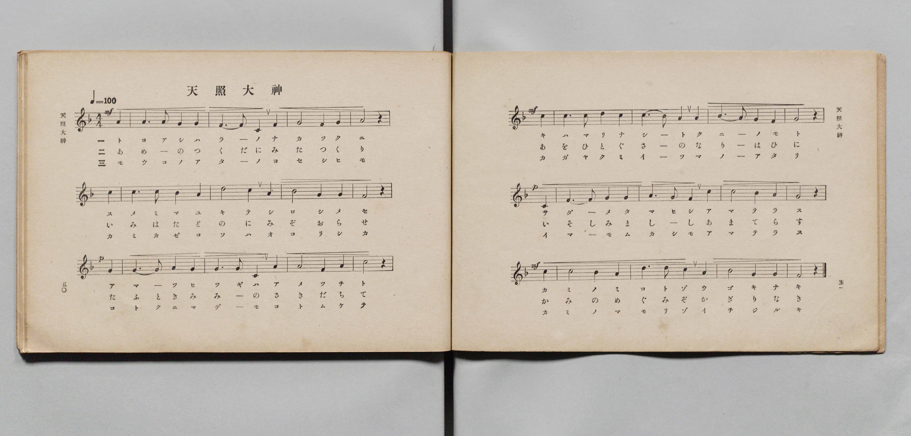
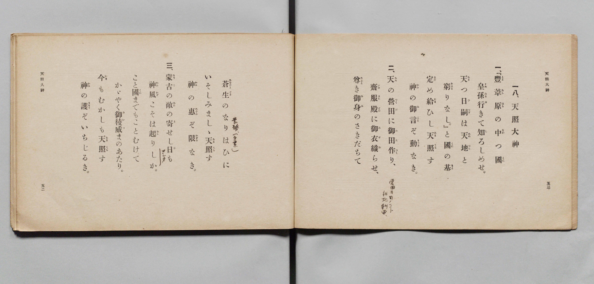

# 天照大神

> Re:Shōka 使用 AI 協助辨識與重建樂譜，可能會有錯誤。歡迎回報。

- **鋼琴伴奏版**：<br><audio controls src="amaterasu_omikami.mp3"></audio>

- 詞：文部省
- 曲：文部省
- 文部省《尋常小學唱歌 第六學年用》（大正三年，索書號 4078）

## 說明

原書資訊與歌詞全文（對應 P028.jpg–P029.jpg，原書 pp. 50–53，第 18 首）：
調性與拍號：ヘ長調（F 大調）4/4 拍（弱起 1 拍），速度 ♩=100


## 歌詞

```text
一、
『豐葦原（とよあしはら）の中（なか）つ國（くに）
皇孫（すめみま）行（ゆ）きて知（し）ろしめせ。
天（あま）つ日嗣（ひつぎ）は天地（あめつち）と
窮（きはま）りなし。』と國（くに）の基（もと）
定（さだ）め給（たま）ひし天照（あまてら）す
神（かみ）の御言（みこと）ぞ動（うごき）なき。

二、
天（あめ）の營田（つくだ）に御田（みた）作（つく）り、
齋服殿（いみはたどの）に御衣（みぞ）織（お）らせ、
尊（たふと）き御身（みみ）のさきだちて
蒼生（あをひとぐさ）のなりはひに
いそしみましゝ天照（あまてら）す
神（かみ）の惠（めぐみ）ぞ限（かぎり）なき。

三、
蒙古（もうこ）の敵（あた）の寄（よ）せし日（ひ）も
神風（かみかぜ）こそは起（おこ）りしか。
こと國（くに）までもことむけて
かゞやく御稜威（みいつ）まのあたり。
今（いま）もむかしも天照（あまてら）す
神（かみ）の護（まもり）ぞいちじるき。
```

## ABC

<div class="abc-score" data-abc-src="amaterasu_omikami.abc" aria-label="五線譜載入中"></div>

[下載 ABC 原始檔](amaterasu_omikami.abc)

## TMD 檔案連結

- [主旋律 TMD 檔案](amaterasu_omikami.tmd) [[在 TMD Studio 編輯](https://tmdlang.github.io/Tmd-TS/#tmd=s7IKdvYPcrWy4qpTUCpJTLdSSM7PyUlNLsnMz7PKyszLyo8vzshPT8wuBdHZiUpwdWX5OaW5qVbpRYkpqfFm8SYG5hYIyeL80qLkVKvi5Iz8_Jz4ktSKkqT8_Gx0-fiCxPRUqwADIwtdIGGJkC4oyi9LzUvMAxpRUJSZV5KaAjYDoSC1LDMlFSRdllqUmZaZmoJFqjg5MS8eUx4oUgzyHNQJJUWJecXJRZkFIB8jVOUXlQC9XZRYkFFplZFZXJJflJmcmBOfnZiHFAQlGanAEChKzclMR9EMEYdoq0QXTk4tSs3Nz8tMzEG2DWhCnhVQOKkUGMxKXFpaCk-XrHzeuvzpkuXPl85T0NLiUrRVMDQw4LK3VXDjsjHRN7ED6X6xct77PbOeTWt_2bzi-ZxGsInPZm_CFIPxHjd0Pd3Q_XTHjqcb-p-u3fF0ysZna3sUnq9Z87R1LYi_c8vzKSseN3S_39MBtPrZ2sVPdnQCBd_v6Xm-ZdGz2TtezJyvAIrq93s6lbi49LUUbKkFuBQUFJ72zQfZsbn9xYquFx3tQKcBPfi0dQXQ-SAHbeh91t6pAEovelkF6Y8aJoNSDYgJdB5Eq0JBgZ6CqQFQytQY5OY1axQMLRReLpsGdC8wUEB2vFi1_1nDcpDp3b1A3wBFHzfPeDl1O1AcaIcbMNyXg5mdwDBWAKoBWbxn44ut2xUMIVygQT0vG-Y_3bVM4dHMlbagSAGZ-2RHw-OGRhDrcUPfi40TXkxcBnQTUPfjxhWPm4Bk0-PG6Y8b1z9uAhrQ-bhx3ZMda8Gyqx43AoMbKLLk6RxQuD9u7H_cuBooAjLr-az2p2uBHKDozMdNjY8b9z9u3AeUe7GwByTY1AbW2fu4cdnz-UvByqaDRJqAItPB6mc_bmgCB-2SlWBpoCtA-oG2PZu-9On0xWDBTUDu48Y-sPh6oMqnczZAFYOMAEotBEutALto1TqwHNCG9VCzmrrAvpgOtOpxA9DxK9A8AvTs0_m7wO4FWr8C6rWn62aBFU193LgAbErj863LwCLzYW4Eums6JB_A3Q70KSwEZ4KdsxSYA4By3cCggVq1b-GLFQ1gQWBgTYZY-Lhx3tPuqWDBtseNU4DOBwsCXd0LCiBwBO7qgUYgIqyaGiFmPm-f_3wKJEyAoQH0FtjFjauBdsHEgXYBY7vzyd45cGXQsIEY-nJv97M5vc_WgVLZ48YWsAZgAAL9uhJoAdy4FwshUQKUBXqs8_nOKWBuF9gsoBpgfELcuAEoBAmrrTAv9oL074KkFqB-aHiAQxgYWwuA0QgMPXAemLTn-RRI2gT6cRI4oFc8bpwAVArTswocq0AHAqVWg1M1yM1zwWkYlAbB6WsuyZHzrBkYcsB0AExWQNsggvNezpwAU9YHtBYzZnZ0Qn39YtLMp_1LYCkJGJOTocZO3QpzBCgSQKlgfQtYWQeYOxvoXGB6hyR2cFCCMwXQfS8XAcMO6kQwCYw-oAZgsgH6dT0w20OCH2oTKEyAAdANzVSQ5IWR2oHhsBzsQJDs46aGx40ToQEP0to073ETMCj7QWlnxZynK4BJDBJfQEGg1yD6gTEA8gs4-YCterIbEt9ARZA8B4w4oMFABwPjoYnkeHixFuKxfWCDIEE-D2w6MI3MeNwEVAkOfqBmyot2KFDQ0uficsxNLEktSiwu9c_NzE7MzbQKyEzMy3eo0TWsqQbZpmBjoWUHZmCrXEA1FbCgBZZ-ChrIpbKCtoIxMEv0P1_fAGYChXTgFYXC0-3LXi5ofLKjSxOLiUBHgWyrUTBQ0IXD6ty0WqAxukBhEKkLJI2AJAjXAG0EiRgqmMaDKZAQSAIiCFUENtPHsEYBpAYGHzd3gFU_bl4B4TctAuLtYJl-qMxKuNo-MNkFEW9aDRdvAetcj7DFCM2Wxiaonka4yDowuQQi3giyC8RfAMQgc4GpAiozH64DpBaiEmqLMbpfFkFtWQb1y2aYm4G-gsiATEX2C8jXIPHdMHGo3yeBbcEf6bt6wJGOEadr8cYpJPJ0wXFrCrYdRILYJkASEsFmUDUgGYgISA4E4VEOj83Hzd1QOVBYPG7aCfFR80KoP-cD8TwwCxQqIL-uhYdBG9zHIB1wcWgYgExAxCcwSyLb0wiKc1D8QEIUWDBB4wpYeUBlQDEMkUONUZBrIOIgE4GlAsIeYIxCYhHhH5BekCgkHYD4j5v2gFmbof7ZC_cPKG08bloFFQfJQ8RBIlB_EojTHaBmDJY47cYbp5DsB4nT6oJaaKaE5EAjcAyiioCzKXJehmRTsAgiYuGJEhIQ0CQMjkykbAdJqlAeSN06eEDAdECSAkIHKBMiRWzjbGR7wJEIEt0K0dO4Aoh7wSxYBMIzETQTT4WKg1TBsjGIREpAoIiFFxgQ_0CjD1wAQYoPSFKG-BAk0w53N8gn6DpA4mB7mjaC7cEbsU9nz0aL2P7NRBTAkKwJjVhQAYyaY0H5FFnEBByFyDkWUkiDS2SkHAvzACQgQPkOJAotA4Heh6ZYeEkLSrkQOZBOaEmLlPNhpRk4wpEiFlIOwiIWVgaDEgyIvwkcuSDWBIgMOCKRIxaWk2A5H5TLITpRcyyoHMHIsU1roG5bAnUxJA-DZEAlOXKChEU4yBeQxACJcHCCI1QKT8EesfhLYVjtCMux4ByJqEcRNSskfxqBZZCjGhTZGDkWLWJBOQgk2gD3LihHQL0Fz8mgHAwtcrHkcXARDa6CkSMWJSfBi-K5ED2N06F5FNiWgspMh5kHZsGTAlgeIg5KKphFMSgBIPwDrayRXAeOJnAuRORvkF9gORa_f_Dn2Na12CMWf1GMErHoORYp0qB1rBm-OhalXAdh5MIZVM9ipHloLYXIkbAUD6mLQAnkcRMo0CFtFJDMFpgOcDmAyPMgHsx8cOJEiv6ZyHY3gkoBLMUyuK0FEgflbkjxDal7EToQ-Q1cE8PyO7wgR7MbXIgT529YjobU5aCEBPM3LBHBW4JNO8AqYKUGpr9rubh07RTQW-nRPoaxCljFjXCIG4PFlbkA)]
- [鋼琴伴奏 TMD 檔案](amaterasu_omikami_piano.tmd) [[在 TMD Studio 編輯](https://tmdlang.github.io/Tmd-TS/#tmd=s7IKdvYPcrWy4qpTUCpJTLdSSM7PyUlNLsnMz7PKyszLyo8vzshPT8wuBdHZiUpwdWX5OaW5qVbpRYkpqfFm8SYG5hYIyeL80qLkVKvi5Iz8_Jz4ktSKkqT8_Gx0-fiCxPRUqwADIwtdIGGJkC4oyi9LzUvMAxpRUJSZV5KaAjYDoSC1LDMlFSSdmJycn1uQmJeZm5qHJF-WWlQM8gHUnpKixLzi5KLMApC3EKryi0qAfitKLMiotMrILC7JL8pMTsyJz07MQ_JnYhFQc3oqyHyrgszEvPx4HHaWZAAVWRWl5mSmo9gCEYeYX4kunJxalJqbn5eZmIPsLKAJeVZA4aRSYKArcWlpKTxdsvJ56_KnS5Y_Xzrv_Z6Ol917nk_Y8mTPlqdL-593drzf06mgpcWlaKtgaGDAZW-r4MZlY6JvYgcy8sVKoIZZz6a1v2xe8XxOI9iaZ7M3YYrBeI8bup5u6H66Y8fTDf1P1-54OmXjs7U9Cs_XrHnauhbE37nl-ZQVjxu6gc4AuufZ2sVPdnQCBd_v6Xm-ZdGz2TtezJyvAEoNQEcpcXE55iaWpBYlFpf652ZmJ-ZmWgWAwjDIw6FG17CmmksBCGwstOzAjBoFAwVdOKzOTatVMAYyasCkLpA0ApIgXKNgCBYxVDCNB1MgIZAERBCqCGymj2GNAkgNDD5u7gCrfty8AsJvWgTE28Ey_VCZlXC1fWCyCyLetBou3gLWuR5hixGaLY1NUD2NcJF1YHIJRLwRZBeIvwCIQeY-btwPlZkP1wFSC1EJtcUY3S-LoLYsg_plM8zNQF9BZECmIvsF5GuQ-G6YONTvk8C2QKMBEt664OgwBWsAkSC2CZCExIkZVA1IBiICkgNBeCzBI-BxczdUDuT8x007IY5oXgh12nwgngdmgTwCct5auLPb4I4E6YCLQ50NMgERBY-bQFEFt6cRFE2gIIUEwuPG9dDgfdwIimKQDChSIHKokQByDUQcZOLjpk6EPcBIgAQ8wj8gvSBRSNSB-I-b9oBZm6H-2Qv3Dyg6HzetgoqD5CHiIBGoP2HRAEnkkGioLqiFJn1IOjcCBzqqCDgzIOcYSGYAiyDiAh71ELdDEwo4_JESNyRBQHkgdevgbofpgMQeQgcoqSPFReNsZHvA4Q4S3QrR07gCiHvBLFiYw5MqNKtMhYqDVMEyC4hEinNQXMCzJcQ_0BAHZ3NIJoWkPogPQTLtcHeDfIKuAyQOtqdpI9geaFxAMgA0LkAlE2q-AOUGZBETcKgj5wtI6QUuqpDyBcxOiNtBqRskCi0cgC6Gpgt4EQRKHxA5kE5oEYSUv2DZHBxHSHEBKSBgcQErnEBxDOJvAscHiDUBIgMOe-S4gKVXWP4C5SWITtR8AcqtGPmiaQ3UbUugLobkFJAMqIhDTkOwOAL5AhJ_kDgCpxFYXMBKeli-AKd7RJ2AqCUgucAILIMcO6D4wcgXaHEBSqcg0Qa4C0HpDuoSeH4B5RNoWYQlJ4HLLnB1ghwXKOkVXkbNhehpnA7NCY8b90FlpsPMA7PgsQeWh4iDYhezjALFGcI_0IoHyXXgkAWndUQuAvkFli_w-wdbXKDnC6RwhtYXZvjqC5QCD4SRSy1QnYGRsqAlLiLdw9IVpFwFxenjJlA4QapIkMwWmA5wbkPkLBAPZj44PSHF2ExkuxtBeQ1LeQWu6kHioDwEKdcg9QhCByJVg2sVWK6Cl3BodoNLN-L8Dcs3kHoJFPcwf8PiHd4QadoBVgHLm5j-rsXVavNBabWZILXaILAGkgIM4xWiDWOBuRJIm8bHguIVIQJkAlMHTArIA7Eh_oWrg5gF5ZhAKGByATJMwFpQ-AhrsBkCKR7QbEOIwF0E1QQzHFbow9Rh-g7uLKihyM5CCOEyCOgqrKGEYhLCJjwmYXMSwZBCCSNQfOvaKaBHebQPUAFWcSMc4sZgcWUuAA)]

## 分析

```text
================================================================================
📊 TMD Song Profile: [ 天照大神 ]
================================================================================
⏱  Duration:       2:52 (172.8s), 72 measures total
🎼 Key & Tempo:    首調基準 F, != 100.0 BPM, <4/4>
   - 分析範圍：      由實際發聲的音符與和弦推測調性；播放脈絡另行呈現
🎤 人聲音域:    C4 (MIDI 60) – D5 (MIDI 74) [跨度: 14 個半音 / 1.2 個八度, 難度: moderate]
   - 最低音:  C4 in [AmaterasuOmikami[L1] #1 @ m.3, 0:06]
   - 最高音: D5 in [AmaterasuOmikami[L1] #1 @ m.7, 0:14]
   - 適合: soprano, mezzo-soprano, contralto, tenor, baritone, bass
🏛  結構:      AmaterasuOmikami[L1] (57.6s) -> AmaterasuOmikami[L2] (57.6s) -> AmaterasuOmikami[L3] (57.6s)
⚡ 編曲密度:        Peak 1 軌道同時演奏
🗝  調性診斷：       C 調性不明確（流行色彩大調，未偵測到可信轉調）
   - 風格氣質:    流行大調（略帶和弦色彩音與裝飾副屬和弦）
   - 轉調歷程:    全曲維持單一推測調性（未偵測到可信轉調）
   - 核心骨幹音:  G, C, A, F, A#
   - 調性數值:    C 調性不明確 [相關度: 0.75, 穩定度: Ambiguous, 自然音純度: 90.0%]
   - 候選調性 (K-S): C 大調 (0.75), F 大調 (0.73), A 小調 (0.58)
   - 五度圈歷程:   +0 -> +0 -> +0
   - 各段落調性細節:
     • [AmaterasuOmikami[L1] #1]: C 大調 (r: 0.75, 自然音純度: 89.8%, 調外音: A#)
     • [AmaterasuOmikami[L2] #1]: C 調性不明確 (r: 0.75, 自然音純度: 90.0%, 調外音: A#)
     • [AmaterasuOmikami[L3] #1]: C 調性不明確 (r: 0.75, 自然音純度: 90.0%, 調外音: A#)

  [ 五度圈游移軌跡 ]
              [C ]*
         F            G  
      Bb               D  
      Eb               A  
         Ab           E  
            Db       B  
               F# 
     (* = active key center)

  [ 十二半音累積音高分佈 ]
     C  : ███████████████████████   23.9%
     C# :                            0.0%
     D  : █████                      5.6%
     D# :                            0.0%
     E  :                            0.0%
     F  : ██████████████            14.4%
     F# :                            0.0%
     G  : ████████████████████████  25.0%
     G# :                            0.0%
     A  : ████████████████████      21.1%
     A# : ██████████                10.0%
     B  :                            0.0%
--------------------------------------------------------------------------------
Assignment 軌道音域：
  - Piano         : C4 – D5 (14 個半音 / 1.2 個八度, 231 個音符)
================================================================================
```


## 原書掃描頁






