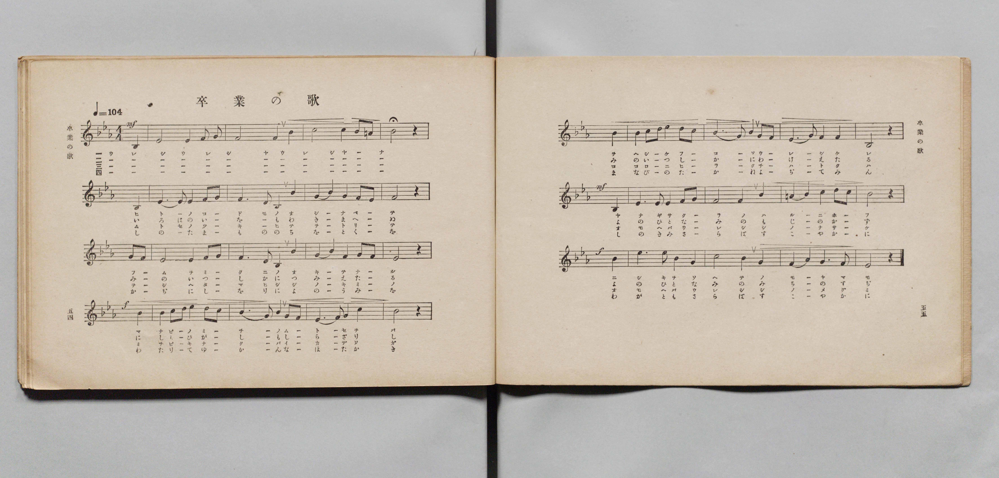
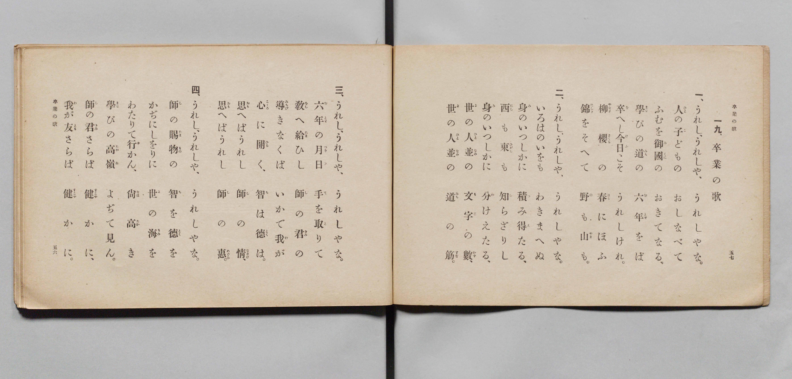

# 卒業の歌

> Re:Shōka 使用 AI 協助辨識與重建樂譜，可能會有錯誤。歡迎回報。

- **鋼琴伴奏版**：<br><audio controls src="sotsugyo_no_uta.mp3"></audio>
- **NEUTRINO 歌聲合成版**：<br><audio controls src="sotsugyo_no_uta_neutrino.mp3"></audio>

- 詞：文部省
- 曲：文部省
- 文部省《尋常小學唱歌 第六學年用》（大正三年，索書號 4078）

## 說明

原書資訊與歌詞全文（對應 P030.jpg–P031.jpg，原書 pp. 54–57，第 19 首）：
調性與拍號：變ホ長調（E♭ 大調）4/4 拍（弱起第 4 拍進入），速度 ♩=104
合唱編制：全曲二部合唱（Soprano / Alto）


## 歌詞

```text
一、
うれし、うれしや、　うれしやな。
人（ひと）の子（こ）どもの　おしなべて
ふむを御國（みくに）の　おきてなる、
學（まな）びの道（みち）の　六年（むとせ）をば
卒（を）へし今日（けふ）こそ　うれしけれ。
柳（やなぎ）櫻（さくら）の　春（はる）にほふ
錦（にしき）をそへて　野（の）も山（やま）も。

二、
うれし、うれしや、　うれしやな。
いろはのいをも　わきまへぬ
身（み）のいつしかに　積（つ）み得（え）たる、
西（にし）も東（ひがし）も　知（し）らざりし
身（み）のいつしかに　分（わ）けえたる、
世（よ）の人並（ひとなみ）の　文字（もじ）の數（かず）、
世（よ）の人並（ひとなみ）の　道（みち）の筋（すぢ）。

三、
うれし、うれしや、　うれしやな。
六年（むとせ）の月日（つきひ）　手（て）を取（と）りて
敎（をし）へ給（たま）ひし　師（し）の君（きみ）の
導（みちび）きなくば　いかで我（わ）が
心（こゝろ）に開（ひら）く、　智（ち）は德（とく）は。
思（おも）へばうれし　師（し）の情（なさけ）、
思（おも）へばうれし　師（し）の惠（めぐみ）。

四、
うれし、うれしや、　うれしやな。
師（し）の賜物（たまもの）の　智（ち）を德（とく）を
かぢにしをりに　世（よ）の海（うみ）を
わたりて行（ゆ）かん、　尚（なほ）高（たか）き
學（まな）びの高嶺（たかね）　よぢて見（み）ん。
師（し）の君（きみ）さらば　健（すこや）かに、
我（わ）が友（とも）さらば　健（すこや）かに。
```

## ABC

<div class="abc-score" data-abc-src="sotsugyo_no_uta.abc" aria-label="五線譜載入中"></div>

[下載 ABC 原始檔](sotsugyo_no_uta.abc)

## TMD 檔案連結

- [主旋律 TMD 檔案](sotsugyo_no_uta.tmd) [[在 TMD Studio 編輯](https://tmdlang.github.io/Tmd-TS/#tmd=s7IKdvYPcrWy4qpTUCpJTLdSSM7PyUlNLsnMz7PKyszLyo8vzshPT8wuBdHZiUpwdWX5OaW5qVbpRYkpqfFm8SYG5hYIyeL80qLkVKvi5Iz8_Jz4ktSKkqT8_Gx0-fiCxPRUqwADYwNdIGGIkC4oyi9LzUvMAxpRUJSZV5KaAjYDoSC1LDMlFSRdllqUmZaZmoJFqjg5MS8eUx4oUgzyHNQJJUWJecXJRZkFIB8jVOUXlQC9XZRYkFFplZFZXJJflJmcmBOfnZiHFAQlGanAEIB6MiczLRVdKjm1KDU3Py8zMQfZ5Mz0zDwroHBSKTBIMSTKU4tLUovy4nNTc_JTKpW4tLQUnvZOerZ07ePGdc_W9ihoaXEp2ioYGphw2dsquOpw2Zjom9iBDHmxct77PbOeTWt_2bzi-ZxGsMHPZm_CFIPxHjd0Pd3Q_XTHjqcb-p-u3fF0ykaQ-c_XrHnauhbE37nl-ZQVjxu63-_peLpk-bO1i5_s6AQKvt_T83zLomezd7yYOV8BFO3v93QqcXHpaynYUgtwKSgoPO2bD7Jjc_uLFV0vOtqBTgN68GnrCqDzQQ7a0PusvVMBlHb0sgrSHzVMBqUgEBPoPIhWhYICPQVTE6CUqTnIzWvWKBhaKrxcNg3oXmCggOx4sWr_s4blINO7e4G-AYq-WNf1uHn2y6nbgVJAa1wfzVyrAPQ8mNcJDGkFoEqQ9Xs2vti6HWQkWORlw6anrUvB5va8bJj_dNcyhUczV9qCIgnkkwkdwLB9vn3F045tQCtAfpi96cmuHmAsQKSABgbnFwATYr6CvoJjTkk-0CQukM4nOxoeNzSCWI8b2x439TxunA7kI9hNLSBuQwOKSOOqxw1NYN27dgFNfty46XHjCqCJwPTzdO0EsMhkMHfl46YmoCBYfxdIM1Bn487HjcsgFm593NTwuGnS030Ln84BpYHHjfsfN_Y_blwNMQumrReoAaSzqRvqVGDSAaveBxQFK90MVP0SZCfEiIVw_aB0BkpPHSCbGlc8bpwNkmqa9LhxA9ig3klgOSAJ1LAD6MInu7ueTQeGM9CgiUAHgsUnP26cixIEQCkgAxIEz-ZvBhsBDpXGPqCGZ6t3g_VPBfmlCRhhULc8mwExdz3QI2DB1Y8bdwPtAJnysmcZWA4oBDQeGP8QR84FO2oZUPPLdqDRQAXrwFJNTzeCohRs6z6ICMg5kCgBuozsCH3c2PK4CRje60FOBrEngY0GxhIwWoDiwBAHOmgNOGXvAkYTKLyhHgSqblwCdn43yB8NDc9XgtIxUBCsYP_TfdPB3A4wdz4iNl8sBeUDiN8hfnk2F-w7ULICuRDmwYbn8yEhCBEBmjLtcRMoWRHlnKcdbeAg6wcrAEYuUDGSK57sAOZaoDTEeeuAKfvJDkicgBI3OHJhRgOjclr707Vg74DS9wyI-LOpkFQJtG8WSIQMczHT8PO1kIwx83HjIrCh0FjeATOfnFjGniuAPpjTAUv8wKADRjewaAfa0_CsE-IIoLtB6fJpP9hLkCwPigBwdn42FZxCQckWHD-NO55vhXh0PjSRgnwMdGbD0x2QqIIoW_d0AtB6IBdoHzQkwG7cAEnwoKAAZnCwBFAFMLiAKXED2GtAHwHDevmzjolIEdsD1ry_GVIKPW6aC0zPkNz2chrEF5tgmbIfEkbPZkIKMUiIr3-6bzvEd0AFEBFYTm-YC5boAkY6rLzYgBT86P561twK5gKdDCwKgG6ERRnpBi0AexAYvxOgYQRNBk9nz6YkGaBa82LznOedK-ExBim6EUkeOZRAZTZqKDVNgrgCGCGLoMUYqOwAJg5Q3kPLBM-2QjS3QX0D1QwqY4A5EpSgXizsAWsAZlmghu7HTZMhHnm6AZi1IGEKLGQ7X64G5j2IeyFFai_u6mH1jKfbIF4AqX7cuBaStoGOAjt52Ytl0CoI7CKgfdjCCCOtTgWXQ6D0-LQRknOAORWY7FqgDgd5HxLpqKn0aT_EthWwNECMQWAXUd72gQIFLX0uruD8kuLS9Mp8v_zQkkQraBvBoUbXsKYaZJmCjYWWHZiBrfEFaskBGxDAyFLQgLRXFLSBzRVgY-_5-gYdeNNJ4en2ZS8XNIKbRwpAxZpYTAK6BWRLjYKBgi4cV-em1SqYxgNZNUCdumAIoo0UjIEiRlAREG0KVmMGFQHRpgom6kAhkAQIgoyDmAS2x8ewRgHEg-HHTcvAJjxuXgPV8LhpO1QcJAaUAfPBMs1L8OkAy4LEu6DiYPObJyHsNkKzu7ENoqOpB2ZS43SoOEgMKAPmQ-xowacDLAtSvwrZ7kawKMRuY3r7ewHCbhN6-xskVwMuKHEn31094OSLN9UaEUy1kNRpiJE6zeMhqQ6SPo2hLBBtBFSLSMOg5GkM5CFS5-PmDmio9wH9txnM6oSG8CJ4jPSBfQ_yNWpMgeLgcfNMqHpQqCFiZCoiRoApEVg9QkNyPRCvA7OgodkESrOQ0G8Ck_3QUIboAKncByZ3QMVhKQIS-vsR9gBTHdw_Tbth7m6G2bMW7m6QjRD3gnRsgouD9D5uhvoTzT8gVYgUBvEDyP75MPeBXY-QAclB_LkQ3Z-NK8Ak1J9wcYh_usH2ECgMOwmnJmMqpyaQHDjtwMtIcNkJKjoRIQNOUaC8CAmxx83zwSGzHhqiIL9hS1GImAGFOSRdgdSvRomBeQh7QCkKHgMtQAwuMyA5ERqGIP5quAw4lQBpSOqAxBvIzD1QF8BcBokDkL1IaQqa4h83zwCyQSZB3QJNSZCyCVY-gXyG6icUm8DyCD-B5JBTFSTPQVwOKXPAJTqQhpR3YJkmcDoF-x-kB5ZOIb5E-AklXUFyFf50BWznEU5XJgTTFSg9mCmYKxjGARnmQCasfjSGFkuIRARKdpCKFK0ORQQLOElBCprJ8ACGBhyQboQGMrD4Aic8SCYGeX83PAJAWRcRARNQIgApW4MTFSTQwQVRI1hfI6gSQK0kILLQxNYEKi4hwT8NLAtNvHD12IspkLuBTUawDlBSgSd6cGaBuBvk0sdN0AqvCZYZHje3g0lopmpCKQ7BRThygoJkQHD4NYKqVGBjF-o-eGZsAocruFIDicPDDaIXUiAhFccQ_4CKPIKV3hScyal_M9FNNRKSE4gNKamAakDuhBdTiCYeUqqaAfY9pCGyERym4EoLGoqQsNkLJnE1X0C6kMUhaQocY2gFFaS6w15QwYocRNU3ES4OyerQ1I5aTIGLAeRiClJ9Q1ITSCW0OQikV8LdDUo1kNQHEgfZB0lTYHvgBTVMHGIPOGUgpSkQH5p2oX6Dug_JP2BXQFwIL9bgaRBWHINTHiJNEdGQAo4pEE5T5DekkJv5wIY9hAkqnpDTHe6aD1pGN60D4q0oAQqPAGjxBY1oeA0Hi7DZUHFQQkQkKEibALPmA9aw0LYELPOCAhYiB44YeJsElNSRxOGZehayPegJCtoCBNd70MIIV0YAkci1G7TIBocCKKJBGQV3goL5pxdWhzXCMiKicN0AJqFtzUZYwoG12GH-QWkxEFPnPdnRTDhBEdGWAhVOwBQVB295I_qJCBFQ4jKB8kBJDbUtBcJIqQnW6gBWD9AqDFwYwQouSChD2kvQNgdSix1UzIDoeSjisD4RWWkJ3oYCtWcR4pBYQc7kaLZQnJIg9j1u2gAWBxU1WGwBpyNIfw3kD1glTVo6gqQk9HQEsaUWfRQDNL-BbQiDuMEFYCMb1DMDUhAxMAOLOhBGUoY2wIBakqGaCVQGVgnmQhSC0h02yykzFaoIRQxmKmopCSlBTaDNPmMgC9K_AJkBcRvQCJgBYHuxBwB5BhoqmIFMARME2gf4QgDVs5BuEWzACCNU0f0PcZwxXAu2yAY7EMYFW4StnACmR107BZQkqQAUUOYCAA)]
- [鋼琴伴奏 TMD 檔案](sotsugyo_no_uta_piano.tmd) [[在 TMD Studio 編輯](https://tmdlang.github.io/Tmd-TS/#tmd=s7IKdvYPcrWy4qpTUCpJTLdSSM7PyUlNLsnMz7PKyszLyo8vzshPT8wuBdHZiUpwdWX5OaW5qVbpRYkpqfFm8SYG5hYIyeL80qLkVKvi5Iz8_Jz4ktSKkqT8_Gx0-fiCxPRUqwADYwNdIGGIkC4oyi9LzUvMAxpRUJSZV5KaAjYDoSC1LDMlFSSdmJycn1uQmJeZm5qHJF-WWlQM8gHUnpKixLzi5KLMApC3EKryi0qAfitKLMiotMrILC7JL8pMTsyJz07MQ_JnYhFQc3oqyHyrgszEvPx4HHaWZAAVwbyck5mWii6VnFqUmpufl5mYg-yEzPTMPCugcFIpMICVuLS0FJ72Tnq2dO3jxnXP1va839PxsnvP8wlbnuzZ8nRp__POjvd7OhW0tLgUbRUMDUy47G0VXHW4bEz0TexAZr5YOe_9nlnPprW_bF7xfE4j2J5nszdhisF4jxu6nm7ofrpjx9MN_U_X7ng6ZSPQUoXna9Y8bV0L4u_c8nzKiscN3UB3PF2y_NnaxU92dAIF3-_peb5l0bPZO17MnK8Ainqgq5S4uILzS4pL0yvz_fJDSxKtAkChFeThUKNrWFPNpQAENhZadmCGvpaCLToA2fpkR8OLhT0KGk_3bHyxdbuCtoKJAtBhz9c36CiAkoleVkG6wtPty14uaAQqVjBUACrWxGKSlj7YlhoFAwVdOK7OTatVMI0HsmqAOnXBEEQbKRgDRYygIiDaFKzGDCoCok0VTNSBQiAJEAQZBzEJbI-PYY0CiAfDj5uWgU143LwGquFx03aoOEgMKAPmg2Wal-DTAZYFiXdBxcHmN09C2G2EZndjG0RHUw_MpMbpUHGQGFAGzIfY0YJPB1gWpH4Vst2NYFGI3cb09vcChN0m9PY3SK6GC3_y3dUDTr54U60RwVQLSZ2GGKnTPB6S6iDp0xjKAtFGQLWINAxKnsZAHiJ1Pm7ugIZ6H9B_m8GsTmgIL4LHSB_Y9yBfo8YUKA4eN8-EqgeFGiJGpiJiBJgSHzf1QkNyPRCvA7OgodkESrOQ0G8Ck_3QUIboAKncByZ3QMVhKQIS-vsR9gBTHdw_Tbth7m6G2bMW7m6QjRD3gnRsgouD9D5uhvoTzT8gVYgUBvEDyP75MPeBXY-QAclB_LkQ3Z-NK8Ak1J9wcYh_usH2ECgMOwmnJmMqpyaQHDjtwMtIcNkJKjoRIQNOUaC8CAmxx83zwSGzHhqiIL9hS1GImAGFOSRdgdSvRomBeQh7QCkKHgMtQAwuMyA5ERqGIP5quAw4lQBpSOqAxBvIzD1QF8BcBokDkL1IaQqa4h83zwCyQSZB3QJNSZCyCVY-gXyG6icUm8DyCD-B5JBTFSTPQVwOKXPAJTqQhpR3YJkmcDoF-x-kB5ZOIb5E-AklXUFyFf509XT2bMLpyoRgugKlBzMFcwXDOCDDHMiE1Y_G0GIJkYhAyQ5SkaLVoYhgAScpSEEzGR7A0IAD0o3QQAYWX-CEB8nEIO_vhkcAKOsiImACSgQgZWtwooIEOrggagTrawRVAqiVBEQWmtiaQMUlJPingWWhiReuHnsxBXL340ZwgQtOKvBED84sEHeDXPq4CVrhNcEyw-PmdjAJzVRNKMUhuAhHTlCQDAgOv0ZQlfq4CVrsQTMJSAQcruBKDSQODzeIXkiBhFQcQ_wDKvIIVnpTcCan_s1EN9VISE4gNqSkAqoBuRNeTCGaeEipagbY95CGyEZwmIIrLWgoQsJmL5jE1XwB6UIWh6QpcIyhFVSQ6g57QQUrchBV30S4OCSrQ1M7ajEFLgaQiylI9Q1JTSCV0OYgkF4Jdzco1UBSH0gcZB8kTYHtgRfUMHGIPeCUgZSmQHxo2oX6Deo-JP-AXQFxIbxYg6dBWHEMTnmINEVEQwrY-yCcpshvSCE384ENewgTVDwhpzvcNR-0jG5aB8RbUQIUHgHQ4gsa0fAaDhZhs6HioISISFCQNgFmzQesYaFtCVjmBQUsRA4cMfA2CSipI4nDM_UsZHvQExS0BQiu96CFEa6MACKRazdokQ0OBVBEgzIK7gQF808vrA5rhGVEROG6AUxC25qNsIQDa7HD_IPSYiCmznuyo5lwgiKiLQUqnIApKg7e8kb0ExEioMRlAuWBkhpqWwqEkVITrNUBrB6gVRi4MIIVXJBQhrSXoG0OpBY7qJgB0fNQxGF9IrLSErwNBWrPIsQhsYKcydFsoTglQex73LQBLA4qarDYAk5HkP4ayB-wSpq0dARJSejpCGJLLdZRDB-UUQwT6CgGaHwBAoExHK8QbRgLo0D1EpBlGh-LYABTCohpFp8bq2AEZBihKAObAktlRJiFUw2ZBmGKIBsElwXJmaDZj-EgsAKsDiLCHGoGEtQE0gwygTgNnY8rgIAJRtdOASXNRPsAZTEFgU7AFDTGJgi0DiiozAUA)]

## 分析

```text
================================================================================
📊 TMD Song Profile: [ 卒業の歌 ]
================================================================================
⏱  Duration:       1:04 (64.6s), 28 measures total
🎼 Key & Tempo:    首調基準 E,, != 104.0 BPM, <4/4>
   - 分析範圍：      由實際發聲的音符與和弦推測調性；播放脈絡另行呈現
🎤 人聲音域:    A#3 (MIDI 58) – D#5 (MIDI 75) [跨度: 17 個半音 / 1.4 個八度, 難度: challenging]
   - 最低音:  A#3 in [SotsugyoNoUta #1 @ m.1, 0:01]
   - 最高音: D#5 in [SotsugyoNoUta #1 @ m.14, 0:31]
   - 適合: soprano, mezzo-soprano, contralto, tenor, baritone, bass
🏛  結構:      SotsugyoNoUta (64.6s)
⚡ 編曲密度:        Peak 2 軌道同時演奏
🗝  調性診斷：       D# 大調（純淨自然大調，未偵測到可信轉調）
   - 風格氣質:    純淨自然大調（陽光明朗、易唱易記，無明顯調外色彩）
   - 轉調歷程:    全曲維持單一推測調性（未偵測到可信轉調）
   - 核心骨幹音:  D#, A#, D, G, F
   - 調性數值:    D# 大調 [相關度: 0.88, 穩定度: Moderate, 自然音純度: 99.3%]
   - 候選調性 (K-S): D# 大調 (0.88), A# 大調 (0.76), G 小調 (0.63)
   - 五度圈歷程:   -3
   - 各段落調性細節:
     • [SotsugyoNoUta #1]: D# 大調 (r: 0.88, 自然音純度: 99.3%, 調外音: A)

  [ 五度圈游移軌跡 ]
               C  
         F            G  
      Bb               D  
     [Eb]*              A  
         Ab           E  
            Db       B  
               F# 
     (* = active key center)

  [ 十二半音累積音高分佈 ]
     C  : █████                      6.0%
     C# :                            0.0%
     D  : ███████████               14.3%
     D# : ████████████████████████  31.7%
     E  :                            0.0%
     F  : ████████                  11.0%
     F# :                            0.0%
     G  : █████████                 12.4%
     G# : █                          1.4%
     A  : █                          0.7%
     A# : █████████████████         22.6%
     B  :                            0.0%
--------------------------------------------------------------------------------
Assignment 軌道音域：
  - Alto          : A#3 – A#4 (12 個半音 / 1.0 個八度, 105 個音符)
  - Soprano       : A#3 – D#5 (17 個半音 / 1.4 個八度, 108 個音符)
================================================================================
```


## 原書掃描頁






