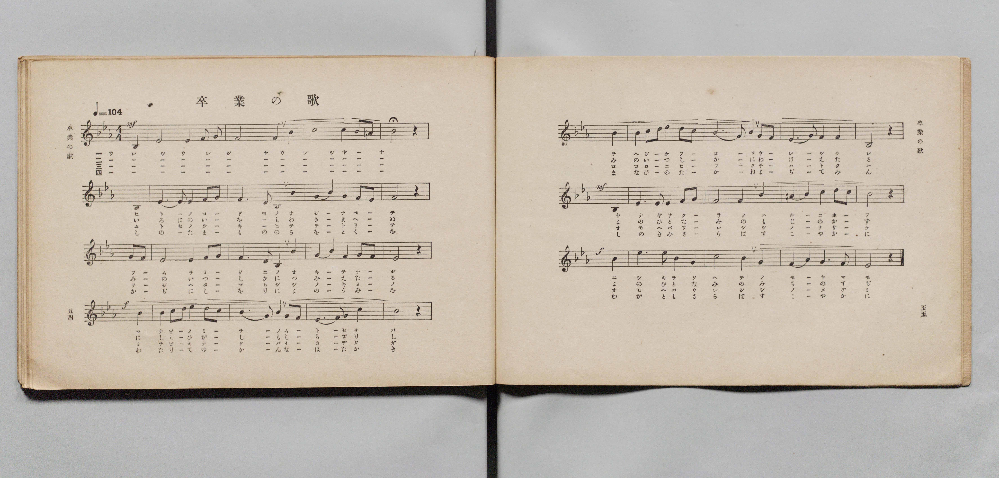
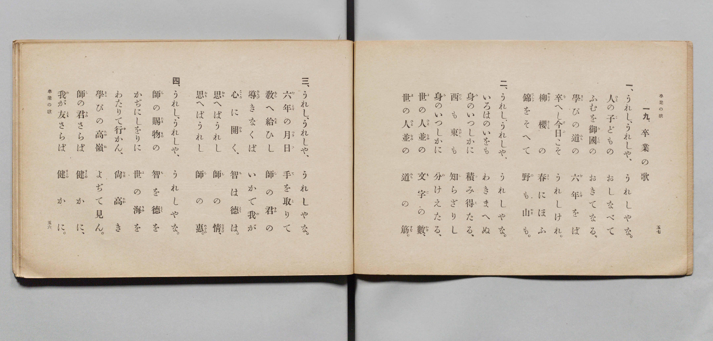

# 卒業の歌

> Re:Shōka 使用 AI 協助辨識與重建樂譜，可能會有錯誤。歡迎回報。

- **鋼琴伴奏版**：<br><audio controls src="sotsugyo_no_uta.mp3"></audio>

- 詞：文部省
- 曲：文部省
- 文部省《尋常小學唱歌 第六學年用》（大正三年，索書號 4078）

## 說明

原書資訊與歌詞全文（對應 P030.jpg–P031.jpg，原書 pp. 54–57，第 19 首）：
調性與拍號：變ホ長調（E♭ 大調）4/4 拍（弱起第 4 拍進入），速度 ♩=104
合唱編制：全曲二部合唱（Soprano / Alto）


## 歌詞

```text
一、
うれし、うれしや、　うれしやな。
人（ひと）の子（こ）どもの　おしなべて
ふむを御國（みくに）の　おきてなる、
學（まな）びの道（みち）の　六年（むとせ）をば
卒（を）へし今日（けふ）こそ　うれしけれ。
柳（やなぎ）櫻（さくら）の　春（はる）にほふ
錦（にしき）をそへて　野（の）も山（やま）も。

二、
うれし、うれしや、　うれしやな。
いろはのいをも　わきまへぬ
身（み）のいつしかに　積（つ）み得（え）たる、
西（にし）も東（ひがし）も　知（し）らざりし
身（み）のいつしかに　分（わ）けえたる、
世（よ）の人並（ひとなみ）の　文字（もじ）の數（かず）、
世（よ）の人並（ひとなみ）の　道（みち）の筋（すぢ）。

三、
うれし、うれしや、　うれしやな。
六年（むとせ）の月日（つきひ）　手（て）を取（と）りて
敎（をし）へ給（たま）ひし　師（し）の君（きみ）の
導（みちび）きなくば　いかで我（わ）が
心（こゝろ）に開（ひら）く、　智（ち）は德（とく）は。
思（おも）へばうれし　師（し）の情（なさけ）、
思（おも）へばうれし　師（し）の惠（めぐみ）。

四、
うれし、うれしや、　うれしやな。
師（し）の賜物（たまもの）の　智（ち）を德（とく）を
かぢにしをりに　世（よ）の海（うみ）を
わたりて行（ゆ）かん、　尚（なほ）高（たか）き
學（まな）びの高嶺（たかね）　よぢて見（み）ん。
師（し）の君（きみ）さらば　健（すこや）かに、
我（わ）が友（とも）さらば　健（すこや）かに。
```

## ABC

<div class="abc-score" data-abc-src="sotsugyo_no_uta.abc" aria-label="五線譜載入中"></div>

[下載 ABC 原始檔](sotsugyo_no_uta.abc)

## TMD 檔案連結

- [主旋律 TMD 檔案](sotsugyo_no_uta.tmd) [[在 TMD Studio 編輯](https://tmdlang.github.io/Tmd-TS/#tmd=s7IKdvYPcrWy4qpTUCpJTLdSSM7PyUlNLsnMz7PKyszLyo8vzshPT8wuBdHZiUpwdWX5OaW5qVbpRYkpqfFm8SYG5hYIyeL80qLkVKvi5Iz8_Jz4ktSKkqT8_Gx0-fiCxPRUqwADYwNdIGGIkC4oyi9LzUvMAxpRUJSZV5KaAjYDoSC1LDMlFSRdllqUmZaZmoJFqjg5MS8eUx4oUgzyHNQJJUWJecXJRZkFIB8jVOUXlQC9XZRYkFFplZFZXJJflJmcmBOfnZiHFAQlGanAEIB6MiczLRVdKjm1KDU3Py8zMQfZ5Mz0zDwroHBSKTBIlbi0tBSe9k56tnTt48Z1z9b2KGhpcSnaKhgamHDZ2yq46nDZmOib2IG0v1g57_2eWc-mtb9sXvF8TiPYyGezN2GKwXiPG7qebuh-umPH0w39T9fueDplI8j852vWPG1dC-Lv3PJ8yorHDd3v93Q8XbL82drFT3Z0AgXf7-l5vmXRs9k7XsycrwCK1_d7OpW4uPS1FGypBbgUFBSe9s0H2bG5_cWKrhcd7UCnAT34tHUF0PkgB23ofdbeqQBKHHpZBemPGiaDkgiICXQeRKtCQYGegqkJUMrUHOTmNWsUDC0VXi6bBnQvMFBAdrxYtf9Zw3KQ6d29QN8ARV-s63rcPPvl1O1AKaA1ro9mrlUAeh7M6wSGtAJQJcj6PRtfbN0OMhIs8rJh09PWpWBze142zH-6a5nCo5krbUGRBPLJhA5g2D7fvuJpxzagFSA_zN70ZFcPMBYgUkADg_MLgCktX0FfwTGnJB9oEhdI55MdDY8bGkGsx41tj5t6HjdOB_IR7KYWELehAUWkcdXjhiaw7l27gCY_btz0uHEF0ERg-nm6dgJYZDKYu_JxUxNQEKy_C6QZqLNx5-PGZRALtz5uanjcNOnpvoVP54DSwOPG_Y8b-x83roaYBdPWC9QA0tnUDXUqMOmAVe8DioKVbgaqfgmyE2LEQrh-UDoDpacOkE2NKx43zgZJNU163LgBbFDvJLAckARq2AF04ZPdXc-mA8MZaNBEoAPB4pMfN85FCQKgFJABCYJn8zeDjQCHSmMfUMOz1bvB-qeC_NIEjDCoW57NgJi7HugRsODqx427gXaATHnZswwsBxQCGg-Mf4gj54IdtQyo-WU70GiggnVgqaanG0FRCrZ1H0QE5BxIlABdRnaEPm5sedwEDO_1ICeD2JPARgNjCRgtQHFgiAMdtAacsncBowkU3lAPAlU3LgE7vxvkj4aG5ytB6RgoCFaw_-m-6WBuB5g7HxGbL5aC8gHE7xC_PJsL9h0oWYFcCPNgw_P5kBCEiABNmfa4CZSsiHLO0442cJD1gxUAIxeoGMkVT3YAcy1QGuK8dcCU_WQHJE5AiRscuTCjgVE5rf3pWrB3QOl7BkT82VRIqgTaNwskQoa5mGn4-VpIxpj5uHER2FBoLO-AmU9OLGPPFUAfzOmAJX5g0AGjG1i0A-1peNYJcQTQ3aB0-bQf7CVIlgdFADg7P5sKTqGgZAuOn8Ydz7dCPDofmkhBPgY6s-HpDkhUQZStezoBaD2QC7QPGhJgN26AJHhQUAAzOFgCqAIYXMCUuAHsNaCPgGG9_FnHRKSI7QFr3t8MKYUeN80FpmdIbns5DeKLTbBM2Q8Jo2czIYUYJMTXP923HeI7oAKICCynN8wFS3QBIx1WXmxACn50fz1rbgVzgU4GFgVAN8KijHSDFoA9CIzfCdAwgiaDp7NnU5IMUK15sXnO886V8BiDFN2IJI8cSqAyGzWUmiZBXAGMkEXQYgxUdgATByjvoWWCZ1shmtugvoFqBpUxwBwJSlAvFvaANQCzLFBD9-OmyRCPPN0AzFqQMAUWsp0vVwPzHsS9kCK1F3f1sHrG020QL4BUP25cC0nbQEeBnbzsxTJoFQR2EdA-bGGEkVangsshUHp82gjJOcCcCkx2LVCHg7wPiXTUVPq0H2LbClgaIMYgsIsob_tAgYKWPhdXcH5JcWl6Zb5ffmhJohW0jeBQo2tYUw2yTMHGQssOzMDW-AK15IANCGBkKWhA2isK2sDmCrCx93x9gw686aTwdPuylwsawc0jBaBiTSwmAd0CsqVGwUBBF46rc9NqFUzjgawaoE5dMATRRgrGQBEjqAiINgWrMYOKgGhTBRN1oBBIAgRBxkFMAtvjY1ijAOLB8OOmZWATHjevgWp43LQdKg4SA8qA-WCZ5iX4dIBlQeJdUHGw-c2TEHYbodnd2AbR0dQDM6lxOlQcJAaUAfMhdrTg0wGWBalfhWx3I1gUYrcxvf29AGG3Cb39DZKrAReUuJPvrh5w8sWbao0IplpI6jTESJ3m8ZBUB0mfxlAWiDYCqkWkYVDyNAbyEKnzcXMHNNT7gP7bDGZ1QkN4ETxG-sC-B_kaNaZAcfC4eSZUPSjUEDEyFREjwJQIrB6hIbkeiNeBWdDQbAKlWUjoN4HJfmgoQ3SAVO4Dkzug4rAUAQn9_Qh7gKkO7p-m3TB3N8PsWQt3N8hGiHtBOjbBxUF6HzdD_YnmH5AqRAqD-AFk_3yY-8CuR8iA5CD-XIjuz8YVYBLqT7g4xD_dYHsIFIadhFOTMZVTE0gOnHbgZSS47AQVnYiQAacoUF6EhNjj5vngkFkPDVGQ37ClKETMgMIckq5A6lejxMA8hD2gFAWPgRYgBpcZkJwIDUMQfzVcBpxKgDQkdUDiDWTmHqgLYC6DxAHIXqQ0BU3xj5tnANkgk6BugaYkSNkEK59APkP1E4pNYHmEn0ByyKkKkucgLoeUOeASHUhDyjuwTBM4nYL9D9IDS6cQXyL8hJKuILkKf7oCtvMIpysTgukKlB7MFMwVDOOADHMgE1Y_GkOLJUQiAiU7SEWKVociggWcpCAFzWR4AEMDDkg3QgMZWHyBEx4kE4O8vxseAaCsi4iACSgRgJStwYkKEujggqgRrK8RVAmgVhIQWWhiawIVl5DgnwaWhSZeuHrsxRTI3cAmI1gHKKnAEz04s0DcDXLp4yZohdcEywyPm9vBJDRTNaEUh-AiHDlBQTIgOPwaQVUqsLELdR88MzaBwxVcqYHE4eEG0QspkJCKY4h_QEUewUpvCs7k1L-Z6KYaCckJxIaUVEA1IHfCiylEEw8pVc0A-x7SENkIDlNwpQUNRUjY7AWTuJovIF3I4pA0BY4xtIIKUt1hL6hgRQ6i6psIF4dkdWhqRy2mwMUAcjEFqb4hqQmkEtocBNIr4e4GpRpI6gOJg-yDpCmwPfCCGiYOsQecMpDSFIgPTbtQv0Hdh-QfsCsgLoQXa_A0CCuOwSkPkaaIaEgBxxQIpynyG1LIzXxgwx7CBBVPyOkOd80HLaOb1gHxVpQAhUcAtPiCRjS8hoNF2GyoOCghIhIUpE2AWfMBa1hoWwKWeUEBC5EDRwy8TQJK6kji8Ew9C9ke9AQFbQGC6z1oYYQrI4BI5NoNWmSDQwEU0aCMgjtBwfzTC6vDGmEZEVG4bgCT0LZmIyzhwFrsMP-gtBiIqfOe7GgmnKCIaEuBCidgioqDt7wR_USECChxmUB5oKSG2pYCYaTUBGt1AKsHaBUGLoxgBRcklCHtJWibA6nFDipmQPQ8FHFYn4istARvQ4HaswhxSKwgZ3I0WyhOSRD7HjdtAIuDihostoDTEaS_BvIHrJImLR1BUhJ6OoLYUos-igGa38A2hEHc4AKwkQ3qmQEpiBiYgUUdCCMpQxtgQC3JUM0EKgOrBHMhCkHpDpvllJkKVYQiBjMVtZSElKAm0GafMZAF6V-AzIC4DWgEzACwvdgDgDwDDRXMQKaACQLtA3whgOpZSLcINmCEEaro_oc4zhiuBVtkgx0I44ItwlZOANOjrp0CSpKM9jGMVcAUNMImaIxN0AQsqMwFAA)]
- [鋼琴伴奏 TMD 檔案](sotsugyo_no_uta_piano.tmd) [[在 TMD Studio 編輯](https://tmdlang.github.io/Tmd-TS/#tmd=s7IKdvYPcrWy4qpTUCpJTLdSSM7PyUlNLsnMz7PKyszLyo8vzshPT8wuBdHZiUpwdWX5OaW5qVbpRYkpqfFm8SYG5hYIyeL80qLkVKvi5Iz8_Jz4ktSKkqT8_Gx0-fiCxPRUqwADYwNdIGGIkC4oyi9LzUvMAxpRUJSZV5KaAjYDoSC1LDMlFSSdmJycn1uQmJeZm5qHJF-WWlQM8gHUnpKixLzi5KLMApC3EKryi0qAfitKLMiotMrILC7JL8pMTsyJz07MQ_JnYhFQc3oqyHyrgszEvPx4HHaWZAAVwbyck5mWii6VnFqUmpufl5mYg-yEzPTMPCugcFIpMICVuLS0FJ72Tnq2dO3jxnXP1va839PxsnvP8wlbnuzZ8nRp__POjvd7OhW0tLgUbRUMDUy47G0VXHW4bEz0TexAZr5YOe_9nlnPprW_bF7xfE4j2J5nszdhisF4jxu6nm7ofrpjx9MN_U_X7ng6ZSPQUoXna9Y8bV0L4u_c8nzKiscN3UB3PF2y_NnaxU92dAIF3-_peb5l0bPZO17MnK8Ainqgq5S4uILzS4pL0yvz_fJDSxKtAkChFeThUKNrWFPNpQAENhZadmCGvpaCLToA2fpkR8OLhT0KGk_3bHyxdbuCtoKJAtBhz9c36CiAkoleVkG6wtPty14uaAQqVjBUACrWxGKSlj7YlhoFAwVdOK7OTatVMI0HsmqAOnXBEEQbKRgDRYygIiDaFKzGDCoCok0VTNSBQiAJEAQZBzEJbI-PYY0CiAfDj5uWgU143LwGquFx03aoOEgMKAPmg2Wal-DTAZYFiXdBxcHmN09C2G2EZndjG0RHUw_MpMbpUHGQGFAGzIfY0YJPB1gWpH4Vst2NYFGI3cb09vcChN0m9PY3SK6GC3_y3dUDTr54U60RwVQLSZ2GGKnTPB6S6iDp0xjKAtFGQLWINAxKnsZAHiJ1Pm7ugIZ6H9B_m8GsTmgIL4LHSB_Y9yBfo8YUKA4eN8-EqgeFGiJGpiJiBJgSHzf1QkNyPRCvA7OgodkESrOQ0G8Ck_3QUIboAKncByZ3QMVhKQIS-vsR9gBTHdw_Tbth7m6G2bMW7m6QjRD3gnRsgouD9D5uhvoTzT8gVYgUBvEDyP75MPeBXY-QAclB_LkQ3Z-NK8Ak1J9wcYh_usH2ECgMOwmnJmMqpyaQHDjtwMtIcNkJKjoRIQNOUaC8CAmxx83zwSGzHhqiIL9hS1GImAGFOSRdgdSvRomBeQh7QCkKHgMtQAwuMyA5ERqGIP5quAw4lQBpSOqAxBvIzD1QF8BcBokDkL1IaQqa4h83zwCyQSZB3QJNSZCyCVY-gXyG6icUm8DyCD-B5JBTFSTPQVwOKXPAJTqQhpR3YJkmcDoF-x-kB5ZOIb5E-AklXUFyFf509XT2bMLpyoRgugKlBzMFcwXDOCDDHMiE1Y_G0GIJkYhAyQ5SkaLVoYhgAScpSEEzGR7A0IAD0o3QQAYWX-CEB8nEIO_vhkcAKOsiImACSgQgZWtwooIEOrggagTrawRVAqiVBEQWmtiaQMUlJPingWWhiReuHnsxBXL340ZwgQtOKvBED84sEHeDXPq4CVrhNcEyw-PmdjAJzVRNKMUhuAhHTlCQDAgOv0ZQlfq4CVrsQTMJSAQcruBKDSQODzeIXkiBhFQcQ_wDKvIIVnpTcCan_s1EN9VISE4gNqSkAqoBuRNeTCGaeEipagbY95CGyEZwmIIrLWgoQsJmL5jE1XwB6UIWh6QpcIyhFVSQ6g57QQUrchBV30S4OCSrQ1M7ajEFLgaQiylI9Q1JTSCV0OYgkF4Jdzco1UBSH0gcZB8kTYHtgRfUMHGIPeCUgZSmQHxo2oX6Deo-JP-AXQFxIbxYg6dBWHEMTnmINEVEQwrY-yCcpshvSCE384ENewgTVDwhpzvcNR-0jG5aB8RbUQIUHgHQ4gsa0fAaDhZhs6HioISISFCQNgFmzQesYaFtCVjmBQUsRA4cMfA2CSipI4nDM_UsZHvQExS0BQiu96CFEa6MACKRazdokQ0OBVBEgzIK7gQF808vrA5rhGVEROG6AUxC25qNsIQDa7HD_IPSYiCmznuyo5lwgiKiLQUqnIApKg7e8kb0ExEioMRlAuWBkhpqWwqEkVITrNUBrB6gVRi4MIIVXJBQhrSXoG0OpBY7qJgB0fNQxGF9IrLSErwNBWrPIsQhsYKcydFsoTglQex73LQBLA4qarDYAk5HkP4ayB-wSpq0dARJSejpCGJLLdZRDB-UUQwT6CgGaHwBAoExHK8QbRgLo0D1EpBlGh-LYABTCohpFp8bq2AEZBihKAObAktlRJiFUw2ZBmGKIBsElwXJmaDZj-EgsAKsDiLCHGoGEtQE0gwygTgNnY8rgIAJRtdOASXNRPsAZTEFgU7AFDTGJgi0DiiozAUA)]

## 分析

```text
================================================================================
📊 TMD Song Profile: [ 卒業の歌 ]
================================================================================
⏱  Duration:       4:18 (258.5s), 112 measures total
🎼 Key & Tempo:    首調基準 E,, != 104.0 BPM, <4/4>
   - 分析範圍：      由實際發聲的音符與和弦推測調性；播放脈絡另行呈現
🎤 人聲音域:    A#3 (MIDI 58) – D#5 (MIDI 75) [跨度: 17 個半音 / 1.4 個八度, 難度: challenging]
   - 最低音:  A#3 in [SotsugyoNoUta[L1] #1 @ m.1, 0:01]
   - 最高音: D#5 in [SotsugyoNoUta[L1] #1 @ m.14, 0:31]
   - 適合: soprano, mezzo-soprano, contralto, tenor, baritone, bass
🏛  結構:      SotsugyoNoUta[L1] (64.6s) -> SotsugyoNoUta[L2] (64.6s) -> SotsugyoNoUta[L3] (64.6s) -> SotsugyoNoUta[L4] (64.6s)
⚡ 編曲密度:        Peak 2 軌道同時演奏
🗝  調性診斷：       D# 大調（純淨自然大調，未偵測到可信轉調）
   - 風格氣質:    純淨自然大調（陽光明朗、易唱易記，無明顯調外色彩）
   - 轉調歷程:    全曲維持單一推測調性（未偵測到可信轉調）
   - 核心骨幹音:  D#, A#, D, G, F
   - 調性數值:    D# 大調 [相關度: 0.88, 穩定度: Moderate, 自然音純度: 99.3%]
   - 候選調性 (K-S): D# 大調 (0.88), A# 大調 (0.76), G 小調 (0.63)
   - 五度圈歷程:   -3 -> -3 -> -3 -> -3
   - 各段落調性細節:
     • [SotsugyoNoUta[L1] #1]: D# 大調 (r: 0.88, 自然音純度: 99.3%, 調外音: A)
     • [SotsugyoNoUta[L2] #1]: D# 大調 (r: 0.88, 自然音純度: 99.3%, 調外音: A)
     • [SotsugyoNoUta[L3] #1]: D# 大調 (r: 0.88, 自然音純度: 99.3%, 調外音: A)
     • [SotsugyoNoUta[L4] #1]: D# 大調 (r: 0.88, 自然音純度: 99.3%, 調外音: A)

  [ 五度圈游移軌跡 ]
               C  
         F            G  
      Bb               D  
     [Eb]*              A  
         Ab           E  
            Db       B  
               F# 
     (* = active key center)

  [ 十二半音累積音高分佈 ]
     C  : █████                      6.0%
     C# :                            0.0%
     D  : ███████████               14.3%
     D# : ████████████████████████  31.7%
     E  :                            0.0%
     F  : ████████                  11.0%
     F# :                            0.0%
     G  : █████████                 12.4%
     G# : █                          1.4%
     A  : █                          0.7%
     A# : █████████████████         22.6%
     B  :                            0.0%
--------------------------------------------------------------------------------
Assignment 軌道音域：
  - Alto          : A#3 – A#4 (12 個半音 / 1.0 個八度, 420 個音符)
  - Soprano       : A#3 – D#5 (17 個半音 / 1.4 個八度, 432 個音符)
================================================================================
```


## 原書掃描頁






