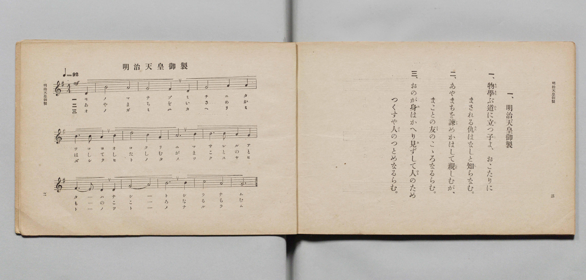

# 明治天皇御製

> Re:Shōka 使用 AI 協助辨識與重建樂譜，可能會有錯誤。歡迎回報。

- **鋼琴伴奏版**：<br><audio controls src="meiji_tenno_gyosei.mp3"></audio>

- 詞：明治天皇御製
- 曲：文部省
- 文部省《尋常小學唱歌 第六學年用》（大正三年，索書號 4078）

## 說明

原書資訊與歌詞全文（對應 P004.jpg，原書 pp. 2–3，第 1 首）：
調性與拍號：ト調（G 大調 / E 羽調式）4/4 拍，速度 ♩=92，力度 mf


## 歌詞

```text
一、
物學（ものまな）ぶ道（みち）に立（た）つ子（こ）よ、おこたりに
まされる仇（あだ）はなしと知（し）らなむ。

二、
あやまちを諫（いさ）めかはして親（した）しむが、
まことの友（とも）のこゝろなるらむ。

三、
おのが身（み）はかへり見（み）ずして人（ひと）のため
つくすや人（ひと）のつとめなるらむ。
```

## ABC

<div class="abc-score" data-abc-src="meiji_tenno_gyosei.abc" aria-label="五線譜載入中"></div>

[下載 ABC 原始檔](meiji_tenno_gyosei.abc)

## TMD 檔案連結

- [主旋律 TMD 檔案](meiji_tenno_gyosei.tmd) [[在 TMD Studio 編輯](https://tmdlang.github.io/Tmd-TS/#tmd=s7IKdvYPcrWy4qpTUCpJTLdSSM7PyUlNLsnMz7PKyszLyo8vzshPT8wuBdHZiUpwdWX5OaW5qVbpRYkpqfFm8SYG5hYIyeL80qLkVKvi5Iz8_Jz4ktSKkqT8_Gx0-fiCxPRUqwADAxOETEFRfllqXmIeUHdBUWZeSWoKWDtCQWpZZkoqSLostSgzLTM1BYtUcXJiXjymPFCkGOQvqO0lRYl5xclFmQUgzyJU5ReVAH1clFiQUWmVkVlckl-UmZyYE5-dmIfk-5KMVKDnc_OLEnPQBTNzC4A2I4sDTUjPzAOqzksqBYaiEpeWlsKzGX3PNu1-umTl81ntT_ctfLF4r4KWFpeirYKlEZe9rYI7l42JvokdyIgXK-e93zMLUz3Y_GezN4Ekp7W_bF7xfE4jRAzGe9zQ9XRD99MdO55u6H-6dsfTKRufre1ReL5mzdPWtSD-zi3Pp6x43ND9fk_H0yXLn61d_GRHJ1Dw_Z6e51sWPZu948XM-QqgeH2_p1OJi0tfS8GWWoBLQUHhad98kB2b21-s6HrR0Q50GtCnT1tXAJ0PctCG3mftnQqgxKGXVZAOdBNEvUJBgZ6C0aOGycYgZ65Zo2Co8HLZNKALgcEAMvXFqv3PGpaDzOvuBbofKPq4uQMoCDTSXQHoSyBTQV_BVeH5vr1A5tM9_UCtwJBWACoHGviyYf7TXcsUHs1caWtpBLKzazaIn5vGBTL7yY6Gxw2NINbzzpXAAASa-bip6XHjuseN-x43rgKa9Lhx28vGySDxxv2PGxeCRVY_Xw0K4ceNQMcAuUuerp0A5gKVdT5u6gCa-LixC8gFKnjcBGSsBlkANnHq46aex03dT3aDAuRxI9CmBWAj1gMte9w4_XHjiufzl4KlpoPNAkqtetwEdGMTxLm7eqDOBeltagGbufBx06QXq1eDdQFFpoI1Al3QDTYWaOayF8uAPgGZCXPxdJCZjQizgKYAHbsC6O-n_RCfrQAGA1gpMCQmP26a-7ipF-yUbpCbkBy0oxNuCNCjQMU9L3ZBnAKMH4jHgO7YAQyGF8sgJkPEZ0Fc9mTXLrDgJqCNMOuAYQY1ccnjxv7HjTOBHsWmDigLdCXQo6jOAuqkPDVDgYKWPheXb2pmVmZIal5evntlfnFqplVAZmJevkONrmFNNcg2BRsLLTswA1t-AmVOYCp7sbBHQePpno0vtm4Hpm9g0lTQVjBWAObi5-sbdOB5QhOLfqATQGbXKBgo6MJxdW5arYJpPJBVAzRGFwyNoHQN0AIIyxykAKoKJgZSBcI1YFN9DGsUQPIw_Lh5EVj14-Y-qPrHzfPg5j5u7oKLTgOT86HijXDxbhDZtB9hgxGaDY1NED1NLTA9jfsQNjQuhIk2TQLLgVSBxKfCxUF2AVMVwgZjNBuaVqH7oWkNkh9Aboa4tR8stxoqPgMuDtIP9Rs4leOO2F094Ig1IS0mITFmDI4HELtGwRRqN4gHiqkaeGzCRFF1gdXAY_BxMyQsHzdtBrJXIIcBUAQWBqA4gfgNpAMUfjAIiWOQ6q1Q_hogBoXL4yZweoDHJDBDQ1Q0TgfiZVAWJIbg4QoWAeZGqHgPsk3guAaJTobyVwDxOigLOUYfN-2Cuns70C1tYFeBUgTI7R1wd4NiGJragDxY2oHIQVNOE9TFTTuBYksQ5hCI2R2d4Jg1JS1mwTlOV8EsHpLtsOQ9SCqE5VlE7JpgqIHpAkFQnkeOb1DYIqVhcL4E-XU7kh5YeoeFFiw0IaIr4SbA8jRIdAGSWrDbETHfBMq3kDiDxBcoBhExiWJnUy-ynY2wtAhLc8DCGkktzC9odoLSAHpMw-IUxU8wt6PGPjREwKkYIgLzMXZ_1nJx6dopoJf1CkAxZS4A)]
- [鋼琴伴奏 TMD 檔案](meiji_tenno_gyosei_piano.tmd) [[在 TMD Studio 編輯](https://tmdlang.github.io/Tmd-TS/#tmd=s7IKdvYPcrWy4qpTUCpJTLdSSM7PyUlNLsnMz7PKyszLyo8vzshPT8wuBdHZiUpwdWX5OaW5qVbpRYkpqfFm8SYG5hYIyeL80qLkVKvi5Iz8_Jz4ktSKkqT8_Gx0-fiCxPRUqwADAxOETEFRfllqXmIeUHdBUWZeSWoKWDtCQWpZZkoqSDoxOTk_tyAxLzM3NQ9Jviy1qBjkeKgVJUWJecXJRZkFIB8hVOUXlQC9VZRYkFFplZFZXJJflJmcmBOfnZiH5MXEIqDm9FSQ-VYFmYl5-fE47CzJACqyys0vSsxBF8zMLUgtykQWB1qVnpkHVJ2XVAoMUyUuLS2FZzP6nm3a_XTJyuez2p_uW_hi8d73ezpedu95PmHLkz1bni7tf97Z8X5Pp4KWFpeirYKlEZe9rYI7l42JvokdyNwXK-e93zML0xCwpc9mbwJJTmt_2bzi-ZxGiBiM97ih6-mG7qc7djzd0P907Y6nUzY-W9uj8HzNmqeta0H8nVueT1nxuKEb6JynS5Y_W7v4yY5OoOD7PT3Ptyx6NnvHi5nzFUBRD3ScEheXb2pmVmZIal5evntlfnFqplUAKNSCPBxqdA1rqrkUgMDGQssOzNDXUrBFByCLn-xoeLGwR0Hj6Z6NL7ZuVzBUeNbdq6CtYKwAdOHz9Q06CqD0opdVkK6JRb-WPtjsGgUDBV04rs5Nq1UwjQeyaoDG6IKhEZSuAVoAYZmDFEBVwcRAqkC4Bmyqj2GNAkgehh83LwKrftzcB1X_uHke3NzHzV1w0Wlgcj5UvBEu3g0im_YjbDBCs6GxCaKnqQWmp3EfwobGhTDRpklgOZAqkPhUuDjIrseNIHugNhij2dC0Ct0PTWuQ_AByM8St_WC51VDxGXBxkH6o37jwR-yuHnDEmpAWk5AYMwbHA4hdo2AKtRvEA8VUDTw2YaKousBq4DH4uBkSlo-bNgPZK5DDACgCCwNQnED8BtIBCj8YhMQxSPVWKH8NEIPC5XETOD3AY_Jx43qIisbpQLwMyoLEEDxcwSKPmxqg4j3INoHjGiQ6GcpfAcTroCzkGH3ctAvq7u1At7SBXQVKESC3d8DdDYphaGoD8mBpByIHTTlNUBc37QSKLUGYQyBmd3SCY9aUtJgF5zhdBbN4SLbDkvcgqRCWZxGxa4KhBqYLBEF5Hjm-QWGLlIbB-RLk1-1IemDpHRZasNCEiK6EmwDL0yDRBUhqwW5HxHwTKN9C4gwSX6AYRMQkip1Nvch2NsLSIizNPW7qRFIL8wuanaA0gB7TsDhF8RPM7aixDw0RcCqGiMB8jN2ftbiKeh-Uot4EWtSDimMQNI2PB0VVvEK0YSyYE20aH0ucCNQcZHEgDReAUsCyAaYDQwlcAGoUqkoCDoGbbwJkmOBQYQAJGV07BfTAifYBqsAqboRD3BgsrswFAA)]

## 分析

```text
================================================================================
📊 TMD Song Profile: [ 明治天皇御製 ]
================================================================================
⏱  Duration:       0:31 (31.3s), 12 measures total
🎼 Key & Tempo:    首調基準 G, != 92.0 BPM, <4/4>
   - 分析範圍：      由實際發聲的音符與和弦推測調性；播放脈絡另行呈現
🎤 人聲音域:    D4 (MIDI 62) – D5 (MIDI 74) [跨度: 12 個半音 / 1.0 個八度, 難度: easy]
   - 最低音:  D4 in [MeijiTennoGyosei #1 @ m.1, 0:01]
   - 最高音: D5 in [MeijiTennoGyosei #1 @ m.6, 0:13]
   - 適合: soprano, mezzo-soprano, contralto, tenor, baritone, bass
🏛  結構:      MeijiTennoGyosei (31.3s)
⚡ 編曲密度:        Peak 1 軌道同時演奏
🗝  調性診斷：       G 大調（純淨自然大調，未偵測到可信轉調）
   - 風格氣質:    純淨自然大調（陽光明朗、易唱易記，無明顯調外色彩）
   - 轉調歷程:    全曲維持單一推測調性（未偵測到可信轉調）
   - 核心骨幹音:  A, B, G, D, F#
   - 調性數值:    G 大調 [相關度: 0.69, 穩定度: Moderate, 自然音純度: 100.0%]
   - 候選調性 (K-S): G 大調 (0.69), D 大調 (0.62), B 小調 (0.60)
   - 五度圈歷程:   +2
   - 各段落調性細節:
     • [MeijiTennoGyosei #1]: D 調性不明確 (r: 0.63, 自然音純度: 95.6%, 調外音: C)

  [ 五度圈游移軌跡 ]
               C  
         F            G  
      Bb              [D ]*
      Eb               A  
         Ab           E  
            Db       B  
               F# 
     (* = active key center)

  [ 十二半音累積音高分佈 ]
     C  : ████                       4.2%
     C# :                            0.0%
     D  : ███████████               12.5%
     D# :                            0.0%
     E  : █                          1.0%
     F  :                            0.0%
     F# : █████                      5.2%
     G  : ████████████████████      22.9%
     G# :                            0.0%
     A  : ████████████████████████  27.1%
     A# :                            0.0%
     B  : ████████████████████████  27.1%
--------------------------------------------------------------------------------
Assignment 軌道音域：
  - Piano         : D4 – D5 (12 個半音 / 1.0 個八度, 33 個音符)
================================================================================
```


## 原書掃描頁




