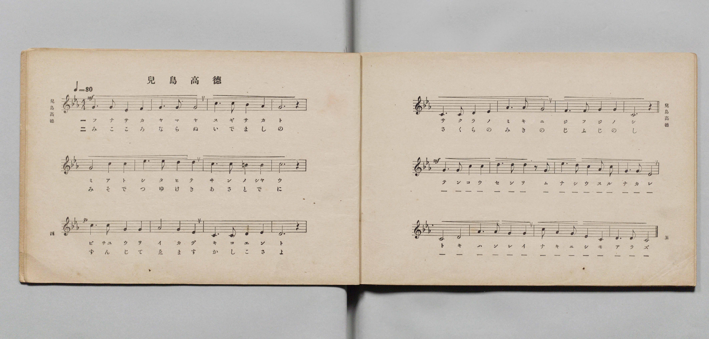
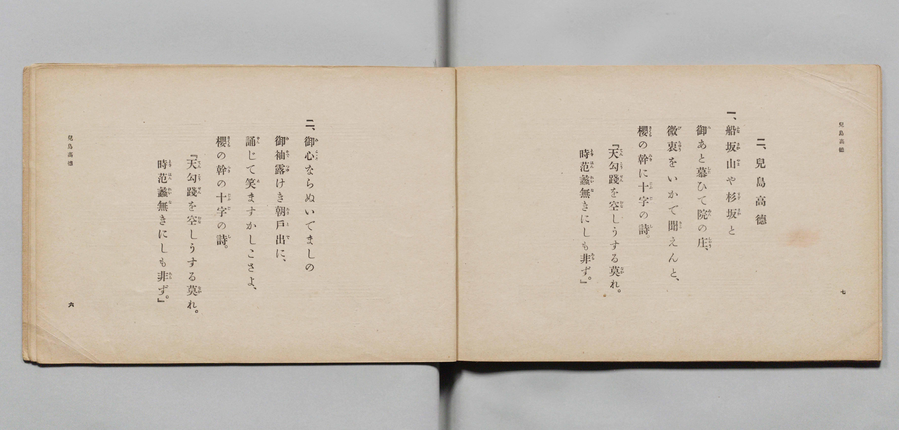

# 兒島高德

> Re:Shōka 使用 AI 協助辨識與重建樂譜，可能會有錯誤。歡迎回報。

- **鋼琴伴奏版**：<br><audio controls src="kojima_takanori.mp3"></audio>

- 詞：文部省
- 曲：文部省
- 文部省《尋常小學唱歌 第六學年用》（大正三年，索書號 4078）

## 說明

原書資訊與歌詞全文（對應 P005.jpg–P006.jpg，原書 pp. 4–7，第 2 首）：
調性與拍號：ハ短調（C 小調 / 關係調 E♭ 大調）4/4 拍，速度 ♩=80


## 歌詞

```text
一、
船坂山（ふなさかやま）や杉坂（すぎさか）と
御（み）あと慕（した）ひて院（ゐん）の庄（しやう）、
微衷（びちゆう）をいかで聞（きこ）えんと、
櫻（さくら）の幹（みき）に十字（じふじ）の詩（し）。
『天（てん）勾踐（こうせん）を空（むな）しうする莫（なか）れ。
時（とき）范蠡（はんれい）無（な）きにしも非（あら）ず。』

二、
御心（みこゝろ）ならぬいでましの
御袖（みそで）露（つゆ）けき朝戸出（あさとで）に、
誦（ずん）じて笑（ゑ）ますかしこさよ、
櫻（さくら）の幹（みき）の十字（じふじ）の詩（し）。
『天（てん）勾踐（こうせん）を空（むな）しうする莫（なか）れ。
時（とき）范蠡（はんれい）無（な）きにしも非（あら）ず。』
```

## ABC

<div class="abc-score" data-abc-src="kojima_takanori.abc" aria-label="五線譜載入中"></div>

[下載 ABC 原始檔](kojima_takanori.abc)

## TMD 檔案連結

- [主旋律 TMD 檔案](kojima_takanori.tmd) [[在 TMD Studio 編輯](https://tmdlang.github.io/Tmd-TS/#tmd=s7IKdvYPcrWy4qpTUCpJTLdSSM7PyUlNLsnMz7PKyszLyo8vzshPT8wuBdHZiUpwdWX5OaW5qVbpRYkpqfFm8SYG5hYIyeL80qLkVKvi5Iz8_Jz4ktSKkqT8_Gx0-fiCxPRUqwADA1NdIGGGkC4oyi9LzUvMAxpRUJSZV5KaAjYDoSC1LDMlFSRdllqUmZaZmoJFqjg5MS8eUx4oUgzyHNQJJUWJecXJRZkFIB8jVOUXlQC9XZRYkFFplZFZXJJflJmcmBOfnZiHFAQlGanAEIBIVyLrzUzPzLPKzc9LKgUGmhKXlpbC09ZJTzdve7l6xtN92xW0tLgUbRUsDLjsbRVcdbiyUyttFZxzuWxM9E3sQKa8WDnv_Z5Zz6a1v2xe8XxOI9jkZ7M3YYrBeI8bup5u6H66Y8fTDf1P1-54OmXjs7U9Cs_XrHnauhbE37nl-ZQVjxu63-_peLpk-bO1i5_s6AQKvt_T83zLomezd7yYOV8BFIHv93QqcXHpaynYUgtwKSgoPO2bD7Jjc_uLFV0vOtqBTgN68GnrCqDzQQ7a0PusvVMBlAr0sgrSHzVMBqUFEBPoPIhWhYICPQUToIw5yMVr1igYKbxcNg3oWGCIgCx4sWr_s4blIKO7e4FeAYo-bu5_Pn8tUBxogbMCMFSATAV9hZfT5zzZ3wRiuz6auVYBGBZgJZ3AgFcA6gWa_rJh_tNdyxQezVxpC4wfkOFPdjQ8bmgEW9Ox8-ncpqcbNwINfdy49XHjqseNUx83dj9uanncuA9oDJDxbG4nUA1YwczHjX0QBSCpxhXgoNi3ECwHsvRxYxNQ9FnrVLDI9MeNQIcDBTc9blz2cuYikGDThMdNk8GC657uaoEqA1nWBhKEOOrpvnUvFm4Hy21-3LjwcVMbVLpp0uNGoNLux43LXzQC0xNQQe_jRohxQKMnA-2GGvFs9W6wNNCp_Y-bgIEKtnDnTohLgdrAIquf9jY-XTsdLDgD7P0ZEJUvVq6EOA3sqCaQiY8b-p4ugYgug3jhafe-FzsmgEWANgPdOBvqtaZJz1fuAnu2ARigYBOBQQFUMPNxU_eLvtVgLcCABgdiUw_UgmczIWG8AuK6Fz3NLxZAQnY9yGtAdY3A8Op83gIRhJgL9P5qcAg2vZwLCZAmmHdnAc193NAPifBdQFugYbvw6f5mWDAAjZ37uAkSGKuAGh83rgGH8HJg5IMdvQ6q58UiYNqE6JkLlAZqeDkHmHmBIkuA0QPWPxHommdz5j7r2PG0Hex7UFoAhj_QPyD1IIdC09yqZWDpWbCUAAz6Zc_XTASHGJAEigAtByY1YDwDnQAM26mPmzpIith1IyFigUZTXphBgYKWPheXd35WZm5iSCKwRgCW91YBmUDaocagphpklYKNhZYdmIGtLAUVzMBS5cXCHgUNE1Dh9Hx9gw68AFR4un3ZywWNT3Z0aWLRCrQaZGyNQnVuWq2CsYIuEBorGAJJIyCugYtAaJCIGZg2UzAFkiZIaiDQACQCNtLHsEbhcfNUsOjj5i6Fx01bQaym1WA9j5uXQGXmwdlg8aadEPGmdRg6OpDsiUfYYwSUa9wP0dU4GYxBunohuhpXQc3rBLLXIOxpbIHqWA7E-8Cs6VCZdRj24A_6XT2Egn4t3qCHhR8oZEG4RsEwDiwApMyBFAgjhbs6kAITMDHsIT8fKv64aRE4nEGhBwrf7VDR_UCxSWCZNmj4boDGyGYg7gOr2f64eTFU2zKCgQ8KwrnQIIUEJDSKm9qA7IlgGVikNEHVTwXiFSh6QJFNSuDv6CQU-N34031BLTxoQREBwjXghA1J-MBYgAQ1yDFARfEK5iAWRBDMxBUBoGQICs7Gx81LoQH4uHkTNDhhKR6Suh83t0PF10JFgXHQBA4YYGwQTv2zoLpAqX8GODhBtoHMAwU7JKghaXwmNJi7oaLTYfkFGBUQHZj24I2Ap7Nn44yA_s1EFDxYAxYS_iZIxQ6oOAIVSog4gmrEGvjgkgMUIuuBIbcSHI6gFI3IF6CQftwMCQWIv3dAxIElFoQN1wHNMdhDHlq-NfaDSxgQC1R6IJdIvUglCkgcFD8g8a3wuILpAJU_pCT9XVMIhTz-cgelyEcUPqDiBlTogGgDoAy8ODIHKzABkoh6ARRdYJ8hJXxQeQItR4DpGBTWsNS4GyEDzgnxQHoBOFa6oLGyHZZTgPXA4-bVKHKrgWx4CY4UB5CiCZL6IWkZWqI1zkbINIHKOqB9TQ3ItQI4_YNUg3IGsB2BItcNFOmB24c_F7SuJRQX-IsheGKGFymomQCa5MFikFAH64AXQUAKbgRyXMByM6xkgeSBfqR4AIUopDyChDVEJShvQFL-42ZQ_QGKPRAN4q8EsndhiQdQeQVL84j0vh4pDkChCal5IeEMUQkq9CGpH9jigspBKwhwrQ0p3UB21XJx6dopoDaVFIAiylwA)]
- [鋼琴伴奏 TMD 檔案](kojima_takanori_piano.tmd) [[在 TMD Studio 編輯](https://tmdlang.github.io/Tmd-TS/#tmd=s7IKdvYPcrWy4qpTUCpJTLdSSM7PyUlNLsnMz7PKyszLyo8vzshPT8wuBdHZiUpwdWX5OaW5qVbpRYkpqfFm8SYG5hYIyeL80qLkVKvi5Iz8_Jz4ktSKkqT8_Gx0-fiCxPRUqwADA1NdIGGGkC4oyi9LzUvMAxpRUJSZV5KaAjYDoSC1LDMlFSSdmJycn1uQmJeZm5qHJF-WWlQM8gHUnpKixLzi5KLMApC3EKryi0qAfitKLMiotMrILC7JL8pMTsyJz07MQ_JnYhFQc3oqyHyrgszEvPx4HHaWZAAVQc2pRLYkMz0zzyo3Py-pFBiESlxaWgpPWyc93bzt5eoZT_dtf7-n42X3nucTtjzZs-Xp0v7nnR3v93QqaGlxKdoqWBhw2dsquOpwZadW2io453LZmOib2IGMfrFy3vs9s55Na3_ZvOL5nEawdc9mb8IUg_EeN3Q93dD9dMeOpxv6n67d8XTKxmdrexSer1nztHUtiL9zy_MpKx43dAOd83TJ8mdrFz_Z0QkUfL-n5_mWRc9m73gxc74CKI6BjlPi4vLOz8rMTQxJBAYV0H9WAaBwCfJwqDGoqeZSAAIbCy07MENfS8EWHYBsfbKj4cXCHgUNEwWge56vb9BRACUDvayCdIWn25e9XND4ZEeXJhatWvpgY2sUqnPTahWMFXSB0FjBEEgaAXENXARCg0TMwLSZgimQNEFSA4EGIBGwkT6GNQqPm6eCRR83dyk8btoKYjWtBut53LwEKjMPzgaLN-2EiDetw9DRgWRPPMIeI6Bc436IrsbJYAzS1QvR1bgKal4nkL0GYU9jC1THciDeB2ZNh8qsw7AHf9Dv6iEU9GvxBj0s_EAhC8I1CoZxYAEgZQ6kQBgp3NWBFJiAiWEP-flQ8cdNi8DhDAo9UPhuh4ruB4pNAsu0QcN3AzRGNgNxH1jN9sfNi6HalhEMfFAQzoUGKSQgoVHc1AZkTwTLwCKlCap-KhCvQNEDimxSAn9HJ6HA78af7gtq4UELiggQrgEnbEjCB8YCJKhBjgEqilcwB7EggmAmrggAJUNQcDY-bl4KDcDHzZugwQlL8ZDU_bi5HSq-FioKjIMmcMAAY4Nw6p8F1QVK_TPAwQmyDWQeKNghQQ1J4zOhwdwNFZ0Oyy_AqIDowLQHbwQ8nT0bZwT0byai4MEasJDwN0EqdkDFEahQQsQRVCPWwAeXHKAQWQ8MuZXgcASlaES-AIX042ZIKED8vQMiDiyxIGy4DmiOwR7y0PKtsR9cwoBYoNIDuUTqRSpRQOKg-AGJb4XHFUwHqPwhJenvmkIo5PGXOyhFPqLwARU3oEIHRBsAZeDFkTlYgQmQRNQLoOgC-wwp4YPKE2g5AkzHoLCGpcbdCBlwTogH0gvAsdIFjZXtsJwCrAceN69GkVsNZMNLcKQ4gBRNkNQPScvQEq1xNkKmCVTWAe1rakCuFcDpH6QalDMeN3WjyHUDRXrg9uHPBa1rCcUF_mIInpjhRQpqJoAmebAYJNTBOuBFEJCCG4EcF7DcDCtZIHmgHykeQCEKKY8gYQ1RCcobkJT_uBlUf4BiD0SD-CuB7F1Y4gFUXsHSPCK9r0eKA1BoQmpeSDhDVIIKfUjqf9wEqhiQKghwrQ0p3UB21WJvKfkgt5RMoC0lUJjGK0SbxefGIrEIixqDWMbxmEoNoJ4FJn6YEpxqYcYaAZlGaGIouskxlLBK_KbCmTDX4fA-DoeSEqwwGwj5iagwwOZcExDLBNW5IFloatG1U0BNMNE-hrEKWESNwKLKXAA)]

## 分析

```text
================================================================================
📊 TMD Song Profile: [ 兒島高德 ]
================================================================================
⏱  Duration:       1:12 (72.0s), 24 measures total
🎼 Key & Tempo:    首調基準 E,, != 80.0 BPM, <4/4>
   - 分析範圍：      由實際發聲的音符與和弦推測調性；播放脈絡另行呈現
🎤 人聲音域:    C4 (MIDI 60) – D#5 (MIDI 75) [跨度: 15 個半音 / 1.2 個八度, 難度: moderate]
   - 最低音:  C4 in [KojimaTakanori #1 @ m.11, 0:30]
   - 最高音: D#5 in [KojimaTakanori #1 @ m.6, 0:15]
   - 適合: soprano, mezzo-soprano, contralto, tenor, baritone, bass
🏛  結構:      KojimaTakanori (72.0s)
⚡ 編曲密度:        Peak 1 軌道同時演奏
🗝  調性診斷：       C 小調（純淨自然小調，未偵測到可信轉調）
   - 風格氣質:    純淨自然小調（陰鬱抒情、旋律集中，無明顯調外色彩）
   - 轉調歷程:    全曲維持單一推測調性（未偵測到可信轉調）
   - 核心骨幹音:  C, G, D, D#, G#
   - 調性數值:    C 小調 [相關度: 0.86, 穩定度: High, 自然音純度: 97.8%]
   - 候選調性 (K-S): C 小調 (0.86), C 大調 (0.69), G 大調 (0.62)
   - 五度圈歷程:   +0
   - 各段落調性細節:
     • [KojimaTakanori #1]: C 小調 (r: 0.86, 自然音純度: 97.8%, 調外音: B)

  [ 五度圈游移軌跡 ]
              [C ]*
         F            G  
      Bb               D  
      Eb               A  
         Ab           E  
            Db       B  
               F# 
     (* = active key center)

  [ 十二半音累積音高分佈 ]
     C  : ████████████████████████  29.5%
     C# :                            0.0%
     D  : █████████████             15.8%
     D# : █████████                 11.5%
     E  :                            0.0%
     F  : ███                        3.3%
     F# :                            0.0%
     G  : ██████████████████████    27.3%
     G# : ████████                   9.3%
     A  :                            0.0%
     A# : █                          1.1%
     B  : ██                         2.2%
--------------------------------------------------------------------------------
Assignment 軌道音域：
  - Piano         : C4 – D#5 (15 個半音 / 1.2 個八度, 78 個音符)
================================================================================
```


## 原書掃描頁






