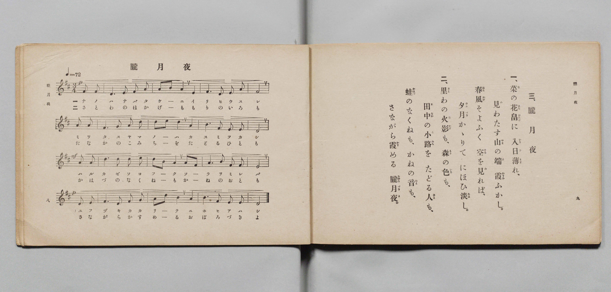

# 朧月夜

> Re:Shōka 使用 AI 協助辨識與重建樂譜，可能會有錯誤。歡迎回報。

- **鋼琴伴奏版**：<br><audio controls src="oborozukiyo.mp3"></audio>

- 文部省
- 臺灣教育會公認《新定兒童唱歌》尋常科第六學年用（2020.006.0847.0006）

## 說明

原書資訊與歌詞全文（對應 P024.jpg，書頁 p. 1，第一學期第 1 首）：
調性與拍號：に長調四分之三拍子（D 大調 3/4 拍，弱起 1 拍），「優美ニ」（♩=72）


## 歌詞

```text
一　菜（な）の花畠（はなばたけ）に　入日薄（いりひうす）れ
見わたす山の端（は）霞（かすみ）ふかし
春風そよふく空を見れば
夕月かゝりてにほひ淡（あは）し

二　里わの火影（ほかげ）も　森の色も
田中の小路（こみち）をたどる人も
蛙（かはづ）のなくねもかねの音（おと）も
さながら霞める　朧月夜
```

## ABC

<div class="abc-score" data-abc-src="oborozukiyo.abc" aria-label="五線譜載入中"></div>

[下載 ABC 原始檔](oborozukiyo.abc)

## TMD 檔案連結

- [主旋律 TMD 檔案](oborozukiyo.tmd) [[在 TMD Studio 編輯](https://tmdlang.github.io/Tmd-TS/#tmd=s7IKdvYPcrWy4qpTUCpJTLdSSM7PyUlNLsnMz7PKyszLyo8vzshPT8wuBdHZiUpwdWX5OaW5qVbpRYkpqfFm8SYG5hYIyeL80qLkVKvi5Iz8_Jz4ktSKkqT8_Gx0-fiCxPRUqwADIxOETEFRfllqXmIeUHdBUWZeSWoKWDtCQWpZZkoqSLo4OTEvviy1KDMtMzUFyV2pRcUgx0OtKClKzCtOLsosAPkIoSq_qAToraLEgoxKq4zM4pL8oszkxJz47MQ8JC-WZKQCfViSmZsan58Wn5JYiS5VnJpYnJ9XjGxsZnpmnlVufl5SKTC8MCVSM7MykcJDS0vh2Zzlz-Z0PF0yR0FLi0vRVsHciMveVsGFy8ZY38QOpP_ZtPaXzSuez2kEm_aifdfzxsXPps580bTp2Zzmp61rXqzqfdzQ9WzahqfrZj1tnfR89dKnUzY-W9vzuKH76Ybupzt2PF8-8fmaNU9b1z5du-Ppzi3Pp6x4v6fDyMDIQM_AwEzPwMLEHMgwMHu_p1OJi0tfS8GWWoBLQUHhad_8Z7N3vNjc_mJF14uOdqC7Xqyc97R1BdBXQFc83dD7rL1TAZQE9LIK0t_v6QEqfrmgUaFAT8EQyAO6-8mOBqC7n82ZD2QrGCq8XDYN6ND3e2aBDH-xav-zhuUgY7t7X8ycDxR93Lj65dTtQPGns2c_7Wh7srP7yY5OoOzTtROA1rkoPF2yHCipAAxbBaAo0Ianeza-2LodaDCYCzQYGG49T1tWPd_X97i5-3EDULDj0cyVtuZGQFkukKVABz1uaHjRPwco87hxFVD4ceO6F10bn09dABZZDxR83LjhceP8x40TwbKrgeqfti59Nn3pi2ktYDUtj5u6HjduetzY9rhxJkhNUw_YP8u6Hzf1g3XOfLpxI9Dc56vXQwwFKno5Zx6Y3Q2Ufdy4H2z0VjB3OkjzsxlLXy5a8bhx7uMmoCKgRP_zlbseN00CG9oDdBE4OpZMBaY2kKYmoDqgG5aBnNe4G-iYZ9sXgo1vgtgGMhXs3V3AEGl42d4Ddtm6542rn-7dCFYI1AS0exLY-U1ANc8WrwOFROcmIBek8_mUDU92rAUKPd3Q_2I7xB-TgQ5_3Ai0CKhnEtijKx83dT_ZBXQoWM-L2cDggPgRGI5LIYELDlCg5WtB9oCkQIa-nL8ZrBLoB2B6BjkBpP9x41SwaqBrQeH1uKkRaDzIbbBcBlJEecqGAgUtfS4u_6T8ovyq0uzMynyrgMzEvHyHGoOaapA9CjYWWnZgBrZcpQBJ3C8W9ihoQFOhtoKJAjCwnq9v0IHnCU0sOoHWgkytUTBQ0AXD6oJaBWMgrAEmZBDfCMg2BfJMFcyAGMTXBfKMwXKGQJ5pPJyrC-KA-GAjfQxrFOKBYiAMDEggXgdUCYwMsEqIyAYgng8WnQgVXQ3ELWArgGkKKrYJiNuAeCZYtAdqFzD6gbx-mG1GyLZNBeIVYNX9ULXrgHg3EHeDbZsEEW1qAmNU20AqW4D8XrAoSBYiPh_s5hpwSsYdC7t6wLFAYuBDws8EGMCGcaCQj1MwigORwBAFu84MLG8MDG4jeMQAoyo3rRYjyEEOhTh4JtD5QI807gN7eR1UdD04EMBeBqqAB2TjVnjgTId7Gai2CSgGD2CITlggTQbrBIkuhAbnJKjtILGVULFuaARCogMRnCDx9QSDc0cnOcEJDjlg8gSHITAkwSKQ5GsKTtogli5QBJLQQUkalvRBSRo5MGEengPEc4Ee6AB7bitUtB8sCkk_nUiBAEqZPWCVG2AebgKl4K0ogbkUKTBBuQGYloHkWkTahEcUVAyssgtLYILSO8G0CazHyE-bhkDaBBxy4KDEnzBBZQlyIMI82guNd3A6g2e4ZUC8GurR3VAxUIoBBQAwhSClSFDmRg5ASFEACnqIuZACohEp5YHsAKncAxUDuWAp2CUglR0o5tZycenaKSCVwQpArjIXAA)]
- [鋼琴伴奏 TMD 檔案](oborozukiyo_piano.tmd) [[在 TMD Studio 編輯](https://tmdlang.github.io/Tmd-TS/#tmd=s7IKdvYPcrWy4tLSUng2Z_mzOR1Pl8x5v6fjZfee5xO2PNmz5enS_uedHe_3dCpoaXEp2iqYG3HZ2yq4cNkY65vYcdUpKD2b1v6yecXzOY1KIN6L9l3PGxc_mzrzRdOmZ3Oan7auebGq93FD17NpG56um_W0ddLz1UufTtn4bG3P44bupxu6n-7Y8Xz5xOdr1jxtXft07Y6nO7c8n7ICaL-RgZGBnoGBmZ6BhYk5kGFgBnSCEheXf1J-UX5VaXZmZb5VQGZiXn6Qh0ONrmFNNZcCENhYaNmBGfpaCrboQAFoy5MdDS8W9ihoBBgYmehlFaRrYlGmpQ82okbBQEEXDKsLahWMgbBGwRDMNwKyTYE8UwUzIAbxdYE8Y7CcIZBnGg_n6oI4ID7YSB_DGoV4oBgIP25cBcTrgCofN64Hq4SIbADi-WDRiVDR1UDcArbicVMXVGwTELcB8UywaA_UrseN-4G8fphtRsi2TQXiFWDV_VC164B4NxB3g22bBBFtagJjVNtAKluA_F6wKEgWIj4f7OYaLvxBvquH-CCHhJoJMFgN40DhHadgFAcigeEIdpMZWN4YGMhG8OgARlBuWi1GQIOcB3HmTKCjgc5v3Af26Dqo6Hqw18EeBaqAB1_jVniQTId7FKi2CSgGD1aITljQTAbrBIkuhAbiJKjtILGVULFuaLRBIgERiCDx9QQDcUcn8YEIDi9gUgSHHDD8wCKQpGoKTsYgli5QBJKoQckXlsxByRc5CGHenAPEc4HO7gB7aStUtB8sCkkrnUheB6XCHrDKDTBvNoFS61aUIFyKFISglA9Mt0ByLSIdwqMHKgZW2YUlCEFpm2A6fDp7Nqnp0BBIm4DDCxyA-BMhqLRADjqY93qhcQxOU_AstQyIV0O9txsqBkodIG8DUwNS6gNlX-Rgg2R2UIBDzIUUAY1IqQxkB0jlHqgYyAVLwS4BqexAMbcWS5Hqg1KkmkCLVFB5aABOJAYgX8crRBvGgnGNggmQYwLkmMaDeDApFB5QDyx1YtOJ2xhw3iZGN4qMaTyQBzIH6l7y7AZpBAaQrp0CUhhF-wBl0IWMwELKXAA)]

## 分析

```text
================================================================================
📊 TMD Song Profile: [ 朧月夜 ]
================================================================================
⏱  Duration:       0:42 (42.5s), 17 measures total
🎼 Key & Tempo:    首調基準 D, != 72.0 BPM, <3/4>
   - 分析範圍：      由實際發聲的音符與和弦推測調性；播放脈絡另行呈現
🎤 人聲音域:    A3 (MIDI 57) – E5 (MIDI 76) [跨度: 19 個半音 / 1.6 個八度, 難度: challenging]
   - 最低音:  A3 in [Oborozukiyo #1 @ m.4, 0:09]
   - 最高音: E5 in [Oborozukiyo #1 @ m.7, 0:15]
   - 適合: soprano, mezzo-soprano, contralto, tenor, baritone, bass
🏛  結構:      Oborozukiyo (42.5s)
⚡ 編曲密度:        Peak 1 軌道同時演奏
🗝  調性診斷：       D 大調（純淨自然大調，未偵測到可信轉調）
   - 風格氣質:    純淨自然大調（陽光明朗、易唱易記，無明顯調外色彩）
   - 轉調歷程:    全曲維持單一推測調性（未偵測到可信轉調）
   - 核心骨幹音:  D, F#, A, E, B
   - 調性數值:    D 大調 [相關度: 0.89, 穩定度: High, 自然音純度: 100.0%]
   - 候選調性 (K-S): D 大調 (0.89), A 大調 (0.70), F# 小調 (0.67)
   - 五度圈歷程:   +2
   - 各段落調性細節:
     • [Oborozukiyo #1]: D 大調 (r: 0.89, 自然音純度: 100.0%)

  [ 五度圈游移軌跡 ]
               C  
         F            G  
      Bb              [D ]*
      Eb               A  
         Ab           E  
            Db       B  
               F# 
     (* = active key center)

  [ 十二半音累積音高分佈 ]
     C  :                            0.0%
     C# :                            0.0%
     D  : ████████████████████████  26.0%
     D# :                            0.0%
     E  : ██████████████            15.6%
     F  :                            0.0%
     F# : █████████████████████     22.9%
     G  : ██                         2.1%
     G# :                            0.0%
     A  : ████████████████████      21.9%
     A# :                            0.0%
     B  : ███████████               11.5%
--------------------------------------------------------------------------------
Assignment 軌道音域：
  - Piano         : A3 – E5 (19 個半音 / 1.6 個八度, 61 個音符)
================================================================================
```


## 原書掃描頁




