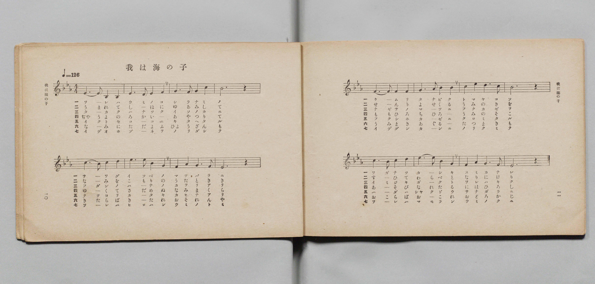
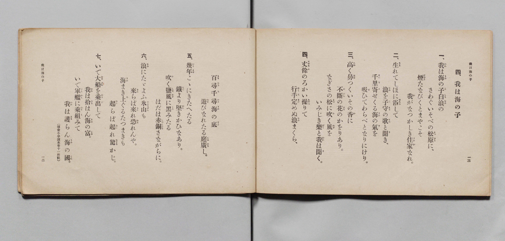

# 我は海の子

> Re:Shōka 使用 AI 協助辨識與重建樂譜，可能會有錯誤。歡迎回報。

- **鋼琴伴奏版**：<br><audio controls src="ware_wa_umi_no_ko.mp3"></audio>

- 詞：文部省（尋常小學讀本卷十一所載）
- 曲：文部省
- 文部省《尋常小學唱歌 第六學年用》（大正三年，索書號 4078）

## 說明

原書資訊與歌詞全文（對應 P008.jpg–P009.jpg，原書 pp. 10–13，第 4 首）：
調性與拍號：變ホ長調（E♭ 大調）4/4 拍，速度 ♩=126


## 歌詞

```text
一、
我（われ）は海（うみ）の子（こ）白浪（しらなみ）の
さわぐいそべの松原（まつばら）に、
煙（けぶり）たなびくとまやこそ
我（わ）がなつかしき住家（すみか）なれ。

二、
生（うま）れてしほに浴（ゆあみ）して
浪（なみ）を子守（こもり）の歌（うた）と聞（き）き、
千里（せんり）寄（よ）せくる海（うみ）の氣（き）を
吸（す）ひてわらべとなりにけり。

三、
高（たか）く鼻（はな）つくいその香（か）に
不斷（ふだん）の花（はな）のかをりあり。
なぎさの松（まつ）に吹（ふ）く風（かぜ）を
いみじき樂（がく）と我（われ）は聞（き）く。

四、
丈餘（ぢやうよ）のろかい操（あやつ）りて
行手（ゆくて）定（さだ）めぬ浪（なみ）まくら、
百尋（もゝひろ）千尋（ちひろ）海（うみ）の底（そこ）
遊（あそ）びなれたる庭廣（にはひろ）し。

五、
幾年（いくとせ）こゝにきたへたる
鐵（てつ）より堅（かた）きかひなあり。
吹（ふ）く鹽風（しほかぜ）に黑（くろ）みたる
はだは赤銅（しやくどう）さながらに。

六、
浪（なみ）にたゞよふ氷山（ひようざん）も
來（きた）らば來（きた）れ恐（おそ）れんや。
海（うみ）まき上（あ）ぐるたつまきも
起（おこ）らば起（おこ）れ驚（おどろ）かじ。

七、
いで大船（おほぶね）を乘出（のりだ）して
我（われ）は拾（ひろ）はん海（うみ）の富（とみ）。
いで軍艦（ぐんかん）に乘組（のりく）みて
我（われ）は護（まも）らん海（うみ）の國（くに）。
（尋常小學讀本卷十一所載）
```

## ABC

<div class="abc-score" data-abc-src="ware_wa_umi_no_ko.abc" aria-label="五線譜載入中"></div>

[下載 ABC 原始檔](ware_wa_umi_no_ko.abc)

## TMD 檔案連結

- [主旋律 TMD 檔案](ware_wa_umi_no_ko.tmd) [[在 TMD Studio 編輯](https://tmdlang.github.io/Tmd-TS/#tmd=s7IKdvYPcrWy4qpTUCpJTLdSSM7PyUlNLsnMz7PKyszLyo8vzshPT8wuBdHZiUpwdWX5OaW5qVbpRYkpqfFm8SYG5hYIyeL80qLkVKvi5Iz8_Jz4ktSKkqT8_Gx0-fiCxPRUqwADAwtdIGGJkC4oyi9LzUvMAxpRUJSZV5KaAjYDoSC1LDMlFSRdllqUmZaZmoJFqjg5MS8eUx4oUgzyHNQJJUWJecXJRZkFIB8jVOUXlQC9XZRYkFFplZFZXJJflJmcmBOfnZiHFAQlGanAEMhLLCktSkUXLU7FUJibWJRZkpmLpBRoanpmnlVufl5SKTB4lbi0tBSedUx83Lj-2dbtjxvXPV07QUFLi0vRVsHQyIzL3lbBVYfLxkTfxA5kwouV897vmfVsWvvL5hXP5zS-39PxdEP30x07nm7of7p2x4t1Dc_mrHnau_1pb-OTHQ3POhte7Ol8v6cTbPmz2ZuQtULEYLzHDV3IBj2dsvHZ2h6F52vWPG1dC-Lv3PJ8yorHDd0gC5csf7Z28ZMdnUDB93t6nm9Z9Gz2jhcz5yuAUgPYMi59LQVbagEuBQWFp33zQXZsbn-xoutFRzvQacBweNq6Auh8cAj0PmvvVAAlKb2sgvRHDZNBCQvEBDoPolWhoEBPwdAAKGVoDHLzmjUKJgovl00DOhcYJiArXqza_6xhOcjw7l6gZ4CiL9Z1PW6e_XLqdqAU0BbXRzPXKgD9DuZ1AuNDAagSaNbLhvlPdy1TeDRzpS0ovkBmAYP-cUMjiAWMV6DWx039j5t6gLogcQwSaWx73AgyBxLfYJHJQO7zmXufbV0F5k5_3ASUXQVXBjLuceNUkFmNEx43tjxunPu4cSdQ4tncfUBPgvXse9y45HHjBqBOsJ7VUFc8b50JlgamsW2Pm7rAcvPBZm9-3Ag0bgVIZxPQxMlAQ1GcDVbaA1YKNLgb5KrG3id7-5-u2wY2cSbQeUBxsLJVQD8-bmiChMAuIBNi9xSI04D-3QdSBlTTuAxszm6gA59tBSYhoEVA2SaYT4FSy8COgAYELAiaJgFD6um6DkhgPW5qgnllHTA9wOwAWgYUWfGiEZhNgCLACAJye6Fuedrb_LIdonT24yagESD9T9e3gJ0ANBeodDYoQJq6MWPp2YbFCBObJoGNm7ADEghgFZtA_gJFNJANjBZgmAIDpAsUCcBwBzJgIbOjE-qal6tngLUDYwISgP0v9-wGi6wH6gWLAMMcGD2QqF73chkkFiGKV0MM6302DeLSrY8bFwD9BHHsi66NqAatA0Ve0ySwg0DhBnINOD0BA7cPlKrAyQiehiA2PJ2wE2I01HWLVkDsf9w4BxEIYOcB08AMYNA8W9EEVgGMYkjKWYGZ_lFjph8WLE9nz4YGy5MdHS-XQEJmEThRtsHiZt3jpl6w9S3PJgO1AxUAvQJUAHYuyGfgZPNiYc-zTlA5BU5VwOBbBorkdbPAGoAeXQBW3fi4cQ16AgN5HRx_0JQ7cx-wSAQbBLQHGAObgPaDzOpthoo3LoQLYsnWu6aCRYAaQbECjvFGYIIDO7txLlgRMPuBcw0wDTR1P9219uluSCIDphlg1EGNBuUIeLaaAkvKO_eBi1-gYmAIQPLwbLBiYLIGWgk0ARhWwKS1A2I42PoJwJgEagBmP0iQAX3W9XRBKyxWIXkHEsTA1AwMFqSkgp4Ydu6FpQdIVoalisbVL3eD4xwUlBDnA1MHzAlgfy0AJYOtS152QWwGFnQQL6wEBh9YAzCWgJb3gLMSsAyDppDWtbBCFT3egJ4FWjAP5KHGrc82bH-6EZL8gQEIiZJp0JzRBPbKk31Aa0BJEOplkDUbMAR7njVCymVgwgLHFjCeQGVGCzRAMGIcmHp6n-yAxjBYZALQ1-BIAOZjkCzU_hdQnUCDIa4C2Y8h2PNyJSTNAkVWwoISaNwMREnSDA0QcBpYDqqbOiCRBNQCjJJtjxvXQjLqk50znrbvAksBMxFQFpwJECUtZi3VDSkM4ElwPdDvWNL4ekhpCkx8YBFYqQJyzovdvS86gXkPKA0MB2DNAiyAIMXTaqBznm8Fl7pQ50BKC2A6weGcF2shNgNrKXDIAkMMq3PmQLIlMC2tRjgHKERMGwmklPLWChQoaOlzcYUnFqWGJ4bmZvrle-dbBWQm5uU71BjUVINsUrCx0LIDM7C1lUANL6DbgEWZgoaJAtDdz9c36MAbOApPty97uQDo-C5NLFqBNoOMrVEwVNAFQkMF03ggBSZgYubxYIYRWMgYLGQEpk3BImZgEQg0AImADfQxrFF43LweLPq4eQ8QrwGz-sF6Hjctg8rMB-I-EKtpM1RmO1RmJRB3QdWAZcDqYBDsQIhNRkC5xjaIrsZ9QBN6wCyQDSCZ6VCZ3UC8GmwTSC1Ipgkqsx-qCuROiAzEdRg2GYPctx_hpyaIeSBfgtwH8htIpguIW5BlmpZAZJr2wn0L0gnS043dJhOQK0AVGtSJbUAtHWDWOqiRvVCZblAGQnE81FtAvcCiBMwCBSMeb5kiO3E90CSwTU27oTaBIgbmYRAb4miQzFqoHmAANs-AsiDeAnkPi01mIFesQpgHDHqQH6CB0QiKaBB_Ady3W6EyoLIZERSN08CWTYY6A-JhDMvMkbzV3A5kgywGttGhTgSZAUuboMB83LwJKgNJZ4-bVwFxA9gmUJoEyUBSGbJN-DPlrh5CmbIbb6aE5C1TMG0OdoNhHFgISIFyHygX1oBzJogFokFZGJZxsebJJlCQwvwNSp-PmzZAwxE5lc4EqwGFBMjf88A8SDKbANW_El_6BedJjIhumgQxrxEUcyB-EzRxwpM1OB9DEgKwnoCoauwFy0ASPNY82TwValMDEEOSKMzlsDwJ8i2kNIHKQPIuOM5BMQ1xzyKwHggPa54Elx0wP4HMRpQzUDeAE28jmAUq8WDhAEvq-6Cq-sFu6MRuEyhDQtMaKNQfN4NCAuIumMthGRISrqCMiPATKJQhviXoJ3CGhIQsKNQhLgK2L6Auh8qAfQuOE3DZCpKBxNpcuBgkP4LcACmysOZG3PUB2M0g_lqoGCQeYTUFpA5A5MwOsB5IcUF8btzRiTM39m8mooqE5C8jMI1cG5qA8yKiNgTnUVB21QVya8ASuDLjRqQAARdq8EiGVTOgygSUXRDVDLhkhGZJWJbdDNazF3vQgzMjqNiDJRqIedBaAV6wzoYl6SZo-Q7NjJCEC8qg8MwIzsi4MiMs4a2DFjaoxQgsSYPsgNdZ4AwM8SE8eTftAcuAMiiuzAir6YDFSCM4I4NrRZDLF0JduwkqhqgdsflpLlKhhD0zQjM3qHYEVwbwagQlM4LsQNSOYN8AEzQs-YL07ydYO8IaMqBGCaiwgGRCkAysuTIBGkMIP0GKS3BdDy9gIPFEbNUIyvCILIfkJ2hxCvUTpPECTqMQ_0H8hiiuiM6MwB48ocxI96oRVjw1rYFXFqDCDD2WwfEPL3J3QsMAKeUC9YJMAxVwuHIjqHqFmgdJubBqpAlaYQELYuDAEFgGVPjDqxFodQm1qXEiWA8kx2HNjfBYBhXuO1BcDnEfxE-QtAoqCWDhgFxAQ3TB0jSO3AhLn2A_gSuGRmh6gjUEgBUFrBqBlTDgCqsRbB84HCB5GCQDabZjz43IlTq4gQbvVmxHFImghiy4NgPXICBJSGEEDkC45_G2YsAZElqcAYsH9NoRKgP2MKRIRa0dV0K9A9HfDZYBNZNxZEg8tSOs4FwEdjFyVsVSOwJ9jt1PtVxcunYKKP1MBaCAMhcA)]
- [鋼琴伴奏 TMD 檔案](ware_wa_umi_no_ko_piano.tmd) [[在 TMD Studio 編輯](https://tmdlang.github.io/Tmd-TS/#tmd=s7IKdvYPcrWy4qpTUCpJTLdSSM7PyUlNLsnMz7PKyszLyo8vzshPT8wuBdHZiUpwdWX5OaW5qVbpRYkpqfFm8SYG5hYIyeL80qLkVKvi5Iz8_Jz4ktSKkqT8_Gx0-fiCxPRUqwADAwtdIGGJkC4oyi9LzUvMAxpRUJSZV5KaAjYDoSC1LDMlFSSdmJycn1uQmJeZm5qHJF-WWlQM8gHUnpKixLzi5KLMApC3EKryi0qAfitKLMiotMrILC7JL8pMTsyJz07MQ_JnYhFQc3oqyHyrgszEvPx4HHaWZAAVWeUllpQWpaKLFqcimQgRyk0syiwBGoHsnMz0zDyr3Py8pFJgYCtxaWkpPOuY-Lhx_bOt2x83rnu6dsL7PR0vu_c8n7DlyZ4tT5f2P-_seL-nU0FLi0vRVsHQyIzL3lbBVYfLxkTfxA5k7IuV897vmfVsWvvL5hXP5zQCdT_d0P10x46nG_qfrt3xYl3DszlrnvZuf9rb-GRHw7POhhd7OoHmgV30bPYmZK0QMRjvcUMXskFPp2x8trZH4fmaNU9b14L4O7c8n7LicUM3yMIly5-tXfxkRydQ8P2enudbFj2bvePFzPkKoAQDtowrPLEoNTwxNDfTL9873yoAFMZBHg41BjXVXApAYGOhZQdm6Gsp2KIDkKVAt79Y2KOgYaIAdM7z9Q06CqAkpZdVkK7wdPuylwuAnuvSxKJVSx9sbI2CoYIuEBoqmMYDKTABEzOPBzOMwELGYCEjMG0KFjEDi0CgAUgEbKCPYY3C4-b1YNHHzXuAeA2Y1Q_W87hpGVRmPhD3gVhNm6Ey26EyK4G4C6oGLANWB4NgB0JsMgLKNbZBdDXuA5rQA2aBbADJTIfK7Abi1WCbQGpBMk1Qmf1QVSB3QmQgrsOwyRjkvv0IPzVBzAP5EuQ-kN9AMl1A3IIs07QEItO0F-5bkE6Qnm7sNpmAXLHocRPIGJAT24BaOsCsdVAje6Ey3UAMtgzueKi3gHofN4IsftwECkY83jJFduJ6oElgm5p2Q20CRQzMwyA2xNEgmbVQPcAAbJ4BZUG8BfIeFpvMQK5YhTAPGPQgP0ADoxEU0SD-Arhvt0JlNkEEoEHROA1s2WSoMyAexrDMHMlbze1ANsjix82zoU4EmQFLm6DAfNy8CSoDSWePm1cBcQPYJlCaBMlAUhmyTfgz5a4eQpmyG2-mhOQtUzBtDnaDYRxYCEiBch8oF9aAcyaIBaJBWRiWcbHmySZQkML8DUqfj5s2QMMROZXOBKsBhQTI3_PAPEgymwDVvxJf-gXnSYyIbpoEMa8RFHMgfhM0ccKTNTgfQxLC48YVEFWNvWAZSILHmiebp0JtagBiSBKFuRyWJ0G-hZQmUBlI3gXHOSimIe5ZBNYD4WHNk-CyA-YnkNmIcgbqBnDibQSzQCUeLBxgSX0fVFU_2A2d2G0CZUhoWgOF-uNmUEhA3AVzOSxDQsIVlBERfgKFMsS3BP0EzpCQkAWFOsRFjxuhKQImA_YtOE7AZStIBhJrc-FikPwIcgOkyMKaG3HXB2A3g_hroWKQeITVFJA6AJEzO8B6IMUF8blxRyfO3Ni_mYgqEpK_jMA0cm1oAs6LiNoQnEdB2VUXyK0BS-DKjBuRAgRcqMEjGVbNgCoTUHZBVDPgkhGaJWFZdjNYz17sQQ_OjKBiD5ZoIOZBawV4wToblqSboOU7NDNCEi4og8IzIzgj48qMsIS3DlrYoBYjsCQNsgNeZ4EzMMSH8OTdtAcsA8qguDIjrKYDFiON4IwMrhVBLl8Ide0mqBiidsTmp7lIhRL2zAjN3KDaEVwZwKsRlMwIsgNRO4J9A0zQsOQL0r-fYO0Ia8iAGiWgwgKSCUEysObKBGgMIfwEKS7BdT28gIHEE7FVIyjDI7Ickp-gxSnUT5DGCziNQvwH8RuiuCI6Mz6dPZtQZqR71QgrnprWwCsLUGGGHsvg-IcXuTuhYYCUcoF6QaaBCjhcuRFUvULNg6RcWDXSBK2wgAXx40aw2eBqEF6NQKtLqE2NE8F6IDkOa26ExzKocN-B4nKI-yB-gqRVUEkACwfkAhqiC5amceRGWPoE-wlcMTRC0xOsIQCsKGDVCKyEAVdYjWD7wOEAycMgGUizHXtuRK7UwQ00eLdiO6JIBDVkwbUZuAYBSUIKI3AAwj2PtxUDzpDQ4gxYPKDXjlAZsIchRSpq7bgS6h2I_m6wDKiZjCND4qkdYQXnIrCLkbMqltoR6HPsfqrF2s30Qe5mmkC7mcB8Eq8QbRgfC-wKAhmmQAZYCMSDUgglMLpGwQTIMgGygLQB1GsogsB-JTZtcDtADCM0NQiDUJQh3ITDDfjNooKjgMGpa6eAEqLRPoaxCpiCRtgEjbEJmmATNMUmaIZN0BwsqMwFAA)]

## 分析

```text
================================================================================
📊 TMD Song Profile: [ 我は海の子 ]
================================================================================
⏱  Duration:       0:30 (30.5s), 16 measures total
🎼 Key & Tempo:    首調基準 E,, != 126.0 BPM, <4/4>
   - 分析範圍：      由實際發聲的音符與和弦推測調性；播放脈絡另行呈現
🎤 人聲音域:    A#3 (MIDI 58) – D#5 (MIDI 75) [跨度: 17 個半音 / 1.4 個八度, 難度: challenging]
   - 最低音:  A#3 in [WareWaUmiNoKo #1 @ m.1, 0:00]
   - 最高音: D#5 in [WareWaUmiNoKo #1 @ m.6, 0:09]
   - 適合: soprano, mezzo-soprano, contralto, tenor, baritone, bass
🏛  結構:      WareWaUmiNoKo (30.5s)
⚡ 編曲密度:        Peak 1 軌道同時演奏
🗝  調性診斷：       D# 大調（純淨自然大調，未偵測到可信轉調）
   - 風格氣質:    純淨自然大調（陽光明朗、易唱易記，無明顯調外色彩）
   - 轉調歷程:    全曲維持單一推測調性（未偵測到可信轉調）
   - 核心骨幹音:  D#, A#, F, C, G
   - 調性數值:    D# 大調 [相關度: 0.86, 穩定度: Moderate, 自然音純度: 100.0%]
   - 候選調性 (K-S): D# 大調 (0.86), A# 大調 (0.75), C 小調 (0.70)
   - 五度圈歷程:   -3
   - 各段落調性細節:
     • [WareWaUmiNoKo #1]: D# 大調 (r: 0.86, 自然音純度: 100.0%)

  [ 五度圈游移軌跡 ]
               C  
         F            G  
      Bb               D  
     [Eb]*              A  
         Ab           E  
            Db       B  
               F# 
     (* = active key center)

  [ 十二半音累積音高分佈 ]
     C  : ██████████████            15.8%
     C# :                            0.0%
     D  : ██████                     6.7%
     D# : ████████████████████████  27.5%
     E  :                            0.0%
     F  : ███████████████           17.5%
     F# :                            0.0%
     G  : ████████████              13.3%
     G# : █                          0.8%
     A  :                            0.0%
     A# : ████████████████          18.3%
     B  :                            0.0%
--------------------------------------------------------------------------------
Assignment 軌道音域：
  - Piano         : A#3 – D#5 (17 個半音 / 1.4 個八度, 52 個音符)
================================================================================
```


## 原書掃描頁






