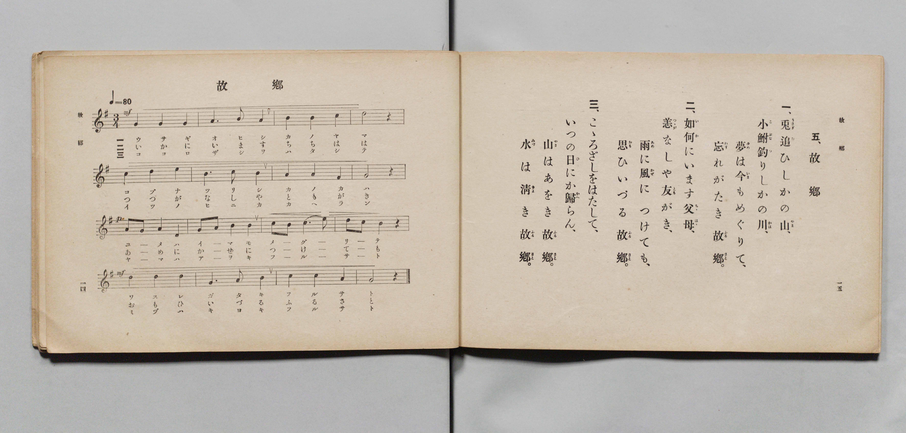

# 故郷

> Re:Shōka 使用 AI 協助辨識與重建樂譜，可能會有錯誤。歡迎回報。

- **鋼琴伴奏版**：<br><audio controls src="furusato.mp3"></audio>

- 詞：高野辰之（文部省尋常小學唱歌）
- 曲：岡野貞一（文部省尋常小學唱歌）
- 文部省《尋常小學唱歌 第六學年用》（大正三年，索書號 4078）

## 說明

原書資訊與歌詞全文（對應 P010.jpg，原書 pp. 14–15，第 5 首）：
調性與拍號：ト長調（G 大調）3/4 拍，速度 ♩=80
合唱編制：前二行齊唱，後二行二部合唱（Soprano / Alto）


## 歌詞

```text
一、
兎（うさぎ）追（お）ひしかの山（やま）、
小鮒（こぶな）釣（つ）りしかの川（かは）、
夢（ゆめ）は今（いま）もめぐりて、
忘（わす）れがたき故郷（ふるさと）。

二、
如何（いか）にいます父母（ちゝはゝ）、
恙（つゝが）なしや友（とも）がき、
雨（あめ）に風（かぜ）につけても、
思（おも）ひいづる故郷（ふるさと）。

三、
こゝろざしをはたして、
いつの日（ひ）にか歸（かへ）らん、
山（やま）はあをき故郷（ふるさと）、
水（みづ）は清（きよ）き故郷（ふるさと）。
```

## ABC

<div class="abc-score" data-abc-src="furusato.abc" aria-label="五線譜載入中"></div>

[下載 ABC 原始檔](furusato.abc)

## TMD 檔案連結

- [主旋律 TMD 檔案](furusato.tmd) [[在 TMD Studio 編輯](https://tmdlang.github.io/Tmd-TS/#tmd=s7IKdvYPcrWy4qpTUCpJTLdSSM7PyUlNLsnMz7PKyszLyo8vzshPT8wuBdHZiUpwdWX5OaW5qVbpRYkpqfFm8SYG5hYIyeL80qLkVKvi5Iz8_Jz4ktSKkqT8_Gx0-fiCxPRUqwADQwOETEFRfllqXmIeUHdBUWZeSWoKWDtCQWpZZkoqSLostSgzLTM1BYtUcXJiXjymPFCkGOQvqO0lRYl5xclFmQUgzyJU5ReVAH1clFiQUWmVkVlckl-UmZyYE5-dmIfk-5KMVKDnM_JzU9HF8hJLSouQRIHa0zPzrHLz85JKgUGoxKWlpfBsauvL5u0KWlpcirYKFgZc9rYK7lw2xvomdiBtL1bOe79n1svVM162973Yt-HJzu73ezqeTWt_2bzi-ZzGpxu6n-7Y8XRD_9O1O55O2fhsbc_7PZ1g657N3gTU93TTQpC-TfOe7GggUh9MyeOGLkxVCs_XrHnauhbE37nl-ZQVjxtAznm6ZPmztYuf7OgECr7f0_N8y6Jns3e8mDlfAZQOwAZz6Wsp2FILcCkoKDztmw-yY3P7ixVdLzragU4DBtTT1hVA54MctKH3WXunAigx6WUVpAPdBFGvUFCgp2Bo8qhhsqEpyKFr1iiYKrxcNg3oRmBggcx9sWr_s4blIBO7e4E-AIo-bu54OXU7UBxorrsC0KtgZicwfhSAaoCmvGyY_3TXMoVHM1faAmMP5LYJHcDQer59xdOObaA46Ox9sqvnxcKel3u7gOIgx-zrgYgASWBgQ9QDjQ_OLwCmwnwFfQXHnJJ8oCVcIOOAUfe4oRFscGsfUNXjxrbHjVMfNwLZnS_27wWLdAHZjxs3PW6c_rix-3HjuqcbQeY9bmp53LgPJAXVv6H_5bpJYA2THzdue9y4Cij3sn0xWGQJSF1TF8KI7XPB4kD2eiQjliwCG9z2uKkRbOf6J7uBlgPVwaxqagJKPW6cADZrGUzb_hlgbf2PG2eCFfU8bgSi-Y8beyHJH2zE1sdNQNuAXlsBtrAJ4v1dPTBDljU92TsVZhkw4QGtXw2xGGjs845tz9YD4wMou_Bx01ygy4AkwuHPQBaDvAmWAyV3oPdBnm1qedoPSsRAW4FuB4sDXdYL1fZyNtAtQDmQpyAWvlwEEQG6dA7MCUseN04EeRbod6htDZDA64IZCYwaoDuXAj1I0L87YE4GxRLQsU29jxungV06CeQpUKABowgWsmBzgfavezZ9KdhQYLaHOKr72dodMJcCGcBAB6LJsLBESyAgg4F-BNqAJ0IgXtsAzONAuf1A70B0PtvRChbpfdzUARbBG6dAIygvAqBAQUufi8uttKi0OLEk3wqafRxqDGqqQdYo2Fho2YEZ2EofUFEGzFrAXKigYQLKGs_XN-jAiwxNLBqAloEMq1Gozk2rVTBU0IXjGgUjIKmrYAyma4A0iK2rYALmmYLldBUMQDywET6GNQqPm5YB-Y-btoLJdWCVj5tWgVU-bp4EZG-Hiq0Gi_SBySUQseZ5UDPjEWYaAcUbW0CqGrvBJEgfTAzE3wfEM6FiC8EiEHI9VAxEo5lpDLJ_M9iFYLJ5LdRN2yBmAt34uHkT1E39YJH9UHGIWBuKmfgjA1wkkhwZoDAGhbAZPORB4Q6iIbECwuZg68FRhS0iIF6bBia7oA6HBlrzKuwRAWbDPI0tIkARBSN7oAEMjdzG6UD9IPNBYivApjWhqOvFERFg08Aug7gCZP8kqDu7EW6CunMGmFwJVQfyI7ERsaOTrFxRUIuWDQyBLFDUICIDFFUmQBYo2ozB8YEWF82gTAFy90Jo2CL8DUryj5sXQf0DSrqgkNsApkEioNCFJDj0uACFLkhtI1KmgGSROWASJgayB8SfCDOzEZJFQfrR4gKcESGuQrgT5DZIdnjcBM0ozVOh6kB2QFSBM3xzB3Fx8XT2bLJLKEI5AxQx-HNGM6hIeNy0E-ziNVD3g2hIRsfmS4j_QGIgH2LLGaAcBkvx0KIDXkQtBcqAYgYkBjIHpBKYshtB5sNyC5ac0TwfbHsrmITFBshtIP4KktxZi1ShgFphWGoTKlQAFBZbkMwGlgbZj6QO4SCoLMhFQCbIUEO0DAf1B8gmhFshloEUIxliqGCKzSnAsNK1U4AFV7SPYawCCt8IjW8M5itzAQA)]
- [鋼琴伴奏 TMD 檔案](furusato_piano.tmd) [[在 TMD Studio 編輯](https://tmdlang.github.io/Tmd-TS/#tmd=s7IKdvYPcrWy4qpTUCpJTLdSSM7PyUlNLsnMz7PKyszLyo8vzshPT8wuBdHZiUpwdWX5OaW5qVbpRYkpqfFm8SYG5hYIyeL80qLkVKvi5Iz8_Jz4ktSKkqT8_Gx0-fiCxPRUqwADQwOETEFRfllqXmIeUHdBUWZeSWoKWDtCQWpZZkoqSDoxOTk_tyAxLzM3NQ9Jviy1qBjkeKgVJUWJecXJRZkFIB8hVOUXlQC9VZRYkFFplZFZXJJflJmcmBOfnZiH5MXEIqDm9FSQ-VYFmYl5-fE47CzJACqyysjPTUUXy0ssKS1CEgXak56ZZ5Wbn5dUCgxQJS4tLYVnU1tfNm9_v6fjZfee5xO2PNmz5enS_uedHe_3dCpoaXEp2ipYGHDZ2yq4c9kY65vYgcx6sXLe-z2zXq6e8bK978W-DU92dgO1P5vW_rJ5xfM5jU83dD_dsePphv6na3c8nbLx2doeoFFgNzybvQmo7-mmhSB9m-Y92dFApD6YkscNXZiqFJ6vWfO0dS2Iv3PL8ykrHjeAnPN0yfJnaxc_2dEJFHy_p-f5lkXPZu94MXO-AiipgA3mcistKi1OLMm3CgCFbpCHQ41BTTWXAhDYWGjZgRn6Wgq26ABkH9DpLxb2KGiYKABd8nx9g44CKB3pZRWka2LRoKUPNqxGoTo3rVbBUEEXjmsUjICkroIxmK4B0iC2roIJmGcKltNVMADxwEb4GNYoPG5aBuQ_btoKJteBVT5uWgVW-bh5EpC9HSq2GizSByaXQMSa50HNjEeYaQQUb2wBqWrsBpMgfTAxEH8fEM-Eii0Ei0DI9VAxEI1mpjHI_s1gF4LJ5rVQN22DmAl04-PmTVA39YNF9kPFIWJtKGbij4xdPeREBiiMQSFsBg95ULiDaEisgLA52HpwVGGLCIjXpoHJLqjDoYHWvAp7RIDZME9jiwhQRMHIHmgAQyO3cTpQP8h8kNgKsGlNKOp6cUQE2DSwyyCuANk_CerOboSboO6cASZXQtWB_EhsROzoJCtXFNSiZQNDIAsUNYjIAEWVCZAFijZjcHygxUUzKFOA3L0QGrYIf4OS_OPmRVD_gJIuKOQ2gGmQCCh0IQkOPS5AoQtS24iUKSBZZA6YhImB7AHxJ8LMbIRkUZB-tLgAZ0SIqxDuBLkNkh0eN0EzSvNUqDqQHRBV4Azf3EFcXDydPZvsEopQzgBFDP6c0QwqEh437QS7eA3U_SAaktGx-RLiP5AYyIfYcgYoh8FSPLTogBdRS4EyoJgBiYHMAakEpuxGkPmw3IIlZzTPB9veCiZhsQFyG4i_giR31qJXKD7IFYoJtEIBhli8QrRhLBgDS_h4IM80HsgFEQhJExgHJGwAdTEw7QNFgFIIaUIGIbTisok43WRZDAwRXTsFWKAoANnKXAA)]

## 分析

```text
================================================================================
📊 TMD Song Profile: [ 故郷 ]
================================================================================
⏱  Duration:       1:48 (108.0s), 48 measures total
🎼 Key & Tempo:    首調基準 G, != 80.0 BPM, <3/4>
   - 分析範圍：      由實際發聲的音符與和弦推測調性；播放脈絡另行呈現
🎤 人聲音域:    F#4 (MIDI 66) – E5 (MIDI 76) [跨度: 10 個半音 / 0.8 個八度, 難度: easy]
   - 最低音:  F#4 in [Furusato[L1] #1 @ m.7, 0:15]
   - 最高音: E5 in [Furusato[L1] #1 @ m.5, 0:10]
   - 適合: soprano, mezzo-soprano, contralto, tenor, baritone, bass
🏛  結構:      Furusato[L1] (36.0s) -> Furusato[L2] (36.0s) -> Furusato[L3] (36.0s)
⚡ 編曲密度:        Peak 2 軌道同時演奏
🗝  調性診斷：       G 大調（純淨自然大調，未偵測到可信轉調）
   - 風格氣質:    純淨自然大調（陽光明朗、易唱易記，無明顯調外色彩）
   - 轉調歷程:    全曲維持單一推測調性（未偵測到可信轉調）
   - 核心骨幹音:  G, A, B, D, F#
   - 調性數值:    G 大調 [相關度: 0.82, 穩定度: High, 自然音純度: 100.0%]
   - 候選調性 (K-S): G 大調 (0.82), D 大調 (0.60), B 小調 (0.55)
   - 五度圈歷程:   +1 -> +1 -> +1
   - 各段落調性細節:
     • [Furusato[L1] #1]: G 大調 (r: 0.82, 自然音純度: 100.0%)
     • [Furusato[L2] #1]: G 大調 (r: 0.82, 自然音純度: 100.0%)
     • [Furusato[L3] #1]: G 大調 (r: 0.82, 自然音純度: 100.0%)

  [ 五度圈游移軌跡 ]
               C  
         F           [G ]*
      Bb               D  
      Eb               A  
         Ab           E  
            Db       B  
               F# 
     (* = active key center)

  [ 十二半音累積音高分佈 ]
     C  : █████████                  9.7%
     C# :                            0.0%
     D  : ██████████                10.8%
     D# :                            0.0%
     E  : ███                        3.4%
     F  :                            0.0%
     F# : █████████                 10.2%
     G  : ████████████████████████  26.7%
     G# :                            0.0%
     A  : ██████████████████        19.9%
     A# :                            0.0%
     B  : █████████████████         19.3%
--------------------------------------------------------------------------------
Assignment 軌道音域：
  - Alto          : D4 – E5 (14 個半音 / 1.2 個八度, 129 個音符)
  - Soprano       : F#4 – E5 (10 個半音 / 0.8 個八度, 132 個音符)
================================================================================
```


## 原書掃描頁




