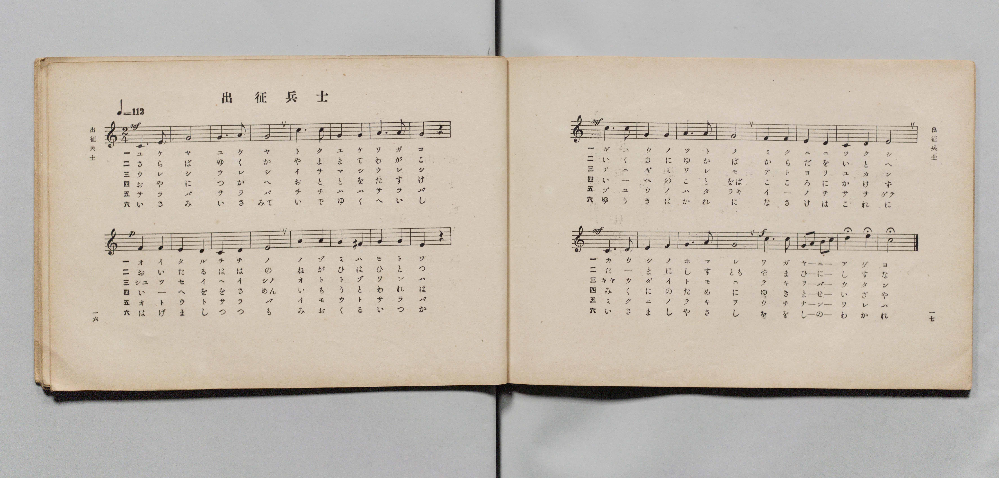
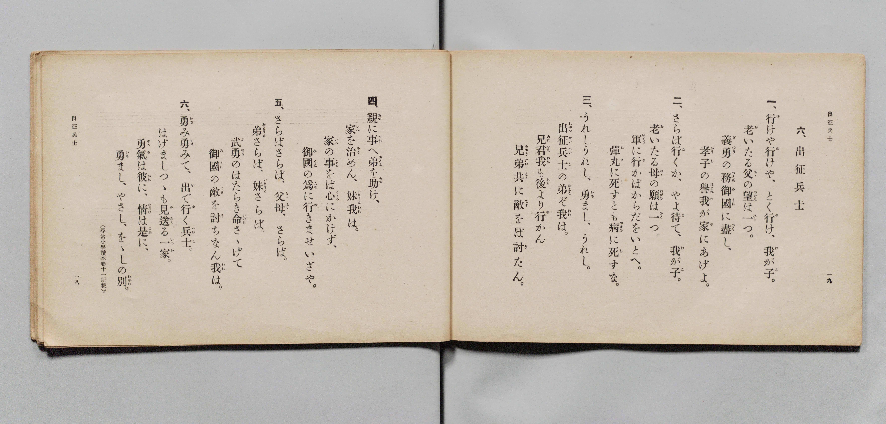

# 出征兵士

> Re:Shōka 使用 AI 協助辨識與重建樂譜，可能會有錯誤。歡迎回報。

- **鋼琴伴奏版**：<br><audio controls src="shussei_heishi.mp3"></audio>

- 詞：文部省（尋常小學讀本卷十一所載）
- 曲：文部省
- 文部省《尋常小學唱歌 第六學年用》（大正三年，索書號 4078）

## 說明

原書資訊與歌詞全文（對應 P011.jpg–P012.jpg，原書 pp. 16–19，第 6 首）：
調性與拍號：ハ長調（C 大調）2/4 拍，速度 ♩=112


## 歌詞

```text
一、
行（ゆ）けや行（ゆ）けや、とく行（ゆ）け、我（わ）が子（こ）。
老（お）いたる父（ちゝ）の望（のぞみ）は一（ひと）つ。
義勇（ぎゆう）の務（つとめ）御國（みくに）に盡（つく）し、
孝子（かうし）の譽（ほまれ）我（わ）が家（や）にあげよ。

二、
さらば行（ゆ）くか、やよ待（ま）て、我（わ）が子（こ）。
老（お）いたる母（はゝ）の願（ねがひ）は一（ひと）つ。
軍（いくさ）に行（ゆ）かばからだをいとへ。
彈丸（たま）に死（し）すとも病（やまひ）に死（し）すな。

三、
うれしうれし、勇（いさ）まし、うれし。
出征兵士（しゆつせいへいし）の弟（おとゝ）ぞ我（われ）は。
兄君（あにぎみ）我（われ）も後（あと）より行（ゆ）かん
兄弟共（きやうだいとも）に敵（てき）をば討（う）たん。

四、
親（おや）に事（つか）へ弟（おとゝ）を助（たす）け、
家（いへ）を治（をさ）めん、妹我（いもうとわれ）は。
家（いへ）の事（こと）をば心（こゝろ）にかけず、
御國（みくに）の爲（ため）に行（ゆ）きませいざや。

五、
さらばさらば、父母（ちゝはゝ）、さらば。
弟（おとうと）さらば、妹（いもうと）さらば。
武勇（ぶゆう）のはたらき命（いのち）さゝげて
御國（みくに）の敵（てき）を討（う）ちなん我（われ）は。

六、
勇（いさ）み勇（いさ）みて、出（い）で行（ゆ）く兵士（へいし）。
はげましつゝも見送（みおく）る一家（いつか）。
勇氣（ゆうき）は彼（かれ）に、情（なさけ）は是（これ）に、
勇（いさ）まし、やさし、をゝしの別（わかれ）。
（尋常小學讀本卷十一所載）
```

## ABC

<div class="abc-score" data-abc-src="shussei_heishi.abc" aria-label="五線譜載入中"></div>

[下載 ABC 原始檔](shussei_heishi.abc)

## TMD 檔案連結

- [主旋律 TMD 檔案](shussei_heishi.tmd) [[在 TMD Studio 編輯](https://tmdlang.github.io/Tmd-TS/#tmd=s7IKdvYPcrWy4qpTUCpJTLdSSM7PyUlNLsnMz7PKyszLyo8vzshPT8wuBdHZiUpwdWX5OaW5qVbpRYkpqfFm8SYG5hYIyeL80qLkVKvi5Iz8_Jz4ktSKkqT8_Gx0-fiCxPRUqwADQ0NdIGGEkC4oyi9LzUvMAxpRUJSZV5KaAjYDoSC1LDMlFSRdllqUmZaZmoJFqjg5MS8eUx4oUgzyHNQJJUWJecXJRZkFIB8jVOUXlQC9XZRYkFFplZFZXJJflJmcmBOfnZiHFAQlGanAEMjNzMksSSyqxBDPL0rMQTYxMz0zDyial1QKDEolLi0thaftu57ua3zauvXp4tUKWlpcirYKhoZGXPa2Cs5cNkb6JnYg3S9Wznu_Z9azae0vm1c8n9P4fk_H0w3dT3fseLqh_-naHS_WNTybs-Zp7_anvY1PdjQ862x4safz_Z5OsMXPZm9C1goRg_EeN3QhG_R0ysZna3sUnq9Z87R1LYi_c8vzKSseN3SDLFyy_NnaxU92dAIF3-_peb5l0bPZO17MnK8AinWwZVz6Wgq21AJcCgoKT_vmg-zY3P5iRdeLjnag04Dh8LR1BdD54BDofdbeqQBKOnpZBemPGiaDEhCICXQeRKtCQYGegqEZUMrQEuTmNWsUzBReLpsGdC4wTEBWvFi1_1nDcpDh3b1AzwBFHzf3v5y6HSgOtMJZAehrMLMTGBMKQDVAU142zH-6a5nCo5krbUERBTIFGOiPGxrB5i3sAep73NQG1PK4ceLjphZMEaDSx40rHjf2o0s1ND7rmAgW6QeL9DxdOwHEbZwM4jY0gS1oAMX-48YusIqWx43zHzd1P-_YBhZc-LhpLlh83bM5s8Ei6x43znvcCPLA48b1QGeCBTcBrQeLLIEa-nzfyqfdoDB93NgHdM7jRoiL1j3tngkWXAJybxPQ4s6n-xY-nQNKDkBDgT543LgarHL189kLYSohbp8ODZCna-fCfNENNBcoATH6xdq9YMHdjxv3PW4ChkMnut_Xgf3U1AKx4HFj0-PGSY-bOkBOBof5rh6oFY8bpz5uAqrZgBqeQMd1g4IaGOBNHU_3tYKt2weWWkZ-UD9bD0wDQMH18KB-uXAGWGQt0BRg2BII6he7IfqBxgEdOBXiOVSHA8NpA4gE-WnB46ZJYMXA9LIDasTTvR1PduwAmzIf5qPVz9buBotAgncmOMKank8H-xoYAsBAhjoNU-UqeJDuAHodGqRtwEgBxSKc0dAISyJA0yDuBpoJEkdSA3EfUokGsQmcpoBJYzZY8w4wCU0HT_cAMx0okMEuhgTpPHjcQFIGKLShRre2PJ0ASdnA5ABMFH2QxI2uoanp6T5wkIKUgSMAmHCautDDuWkyzNA985-2bgRr6AUHF9C9C6Dh3tQEDbepW8EKlgHVgE0ERsyGFyv6wIIQE4EJZDIsMJ_Ong0rE5atgnoRlpif7IJkIWCQABlAkR1YgqFp0tOulbBYBuZDaBEBNhuSN8CBCVH6bBM4UkFuAsdNEzDdA53S-HTZTmjYABU3AQMD6DGgBZgBi2Zi4zqYGyfDAhDk3af7m6GCTXMfN4GDARQLwBQ78XHjLJjrsJcR6553AFMg2DvgogQj3feCUxQkjUwDl5OwnD4FPacjGA2NwMIPlilB5R8ia4JSJlwZxJfIoQwOCrDFCLOAwYUWVqgKwKY8W7sMlhW2IZeWIJtBngN55elESPEG9ApQHFg2QkwBug4YjMvwhRJmMkNNYwtBGbZpMvYsAknOa2ERgZ5h92OKQApDYJaFiIMFl6MVpEhZGSnvQgID7Gmgn8BlATBBg9JF04tl3S-hhSfQAmBogwvZpm5gqYiU0GCpHxo33e3PNiyGWAsOekjqWv907x5o7QH16GpQ4d0MKc5XgUK1ERgSIJXPZqyHJU6ESqzhACu4QDkdqB_CBlYuwOgBemLd046l0LCF2wpxI1CUmHYXSCnlLSAoUNDS5-IKzigtLk7N9EjNLM7ItArITMzLd6gxqKkG2aRgY2imZQdmYWuAgVpzQMcBo1RBw0QB6PDn6xt04K0mhafbl71cAHR9lyYWrUCrQcbWKFTnptUqGCroAqGxgimQBOEaYGMKJGIKFAPRIBGjODDDME7BHEiB5GvAakFsEG0AEgEb6mNYo_C4eRlY7nHTRiB7CYgFFgHKAEXAMmBRmOmPmzug6tdDVULUgWTWQ2XWAPFmICseYZMRUL5xKlS-E8jeAGa1QXQ29kNkGruRbWpqgarvAMrsA8vDXAZT3wPEk1FtMgbJQ_3UDHLJdrAZUJ1AEYiZIFGETRAfPm7aClQxDy6PzSQkm0xALu-C6mwBsleD3QQyCyQD8QswvyLbBFPfuAKMQTonQWXmQ2VmAvFEVJtMQS7ZCnXJSiCeAHUtxE8roTIgUUQ8NUJFG4EYFF4QEptJSDaZgVwCDXdgfAELDzALJIIUg0BRSFzAfAXTsRwap5AYBclAfA9SAczYcLvwZ5VdPYSySjf-rFJQC80PxmAaOadA8gDE3SARUB4BZhVdBRN1JFWm2HJK0yqIX4Cp5XETOFyaQTGOHtZ9SHEAYj9uAqfdZlD8wuOgGRTrID4wbTeDQg89r8DSCSjcwDqbQOkJJAPNZUAaWE4ixcFasGgPmNwEVQGRAfFgaQ6UOtFzy_bHzUuhzgFa17Qb6kmIQ2cgeXo73Huw4IAUB1AS7FGkggCUacAeRs80sOSyA5r8EZkAVkQAA7IJlLGRExiwVgPrgiQwUOZBKgqaQEUByF70bAONNFBAgzMzxK3YsgFyYfC4eRHYVPw60DMOLGomwQssUJIHyUALGCAN8QXMX5DsBYpsSJZBRDMsjBZDixJiMs6OTpwZp38zsXUMtP4wR6pkjOFVCmrmAeYaBSMgiVzJmCCqIqSsA0mooAoDFqagdARKK1B_gjPCQkTIgLMLKDxA1QzI_xASSQdIBl6MI2cdWMj1Q9MTpGAGuQKUckD8biAGVUCwWIAW1eCKaQGYBUuPMLNAWQdWkCNnHVAqgbgN4keIu9HzAEQVxA0wHSD_giuAZlAKRa6IVwPZoOoTyS70XAPO-JCqDyQDMgfialR_QXIQiAb2FJBDAl45TQTiWah2gXJN8zSoKzHjC5bfgFUAKB80gYodlEoUqBJSIMIrKFi-adoElIHEAUq-gcdLGxBD3AkrumAxA8rdILfDfAbN1eAqClRZInRA_YyqA3--AfYTCeUbAhUOON-ArTIGZgDUGsccUr9AXF4Ny2AgFdBsBeTXQNTAKyP07APxCCgqoO0ZeHTMhgb6PHBSQ2QfUHCAWmIgOVjEdMMTICgqQCKQhIOafWDtkH3QAEQUYjOhMsDMgFyIgdtpsAIPVtesBusA6YTog0UZavZZ-7h5McJrzQ1gFqzmgTY0gbkHkvdhXgOX_-B097gZah2wNAYZB2mOQqpmbDkIJAMrGSBeA-UjJE-D6h3kdAZtzEDSJMiDIHo2okZqBOUTWEMVNQdhll-wKIOmdqAPYO6H2AXJZ-Cc0wyt_oG-gEcmOHph-Q-13kFusKHUO7AmNFgGJAazC1HrwsRBYQGrTyH5DpSHYHbVcnHp2img9IEUgALKXAA)]
- [鋼琴伴奏 TMD 檔案](shussei_heishi_piano.tmd) [[在 TMD Studio 編輯](https://tmdlang.github.io/Tmd-TS/#tmd=s7IKdvYPcrWy4qpTUCpJTLdSSM7PyUlNLsnMz7PKyszLyo8vzshPT8wuBdHZiUpwdWX5OaW5qVbpRYkpqfFm8SYG5hYIyeL80qLkVKvi5Iz8_Jz4ktSKkqT8_Gx0-fiCxPRUqwADQ0NdIGGEkC4oyi9LzUvMAxpRUJSZV5KaAjYDoSC1LDMlFSSdmJycn1uQmJeZm5qHJF-WWlQM8gHUnpKixLzi5KLMApC3EKryi0qAfitKLMiotMrILC7JL8pMTsyJz07MQ_JnYhFQc3oqyHyrgszEvPx4HHaWZAAVWeVm5mSWJBZVYojnFyXmIFudmZ6ZBxTNSyoFBqwSl5aWwtP2XU_3NT5t3fp08er3ezpedu95PmHLkz1bni7tf97Z8X5Pp4KWFpeirYKhoRGXva2CM5eNkb6JHcjIFyvnvd8z69m09pfNK57PaQRqfrqh--mOHU839D9du-PFuoZnc9Y87d3-tLfxyY6GZ50NL_Z0Ao0Du-bZ7E3IWiFiMN7jhi5kg55O2fhsbY_C8zVrnrauBfF3bnk-ZcXjhm6QhUuWP1u7-MmOTqDg-z09z7csejZ7x4uZ8xVACQNsGVdwRmlxcWqmR2pmcUamVQAoLIM8HGoMaqq5FIDAxtBMyw7M0tdSsEUHIFuBjn-xsEdBw0QB6J7n6xt0FEBpRy-rIF3h6fZlLxcAfdeliUWrlj7Y2BqF6ty0WgVDBV0gNFYwBZIgXKNgBhYxBYqBaJCIURyYYRinYA6kQPI1YLUgNog2AImADfUxrFF43LwMLPe4aSOQvQTEAosAZYAiYBmwKMz0x80dUPXroSoh6kAy66Eya4B4M5AVj7DJCCjfOBUq3wlkbwCz2iA6G_shMo3dyDY1tUDVdwBl9oHlYS6Dqe8B4smoNhmD5KF-aga5ZDvYDKhOoAjETJAowiaIDx83bQWqmAeXx2YSkk0mIJd3QXW2ANmrwW4CmQWSgfjlceMOZJtg6htXgDFI5ySozHyozEwgnohqkynIJVuhLlkJxBOgroX4aSVUBiSKiKdGqGgjEIPCC0JiMwnJJjOQS6DhDoyvx437wSyQCFIMAkUhcQHzFUzHcmicQmIUJAPxPUjF48bpcLvwZ5VdPYSySjf-rFJQC80PxmAaOadA8gDE3SARUB4BZhVdBRN1JFWm2HJK0yqIX4Cp5XETOFyaQTGOHtZ9SHEAYj9uAqfdZlD8wuOgGRTrID4wbTeDQg89r8DSCSjcwDqbQOkJJAPNZUD6ceM6pDhYCxbtAZOboCogMiAeLM2BUid6btn-uHkp1DlA65p2Qz0JcegMJE9vh3sPFhyQ4gBKgj2KVBCAMg3Yw-iZBpZcdkCTPyITwIoIYEA2gTI2cgJ73NQE1gVJYKDMg1QUNIGKApC96NkGGmmggAZnZohbsWUD5MLgcfMisKn4daBnHFjUTIIXWKAkD5KBFjBAGuILmL8g2QsU2ZAsg4hmWBgthhYlxGScHZ04M07_ZmLrGGj9YY5UyRjDqxTUzAPMNQpGQBK5kjFBVEVIWQeSUEEVBixMQekIlFag_gRnhIWIkAFnF1B4gKoZkP8hJJIOkAy8GEfOOrCQ64emJ0jBDHIFKOWA-N1ADKqAYLEALarBFdMCMAuWHmFmgbIOrCBHzjqgVAJxG8SPEHej5wGIKogbYDpA_gVXAM2gFIpcEa8GskHVJ5Jd6LkGnPEhVR9IBmQOxNWo_oLkIBD9uKkXOSTgldNEIJ6Fahco1zRPg7oSM75g-Q1YBYDyQROo2EGpRIEqIQUivIKC5ZumTUAZSByg5Bt4vLQBMcSdsKILFjOg3A1yO8xn0FwNrqJAlSVCB9TPqDrw55uns2cTyjcEKhxwvgFbZQzMAKg1jjmkfoG4vBqWwUAqoNkKyK-BqIFXRujZB-IRUFRA2zPw6JgNDfR54KSGyD6g4AC1xEBysIjphidAUFSARCAJBzX7wNoh-6ABiCjEZkJlgJkBuRADt9NgBR6srlkN1gHSCdEHizLU7LP2cfNihNeaG8AsWM0DbWgCcw8k78O8Bi7_wenucTPUOmBpDDIO0hyFVM3YchBIBlYyQLwGykdIngbVO8jpDNqYgaRJkAdB9GxEjdQIyiewhipqDsIsv2BRBk3tQB_A3A-xC5LPwDmnGVr9A30Bj0xw9MLyH2q9g9xgQ6l3YE1osAxIDGYXotaFiYPCAlafQvIdKA_B7KrF2gXyQe4CmUB7QMC0HK8QbRgLZJjAGKbxQJZpPIgJlDSAOh6bSiMgwwimBaEQ1QCEHqNcuPEgMUzVOJwAUQ30la6dAorHon2AMpiCQCdhChpjEzTBJmiKTdAMLKjMBQA)]

## 分析

```text
================================================================================
📊 TMD Song Profile: [ 出征兵士 ]
================================================================================
⏱  Duration:       0:17 (17.1s), 16 measures total
🎼 Key & Tempo:    首調基準 C, != 112.0 BPM, <2/4>
   - 分析範圍：      由實際發聲的音符與和弦推測調性；播放脈絡另行呈現
🎤 人聲音域:    C4 (MIDI 60) – E5 (MIDI 76) [跨度: 16 個半音 / 1.3 個八度, 難度: moderate]
   - 最低音:  C4 in [ShusseiHeishi #1 @ m.1, 0:00]
   - 最高音: E5 in [ShusseiHeishi #1 @ m.10, 0:09]
   - 適合: soprano, mezzo-soprano, contralto, tenor, baritone, bass
🏛  結構:      ShusseiHeishi (17.1s)
⚡ 編曲密度:        Peak 1 軌道同時演奏
🗝  調性診斷：       G 大調（純淨自然大調，未偵測到可信轉調）
   - 風格氣質:    純淨自然大調（陽光明朗、易唱易記，無明顯調外色彩）
   - 轉調歷程:    全曲維持單一推測調性（未偵測到可信轉調）
   - 核心骨幹音:  G, A, E, C, D
   - 調性數值:    G 大調 [相關度: 0.82, 穩定度: Moderate, 自然音純度: 96.8%]
   - 候選調性 (K-S): G 大調 (0.82), C 大調 (0.76), E 小調 (0.74)
   - 五度圈歷程:   +1
   - 各段落調性細節:
     • [ShusseiHeishi #1]: G 大調 (r: 0.82, 自然音純度: 96.8%, 調外音: F)

  [ 五度圈游移軌跡 ]
               C  
         F           [G ]*
      Bb               D  
      Eb               A  
         Ab           E  
            Db       B  
               F# 
     (* = active key center)

  [ 十二半音累積音高分佈 ]
     C  : ████████████              13.7%
     C# :                            0.0%
     D  : ██████████                11.3%
     D# :                            0.0%
     E  : ████████████████          17.7%
     F  : ███                        3.2%
     F# : █                          1.6%
     G  : ████████████████████████  27.4%
     G# :                            0.0%
     A  : ████████████████          18.5%
     A# :                            0.0%
     B  : ██████                     6.5%
--------------------------------------------------------------------------------
Assignment 軌道音域：
  - Piano         : C4 – E5 (16 個半音 / 1.3 個八度, 56 個音符)
================================================================================
```


## 原書掃描頁






