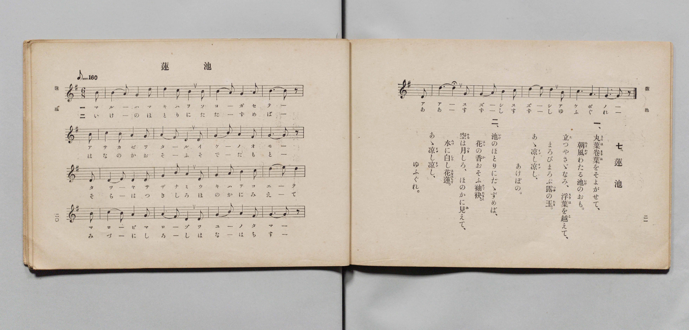

# 蓮池

> Re:Shōka 使用 AI 協助辨識與重建樂譜，可能會有錯誤。歡迎回報。

- **鋼琴伴奏版**：<br><audio controls src="hasuike.mp3"></audio>

- 詞：文部省
- 曲：文部省
- 文部省《尋常小學唱歌 第六學年用》（大正三年，索書號 4078）

## 說明

原書資訊與歌詞全文（對應 P013.jpg，原書 pp. 20–21，第 7 首）：
調性與拍號：ト長調（G 大調）6/8 拍（弱起 1 拍），速度 ♪=160（換算四分音符 != 80）


## 歌詞

```text
一、
丸葉卷葉（まるはまきは）をそよがせて、
朝風（あさかぜ）わたる池（いけ）のおも。
立（た）つやさゞなみ、浮葉（うきは）を越（こ）えて、
まろびまろぶ露（つゆ）の玉（たま）。
あゝ涼（すゞ）し涼（すゞ）し、あけぼの。

二、
池（いけ）のほとりにたゞずめば、
花（はな）の香（か）おそふ袖袂（そでたもと）。
空（そら）は月（つき）しろ、ほのかに見（み）えて、
水（みづ）に白（しろ）し花蓮（はなはちす）。
あゝ涼（すゞ）し涼（すゞ）し、ゆふぐれ。
```

## ABC

<div class="abc-score" data-abc-src="hasuike.abc" aria-label="五線譜載入中"></div>

[下載 ABC 原始檔](hasuike.abc)

## TMD 檔案連結

- [主旋律 TMD 檔案](hasuike.tmd) [[在 TMD Studio 編輯](https://tmdlang.github.io/Tmd-TS/#tmd=s7IKdvYPcrWy4qpTUCpJTLdSSM7PyUlNLsnMz7PKyszLyo8vzshPT8wuBdHZiUpwdWX5OaW5qVbpRYkpqfFm8SYG5hYIyeL80qLkVKvi5Iz8_Jz4ktSKkqT8_Gx0-fiCxPRUqwADQ2OETEFRfllqXmIeUHdBUWZeSWoKWDtCQWpZZkoqSLostSgzLTM1BYtUcXJiXjymPFCkGOQvqO0lRYl5xclFmQUgzyJU5ReVAH1clFiQUWmVkVlckl-UmZyYE5-dmIfk-5KMVKDnC3IS85CcBhHMSywpLUpFNi8zPTPPKjc_L6kUGIZKXFpaCi8mr3u2cYGClhaXoq2ChQGXva2CO5eNmb6FHUjbi5Xz3u-Z9Wxa-8vmFc_nNIKNejZ7E6YYjPe4oevphu6nO3Y83dD_dO2Op1M2Plvbo_B8zZqnrWtB_J1bnk9Z8bih-_2ejqdLlj9bu_jJjk6g4Ps9Pc-3LHo2e8eLmfMVQBH4fk-nEheXvpaCLbUAl4KCwtO--SA7Nre_WNH1oqMd6DSgB5-2rgA6H-SgDb3P2jsVQKlAL6sgHegmiHqFggI9BSODRw2TjQxBDl2zRsFc4eWyaUA3AgMCZO6LVfufNSwHmdjdC_QBUPRxc8fLqduB4kBz3RWAXgUzO4HhqgBUA7Jsz8YXW7crGEK4QIN6XjbMf7prmcKjmatsDc0MgEqe9c9-vm7609mzn3a0vZy_-fmaZQrgOAIq5wLZ-mRHw-OGRghrx4uJnU97twNJoMbHjfseN3U_blwPYjT2AhlALY-bJj1unPu4CSjb87hx9uPGZVDNz-bMfbloBVhb0-PGqY8bgTrngDX0P26cDzQImD7Asi2PGyeCxBvXPW7setzU9LihCaT_-WpQbAKVguWWPG4Cqpv6uGne48ZVjxv3Ay15tnUdzF1tyM55sa0LLDgZrBHIgLkI7H6gus0wxraXc4BpDqgCaHobxAnP-yAmzgeqAYlA3ALyQtPcZ9v2gOVmAl0BVj0dUwRoFdi_Ex837gH5CKgfHJK7emDBgsXXux83rnjc1PW4cTU4ZIBenPW4CWjOBqieF10bwXqAAb8KouflsplgEWAQAblAnXMfN259sWjai0VNYHEgdznYLKBTgHEA88fzlbug0k1AbwJ1rn82pwMaAo2g9ALyATBkQJ4AOgroNGCkrX6xDBIToJSGEqDPNgBzGEjiceNSsNzq5zP3gkVApkCMA7odWBbAnQ8mFwJDjNzAbQLG9dbHjRMeNwFDFKyf8jwMBQpa-lxcHonFpZnZwEI7MzEv36HGoKYaZIeCjYWWHZiBrewAFUTAXPNiYY-CBjQDaiuYKADLqufrG3TgOV_h6fZlLxc0PtnRpYnFDKDlIPNrFAzg0BjIM1bQVTAC5mddBVMgzxRIm4DFUOWMoDyQOFgf2CwfwxqFeDh83DwPqOpx82qwusfN_WASLNa0FiryuHkTiNW0F6xyBURl0xowuRss1gYW0wWZ17QIZo8Rij2NLSCVjRMhuhvXgUmw7kaQicCUDmSBXAFMoWDRBVCVs8CyjWCxDQh7GtcD7cEf-Lt6wIGPJ8zXEgp2E3DgGQFJQyAPRJvHK5jGgwI-HigACmWINFAYwgWpNADLwkP7cdNWsB9WA_EecJgC3Q5k74eGOdjXTUvAYhuhYn1gsVXg0F2EFLr7kUIXmHOgYQnMkmBWFziU5kJDDmwrkAcSWw4Vmw82twke7rDQBKoiEJo7OokIzW68oQkOODPsAQjnGoHTrAk0XZuBSeS0-7i5BRpGS8B-2QoOt21gEWAaaob4cBnWFLwZLApNweBUC07riBBt6oSG03owCY6Txl4wezpQFsKCpFpICu6Gp1pgzADJDqj-ZTAx_KEKrHAJhSr-ICU7gaKEKCicQGExGRYiSGLTwCQ49zaDfIVInWAfA1Vjz_vA4h8aFpDwmQ4Oe1AIQniQUIalYkSYLwSLzURKm8DUSiinTwGHoimWUOzfTETpCkpjoLIUEop4UiE4vEGyIBI5PA1Q8jssx4JCaSfY37ugvO04xYBhh5T_50BtgIQ1JCTgZQo4dJsQdgBDCyQCKikRYYtFrKkNLAYqF0BiE2B2NPWg2FHLxaVrpwCt86J9DGMVkLlGYK4yFwA)]
- [鋼琴伴奏 TMD 檔案](hasuike_piano.tmd) [[在 TMD Studio 編輯](https://tmdlang.github.io/Tmd-TS/#tmd=s7IKdvYPcrWy4qpTUCpJTLdSSM7PyUlNLsnMz7PKyszLyo8vzshPT8wuBdHZiUpwdWX5OaW5qVbpRYkpqfFm8SYG5hYIyeL80qLkVKvi5Iz8_Jz4ktSKkqT8_Gx0-fiCxPRUqwADQ2OETEFRfllqXmIeUHdBUWZeSWoKWDtCQWpZZkoqSDoxOTk_tyAxLzM3NQ9Jviy1qBjkeKgVJUWJecXJRZkFIB8hVOUXlQC9VZRYkFFplZFZXJJflJmcmBOfnZiH5MXEIqDm9FSQ-VYFmYl5-fE47CzJACqyKshJxBTMSywpLUpFtjgzPTPPKjc_L6kUGKJKXFpaCi8mr3u2ccH7PR0vu_c8n7DlyZ4tT5f2P-_seL-nU0FLi0vRVsHCgMveVsGdy8ZM38IOZNaLlfPe75n1bFr7y-YVz-c0gs1_NnsTphiM97ih6-mG7qc7djzd0P907Y6nUzY-W9uj8HzNmqeta0H8nVueT1nxuKEb6IqnS5Y_W7v4yY5OoOD7PT3Ptyx6NnvHi5nzFUBxDHSTEheXR2JxaWY2MO5AoRLk4VBjUFPNpQAENhZadmCGvpaCLToAWfdkR8OLhT0KGk_3bHyxdbuCtoKJAtBFz9c36CiAEoJeVkG6wtPty14uaHyyo0sTixla-mDzaxQM4NAYyDNW0FUwUjAEkqZAnimQNgGLocoZQXkgcbA-sFk-hjUK8XD4uHkeUNXj5tVgdY-b-8EkWKxpLVTkcfMmEKtpL1jlCojKpjVgcjdYrA0spgsyr2kRzB4jFHsaW0AqGydCdDeuA5Ng3Y0gEx83dQFZIFc8bpwPFl0AVTkLLNsIFtuAsKdxPdAe_IG_qwcc-HjCfC2hYDcBB54RkDQE8kC0ebyCaTwo4OOBAqBQhkgDhSFckEoDsCw8tB83bQX7YTUQ7wGHKdDtQPZ-aJiDfd20BCy2ESrWBxZbBQ7dRUihux8pdB83roKG5ePGbjCrCxxKc6EhB7YVyAOJLYeKzQeb2wQPd1hoAlURCM0dnUSEZjfe0AQHnBn2AIRzjcBp1gSars3AJHLafdzcAg2jJWC_bAWH2zawCDANNUN8uAxrCt4MFoWmYHCqBad1RIg2dULDaT2YBMdJYy-YPR0oC2FBUi0kBXfDUy0wZoBkB1T_MpgY_lB9Ons2oVDFH6RkJ1CUEAWFEygsJsNCBElsGpgE595mkK8QqRPsY6Bq7Hn_ceNSaFhAwmc6OOxBIQjhQUIZlooRYb4QLDYTKW0CUyuhnD4FHIqmWEKxfzMRpSsojYHKUkgo4kmF4PAGyYJI5PA0QMnvsBwLCqWdYH_vgvK24xQDhh1S_p8DtQES1pCQgJcp4NBtQtgBDC2QCKikRIQtFrGmNrAYqFwAiU2A2dHUg2JHLVqV54OtykOukoCeVzAEpTlgWEAoUF5HE4AyYOJwAagBsPSMrg2mHkMfAYOI14dhFb1dhB5EcD7MapwGA2NK104BGlnRPoaxCshcIzBXmQsA)]

## 分析

```text
================================================================================
📊 TMD Song Profile: [ 蓮池 ]
================================================================================
⏱  Duration:       1:39 (99.0s), 44 measures total
🎼 Key & Tempo:    首調基準 G, != 80.0 BPM, <6/8>
   - 分析範圍：      由實際發聲的音符與和弦推測調性；播放脈絡另行呈現
🎤 人聲音域:    D4 (MIDI 62) – E5 (MIDI 76) [跨度: 14 個半音 / 1.2 個八度, 難度: moderate]
   - 最低音:  D4 in [Hasuike[L1] #1 @ m.7, 0:14]
   - 最高音: E5 in [Hasuike[L1] #1 @ m.13, 0:27]
   - 適合: soprano, mezzo-soprano, contralto, tenor, baritone, bass
🏛  結構:      Hasuike[L1] (49.5s) -> Hasuike[L2] (49.5s)
⚡ 編曲密度:        Peak 1 軌道同時演奏
🗝  調性診斷：       G 大調（純淨自然大調，未偵測到可信轉調）
   - 風格氣質:    純淨自然大調（陽光明朗、易唱易記，無明顯調外色彩）
   - 轉調歷程:    全曲維持單一推測調性（未偵測到可信轉調）
   - 核心骨幹音:  D, G, B, A, C
   - 調性數值:    G 大調 [相關度: 0.89, 穩定度: High, 自然音純度: 100.0%]
   - 候選調性 (K-S): G 大調 (0.89), D 大調 (0.76), B 小調 (0.65)
   - 五度圈歷程:   +1 -> +1
   - 各段落調性細節:
     • [Hasuike[L1] #1]: G 大調 (r: 0.89, 自然音純度: 100.0%)
     • [Hasuike[L2] #1]: G 大調 (r: 0.89, 自然音純度: 100.0%)

  [ 五度圈游移軌跡 ]
               C  
         F           [G ]*
      Bb               D  
      Eb               A  
         Ab           E  
            Db       B  
               F# 
     (* = active key center)

  [ 十二半音累積音高分佈 ]
     C  : ████████                   8.2%
     C# :                            0.0%
     D  : ████████████████████████  24.6%
     D# :                            0.0%
     E  : ██                         2.5%
     F  :                            0.0%
     F# : ███                        3.3%
     G  : ███████████████████████   23.8%
     G# :                            0.0%
     A  : ██████████████████        18.0%
     A# :                            0.0%
     B  : ███████████████████       19.7%
--------------------------------------------------------------------------------
Assignment 軌道音域：
  - Piano         : D4 – E5 (14 個半音 / 1.2 個八度, 154 個音符)
================================================================================
```


## 原書掃描頁




