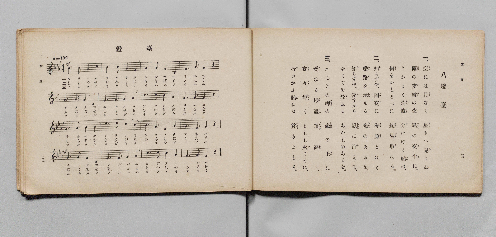

# 燈臺

> Re:Shōka 使用 AI 協助辨識與重建樂譜，可能會有錯誤。歡迎回報。

- **鋼琴伴奏版**：<br><audio controls src="todai.mp3"></audio>

- 詞：文部省
- 曲：文部省
- 文部省《尋常小學唱歌 第六學年用》（大正三年，索書號 4078）

## 說明

原書資訊與歌詞全文（對應 P014.jpg，原書 pp. 22–23，第 8 首）：
調性與拍號：變ホ長調（E♭ 大調）4/4 拍，速度 ♩=104


## 歌詞

```text
一、
空（そら）には月（つき）なく　星（ほし）さへ見（み）えぬ
雨（あめ）の夜（よ）雪（ゆき）の夜（よ）　嵐（あらし）の夜半（よは）に、
さかまく荒波（あらなみ）　分（わ）けゆく船（ふね）は、
何（なに）をかしるべに　舵柄（かぢづか）取（と）れる。

二、
知（し）らずや、闇夜（やみよ）に　海原（うなばら）とほく
船路（ふなぢ）を示（しめ）せる　光（ひかり）のあるを。
知（し）らずや、夜（よ）すがら　嵐（あらし）に消（き）えで、
ゆくてを敎（をし）ふる　あかしのあるを。

三、
かしこの岬（みさき）の　巖（いはほ）の上（うへ）に
聳（そび）ゆる燈臺（とうだい）　頂（いたゞき）高（たか）く、
夜々（よる〳〵）輝（かゞや）く　ともし火（び）こそは、
行（ゆ）きかふ船（ふね）には　尊（たふと）きまもり。
```

## ABC

<div class="abc-score" data-abc-src="todai.abc" aria-label="五線譜載入中"></div>

[下載 ABC 原始檔](todai.abc)

## TMD 檔案連結

- [主旋律 TMD 檔案](todai.tmd) [[在 TMD Studio 編輯](https://tmdlang.github.io/Tmd-TS/#tmd=s7IKdvYPcrWy4qpTUCpJTLdSSM7PyUlNLsnMz7PKyszLyo8vzshPT8wuBdHZiUpwdWX5OaW5qVbpRYkpqfFm8SYG5hYIyeL80qLkVKvi5Iz8_Jz4ktSKkqT8_Gx0-fiCxPRUqwADQxOETEFRfllqXmIeUHdBUWZeSWoKWDtCQWpZZkoqSLostSgzLTM1BYtUcXJiXjymPFCkGOQvqO0lRYl5xclFmQUgzyJU5ReVAH1clFiQUWmVkVlckl-UmZyYE5-dmIfk-5KMVKDni1MxhApyEpNTkQ3LTM_Ms8rNz0sqBQagEpeWlsLz9o4X7bsUtLS4FG0VDA1MuOxtFVx1uGxM9E3sQBpfrJz3fs-sZ9PaXzaveD6nEWzYs9mbMMVgvMcNXU83dD_dsePphv6na3c8nbLx2doehedr1jxtXQvi79zyfMqKxw3d7_d0PF2y_NnaxU92dAIF3-_peb5l0bPZO17MnK8Air_3ezqVuLj0tRRsqQW4FBQUnvbNB9mxuf3Fiq4XHe1ApwE9-LR1BdD5IAdt6H3W3qkASgR6WQXpQDdB1CsUFOgpGBk9aphsZAxy6Jo1ChYKL5dNA7oRGBAgc1-s2v-sYTnIxO5eoA-Aoi_WdT1unv1y6nagFNBo10cz1yoAPQzmdQJDVwGoEmjWy4b5T3ctU3g0c6UtKPRBZj3Z0fC4oRHEer5yF1Dr48a5j5uAFnU-blz9uHH9szkdYMEljxuBBgAFVz1u7H_c0PBsBtBaoPjux43TweJTHzfueLEMFNCPG0GWPm4EMtaAzH05ewVYtOlxUyNYYt3TJXNAIk1Aoztfzl4FZrfBLECRBdr0dOsEmHagLMQykJqnvV0QZUBXQp0L8QfYLd2PG_cBXfqid9KzzYuQ9AOdD3Yd0NyONrD-frDmiWAX9L_o2AlWvPVx41qw-HqooU_2TgVLAPWvBkk0TQLbMf1xE5DcCba84UXH1mfzW8DKgIKLHjcuBTKAip_2A-MOKAgMBqDGHpCWhiZI4O_qgQX-_KVgNWD_gRw663FTC1Du5fR2WHi0AJ0ODRWwdc-2bgcmGLAuoNOBDtsAi7gV4HjpByeVjp0vtgPDB-InoCJgYIBc_3wJJLKBHoBEymywsxqetgKNAIpvAvmhCRjCoNAGBx6QOwnkbjyORYm5xpmPG4F-xRWFq59tg6QsSKwDGcth8QeOiceNy4AWPpvaBzYRGNoQbVshzgSZBQl_NNdBkjTQUmhSgKiZDEoym9ZAEic4fUDTGshx2yGxAwze9cBwg4g_2QFOXKCA3QFxLjgwGzdDcwiIAfR6G9BiSJkGiWCwhgVAsyBJ7OWCJpjR8x83zYPY-nL1DLDgfEjiAGcnsGOBofe4oRWapkG-3Py4YStQxYs9c6FpCmhEE9hocBYE2dcEDIbpz0FJEqgA7CaQX4Hug6XbFwt7INkLLNcLDpCtGKkclNNBQbEB4mug04BS4OQK0rIPZE1TFzTyKS8aoUBBS5-LKyQ_JTHTKiAzMS_focagphpkg4KNhZYdmIGtQAaV7sBCC-gxBQ0TBWC5_3x9gw68FNXEogFoD8iwGoXq3LRaBVMFXSA0VTAGkmZAXIMiYggWAbF0gaQRSDweLASSgAkZgETAZvoY1gDT616w3OPmlUDcDWb1g_U8bm6ByDStBbK7wKz1UJnZUJntQLwVrGcGVGY-VGYFkN0DZIHth9hmBJRvnA6V7wSyZ4FZIFtA7oDa1rgfyO4As1ZDZBrboDKrgHgDVDdEZgVUZjcQg1yNZJsxyEyQCTB3bga7sw_NnVvB_kOSaVoCDY9-qD8RMsugMjOgIQWxDX9c7-ohJ65xRqEhWAgkXQOOf1AqAKUAiAhIThdIgtSiR_MiqOMXQj30uBkUeKCggHoLHM0oMnA9wKQBDELk4IMGPDiQEEGBiGZQooBFGcgUYAEHjTJYAmgEssHB2wTSD5LZBNXTDRQDJ7fGdVCZJqgekAzIHPRohiXhyVDfPG6GJp1mUEIC6VwGZDeAWaDoRYrmJmByg8qAkgFIZj9UZjU0wRMTzTs6ycrSwBwNiWoTcCyCMDCm4yBRHadgDo5fRC43BsesCVgEog-SHtDjGhr6IB80zwOzoBkXOUYhWRqcEUAhBVIBUrkRFobwzD4VqqcXWjQQn6Whod84E4hBhQEi48JiFKQHpB-R2XuhejqAeDlmXMNTHshvIDY8ruGZfQ1QDBS7CB9A3dG8CJ6OJ0P1gAoFkMq9KH7DG9dPZ88mu_imfr4GxyLIR8C80QzKQZBwAPkN5FNYSM2EqkEJqeYmIG5F1gMPKVAYgsTQ4roJVhQD830jJJVA8zWYBslMh-Z-RL6GxjUoX0Pjmsh8jVwygV0ISYvoaRKl0oLlXqAKiG_g-RqcE6CpoHkV3LZaLi5dOwVwTa4AZChzAQA)]
- [鋼琴伴奏 TMD 檔案](todai_piano.tmd) [[在 TMD Studio 編輯](https://tmdlang.github.io/Tmd-TS/#tmd=s7IKdvYPcrWy4qpTUCpJTLdSSM7PyUlNLsnMz7PKyszLyo8vzshPT8wuBdHZiUpwdWX5OaW5qVbpRYkpqfFm8SYG5hYIyeL80qLkVKvi5Iz8_Jz4ktSKkqT8_Gx0-fiCxPRUqwADQxOETEFRfllqXmIeUHdBUWZeSWoKWDtCQWpZZkoqSDoxOTk_tyAxLzM3NQ9Jviy1qBjkeKgVJUWJecXJRZkFIB8hVOUXlQC9VZRYkFFplZFZXJJflJmcmBOfnZiH5MXEIqDm9FSQ-VYFmYl5-fE47CzJACqyKk5F0gsRKshJTE5FtjUzPTPPKjc_L6kUGJxKXFpaCs_bO16073q_p-Nl957nE7Y82bPl6dL-550d7_d0KmhpcSnaKhgamHDZ2yq46nDZmOib2IFMe7Fy3vs9s55Na3_ZvOL5nEawDc9mb8IUg_EeN3Q93dD9dMeOpxv6n67d8XTKxmdrexSer1nztHUtiL9zy_MpKx43dAPd8XTJ8mdrFz_Z0QkUfL-n5_mWRc9m73gxc74CKIqBrlLi4grJT0nMtAoABUmQh0ONQU01lwIQ2Fho2YEZ-loKtugAZNmTHQ0vFvYoaJgoAJ3xfH2DjgIo8vWyCtI1sWjQ0gcbVqNQnZtWq2CqoAuEpgrGQNIMiGtQRAzBIiCWLpA0AonHg4VAEjAhA5AI2EwfwxqFx017wXKPm1cCcTeY1Q_W87i5BSLTtBbI7gKz1kNlZkNltgPxVrCeGVCZ-VCZFUB2D5AFth9imxFQvnE6VL4TyJ4FZoFsAbkDalvjfiC7A8xaDZFpbIPKrALiDVDdEJkVUJndQAxyNZJtxiAzQSbA3LkZ7M4-NHduBfsPSaZpCTQ8-qH-RMgsg8rMgIYUxDb8cb2rh5y4xhmFhmAhkHQNOP5BqQCUAiAiIDldIAlSix7Ni6COXwj10ONmUOCBggLqLXA0o8jA9QCTBjAIkYMPGvDgQEIEBSKaQYkCFmUgUx43TYJGGSwBNALZ4OBtAukHyWyC6ukGioGTW-M6qEwTVA9IBmQOejTDkvBkqG8eN0OTTjMoIYF0LgOyG8AsUPQiRXMTMLlBZUDJACSzHyqzGprgiYnmHZ1kZWlgjoZEtQk4FkEYGNNxkKiOUzAHxy8ilxuDY9YELALRB0kP6HENDX2QD5rngVnQjIsco5AsDc4IoJACqQCp3AgLQ3hmnwrV0wstGojP0tDQb5wJxKDCAJFxYTEK0gPSj8jsvVA9HUC8HDOu4SkP5DcQGx7X8My-BigGil2ED6DuaF4ET8eToXpAhQJI5V4Uv-GN66ezZ5NdfFM_X4NjEeQjYN5oBuUgSDiA_AbyKSykZkLVoIRUcxMQtyLrgYcUKAxBYmhx3QQrioH5vhGSSqD5GkyDZKZDcz8iX0PjGpSvoXFNZL5GLpnALoSkRfQ0iVJpwXIvUAXEN_B8Dc4J0FTQvApuWy1KRe6DXJGbQCtyYCTFK0QbxoIpk1hUPpCC803jgbRpPJqIAdRPeJTBDTKB2ADnw5UCRTDMQdcFpeDy6HxqOwYYdLp2CuDQi_YBqkBwjJA5xmCOMhcA)]

## 分析

```text
================================================================================
📊 TMD Song Profile: [ 燈臺 ]
================================================================================
⏱  Duration:       0:36 (36.9s), 16 measures total
🎼 Key & Tempo:    首調基準 E,, != 104.0 BPM, <4/4>
   - 分析範圍：      由實際發聲的音符與和弦推測調性；播放脈絡另行呈現
🎤 人聲音域:    A#3 (MIDI 58) – D#5 (MIDI 75) [跨度: 17 個半音 / 1.4 個八度, 難度: challenging]
   - 最低音:  A#3 in [Todai #1 @ m.3, 0:06]
   - 最高音: D#5 in [Todai #1 @ m.10, 0:20]
   - 適合: soprano, mezzo-soprano, contralto, tenor, baritone, bass
🏛  結構:      Todai (36.9s)
⚡ 編曲密度:        Peak 1 軌道同時演奏
🗝  調性診斷：       D# 大調（純淨自然大調，未偵測到可信轉調）
   - 風格氣質:    純淨自然大調（陽光明朗、易唱易記，無明顯調外色彩）
   - 轉調歷程:    全曲維持單一推測調性（未偵測到可信轉調）
   - 核心骨幹音:  G, A#, D#, F, C
   - 調性數值:    D# 大調 [相關度: 0.80, 穩定度: Moderate, 自然音純度: 100.0%]
   - 候選調性 (K-S): D# 大調 (0.80), G 小調 (0.74), A# 大調 (0.72)
   - 五度圈歷程:   -3
   - 各段落調性細節:
     • [Todai #1]: D# 大調 (r: 0.80, 自然音純度: 100.0%)

  [ 五度圈游移軌跡 ]
               C  
         F            G  
      Bb               D  
     [Eb]*              A  
         Ab           E  
            Db       B  
               F# 
     (* = active key center)

  [ 十二半音累積音高分佈 ]
     C  : █████████                 10.0%
     C# :                            0.0%
     D  : ██                         1.7%
     D# : ██████████████████        20.0%
     E  :                            0.0%
     F  : █████████████████         18.3%
     F# :                            0.0%
     G  : ████████████████████████  26.7%
     G# : ██                         2.5%
     A  :                            0.0%
     A# : ███████████████████       20.8%
     B  :                            0.0%
--------------------------------------------------------------------------------
Assignment 軌道音域：
  - Piano         : A#3 – D#5 (17 個半音 / 1.4 個八度, 60 個音符)
================================================================================
```


## 原書掃描頁




