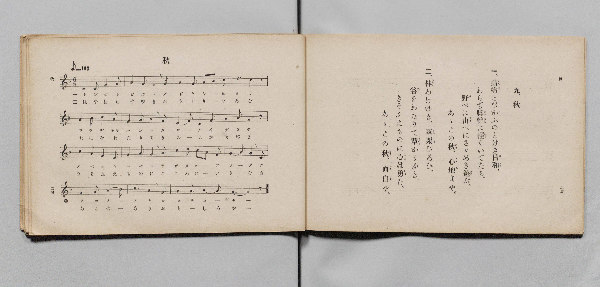

# 秋

> Re:Shōka 使用 AI 協助辨識與重建樂譜，可能會有錯誤。歡迎回報。

- **鋼琴伴奏版**：<br><audio controls src="aki.mp3"></audio>
- **NEUTRINO 歌聲合成版**：<br><audio controls src="aki_neutrino.mp3"></audio>

- 文部省
- 文部省《尋常小學唱歌 第六學年用》（大正三年，索書號 4078）

## 說明

原書資訊與歌詞全文（對應 P037.jpg，書頁 p. 14，第二學期第 2 首）：
調性與拍號：へ長調八分之六拍子（F 大調 6/8 拍），「面白ゲニ」（♩.=96）


## 歌詞

```text
一、
蜻蛉（とんぼ）とびかふのどけき日和（ひより）
わらぢ脚絆（きやはん）に軽くいでたち
野べに山べにさざめき遊ぶ
あゝこの秋心地よや

二、
林わけゆき落栗ひらひ
谷をわたりて茸（きのこ）かりゆき
きそふえものに心は勇む
あゝこの秋面白や
```

## ABC

<div class="abc-score" data-abc-src="aki.abc" aria-label="五線譜載入中"></div>

[下載 ABC 原始檔](aki.abc)

## TMD 檔案連結

- [主旋律 TMD 檔案](aki.tmd) [[在 TMD Studio 編輯](https://tmdlang.github.io/Tmd-TS/#tmd=s7IKdvYPcrWy4qpTUCpJTLdSSM7PyUlNLsnMz7PKyszLyo8vzshPT8wuBdHZiUpwdWX5OaW5qVbpRYkpqfFm8SYG5hYIyeL80qLkVKvi5Iz8_Jz4ktSKkqT8_GyEfEFRfllqXmIeUE1BUWZeSWoKWBFCQWpZZkoqSLo4OTEvviy1KDMtMzUFyfbUomKQEyEWxZcUJeYVJxdlFoDcjVCVX1QCdHxRYkFGpVVGZnFJflFmcmJOfHZiHpJHSjJSgf4oTk0szs8rRtabmZ6ZZ5Wbn5dUCvQ6ut_iCxLTU60CDAxNlbi0tBSeL-9W0NLiUrRVsDTjsrdVcOOyMdO3sANpejat_WXziudzGsFGwHmPG7qebuh-umPH0w39T9fueDpl47O1PQrP16x52roWxN-55fmUFY8but_v6Xi6ZPmztYuf7OgECr7f0_N8y6Jns3e8mDlfARTo7_d0KnFx6Wsp2FILcCkoKDztmw-yY3P7ixVdLzragU57sXLe09YVQOeDHLSh91l7p0KAgbG5XlZBOtBNQMUvFzQqFOgpGJqAnLhmzZNdPUBvPJszH8hWMFJ4uWwa0KXv98wCmf5i1f5nDctB5nb3Av0BFH3cuOPl1O1A8aetq592tD3Z2Q0MBqDs07UTgPa5KQCDACipAAxTBaAo2KSexw09L-cuej5z7-OmTY-bux83AMU7Hs1cqWdraQZUwQWy6cmOhscNjWA75-x-MRuoreNx44rHTZMfN-4BqgGxGzc_bux-3Lj1ceO6x40rHzdOfNzY-2z60qeTesCKNz1u6njc1AUyEGjK46b-x01AbYtetMx6vrUNrKL3cVPL48b1QEPBJq5-sXvv48b-x41AweWPG-c_blwI0vmyve9x406g9NONGyGMx41THzdOe9zUCDTiZWPX48ZtYBsamx43zX3cCHThOmCqerq_-emcDWA3tEB8tAvocbCPns2bDnIO0MFNbUAjXkzY-2zBdLCDga7YBPbzhu2PmyaBFc0H-uFx47IXPTugbgb5FuLgbpAU2AiI_UA5oP3A8ADa2QRWtxroCqAPn3a3P25qwOJIWDS0gOQoT4BQoKClz8XlmJ1pFZCZmJfvUGNQUw0yX8HGQssOzMCW6EE5CBjpLxb2KGiYKADz1vP1DTrwlKqJRQPQFpBhNQqm8Qq6IMIQSBkB-cZgGpVnrGCiYArkmQF5QMVAbKBQA9bvY1gDDBZQ0gIKAlMXiANmbQYqBwYymL0ViNeBWSvBohPB7F4g3gRMWh1A3AUUBxkNgfEww41AqoFJrAWsYTooHYJZE0HGNLXBjekCsxaCDZ8AYgMNhBjeCabRDccfjrt6yAlHUEiBQkkXyKqBhh9IzBAUbqAwNoQENYhvBFYFUoMSjhDfgd28COK3x03NYE-tB0tMBrJWgyW6wQEACd1-IIYE0HKw2vlgb4KCAz0kQTIgE4C5A2xeP1w9JMCWQQMUJAqJL5CNYFvAMQQJcogaYgJyRydZCRIeOMBgg4UVhIRImgFJkAJkOWDQIidIiOt3wsILmIBAovtQRRungkWngVU0Qn0FzONg0blQn26DiSGFI0TdXHDKBrE6wGHTBGavg5s-GWwOOF80gRIpOA6BMQUSnQoxvakBbjrekHw6ezY5IYlIhCbQoAMFFyIJQuRA2RykEiSOnrEhfgKlAlCI6oLdDhKDpQEUXwJTHCg3Q9WBMy22_EzYTEhag6gDZXqQKDYza7m4dO0UgGWlApBS5gIA)]
- [鋼琴伴奏 TMD 檔案](aki_piano.tmd) [[在 TMD Studio 編輯](https://tmdlang.github.io/Tmd-TS/#tmd=s7IKdvYPcrWy4qpTUCpJTLdSyC8qychPL0osyKi0ysgsLskvykxOzInPTsxLVIIrKs4vLUpOjS9ITE-1CjAwNFXi0tJSeL68-_2ejpfde55P2PJkz5anS_ufd3a839OpoKXFpWirYGnGZW-r4MZlY6ZvYQcy6dm09pfNK57PaQSb-6J91_PGxc-mznzRtOnZnOanrWterOp93ND1bNqGp-tmPW2d9Hz10qdTNj5b2_O4ofvphu6nO3Y8Xz7x-Zo1T1vXPl274-nOLc-nrADab2RgZKBnYGCmZ2BhYg5kGJgBnaDExeWYnWkVkJmYlx_k4VBjUFPNpQAENhZadmCGvpaCLTpQABr-ZEfDi4U9ChoBBsbmelkF6ZpYlGnpg42oUTCNV9AFEYZAygjINwbTqDxjBRMFUyDPDMgDKgZiA4UasH4fwxqFx40rHjdNBgo-btwD4oBZm4HKHzd2g9lbgXgdmLUSLDoRzO4F4k0Kj5s6gLgLKA4yGgLjYYYbgVSvf9zUAtYwHaiwH8yaCDKmqQ1uTBeYtRBs-AQQG2ggxPBOMI1uOP7Q29VDfOiBwgcUNrpAVg001EBihqDQAoWsISSAQXwjsCqQGpTQg_gJ7NJFEB89bmoGe2U9WGIykLUaLNEN9jYkTPuBGBIsy8Fq54M9BwoE9PADyYBMeNw0CWxeP1w9JJiWQYMRJAqJJZCNYFvA8QIJaIgaYoJvRycJiQ8eJMDAgoUQhIRImgFJkAJkOWCAIic-iJt3wkIJmFhAovtQRRungkWngVU0Qv3yuLEJLDoX6r9tMDGk0IOomwtOxSBWBzhEmsDsdXDTJ4PNAeeBJlCCBMccMH5AolMhpjc1wE3HG35PZ88mPvwQCc4EGmCgQEIkN4gcKCODVILE0bMuxCegGAeFoy7YxSAxWHyj-A2YukD5FaoOnC2x5VjCZkLSFUQdKFuDRLGZWYtUBPpgKwKBHotXiDaMBWMkJuniJkCOCZADxEBxRDCRYxLIqHiQWUACRcoUJGUKkgIRuO0xA6kzi88F8sAkuk5UHm6nYOqixGOkuAFiDzD-dO0UgFEY7QMUhjGNwExlLgA)]

## 分析

```text
================================================================================
📊 TMD Song Profile: [ 秋 ]
================================================================================
⏱  Duration:       0:30 (30.0s), 16 measures total
🎼 Key & Tempo:    首調基準 F, != 96.0 BPM, <6/8>
   - 分析範圍：      由實際發聲的音符與和弦推測調性；播放脈絡另行呈現
🎤 人聲音域:    C4 (MIDI 60) – D5 (MIDI 74) [跨度: 14 個半音 / 1.2 個八度, 難度: moderate]
   - 最低音:  C4 in [Aki #1 @ m.1, 0:00]
   - 最高音: D5 in [Aki #1 @ m.4, 0:05]
   - 適合: soprano, mezzo-soprano, contralto, tenor, baritone, bass
🏛  結構:      Aki (30.0s)
⚡ 編曲密度:        Peak 1 軌道同時演奏
🗝  調性診斷：       F 大調（純淨自然大調，未偵測到可信轉調）
   - 風格氣質:    純淨自然大調（陽光明朗、易唱易記，無明顯調外色彩）
   - 轉調歷程:    全曲維持單一推測調性（未偵測到可信轉調）
   - 核心骨幹音:  F, A, G, C, D
   - 調性數值:    F 大調 [相關度: 0.83, 穩定度: Moderate, 自然音純度: 100.0%]
   - 候選調性 (K-S): F 大調 (0.83), C 大調 (0.72), A 小調 (0.64)
   - 五度圈歷程:   -1
   - 各段落調性細節:
     • [Aki #1]: F 大調 (r: 0.83, 自然音純度: 100.0%)

  [ 五度圈游移軌跡 ]
               C  
        [F ]*          G  
      Bb               D  
      Eb               A  
         Ab           E  
            Db       B  
               F# 
     (* = active key center)

  [ 十二半音累積音高分佈 ]
     C  : █████████████████████     20.4%
     C# :                            0.0%
     D  : ████████                   7.5%
     D# :                            0.0%
     E  :                            0.0%
     F  : ████████████████████████  23.7%
     F# :                            0.0%
     G  : ██████████████████████    21.5%
     G# :                            0.0%
     A  : ████████████████████████  23.7%
     A# : ███                        3.2%
     B  :                            0.0%
--------------------------------------------------------------------------------
Assignment 軌道音域：
  - Piano         : C4 – D5 (14 個半音 / 1.2 個八度, 60 個音符)
================================================================================
```


## 原書掃描頁




