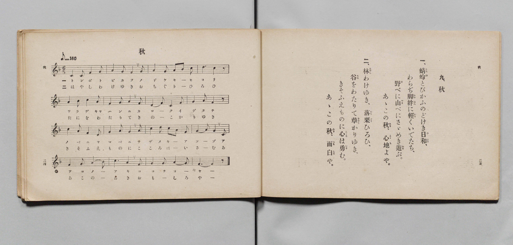

# 秋

> Re:Shōka 使用 AI 協助辨識與重建樂譜，可能會有錯誤。歡迎回報。

- **鋼琴伴奏版**：<br><audio controls src="aki.mp3"></audio>

- 文部省
- 文部省《尋常小學唱歌 第六學年用》（大正三年，索書號 4078）

## 說明

原書資訊與歌詞全文（對應 P037.jpg，書頁 p. 14，第二學期第 2 首）：
調性與拍號：へ長調八分之六拍子（F 大調 6/8 拍），「面白ゲニ」（♩.=96）


## 歌詞

```text
一、
蜻蛉（とんぼ）とびかふのどけき日和（ひより）
わらぢ脚絆（きやはん）に軽くいでたち
野べに山べにさざめき遊ぶ
あゝこの秋心地よや

二、
林わけゆき落栗ひらひ
谷をわたりて茸（きのこ）かりゆき
きそふえものに心は勇む
あゝこの秋面白や
```

## ABC

<div class="abc-score" data-abc-src="aki.abc" aria-label="五線譜載入中"></div>

[下載 ABC 原始檔](aki.abc)

## TMD 檔案連結

- [主旋律 TMD 檔案](aki.tmd) [[在 TMD Studio 編輯](https://tmdlang.github.io/Tmd-TS/#tmd=s7IKdvYPcrWy4qpTUCpJTLdSSM7PyUlNLsnMz7PKyszLyo8vzshPT8wuBdHZiUpwdWX5OaW5qVbpRYkpqfFm8SYG5hYIyeL80qLkVKvi5Iz8_Jz4ktSKkqT8_GyEfEFRfllqXmIeUE1BUWZeSWoKWBFCQWpZZkoqSLo4OTEvviy1KDMtMzUFyfbUomKQEyEWxZcUJeYVJxdlFoDcjVCVX1QCdHxRYkFGpVVGZnFJflFmcmJOfHZiHpJHSjJSgf4oTk0szs8rRtabmZ6ZZ5Wbn5dUCvS6EpeWlsLz5d0KWlpcirYKlmZc9rYKblw2ZvoWdiA9z6a1v2xe8XxOI9gEOO9xQ9fTDd1Pd-x4uqH_6dodT6dsfLa2R-H5mjVPW9eC-Du3PJ-y4nFD9_s9HU-XLH-2dvGTHZ1Awfd7ep5vWfRs9o4XM-crgIL2_Z5OJS4ufS0FW2oBLgUFhad980F2bG5_saLrRUc70GkvVs572roC6HyQgzb0PmvvVAgwMDbXyypIB7oJqPjlgkaFAj0FQxOQE9esebKrB-iNZ3PmA9kKRgovl00DuvT9nlkg01-s2v-sYTnI3O5eoD-Aoo8bd7ycuh0o_rR19dOOtic7u4HBAJR9unYC0D43BWAQACUVgGGqABQFm9TzuKHn5dxFz2fufdy06XFz9-MGoHjHo5kr9WwtzYAquEA2PdnR8LihEWznnN0vZgO1dTxuXPG4afLjxj1ANSB24-bHjd2PG7c-blz3uHHl48aJjxt7n01f-nRSD1jxpsdNHY-bukAGAk153NT_uAmobdGLllnPt7aBVfQ-bmp53LgeaCjYxNUvdu993Nj_uBEouPxx4_zHjQtBOl-29z1u3AmUfrpxI4TxuHHq48Zpj5sagUa8bOx63LgNbENj0-OmuY8bgS5cB0xVT_c3P52zAeyGFoiPdgE9DvbRs3nTQc4BOripDWjEiwl7ny2YDnYw0BWbwH7esP1x0ySwovlAPzxuXPaiZwfUzSDfQhzcDZICGwGxHygHtB8YHkA7m8DqVgNdAfTh0-72x00NWBwJi4YWkBzlCRAKFLT0ubgcszOtAjIT8_IdagxqqkHmK9hYaNmBGdgSPSgHASP9xcIeBQ0TBWDeer6-QQeeUjWxaADaAjKsRsE0XkEXRBgCKSMg3xhMo_KMFUwUTIE8MyAPqBiIDRRqwPp9DGuAwQJKWkBBYOoCccCszUDlwEAGs7cC8TowayVYdCKY3QvEm4BJqwOIu4DiIKMhMB5muBFINTCJtYA1TAelQzBrIsiYpja4MV1g1kKw4RNAbKCBEMM7wTS64fjDcVcPOeEICilQKOkCWTXQ8AOJGYLCDRTGhpCgBvGNwKpAalDCEeI7sJsXQfz2uKkZ7Kn1YInJQNZqsEQ3OAAgodsPxJAAWg5WOx_sTVBwoIckSAZkAjB3gM3rh6uHBNgyaICCRCHxBbIRbAs4hiBBDlFDTEDu6CQrQcIDBxhssLCCkBBJMyAJUoAsBwxa5AQJcf1OWHgBExBIdB-qaONUsOg0sIpGqK-AeRwsOhfq020wMaRwhKibC07ZIFYHOGyawOx1cNMng80B54smUCIFxyEwpkCiUyGmNzXATccbkk9nzyYnJBGJ0AQadKDgQiRBiBwom4NUgsTRMzbET6BUAApRXbDbQWKwNIDiS2CKA-VmqDpwpsWWnwmbCUlrEHWgTA8SxWZmLReXrp0CsKxUAFLKXAA)]
- [鋼琴伴奏 TMD 檔案](aki_piano.tmd) [[在 TMD Studio 編輯](https://tmdlang.github.io/Tmd-TS/#tmd=s7IKdvYPcrWy4tLSUni-vPv9no6X3XueT9jyZM-Wp0v7n3d2vN_TqaClxaVoq2BpxmVvq-DGZWOmb2HHVaeg9Gxa-8vmFc_nNCqBeC_adz1vXPxs6swXTZuezWl-2rrmxarexw1dz6ZteLpu1tPWSc9XL306ZeOztT2PG7qfbuh-umPH8-UTn69Z87R17dO1O57u3PJ8ygqg_UYGRgZ6BgZmegYWJuZAhoEZ0AlKXFyO2ZlWAZmJeflBHg41BjXVXApAYGOhZQdm6Gsp2KIDBaDhT3Y0vFjYo6ARYGBsrpdVkK6JRZmWPtiIGgXTeAVdEGEIpIyAfGMwjcozVjBRMAXyzIA8oGIgNlCoAev3MaxReNy44nHTZKDg48Y9IA6YtRmo_HFjN5i9FYjXgVkrwaITwexeIN6k8LipA4i7gOIgoyEwHma4EUj1-sdNLWAN04EK-8GsiSBjmtrgxnSBWQvBhk8AsYEGQgzvBNPohuMPvV09xIceKHxAYaMLZNVAQw0kZggKLVDIGkICGMQ3AqsCqUEJPYifwC5dBPHR46ZmsFfWgyUmA1mrwRLdYG9DwrQfiCHBshysdj7Yc6BAQA8_kAzIhMdNk8Dm9cPVQ4JpGTQYQaKQWALZCLYFHC-QgIaoISb4dnSSkPjgQQIMLFgIQUiIpBmQBClAlgMGKHLig7h5JyyUgIkFJLoPVbRxKlh0GlhFI9QvjxubwKJzof7bBhNDCj2IurngVAxidYBDpAnMXgc3fTLYHHAeaAIlSHDMAeMHJDoVYnpTA9x0vOH3dPZs4sMPkeBMoAEGCiREcoPIgTIySCVIHD3rQnwCinFQOOqCXQwSg8U3it-AqQuUX6HqwNkSW44lbCYkXUHUgbI1SBSbmbVIRaAPtiIQ6LF4hWjDWDBGYpIubgLkmAA5QAwURwQTOSaBjIoHmQUkUKRMQVKmICkQgdseM5A6s_hcIA9MoutE5eF2CqYuSjxGihsg9gDjT9dOARiF0T5AYRjTCMxU5gIA)]

## 分析

```text
================================================================================
📊 TMD Song Profile: [ 秋 ]
================================================================================
⏱  Duration:       0:30 (30.0s), 16 measures total
🎼 Key & Tempo:    首調基準 F, != 96.0 BPM, <6/8>
   - 分析範圍：      由實際發聲的音符與和弦推測調性；播放脈絡另行呈現
🎤 人聲音域:    C4 (MIDI 60) – D5 (MIDI 74) [跨度: 14 個半音 / 1.2 個八度, 難度: moderate]
   - 最低音:  C4 in [Aki #1 @ m.1, 0:00]
   - 最高音: D5 in [Aki #1 @ m.4, 0:05]
   - 適合: soprano, mezzo-soprano, contralto, tenor, baritone, bass
🏛  結構:      Aki (30.0s)
⚡ 編曲密度:        Peak 1 軌道同時演奏
🗝  調性診斷：       F 大調（純淨自然大調，未偵測到可信轉調）
   - 風格氣質:    純淨自然大調（陽光明朗、易唱易記，無明顯調外色彩）
   - 轉調歷程:    全曲維持單一推測調性（未偵測到可信轉調）
   - 核心骨幹音:  F, A, G, C, D
   - 調性數值:    F 大調 [相關度: 0.83, 穩定度: Moderate, 自然音純度: 100.0%]
   - 候選調性 (K-S): F 大調 (0.83), C 大調 (0.72), A 小調 (0.64)
   - 五度圈歷程:   -1
   - 各段落調性細節:
     • [Aki #1]: F 大調 (r: 0.83, 自然音純度: 100.0%)

  [ 五度圈游移軌跡 ]
               C  
        [F ]*          G  
      Bb               D  
      Eb               A  
         Ab           E  
            Db       B  
               F# 
     (* = active key center)

  [ 十二半音累積音高分佈 ]
     C  : █████████████████████     20.4%
     C# :                            0.0%
     D  : ████████                   7.5%
     D# :                            0.0%
     E  :                            0.0%
     F  : ████████████████████████  23.7%
     F# :                            0.0%
     G  : ██████████████████████    21.5%
     G# :                            0.0%
     A  : ████████████████████████  23.7%
     A# : ███                        3.2%
     B  :                            0.0%
--------------------------------------------------------------------------------
Assignment 軌道音域：
  - Piano         : C4 – D5 (14 個半音 / 1.2 個八度, 60 個音符)
================================================================================
```


## 原書掃描頁




