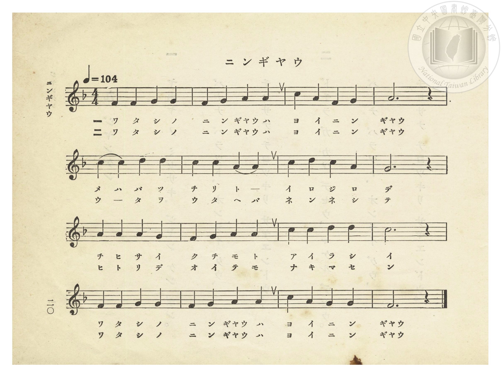
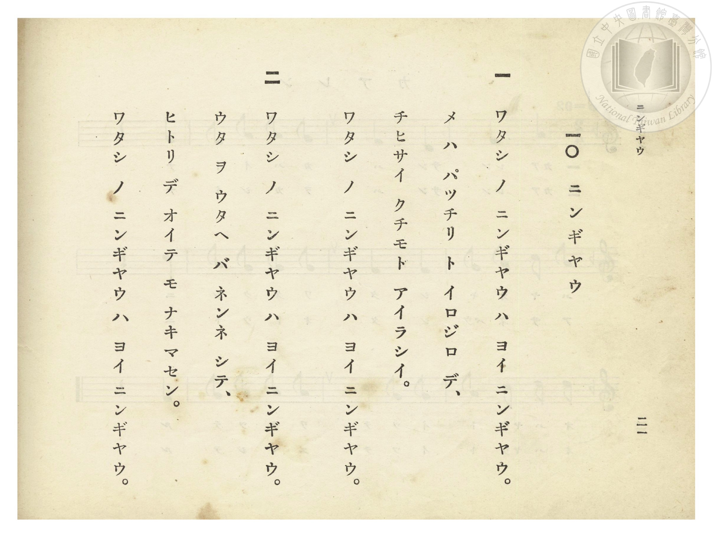

# ニンギヤウ（人偶）

> Re:Shōka 使用 AI 協助辨識與重建樂譜，可能會有錯誤。歡迎回報。

- **鋼琴伴奏版**：<br><audio controls src="ningyo.mp3"></audio>
- **NEUTRINO 歌聲合成版**：<br><audio controls src="ningyo_neutrino.mp3"></audio>

- 詞：文部省《尋常小學唱歌》
- 曲：文部省《尋常小學唱歌》
- 臺灣總督府《公學校唱歌》第一學年用（昭和九年三月第一版、昭和十一年二月第四版，索書號 0729 73）

## 說明


- 出處：臺灣總督府編《公學校唱歌》第一學年用，第十課〈ニンギヤウ〉（人偶），原書第 20–21 頁（掃描檔 P024.jpg–P025.jpg）。
- 調性與拍號：ヘ長調（F 大調），4/4 拍，速度 != 104。
- 背景與曲風：原出自明治 44 年（1911）文部省《尋常小學唱歌（一）》〈人形〉，亦收錄於大正 4 年《公學校唱歌集》第一學年第七首及《新定兒童唱歌》第一學年用第三學期第二首。


## 歌詞

```text
一　ワタシ ノ ニンギヤウ ハ ヨイ ニンギヤウ。
メ ハ パッチリ ト イロジロ デ、
チヒサイ クチモト アイラシイ。
ワタシ ノ ニンギヤウ ハ ヨイ ニンギヤウ。

二　ワタシ ノ ニンギヤウ ハ ヨイ ニンギヤウ。
ウタ ヲ ウタヘ バ ネンネ シテ、
ヒトリ デ オイテ モ ナキマセン。
ワタシ ノ ニンギヤウ ハ ヨイ ニンギヤウ。
```

## ABC

<div class="abc-score" data-abc-src="ningyo.abc" aria-label="五線譜載入中"></div>

[下載 ABC 原始檔](ningyo.abc)

## TMD 檔案連結

- [主旋律 TMD 檔案](ningyo.tmd) [[在 TMD Studio 編輯](https://tmdlang.github.io/Tmd-TS/#tmd=s7IKdvYPcrWy4qpTUCpJTLdSSM7PyUlNLsnMz7PKzk9PzM7Ojy_OyM9OVIKrKMvPKc1NtUovSkxJjTdEiBfnlxYlp1oVJ2fk5-fEl6RWlCTl52ejy8cXJKanWgUYGJkgZAqK8stS8xLzgLoLijLzSlJTwNoRClLLMlNSQdLFyYl58WWpRZlpmakpSE5KLSoGuRhqRUlRYl5xclFmAcgbCFX5RSUZ-UBnF2RUWmVkFpfkF2UmJ-bEZyfmIfmuJCMV6LmUxMycyviczLRUZO2Z6Zl5Vrn5eUmlwCBR4tLSUnjc3P24efPjpnWPm5c8blr2fk_Hk127njZue7-nU0FLi0vRVsHQwITL3lbBjcvGRN_EDmTYi5Xz3u-Z9Wxa-8vmFc_nND5u6Hq6ofvpjh1PN_Q_Xbvj6ZSNz9b2PG7oBlv8bPYmotW-aN_1vHHx8x17n89d_HTXHJDa1jVAVc8WLIQrfL5mzZMdDSCtO7c8n7IC6N5nM9Y-ndTzZOdcoMiTHZ3P5nRA1Dzv7Hjc0AiRfdrbCNIFVLCrB6Lg6ezZQAXv9_Q837Lo2ewdL2bOVzAwN7JUMDcG-lyJi0tfS8GWWoBLQUHhccMEYFA8n73uxapVz2b0PW6YCBZt3v20fdeLmVOBYYTm--fbVxAXAD0g3_Q2vli16XFDB1p0Pm7oRI5RoOKnffOB3gVqUTAyeNQw2chQ4eWCRlAo9jU_6-9_tmqKAihl62UVpANlgUxTEBOo9XFDE9TBL1btf9aw_EVH-7PuXmCwAV3-uHnGy6nbgeJAc9wUni5ZDmaCbAOmGAWgMiDrZcP8p7uWKUDSE5JhzT3PZq4HGTZ708tFQN_MAjoQFCTtoFB6tmm3gomJAtCnQJMNLQ0NgabiT0og3-5oALu3GxgcIJ_vXQQOhZ4nu5Y9m7LtZU_Ls2l7gG58tnaxAthozFB-ObsNPaBB7OaXy6Y97e8Cqn82bcPTdbOetk56vnoprogBcztBxs6ZD2Lv6gFqB3kcmhogEQHUCsxNT1tXAL0FDIUnO9aCGKvmvVi7HphEgL55uqH3WXsnKFKgMQGNQYUCPQUjUHiAzQNa_Lih4XHz-sdN-x83bQeGbB96zgby-4F4xeOmJehS8OhYCFU08XFz8-PmxsfNq4CcDgWglsfNax837QCSQIF2YLaCqAeqmPS4aSvYyKb1YP4iiIZFYD0rgW4BMWDmU-Q8YGBAAgZUnnRMfD6r5emKZiB6NmP906V7IWyg0udz9jyfO_vpnMlPdq17Nqfz-dJ5QOc-n7XuRdus5zP3Pp81ExSEwBSzoR9kwowtL5ZPej5n_rPmncC08qxtwrOW2UBD8JgPD_JdwEinOMiBrKb9QMlNUCYwKwF5E4C4F6S8uRcovv1xMzA9QoN8EjB8IfHSDpRaBQ7mNiBvERB3PW5a-7h53uOm3SC99Az0p_2rXixrBGaFF1u3A5P0k31tTzdsfDan-cnOaUD0fO7CF8t2gcN94_N105_3rgBl7yn7Xkyc_mTn_Cc7eoEqn05e-3LNcsJBD3QT5QUyFCho6XNx-WXmpVfmWwVkJublO9QY1FSDrFCwMdGyAzOw1QMKkKz-YmGPggawCAGmpPUNOvByUxOLBqBFIMNqFAyB0AgIQSwjBWMgrFEwBZIgXg2Q1gVCA4UasGofwxpQ9AGjGZhCoBEIEukG4s1AEeRIBImvAGVUuDxQBK4CxVQjapuKP5x29ZATTqZAaAaEEBYsnMzA7BpgWGGGE7zsAuJmsMsbgRhSgOmC3Q3yBbD8atoBpkEq2sHmxCOHDNhfsDwJ4UN4kHwJ0gXMk6CQguRNsEgb3BwCaaaTnLAA-d4YI80gwgczLEA-nwR03Vawr0G-AMY3WBRUTHSARYAscIishPkCyMNMJ0BTQOU5tMABqQKywPoghQ5ITRdQBFQvzAPSu8Eim4lLG8A2GDXzEExsKOahWi4uXTsFSFmkAGQpcwEA)]
- [鋼琴伴奏 TMD 檔案](ningyo_piano.tmd) [[在 TMD Studio 編輯](https://tmdlang.github.io/Tmd-TS/#tmd=s7IKdvYPcrWy4tLSUnjc3P24efPjpnWPm5c8blr2fk_Hk127njZue9y8-2X3nucTtjzZs-Xp0v7nnR3v93QqaGlxKdoqGBqYcNnbKrhx2Zjom9hx1SkovVg57_2eWc-mtb9sXvF8TuPjhq6nG7qf7tjxdEP_07U7nk7Z-Gxtz-OGbiWQ2mezNxGt9kX7rueNi5_v2Pt87uKnu-aA1LauAap6tmAhXOHzNWue7GgAad255fmUFUAfPJux9umknic75wJFnuzofDanA6IG6InHDY0Q2ae9jSBdQAW7eiAKns6eDfZlz_Mti57N3vFi5nwFA3MjSwVzY6DPlbi4_DLz0ivzrQIyE_PygzwcagxqqrkUgMDGRMsOzNDXUrBFBwoQm18s7FHQMFEAevH5-gYdhQADIxO9rIJ0TSwatPTBhtUoGAKhERCCWEYKxkBYo2AKJEG8GiCtC4QGCjVg1T6GNcCYXK_wuGk_EG8HsvuAaoBxC8SbgSLQ2AXy-sHiK4BiS-DyQBG4ChRTjahtKv5w2tVDTjiZAqEZEEJYsHAyA7NrgGGFGU4LwS5-3DwRiJvBLm8E4lVA3AFUC3I3yBdrgfQOMA1S0Q42Jx45ZMD-AodN8yawLmBIgHkzgHgCWFcvJKRANDD8QCJtcHMIpJlOcsIC5HtjjDSDCB_MsAD5fBLQdVvBvgb5AhjfYNFF4PAAiQBZ4BBZCfMFkIeZToCmANVDwrEdrArIAutrA5sGUtMFFAGGa_M8IL0bLLKZuLQBzJzUzEMwsaGYh2pRiyIfbEVRjUK0YSxQfbRpPIiCc8EkDkmEm-EKTPBohvEghmDRjNdqFJNJ1YzN3cBQ0bVTgARMtA9IAsEzAvOUuQA)]

## 分析

```text
================================================================================
📊 TMD Song Profile: [ ニンギヤウ（人偶） ]
================================================================================
⏱  Duration:       0:36 (36.9s), 16 measures total
🎼 Key & Tempo:    首調基準 F, != 104.0 BPM, <4/4>
   - 分析範圍：      由實際發聲的音符與和弦推測調性；播放脈絡另行呈現
🎤 人聲音域:    F4 (MIDI 65) – D5 (MIDI 74) [跨度: 9 個半音 / 0.8 個八度, 難度: easy]
   - 最低音:  F4 in [Ningyo #1 @ m.1, 0:00]
   - 最高音: D5 in [Ningyo #1 @ m.5, 0:10]
   - 適合: soprano, mezzo-soprano, contralto, tenor, baritone, bass
🏛  結構:      Ningyo (36.9s)
⚡ 編曲密度:        Peak 1 軌道同時演奏
🗝  調性診斷：       C 調性不明確（純淨自然大調，未偵測到可信轉調）
   - 風格氣質:    純淨自然大調（陽光明朗、易唱易記，無明顯調外色彩）
   - 轉調歷程:    全曲維持單一推測調性（未偵測到可信轉調）
   - 核心骨幹音:  A, G, C, F, D
   - 調性數值:    C 調性不明確 [相關度: 0.72, 穩定度: Ambiguous, 自然音純度: 100.0%]
   - 候選調性 (K-S): C 大調 (0.72), F 大調 (0.71), A 小調 (0.71)
   - 五度圈歷程:   +0
   - 各段落調性細節:
     • [Ningyo #1]: C 調性不明確 (r: 0.72, 自然音純度: 100.0%)

  [ 五度圈游移軌跡 ]
              [C ]*
         F            G  
      Bb               D  
      Eb               A  
         Ab           E  
            Db       B  
               F# 
     (* = active key center)

  [ 十二半音累積音高分佈 ]
     C  : ██████████████████        21.7%
     C# :                            0.0%
     D  : ███████                    8.3%
     D# :                            0.0%
     E  :                            0.0%
     F  : ████████████████          18.3%
     F# :                            0.0%
     G  : ████████████████████      23.3%
     G# :                            0.0%
     A  : ████████████████████████  28.3%
     A# :                            0.0%
     B  :                            0.0%
--------------------------------------------------------------------------------
Assignment 軌道音域：
  - Piano         : F4 – D5 (9 個半音 / 0.8 個八度, 52 個音符)
================================================================================
```


## 原書掃描頁






