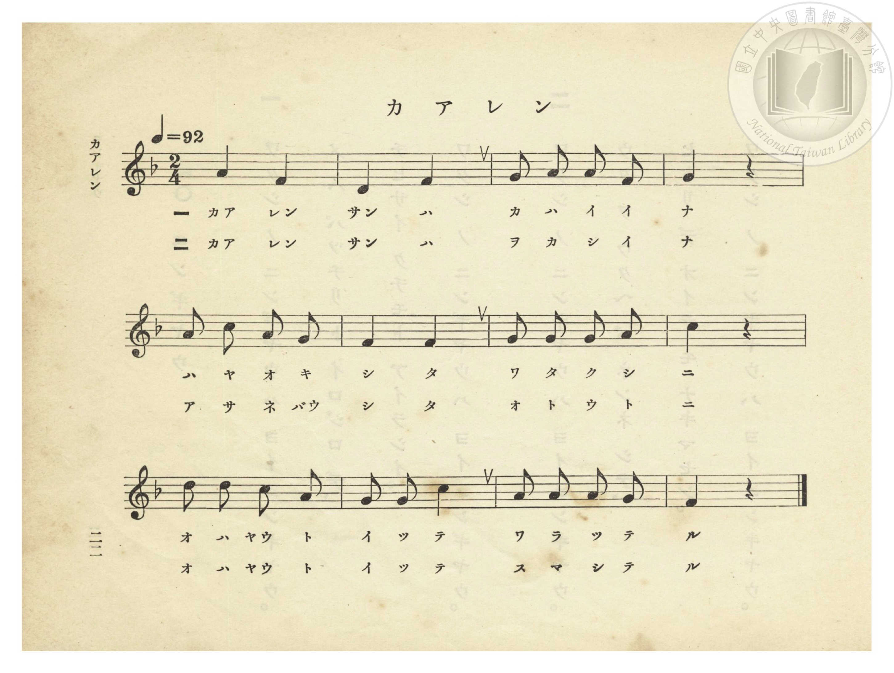
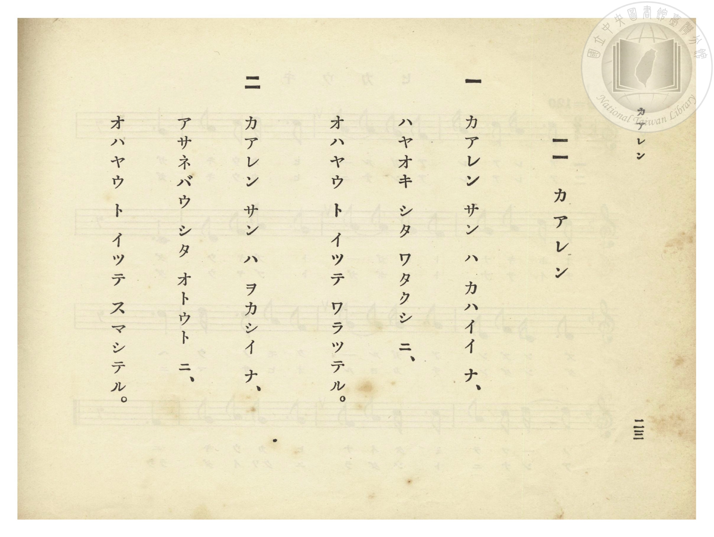

# カアレン（加令／八哥）

> Re:Shōka 使用 AI 協助辨識與重建樂譜，可能會有錯誤。歡迎回報。

- **NEUTRINO 歌聲合成版**：<br><audio controls src="karen_neutrino.mp3"></audio>
- **鋼琴伴奏版**：<br><audio controls src="karen.mp3"></audio>


- 江尚文 作詞（新竹女子公學校・懸賞募集入選）
- 臺灣總督府《公學校唱歌》第一學年用（昭和九年三月第一版、昭和十一年二月第四版，索書號 0729 73）

## 說明


- 出處：臺灣總督府編《公學校唱歌》第一學年用，第十一課〈カアレン〉（加令／八哥），原書第 22–23 頁（掃描檔 P026.jpg–P027.jpg）。
- 調性與拍號：ヘ長調（F 大調五聲音階），2/4 拍，速度 != 92。
- 背景與曲風：臺灣總督府專為臺灣學童編纂之**臺灣鄉土特色曲目**，後亦收錄於昭和 18 年（1943）國民學校《うたのほん 下》第九課〈かあれん〉。曲名「カアレン」源自臺語「加令」（ka-lîng，即八哥，臺灣民間常見、善於模仿人語的籠養鳥）。第一節寫八哥對早起的「我」笑著說早安（「オハヤウ」），第二節則幽默描寫八哥對睡懶覺的弟弟也一本正經地說「オハヤウ」。


## 歌詞

```text
一　カアレン サン ハ カハイイ ナ、
ハヤオキ シタ ワタクシ ニ、
オハヤウ ト イッテ ワラッテル。

二　カアレン サン ハ ヲカシイ ナ、
アサネバウ シタ オトウト ニ、
オハヤウ ト イッテ スマシテル。
```

## ABC

```abc
X:1
T:カアレン（加令／八哥）
M:2/4
L:1/16
Q:1/4=92
K:F
V:V1 name="Piano" snm="Pia"
[V:V1]
A4 F4 | D4 F4 | G2 A2 A2 F2 | G4 z4 |
w: 1.~カア レン | サン ハ | カ ハ イ イ | ナ
w: 2.~カア レン | サン ハ | ヲ カ シ イ | ナ
A2 c2 A2 G2 | F4 F4 | G2 G2 G2 A2 | c4 z4 |
w: 1.~ハ ヤ オ キ | シ タ | ワ タ ク シ | ニ
w: 2.~ア サ ネ バウ | シ タ | オ ト ウ ト | ニ
d2 d2 c2 A2 | G2 G2 c4 | A2 A2 A2 G2 | F4 z4 |
w: 1.~オ ハ ヤウ ト | イ ッ テ | ワ ラ ッ テ | ル
w: 2.~オ ハ ヤウ ト | イ ッ テ | ス マ シ テ | ル
```

## TMD 檔案連結

- [主旋律 TMD 檔案](karen.tmd) [[在 TMD Studio 編輯](https://tmdlang.github.io/Tmd-TS/#tmd=s7IKdvYPcrWy4qpTUCpJTLdSSM7PyUlNLsnMz7PKzk9PzM7Ojy_OyM9OVIKrKMvPKc1NtUovSkxJjTdEiBfnlxYlp1oVJ2fk5-fEl6RWlCTl52ejy8cXJKanWgUYGJkhZAqK8stS8xLzgLoLijLzSlJTwNoRClLLMlNSQdLFyYl58WWpRZlpmakpSE5KLSoGuRhqRUlRYl5xclFmAcgbCFX5RSUZ-UBnF2RUWmVkFpfkF2UmJ-bEZyfmIfmuJCMV6LnEvMzcxBwlLi0thcdNqx83LXrcvOZx8-b3ezqedi14snvJ-z39T1tXP5289P2eTgUtLS5FWwVLIy57WwU3LhsjfRM7kHHPNs5_umHWs2ntCk_2znmxch5Q87NpG56v3vl06eanayc8bV3zdO2OZwsWPm7e_ax9x4vN8552z385u-1p69KXjTuA5oLd9KJ91_PGxc937H0-d_HTXXMeN3TB9T2dsvHZ2p7HDd3P16x5sqMBKPh055bnU1aA7Jmx9umknic75wJFnuzofDanA6LmeWfH44ZGiOzT3kaQLqCCXT0QBU9nzwYqeL-n5_mWRc9m73gxc76CgbmRpYK5Mdg1XPpaCrbUAlwKCgqPGyY8m73p-ex1L1atejaj73HDRLBo8-6n7btezJz6fs8sNN8_376CuADoAfkG7L8XqzY9buhAjsPHDZ1YoxGo62nffKC_gXoVjIweNUw2MlZ4uaARFJx9zc_6-5-tmqIASrd6WQXpQFkg0xzEBGp93NAEdfmLVfufNSx_0dH-rLsXGH5ALzxunvFy6nagONAcN4WnS5YDmU92TXnRuOnl_M0vZ_VBbAamGQWgFiDrZcP8p7uWKYATFJK5zT3PZq4HmTt708tFQB-iB83TDR3Pm3ZBBIEB8Xz1UmBgPd_V9GRnt5YWRPhlS-fTOfOfd-580bkJEu5aWiBP7-t5smvZsynbXva0PJu2B5I4FAwtFICBCXSzoaUJKPqfzul-tmEiNME2dD1ubHvcOP9x47rHjbsfN01WeLKjGxoPO-dCg7yx-3Fj0-OmHqA0MMiBXgHa-XRC7-MGoAhybPQ-2zXhRfsqoBtfrJoHlIXEDFAcaHl2om7O4XV5wDAGJtfNsKjqgfgH6J6X0yY_3bHjxTKg5Y1Pp4Gdv2Lhk93AAAYZ9nxWy_ONC14u6Xq5GRTBQCdAc8H6hqfrV0NMe7qh99n0lS-2bgcqBlr-rGMi0Obnaya-mDgdlCqnr3y6DpRcwK5e9bi5_3HzksdNy8CuA8UbyMBdPSADO9uf7tz7cvcMYEJBNvz53IXP2re9WLYLaP7TPfOB6MnO-UA3PJuz5tnaxc-3TX46ZwPQIkzzQXEPzSSQZAlM6sBC5GnrCmCJAkwIT3asBTFWzXuxdj0w54CSNNAr7Z2gJApNl9D0rFCgp2AEikOweUC7Hzc0IEcBsITbCqaa-8GFHdARTUBHLAEKdAHDFZICIQ5b9bhpLVDN9sdN-4Fi64HU4yYguR3IAUUBWCmSN4DCHUCBJY-bmx83t4F1NK-EcB43r4ambqDLIb4AJmpIsAGj63HDFFg6mPp8zvyn_euftcx-OrEB5KkNvcDIgUcaMMZAKWLVKmCOAkUgOMYgcfh00iogAloD9_suYGmB2-_Nm8BSQN-h-B2oFqSo93HzBLCfoN4H-RNYsCwD-5Eo7zftfNw8D6SdVO8_m9P5YttiNO8_2dGFmbiACoDpCzM0XiyeC6yEkNMdKOhWAIuKCdDwATqF8lIdChS09Lm4vBOLUvOsAjIT8_IdagxqqkE2KNhYaNmBGdjqEgVI9nyxsEdBw0Th6YZ-YL7SgRe5mlg0AO0BGVajYKygq2AIxDUKZvFwphFQ2BjIBrF0FQxAYmDlPoY10FodKARNByD10LQAEuuHCqyG5gpgggBioEhzF6pRRsQa1bwJYhwos2AYhT9IdvWQFySmQGwEZIFCAxYiIGgMZJlihgg4C4A8ugqI14I9sR3kA2Bih_hgPZgNzPFgGZBIN5bAWATyPFCuF4jBGQbDIJAF4JwBySGoBhFIHZ3kBIUZEIICAxIAIK-DggcEYcGDnjhALgQHB5IjwaVCMxC3IcKjeSVcDCSyGigDSn_I4UGMUU07gex5kMSBYVQtF5eunQI4OykAGcpcAA)]
- [鋼琴伴奏 TMD 檔案](karen_piano.tmd) [[在 TMD Studio 編輯](https://tmdlang.github.io/Tmd-TS/#tmd=s7IKdvYPcrWy4tLSUnjctPpx06LHzWseN29-v6fjadeCJ7uXvN_T_7R19dPJSx83737Zvef5hC1P9mx5urT_eWfH-z2dClpaXIq2CpZGXPa2Cm5cNkb6JnZcdQpKL9p3PW9c_HzH3udzFz_dNedxQ9fT1jVP1-54tmDh0ykbn63tedzQ_XzNmic7GoCCT3dueT5lBdDGZzPWPp3U82TnXKDIkx2dz-Z0QNQA7Xrc0AiRfdrbCNIFVLCrB6Lg6ezZYMf0PN-y6NnsHS9mzlcwMDeyVDA3BjpQiYvLM6-kKN8qIDMxLz_Iw6HGoKaaSwEIbCy07MCMGgUzIDRVMAayjIDQVEEXyDIGQyMgyxDINwCJcdWiGOaDbJgJwrD4eIVow1ggyxTEMgWxDJEZIDmQUd6JRal5eNylr6Vgiw4UIAHyYmGPgoaJwtMN_c_XN-goBBgYmellFaRrYtGgpQ91lzHQCyCvgFwIZxqBfWkIZsF8CVLuY1gDTQ5AIUiKAKt_3LQVwnzc3A8VWA1mP25aAsZAkeYuoAzICqhRRsQa1bwJYlzTdixG4Q-SXT3kBQko1mFxDAsREASlBVA6QAsRkEebQR5dBcRrwZ7YDvJB036oD9aD2Y-bQPR2sEg3lsBYBPI8UK4XiCc8blqGaRDIguYOIL0MTKMaRCB1dJITFMRmAUTiALkQHBxIjgQlguZmIG5DhEfzSrgYSGQ1lvAgxqimnUD2PEjiwDAKNTfhyJiwvIeeQ1HzKpJilByLRy2hHG8AcaGunQK49FAAMsCujfYBakJwjMAcZS4A)]

## 分析

```text
================================================================================
📊 TMD Song Profile: [ カアレン（加令／八哥） ]
================================================================================
⏱  Duration:       0:15 (15.7s), 12 measures total
🎼 Key & Tempo:    首調基準 F, != 92.0 BPM, <2/4>
   - 分析範圍：      由實際發聲的音符與和弦推測調性；播放脈絡另行呈現
🎤 人聲音域:    D4 (MIDI 62) – D5 (MIDI 74) [跨度: 12 個半音 / 1.0 個八度, 難度: easy]
   - 最低音:  D4 in [Karen #1 @ m.2, 0:01]
   - 最高音: D5 in [Karen #1 @ m.9, 0:10]
   - 適合: soprano, mezzo-soprano, contralto, tenor, baritone, bass
🏛  結構:      Karen (15.7s)
⚡ 編曲密度:        Peak 1 軌道同時演奏
🗝  調性診斷：       F 大調（純淨自然大調，未偵測到可信轉調）
   - 風格氣質:    純淨自然大調（陽光明朗、易唱易記，無明顯調外色彩）
   - 轉調歷程:    全曲維持單一推測調性（未偵測到可信轉調）
   - 核心骨幹音:  F, A, G, C, D
   - 調性數值:    F 大調 [相關度: 0.76, 穩定度: Moderate, 自然音純度: 100.0%]
   - 候選調性 (K-S): F 大調 (0.76), C 大調 (0.62), A 小調 (0.60)
   - 五度圈歷程:   -1
   - 各段落調性細節:
     • [Karen #1]: F 大調 (r: 0.76, 自然音純度: 100.0%)

  [ 五度圈游移軌跡 ]
               C  
        [F ]*          G  
      Bb               D  
      Eb               A  
         Ab           E  
            Db       B  
               F# 
     (* = active key center)

  [ 十二半音累積音高分佈 ]
     C  : █████████████             14.3%
     C# :                            0.0%
     D  : █████████                  9.5%
     D# :                            0.0%
     E  :                            0.0%
     F  : ████████████████████████  26.2%
     F# :                            0.0%
     G  : ██████████████████████    23.8%
     G# :                            0.0%
     A  : ████████████████████████  26.2%
     A# :                            0.0%
     B  :                            0.0%
--------------------------------------------------------------------------------
Assignment 軌道音域：
  - Piano         : D4 – D5 (12 個半音 / 1.0 個八度, 32 個音符)
================================================================================
```


## 原書掃描頁






