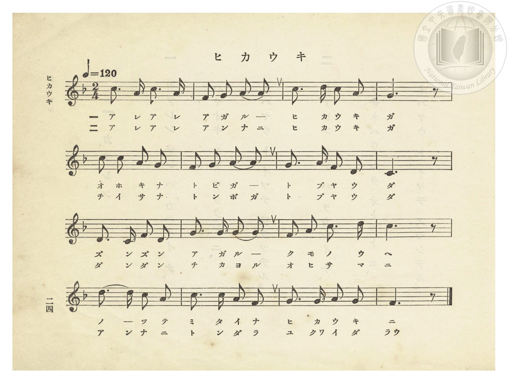
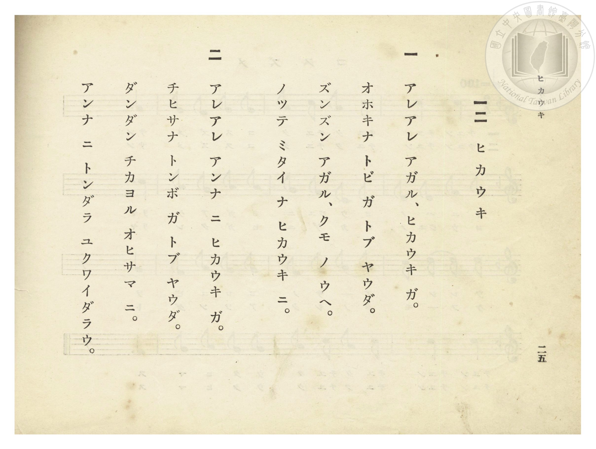

# ヒカウキ（飛機）

> Re:Shōka 使用 AI 協助辨識與重建樂譜，可能會有錯誤。歡迎回報。

- **NEUTRINO 歌聲合成版**：<br><audio controls src="hikoki_neutrino.mp3"></audio>
- **鋼琴伴奏版**：<br><audio controls src="hikoki.mp3"></audio>


- 臺灣總督府《公學校唱歌》第一學年用（昭和九年三月第一版、昭和十一年二月第四版，索書號 0729 73）

## 說明


- 出處：臺灣總督府編《公學校唱歌》第一學年用，第十二課〈ヒカウキ〉（飛機），原書第 24–25 頁（掃描檔 P028.jpg–P029.jpg）。

- 調性與拍號：ヘ長調（F 大調五聲音階），2/4 拍，速度 != 120。

- 背景與曲風：與《新定兒童唱歌》第一學年用第三學期第四首〈ヒカウキ〉同曲同詞（本書第 5 小節第一拍記為兩個八分音符「オホ／チイ」）。描寫飛機如大老鷹（トビ）、小蜻蜓（トンボ）般飛上雲端與太陽旁，展現學童渴望搭乘飛機翱翔天際的嚮往。


## 歌詞

```text
一　アレアレ アガル、ヒカウキ ガ。
オホキナ トビ ガ トブ ヤウダ。
ズンズン アガル、クモ ノ ウヘ。
ノッテ ミタイ ナ ヒカウキ ニ。

二　アレアレ アンナ ニ ヒカウキ ガ。
チヒサナ トンボ ガ トブ ヤウダ。
ダンダン チカヨル オヒサマ ニ。
アンナ ニ トンダラ ユクワイダラウ。
```

## ABC

```abc
X:1
T:ヒカウキ（飛機）
M:2/4
L:1/16
Q:1/4=120
K:F
V:V1 name="Piano" snm="Pia"
[V:V1]
c3 A c3 A | F2 G2 A2 A2 | c3 d c2 A2 | G6 z2 |
w: 1.~ア レ ア レ | ア ガ ル _ | ヒ カ ウ キ | ガ
w: 2.~ア レ ア レ | ア ン ナ ニ | ヒ カ ウ キ | ガ
c2 c2 A2 G2 | F2 G2 A2 A2 | G3 A F2 D2 | C6 z2 |
w: 1.~オ ホ キ ナ | ト ビ ガ _ | ト ブ ヤ ウ | ダ
w: 2.~チ イ サ ナ | ト ン ボ ガ | ト ブ ヤ ウ | ダ
D3 C F2 D2 | G3 G G2 G2 | F2 A2 c3 d | c6 z2 |
w: 1.~ズ ン ズ ン | ア ガ ル _ | ク モ ノ ウ | ヘ
w: 2.~ダ ン ダ ン | チ カ ヨ ル | オ ヒ サ マ | ニ
d3 d c2 A2 | c3 c A2 F2 | G3 G A2 G2 | F6 z2 |
w: 1.~ノ _ ッ テ | ミ タ イ ナ | ヒ カ ウ キ | ニ
w: 2.~ア ン ナ ニ | ト ン ダ ラ | ユ クワ イ ダ | ラウ
```

## TMD 檔案連結

- [主旋律 TMD 檔案](hikoki.tmd) [[在 TMD Studio 編輯](https://tmdlang.github.io/Tmd-TS/#tmd=s7IKdvYPcrWy4qpTUCpJTLdSSM7PyUlNLsnMz7PKzk9PzM7Ojy_OyM9OVIKrKMvPKc1NtUovSkxJjTdEiBfnlxYlp1oVJ2fk5-fEl6RWlCTl52ejy8cXJKanWgUYGFkgZAqK8stS8xLzgLoLijLzSlJTwNoRClLLMlNSQdLFyYl58WWpRZlpmakpSE5KLSoGuRhqRUlRYl5xclFmAcgbCFX5RSUZ-UBnF2RUWmVkFpfkF2UmJ-bEZyfmIfmuJCMV6DmwCQVADUpcWloKj5snPW5a_bhp2eOmte_3dLxcPPvZyvnv93QqaGlxKdoqGBoZcNnbKrhx2Rjpm9iBTHrRvut54-LnO_Y-n7v46a45jxu6nrauebp2x7MFC59O2fhsbc_jhu7na9Y82dEAFHy6c8vzKSuA5j6bsfbppJ4nO-cCRZ7s6Hw2pwOi5nlnx-OGRojs095GkC6ggl09EAVPZ88GKni_p-f5lkXPZu94MXO-goG5kaWCuTHQhUpcXPpaCrbUAlwKCgqPGyY8m73p-ex1L1atejaj73HDRLBo8-6n7btezJz6fs8sNN8_376CuADoAfkG6L9dPS9WbXrc0IEc7I8bOpFDHqj4ad98oHeBWhSMTB41TDYyVXi5oBEUin3Nz_r7n62aogBKZHpZBelAWSDTEsQEan3c0AR18ItV-581LH_R0f6suxcYbECXP26e8XLqdqA40Bw3hadLlgOZT3ZNedG46eX8zS9n9UFsBsayAlALkPWyYf7TXcsUIGkAyeDmnmcz14MMnr3p5SKgz2YB2cAweDZtw9N1s562Tnq-eimuYABzO0FBNWc-JHZfLpuGGRhPJ_QADQeSL1bOA3l6zhpoYJgqPN3Q_3x9A8RYkM9WzHjetOtp68qnDd1PW1c_7WgD-uX5mmWPG3oeN6163Dz7_Z7-x82Nj5uWPG4A-gkUPsDwe7p-NSSwny5rAoVDQ-PL7TuBFj1uBqLJYGWNQItezNn9Yg6QCxHf_Lh5DlDqRccaoN4nO7peAtPJalA4PF2y6uXMvc-mA-On5-nGqc_79wE9CAyEZzu2PJsz-9mEtU92zoBY93z_xuf7pzxdsvLlrNnPZ7U8nbXu6b4GUMhCkx4k1oEhB_T309YVz6a1A41_smMtiLFq3ou164HpEeicpxt6n7V3glIANNqhyUWhQE_ByBToRrB5wAB63NDwuGnR4-Y1EFIBRDWtedy8Gug_5CAHSqyBRTA41EDR0NwFjG1QeIBkIcxpQGoJSEsz2NVg5btAIQMmUY1vWv-4eRFQfR9QGKhhBjwB9T1ubn7c3AZkzX_ctB8YM0AWyCpk5zR3Q5UDfQvxOTCZPZ_T_XRiA4SERMHTvt1PdrWBkio4eJEFgfqfbtj4tLn_6fYVwCgGhjYklp_OWQFUBowFUPpZsRio7MmO3mfTtj-dswEYFyDtve2gAO1tf9qxARjFTzcuebKzGygOVPl8zvxnzZufzp0ARBBngFTOnQBKDE2Ln83bBnEGUCU8DnYBMwFmHIDSEsjL3WjeRsQCMMmCZLbCYwGU-vBGBJAFUgQiwdqBpjavAMYFJEYhZs1DCll0d0DsAGpfCeQAnQOMvvWgbAMWAllFMEKe7psODIaXu_a8bFwAihPUIIHGxgYQAsUGOG9hxsazPTuACBgbL-cueLF_IiRvgYrX1jXQWF3W9GzenBfNe0Hmr1gM0Q4ycOVGoKWgwgZYCO3reNbS-XT_6qcTlkNjA-h0ymsIKFDQ0ufi8sjMzs_OtArITMzLd6gxqKkGWaFgY2imZQdmYauZFCDl1ouFPQoaJtCiTAdekmti0QC0CWRYDbDk0wVCYzhdo2AIpI3AbAiGqTED0xARkDwMGoBEwKb5GNaAoh8sCk2ScDZMBpTUQCKrobqB4s2TIKqaQGlqGZi1FiIDVguD8Qh7jIiwB5hcQWQXmOwmwyb8oQ2sbskMbVgogsIQW2hDwtYYLGMGdoqCKYjCFd6rwD6cDfcNxM8g33aAeZPhoQ4Lb5A4SAac28GyoLAAyTTgDu_mRrBKiPqtWOyBhPccuG2k2kQgdXeSE97g8AMGeTxyaEIC2AhMIyIBFPiwhA5L8tgDfBfUU6CKCcSGeB0pSYJLU6QE3rQerAqSLPugapaBg2EGngCHBBGk3AWx4faAowKajJtXgGVAtiESAyiZQyIJxJsH1gPKAiQEOLAJRVaAQ0MQUVRAQtIUzAOFMyL8UTMBjtCGhhfIH81gsg0aBvOhYbAflijhyRFnJscSBpjFCSi0UQsNWCJGxMNKqAzIdJD5oDoN7gyQEpAkqHLDsK-Wi0vXTgFSxisAWcpcAA)]
- [鋼琴伴奏 TMD 檔案](hikoki_piano.tmd) [[在 TMD Studio 編輯](https://tmdlang.github.io/Tmd-TS/#tmd=s7IKdvYPcrWy4tLSUnjcPOlx0-rHTcseN619v6fj5eLZz1bOf9y8-2X3nucTtjzZs-Xp0v7nnR3v93QqaGlxKdoqGBoZcNnbKrhx2Rjpm9hx1SkovWjf9bxx8fMde5_PXfx015zHDV1PW9c8Xbvj2YKFT6dsfLa253FD9_M1a57saAAKPt255fmUFUCbns1Y-3RSz5Odc4EiT3Z0PpvTAVEDtOxxQyNE9mlvI0gXUMGuHoiCp7Nng13T83zLomezd7yYOV_BwNzIUsHcGOhCJS4uj8zs_OxMq4DMxLz8IA-HGoOaai4FILAxNNOyA7P0tRRs0YECxOoXC3sUNEwUnm7of76-QUchwMDIQi-rIF0TiwYtfbBhNQqmCrpAaAynaxQMgbQRmA3BMDVmYBoiApKHQQOQCNg0H8MahcdNi8Cij5vXoLBhMo-b1oBFVkN1A8WbJ0FUNa0G4mVg1lqIDFgtDMYj7DEiwp7mzWCyC0x2k2ET_tDe1UNuaMNCERSG2EIbErbGYBkzsFMUTEEUrvBeBfbhbLhvIH4G-bYDzJsMD3VYeIPEQTLTgHgJWBYUFiCZBtzh3dwIVglRvxWLPZDwngO3jVSbCKTuTnLCGxx-wCCPRw5NSAAbgWlEJIACH5bQYUkee4DvgnpqM5QN8TpSkgR6HyWBN60Hq4Ikyz6ommXgYJiBJ8AhQQS2B8yG2wOOCmgybl4BlgHZhkgMoGQOiSQQbx5YDygLkBDgwIKKrACHhiCiqICEpCmYBwpnRPijZgIcoQ0NL5A_msFkGzQM5kPDYD8sUcKTI85MjiUMMIsTUGijFhqwRIyIh5VQGZDpIPPXP25eD3cGSAlIciXEdlT7alGLeB_kIt4CWsLXKEQbxgJVQ0gCPNN4EAMUbBDPwBVAJHCojzaByWLRD5FDV4JuoAkyD1U_QeeimQXRDQwaXTsFSOhE-4AkEDwjME-ZCwA)]

## 分析

```text
================================================================================
📊 TMD Song Profile: [ ヒカウキ（飛機） ]
================================================================================
⏱  Duration:       0:16 (16.0s), 16 measures total
🎼 Key & Tempo:    首調基準 F, != 120.0 BPM, <2/4>
   - 分析範圍：      由實際發聲的音符與和弦推測調性；播放脈絡另行呈現
🎤 人聲音域:    C4 (MIDI 60) – D5 (MIDI 74) [跨度: 14 個半音 / 1.2 個八度, 難度: moderate]
   - 最低音:  C4 in [Hikoki #1 @ m.8, 0:07]
   - 最高音: D5 in [Hikoki #1 @ m.3, 0:02]
   - 適合: soprano, mezzo-soprano, contralto, tenor, baritone, bass
🏛  結構:      Hikoki (16.0s)
⚡ 編曲密度:        Peak 1 軌道同時演奏
🗝  調性診斷：       C 大調（純淨自然大調，未偵測到可信轉調）
   - 風格氣質:    純淨自然大調（陽光明朗、易唱易記，無明顯調外色彩）
   - 轉調歷程:    全曲維持單一推測調性（未偵測到可信轉調）
   - 核心骨幹音:  C, G, A, F, D
   - 調性數值:    C 大調 [相關度: 0.86, 穩定度: High, 自然音純度: 100.0%]
   - 候選調性 (K-S): C 大調 (0.86), F 大調 (0.70), A 小調 (0.63)
   - 五度圈歷程:   +0
   - 各段落調性細節:
     • [Hikoki #1]: C 大調 (r: 0.86, 自然音純度: 100.0%)

  [ 五度圈游移軌跡 ]
              [C ]*
         F            G  
      Bb               D  
      Eb               A  
         Ab           E  
            Db       B  
               F# 
     (* = active key center)

  [ 十二半音累積音高分佈 ]
     C  : ████████████████████████  30.8%
     C# :                            0.0%
     D  : ████████                  10.8%
     D# :                            0.0%
     E  :                            0.0%
     F  : ████████████              15.0%
     F# :                            0.0%
     G  : ███████████████████       24.2%
     G# :                            0.0%
     A  : ███████████████           19.2%
     A# :                            0.0%
     B  :                            0.0%
--------------------------------------------------------------------------------
Assignment 軌道音域：
  - Piano         : C4 – D5 (14 個半音 / 1.2 個八度, 52 個音符)
================================================================================
```


## 原書掃描頁






