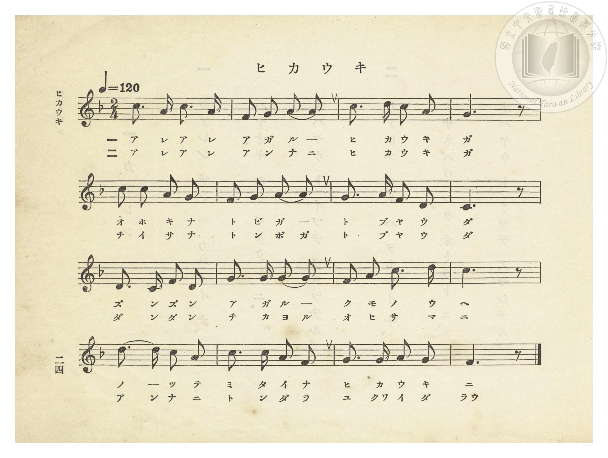
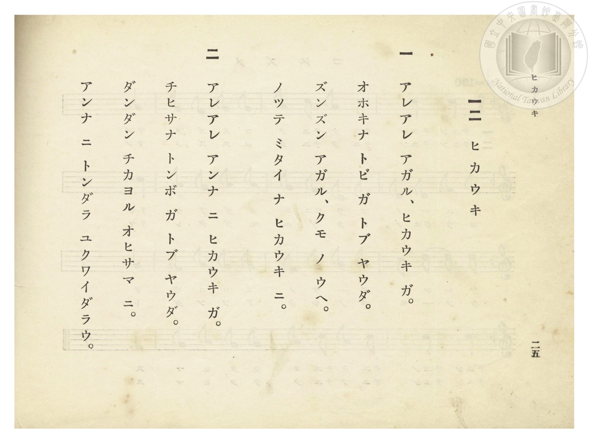

# ヒカウキ（飛機）

> Re:Shōka 使用 AI 協助辨識與重建樂譜，可能會有錯誤。歡迎[回報](https://github.com/TMDLang/reshoka/issues)。

- **鋼琴伴奏版**：<br><audio controls src="hikoki.mp3"></audio>
- **NEUTRINO 歌聲合成版**：<br><audio controls src="hikoki_neutrino.mp3"></audio>

- 臺灣總督府《公學校唱歌》第一學年用（昭和九年三月第一版、昭和十一年二月第四版，索書號 0729 73）

## 說明


- 出處：臺灣總督府編《公學校唱歌》第一學年用，第十二課〈ヒカウキ〉（飛機），原書第 24–25 頁（掃描檔 P028.jpg–P029.jpg）。
- 調性與拍號：ヘ長調（F 大調五聲音階），2/4 拍，速度 != 120。
- 背景與曲風：與《新定兒童唱歌》第一學年用第三學期第四首〈ヒカウキ〉同曲同詞（本書第 5 小節第一拍記為兩個八分音符「オホ／チイ」）。描寫飛機如大老鷹（トビ）、小蜻蜓（トンボ）般飛上雲端與太陽旁，展現學童渴望搭乘飛機翱翔天際的嚮往。


## 歌詞

```text
一　アレアレ アガル、ヒカウキ ガ。
オホキナ トビ ガ トブ ヤウダ。
ズンズン アガル、クモ ノ ウヘ。
ノッテ ミタイ ナ ヒカウキ ニ。

二　アレアレ アンナ ニ ヒカウキ ガ。
チヒサナ トンボ ガ トブ ヤウダ。
ダンダン チカヨル オヒサマ ニ。
アンナ ニ トンダラ ユクワイダラウ。
```

## ABC

<div class="abc-score" data-abc-src="hikoki.abc" aria-label="五線譜載入中"></div>

[下載 ABC 原始檔](hikoki.abc)

## TMD 檔案連結

- [主旋律 TMD 檔案](hikoki.tmd) [[在 TMD Studio 編輯](https://tmdlang.github.io/Tmd-TS/#tmd=s7IKdvYPcrWy4qpTUCpJTLdSSM7PyUlNLsnMz7PKzk9PzM7Ojy_OyM9OVIKrKMvPKc1NtUovSkxJjTdEiBfnlxYlp1oVJ2fk5-fEl6RWlCTl52ejy8cXJKanWgUYGFkgZAqK8stS8xLzgLoLijLzSlJTwNoRClLLMlNSQdLFyYl58WWpRZlpmakpSE5KLSoGuRhqRUlRYl5xclFmAcgbCFX5RSUZ-UBnF2RUWmVkFpfkF2UmJ-bEZyfmIfmuJCMV6DmwCQVADci6M9Mz86xKEjPLgW7IT0vLTM5MzFHi0tJSeNw86XHT6sdNyx43rX2_p-Pl4tnPVs5_v6dTQUuLS9FWwdDIgMveVsGNy8ZI38QOZOCL9l3PGxc_37H3-dzFT3fNedzQ9bR1zdO1O54tWPh0ysZna3seN3Q_X7PmyY4GoODTnVueT1kBNPfZjLVPJ_U82TkXKPJkR-ezOR0QNc87Ox43NEJkn_Y2gnQBFezqgSh4Ons2UMH7PT3Ptyx6NnvHi5nzFQzMjSwVzI2BLlTi4tLXUrClFuBSUFB43DDh2exNz2eve7Fq1bMZfY8bJoJFm3c_bd_1YubU93tmofn--fYVxAVAD8g3QP_t6nmxatPjhg7kYH_c0Ikc8kDFT_vmA70L1KJgZPKoYbKRqcLLBY2gUOxrftbf_2zVFAVQItTLKkgHygKZliAmUOvjhiaog1-s2v-sYfmLjvZn3b3AYAO6_HHzjJdTtwPFgea4KTxdshzIfLJryovGTS_nb345qw9iMzCWFYBagKyXDfOf7lqmAEkDSAY39zybuR5k8OxNLxcBfTYLyAaGwbNpG56um_W0ddLz1UtxBQOY2wkKqjnzIbH7ctk0zMB4OqEHaDiQfLFyHsjTc9ZAA8NU4emG_ufrGyDGgny2Ysbzpl1PW1c-beh-2rr6aUcb0C_P1yx73NDzuGnV4-bZ7_f0P25ufNy05HED0E-g8AGG39P1qyGB_XRZEygcGhpfbt8JtOhxMxBNBitrBFr0Ys7uF3OAXIj45sfNc4BSLzrWAPU-2dH1EphOVoPC4emSVS9n7n02HRg_PU83Tn3evw_oQWAgPNux5dmc2c8mrH2ycwbEuuf7Nz7fP-XpkpUvZ81-Pqvl6ax1T_c1gEIWmvQgsQ4MOaC_n7aueDatHWj8kx1rQYxV816sXQ9Mj0DnPN3Q-6y9E5QCoNEOTS4KBXoKRqZAN4LNAwbQ44aGx02LHjevgZAKIKppzePm1UD_IQc5UGINLILBoQaKhuYuYGyDwgMkC2FOA1JLQFqawa4GK98FChkwiWp80_rHzYuA6vuAwkANM-AJqO9xc_Pj5jYga_7jpv3AmAGyQFYhO6e5G6oc6FuIz4HJ7Pmc7qcTGyAkJAqe9u1-sqsNlFTBwYssCNT_dMPGp839T7evAEYxMLQhsfx0zgqgMmAsgNLPisVAZU929D6btv3pnA3AuABp720HBWhv-9OODcAofrpxyZOd3UBxoMrnc-Y_a978dO4EIII4A6Ry7gRQYmha_GzeNogzgCrhcbALmAkw4wCUlkBe7kbzNiIWgEkWJLMVHgug1Ic3IoAskCIQCdYONLV5BTAuIDEKMWseUsiiuwNiB1D7SiAH6Bxg9K0HZRuwEMgqghHydN90YDC83LXnZeMCUJygBgk0NjaAECg2wHkLMzae7dkBRMDYeDl3wYv9EyF5C1S8tq6Bxuqypmfz5rxo3gsyf8ViiHaQgSs3Ai0FFTbAQmhfx7OWzqf7Vz-dsBwaG0CnU15DQIGClj4Xl0dmdn52plVAZmJevkONQU01yAoFG0MzLTswC1vNpAApt14s7FHQMIEWZTrwklwTiwagTSDDaoAlny4QGsPpGgVDIG0EZkMwTI0ZmIaIgORh0AAkAjbNx7AGFP1gUWiShLNhMqCkBhJZDdUNFG-eBFHVBEpTy8CstRAZsFoYjEfYY0SEPcDkCiK7wGQ3GTbhD21gdUtmaMNCERSG2EIbErbGYBkzsFMUTEEUrvBeBfbhbLhvIH4G-bYDzJsMD3VYeIPEQTLg3A6WBYUFSKYBd3g3N4JVQtRvxWIPJLznwG0j1SYCqbuTnPAGhx8wyOORQxMSwEZgGhEJoMCHJXRYksce4LugngJVTCA2xOtISRJcmiIl8Kb1YFWQZNkHVbMMHAwz8AQ4JIgg5S6IDbcHHBXQZNy8AiwDsg2RGEDJHBJJIN48sB5QFiAhwIFNKLICHBqCiKICEpKmYB4onBHhj5oJcIQ2NLxA_mgGk23QMJgPDYP9sEQJT444MzmWMMAsTkChjVpowBIxIh5WQmVApoPMB9VpcGeAlIAkQZUbhn21XFy6dgqQMl4ByFLmAgA)]
- [鋼琴伴奏 TMD 檔案](hikoki_piano.tmd) [[在 TMD Studio 編輯](https://tmdlang.github.io/Tmd-TS/#tmd=s7IKdvYPcrWy4qpTUCpJTLdSSM7PyUlNLsnMz7PKzk9PzM7Ojy_OyM9OVIKrKMvPKc1NtTJEiBTnlxYlp-JSD5GNL0hMT7UKMDCy0AUSlgjpgqL8stS8xDygASWJmeWJefHpQIGivPyi-PTUvNSixByE2tSyzJRUkMqCoszcxKLK-JT8ZKBb8kqQXJdaVAxyfEFmYl5-fGJRUWJeeiqqkvyikoz89KLEgoxKq4zM4pL8oszkxJz47MQ8JFeXZAB1WaWmlCYnggJDiUtLS-Fx86THTasfNy173LT2_Z6Ol4tnP1s5_3Hz7pfde55P2PJkz5anS_ufd3a839OpoKXFpWirYGhkwGVvq-DGZWOkb2IHMvtF-67njYuf79j7fO7ip7vmPG7oetq65unaHc8WLHw6ZeOztT2PG7qfr1nzZEcDUPDpzi3Pp6wA2vRsxtqnk3qe7JwLFHmyo_PZnA6IGqBljxsaIbJPextBuoAKdvVAFDydPRvsmp7nWxY9m73jxcz5CgbmRpYK5sZAFypxcXlkZudnZ1oFgEIqyMOhxqCmmksBCGwMzbTswCx9LQVbdKAAsfrFwh4FDROFpxv6n69v0FEARaxeVkG6JhYNWvpgw2oUTBV0gdAYTtcoGAJpIzAbgmFqzMA0RAQkD4MGIBGwaT6GNQqPmxaBRR83r0Fhw2QeN60Bi6yG6gaKN0-CqGpaDcTLwKy1EBmwWhiMR9hjRIQ9zZvBZBeY7CbDJvyhvauH3NCGhSIoDLGFNiRsjcEyZmCnKJiCKFzhvQrsw9lw30D8DPJtB5g3GR7qsPAGiYNkpgHxErAsKCxAMg24w7u5EawSon4rFnsg4T0HbhupNhFI3Z3khDc4_IBBHo8cmpAANgLTiEgABT4socOSPPYA3wX11GYoG-J1pCQJ9D5KAm9aD1YFSZZ9UDXLwMEwA0-AQ4IIbA-YDbcHHBXQZNy8AiwDsg2RGEDJHBJJIN48sB5QFiAhwIEFFVkBDg1BRFEBCUlTMA8UzojwR80EOEIbGl4gfzSDyTZoGMyHhsF-WKKEJ0ecmRxLGGAWJ6DQRi00YIkYEQ8roTIg02E2QdwAkgfJrIRYjWpZLWr57oNcvltAi_cahWjDWKBqCEmAZxoPYoDCDOITuAKIBA710SYwWSz6IXLoStANNEHmoeon6Fw0syC6gUGja6cACZ1oH5AEgmcE5ilzAQA)]

## 分析

```text
================================================================================
📊 TMD Song Profile: [ ヒカウキ（飛機） ]
================================================================================
⏱  Duration:       0:16 (16.0s), 16 measures total
🎼 Key & Tempo:    首調基準 F, != 120.0 BPM, <2/4>
   - 分析範圍：      由實際發聲的音符與和弦推測調性；播放脈絡另行呈現
🎤 人聲音域:    C4 (MIDI 60) – D5 (MIDI 74) [跨度: 14 個半音 / 1.2 個八度, 難度: moderate]
   - 最低音:  C4 in [Hikoki #1 @ m.8, 0:07]
   - 最高音: D5 in [Hikoki #1 @ m.3, 0:02]
   - 適合: soprano, mezzo-soprano, contralto, tenor, baritone, bass
🏛  結構:      Hikoki (16.0s)
⚡ 編曲密度:        Peak 1 軌道同時演奏
🗝  調性診斷：       C 大調（純淨自然大調，未偵測到可信轉調）
   - 風格氣質:    純淨自然大調（陽光明朗、易唱易記，無明顯調外色彩）
   - 轉調歷程:    全曲維持單一推測調性（未偵測到可信轉調）
   - 核心骨幹音:  C, G, A, F, D
   - 調性數值:    C 大調 [相關度: 0.86, 穩定度: High, 自然音純度: 100.0%]
   - 候選調性 (K-S): C 大調 (0.86), F 大調 (0.70), A 小調 (0.63)
   - 五度圈歷程:   +0
   - 各段落調性細節:
     • [Hikoki #1]: C 大調 (r: 0.86, 自然音純度: 100.0%)

  [ 五度圈游移軌跡 ]
              [C ]*
         F            G  
      Bb               D  
      Eb               A  
         Ab           E  
            Db       B  
               F# 
     (* = active key center)

  [ 十二半音累積音高分佈 ]
     C  : ████████████████████████  30.8%
     C# :                            0.0%
     D  : ████████                  10.8%
     D# :                            0.0%
     E  :                            0.0%
     F  : ████████████              15.0%
     F# :                            0.0%
     G  : ███████████████████       24.2%
     G# :                            0.0%
     A  : ███████████████           19.2%
     A# :                            0.0%
     B  :                            0.0%
--------------------------------------------------------------------------------
Assignment 軌道音域：
  - Piano         : C4 – D5 (14 個半音 / 1.2 個八度, 52 個音符)
================================================================================
```


## 原書掃描頁






