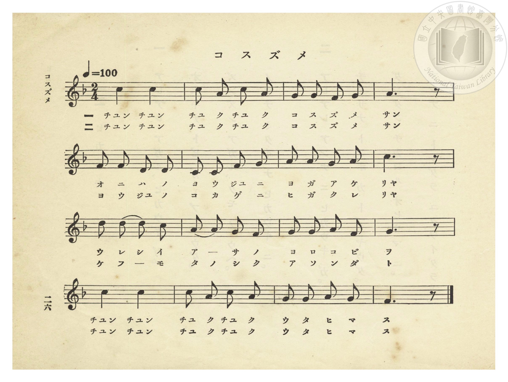
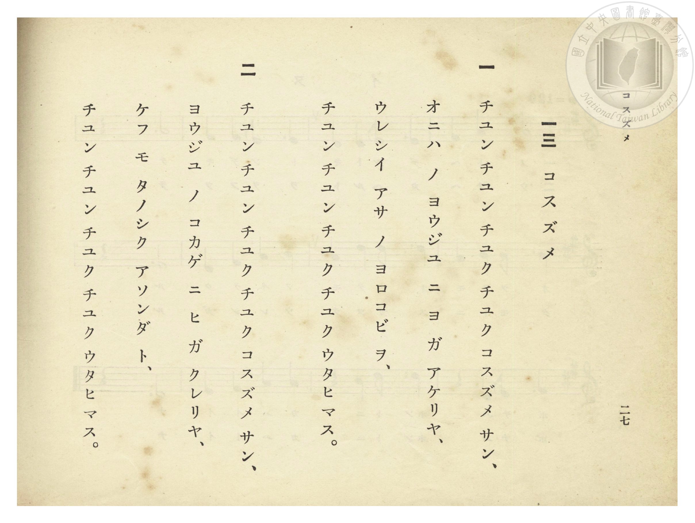

# コスズメ（小麻雀）

> Re:Shōka 使用 AI 協助辨識與重建樂譜，可能會有錯誤。歡迎回報。

- **NEUTRINO 歌聲合成版**：<br><audio controls src="kosuzume_neutrino.mp3"></audio>
- **鋼琴伴奏版**：<br><audio controls src="kosuzume.mp3"></audio>


- 杉内一喜 作詞（懸賞募集入選原題〈子すずめ〉）
- 臺灣總督府《公學校唱歌》第一學年用（昭和九年三月第一版、昭和十一年二月第四版，索書號 0729 73）

## 說明


- 出處：臺灣總督府編《公學校唱歌》第一學年用，第十三課〈コスズメ〉（小麻雀），原書第 26–27 頁（掃描檔 P030.jpg–P031.jpg）。
- 調性與拍號：ヘ長調（F 大調五聲音階），2/4 拍，速度 != 100。
- 背景與曲風：臺灣總督府專為臺灣學童編纂之**臺灣鄉土特色童謠**。歌詞特別融入臺灣庭院與校舍最常見的**榕樹（ヨウジユ）**：第一節寫破曉時分，庭院榕樹上的小麻雀「チユン チユン チユク チユク」歡唱清晨的喜悅；第二節寫日落黃昏時，在榕樹濃蔭下歌唱「今天也快樂地玩了一整天」。


## 歌詞

```text
一　チユン チユン チユク チユク コスズメ サン、
オニハ ノ ヨウジユ ニ ヨ ガ アケリヤ、
ウレシイ アサ ノ ヨロコビ ヲ、
チユン チユン チユク チユク ウタヒマス。

二　チユン チユン チユク チユク コスズメ サン、
ヨウジユ ノ コカゲ ニ ヒ ガ クレリヤ、
ケフ モ タノシク アソンダ ト、
チユン チユン チユク チユク ウタヒマス。
```

## ABC

```abc
X:1
T:コスズメ（小麻雀）
M:2/4
L:1/16
Q:1/4=100
K:F
V:V1 name="Piano" snm="Pia"
[V:V1]
c4 c4 | c2 A2 c2 A2 | G2 G2 F2 G2 | A6 z2 |
w: 1.~チユン チユン | チユ ク チユ ク | コ ス ズ メ | サン
w: 2.~チユン チユン | チユ ク チユ ク | コ ス ズ メ | サン
A2 A2 G2 F2 | D2 D2 F2 G2 | A2 A2 A2 G2 | c6 z2 |
w: 1.~オ ニ ハ ノ | ヨ ウ ジユ ニ | ヨ ガ ア ケ | リヤ
w: 2.~ヨ ウ ジユ ノ | コ カ ゲ ニ | ヒ ガ ク レ | リヤ
d2 d2 d2 c2 | A2 A2 G2 F2 | G2 G2 A2 F2 | G6 z2 |
w: 1.~ウ レ シ イ | ア _ サ ノ | ヨ ロ コ ビ | ヲ
w: 2.~ケ フ _ モ | タ ノ シ ク | ア ソ ン ダ | ト
c4 c4 | d2 c2 d2 c2 | A2 A2 G2 A2 | F6 z2 |
w: 1.~チユン チユン | チユ ク チユ ク | ウ タ ヒ マ | ス
w: 2.~チユン チユン | チユ ク チユ ク | ウ タ ヒ マ | ス
```

## TMD 檔案連結

- [主旋律 TMD 檔案](kosuzume.tmd) [[在 TMD Studio 編輯](https://tmdlang.github.io/Tmd-TS/#tmd=s7IKdvYPcrWy4qpTUCpJTLdSSM7PyUlNLsnMz7PKzk9PzM7Ojy_OyM9OVIKrKMvPKc1NtUovSkxJjTdEiBfnlxYlp1oVJ2fk5-fEl6RWlCTl52ejy8cXJKanWgUYGBsgZAqK8stS8xLzgLoLijLzSlJTwNoRClLLMlNSQdLFyYl58WWpRZlpmakpSE5KLSoGuRhqRUlRYl5xclFmAcgbCFX5RSUZ-UBnF2RUWmVkFpfkF2UmJ-bEZyfmIfmuJCMV6LnEvMzcxBwlLi0thcdNmx837XzctOtx88L3ezqebuh_uWv3y9kN7_d0KmhpcSnaKhgaGHDZ2yq4cdkY6ZvYgUx6NrfzaVvrkx0NT6fNUXiyd86LlfOAWp-173ixed7T7vkvZ7c9bV36snHH0775Lxf2PG7oeLp2wuPGmY8bZz1uanzc0Ak0G-yiF-27njcufr5j7_O5i5_umvO4oetp65qna3c8W7Dw6ZSNz9YCtXY_X7MGZNHaHU93bnk-ZQXInhlrn07qebJzLlDkyY7OZ3M6IGqed3Y8bmiEyD7tbQTpAirY1QNR8HT2bKCC93t6nm9Z9Gz2jhcz5ysYmBtZKpgbg13Dpa-lYEstwKWgoPC4YcKz2Zuez173YtWqZzP6HjdMBIs2737avuvFzKnv98xC8_3z7SuIC4AekG9A_ut8sWoTMHCRYxAcuCiRCFQPjAagj4G6FIzMHjVMNjJXeLmgERSQfc3P-vufrZqiAEqvelkF6UBZINMQxARqfdzQBHXzi1X7nzUsf9HR_qy7FxhyQMc_bp7xcup2oDjQHDeFp0uWA5lPdk150bjp5fzNL2f1QWwGJhgFoBYg62XD_Ke7lilAkhOSwc09z2auBxk8e9PLRUDPoYfK0w0dz5t2QQSBYfB89VJgOD3f1fRkZ7eWFkT4ZUvn0znzn3fufNG5CSj_Ys0CLS2gDcDQA6ZLoPDTjqUv5vUCUyTUlF1rX85cBLJywcIXHb3P5jQ83bHjxbLu57NatLSeLZv6bMVOoJ8eN6943LTscdOOx83LgH7R0gI6DZrM1jc8Xb_6-YItz2Z3PpvZ9LSjDRTEYEMhup_s6AKaBY-Dxw09j5sbgcY8bt4M9DIaq2k9gvW4offZWnDE72h9NnMFyJBpc541tb7fMxtk9a4eiNXPpi99MWHvy93Nz2b0Ax0Asn3OCojVz_Y3v5iy9smObqDngeYArX6yu-vpkpVPds5_un_1sxVNT-dseN638smuNqBHnk3dApQCWgqKDmiShSQVSNA9bV3xbFo7MKCe7FgLYqya92It0I0TwQms91l7JyjZQNMKNI0pFOgpGJkDwwtsHtCOxw0NRHoepSACcrYC1QGzM9hdTaseN3c_bu4Hqu4DYkTMADndIAGgkjVAvOhx08bHzUDFS-A6gdatedy0_XHTEoj8VrgZzWtBNjZPBnKAuQiinGinAqn9j5snPW6eB3IzJDkDwwUSRsCk8nTqPiACGgtiTJoKIUHBBEsVTycCM2fP86nbICkHGNeQGHyxv-_JvjZI6gLGDrDkACp7sm8_VgOBsQmMZWCB8mzNYmBSARkyc8XLaZOBqQgY10BnwWNiF7AkoUZMoIY9MCBBSlc_btoEjYlJ0JhYDwp21JgAxsxUoIpFQCYw6PrAkQKyCxgpe0E2NDcAZUEl-EDFBDQLAeMAnIWeLpn6cubeF0v3P9sEKsrwx8GLidORM9vLad1P9zfjymygWAG6kvJ6BgoUtPS5uLzzi0urQA2XgMzEvHyHGoOaapAlCjYWWnZgBrYKTgFSpL1Y2KOgYaIADBJgCaMDrw00sWgAWgUyrEbBVEEXjEEsYzCuUTACQkMgrgHydIHQQKEGrNrHsAYpHnVR2DAZUKJBZgLFm4Bx3rQTiHcBJRaCRUBpEdVoI5oYjT_EdvWQE2LGQAgKnxoFs3gQgoUURBwSomhh1rQKmq8gRR_IQ6CyDuQNePEHEwQXgKB8BhYBZT0sAYWmG2wkOCxWAzEkE4OUwbMxkL0G0zwC6amTnNAxA0NTlHACpSdjKAszbEAeADlyOxAvAXtkESgBQIt4qG-b10I8CCznQSKbMMMEGGCgkgmUdBaBTdkPLdlA5kISCyhY9wJFQeY0gM3pIC4sgI1OyvIWKESQQwWUywypkrdALJBPgVHdPA8sspMqGQufubVcXLp2CrCSSgHIVuYCAA)]
- [鋼琴伴奏 TMD 檔案](kosuzume_piano.tmd) [[在 TMD Studio 編輯](https://tmdlang.github.io/Tmd-TS/#tmd=s7IKdvYPcrWy4tLSUnjctPlx087HTbseNy98v6fj6Yb-l7t2v5zd8Lh598vuPc8nbHmyZ8vTpf3POzve7-lU0NLiUrRVMDQw4LK3VXDjsjHSN7HjqlNQetG-63nj4uc79j6fu_jprjmPG7qetq55unbHswULn07Z-Gxtz-OG7udr1jzZ0QAUfLpzy_MpK4CWPZux9umknic75wJFnuzofDanA6IGaNnjhkaI7NPeRpAuoIJdPRAFT2fPBrum5_mWRc9m73gxc76CgbmRpYK5MdCFSlxcnnklRflWAZmJeflBHg41BjXVXApAYGOhZQdm1CiYKuiCcY2CGZAG4RoFYyA0AuIaBUOgjK6CgUINVy2KYT7IhpnADTOMV4g2jAUyTGAMkIhpPJQFNcc7v7i0qjQ3FY-79LUUbNGBAiRAXizsUdAwUQBGzvP1DToKAQbGBnpZBemaWDRo6WN40hToLRCuAXrQCOg9I7B3YZ4EqfYxrFF43Nz4uHnZ4-bNQHFkNkwGmFLWIzOB4k2bgXgnEO8CSiwEi2yFaEIy2ogmRuMPsV095IQYJAkYgpJFPAjBQgoiDglRtDBrWgV0XjcQ9wNxH9hDK4CiIG_sAPsGKAkTXAPEi4B4I1hk1ePmJVgCCk032EhwWKwG4k1w8yZBzQMF2xpM8wikp05yQscMDBFZBRROoPRkDGVhhg3IAyBHbgfiJWCPLAIlgKatyGHVvBbiwebJYJFNmGECDLDHzVPBSWcR2JT9YP0QcyGJBRSse4GiIHMawOZ0EBcWwLKEsryFvwChJG-BWCCfAqO6eR5YZCdVMhY-czEKKkJlHpxhGo9e6KGpNAMpwF48QlSiFJ8IM-EsLGbiLXF17RTAhbcCkAHzVLQPUDkK3wjMV-YCAA)]

## 分析

```text
================================================================================
📊 TMD Song Profile: [ コスズメ（小麻雀） ]
================================================================================
⏱  Duration:       0:19 (19.2s), 16 measures total
🎼 Key & Tempo:    首調基準 F, != 100.0 BPM, <2/4>
   - 分析範圍：      由實際發聲的音符與和弦推測調性；播放脈絡另行呈現
🎤 人聲音域:    D4 (MIDI 62) – D5 (MIDI 74) [跨度: 12 個半音 / 1.0 個八度, 難度: easy]
   - 最低音:  D4 in [Kosuzume #1 @ m.6, 0:06]
   - 最高音: D5 in [Kosuzume #1 @ m.9, 0:09]
   - 適合: soprano, mezzo-soprano, contralto, tenor, baritone, bass
🏛  結構:      Kosuzume (19.2s)
⚡ 編曲密度:        Peak 1 軌道同時演奏
🗝  調性診斷：       C 大調（純淨自然大調，未偵測到可信轉調）
   - 風格氣質:    純淨自然大調（陽光明朗、易唱易記，無明顯調外色彩）
   - 轉調歷程:    全曲維持單一推測調性（未偵測到可信轉調）
   - 核心骨幹音:  C, A, G, F, D
   - 調性數值:    C 大調 [相關度: 0.78, 穩定度: Moderate, 自然音純度: 100.0%]
   - 候選調性 (K-S): C 大調 (0.78), A 小調 (0.73), F 大調 (0.68)
   - 五度圈歷程:   +0
   - 各段落調性細節:
     • [Kosuzume #1]: C 大調 (r: 0.78, 自然音純度: 100.0%)

  [ 五度圈游移軌跡 ]
              [C ]*
         F            G  
      Bb               D  
      Eb               A  
         Ab           E  
            Db       B  
               F# 
     (* = active key center)

  [ 十二半音累積音高分佈 ]
     C  : ████████████████████████  26.7%
     C# :                            0.0%
     D  : ███████████               11.7%
     D# :                            0.0%
     E  :                            0.0%
     F  : ████████████              13.3%
     F# :                            0.0%
     G  : ████████████████████      21.7%
     G# :                            0.0%
     A  : ████████████████████████  26.7%
     A# :                            0.0%
     B  :                            0.0%
--------------------------------------------------------------------------------
Assignment 軌道音域：
  - Piano         : D4 – D5 (12 個半音 / 1.0 個八度, 48 個音符)
================================================================================
```


## 原書掃描頁






