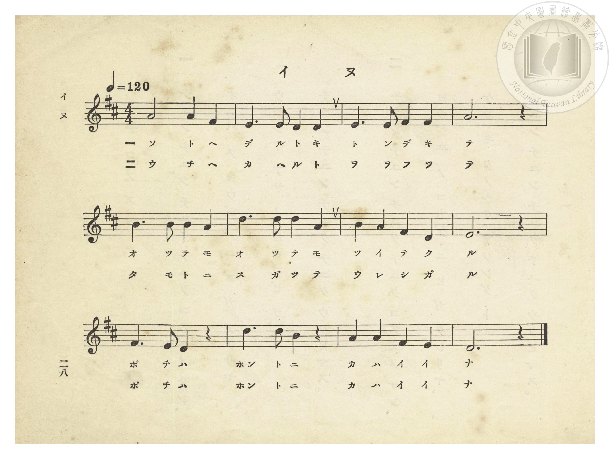
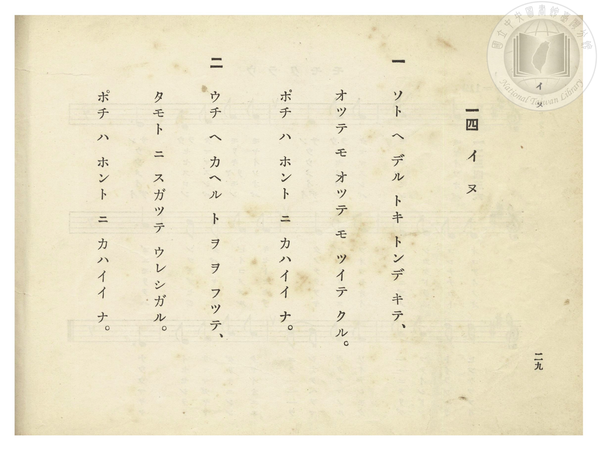

# イヌ（小狗）

> Re:Shōka 使用 AI 協助辨識與重建樂譜，可能會有錯誤。歡迎回報。

- **鋼琴伴奏版**：<br><audio controls src="inu.mp3"></audio>
- **NEUTRINO 歌聲合成版**：<br><audio controls src="inu_neutrino.mp3"></audio>

- 詞：文部省《尋常小學唱歌》
- 曲：文部省《尋常小學唱歌》
- 臺灣總督府《公學校唱歌》第一學年用（昭和九年三月第一版、昭和十一年二月第四版，索書號 0729 73）

## 說明


- 出處：臺灣總督府編《公學校唱歌》第一學年用，第十四課〈イヌ〉（小狗），原書第 28–29 頁（掃描檔 P032.jpg–P033.jpg）。
- 調性與拍號：ニ長調（D 大調），4/4 拍，速度 != 120。
- 背景與曲風：原出自明治 44 年（1911）文部省《尋常小學唱歌（一）》〈犬〉，亦收錄於大正 4 年《公學校唱歌集》第一學年第四首及《新定兒童唱歌》第一學年用第一學期第四首。


## 歌詞

```text
一　ソト ヘ デル トキ トンデ キテ、
オッテ モ オッテ モ ツイテ クル。
ポチ ハ ホント ニ カハイイ ナ。

二　ウチ ヘ カヘル ト ヲ ヲ フッテ、
タモト ニ スガッテ ウレシガル。
ポチ ハ ホント ニ カハイイ ナ。
```

## ABC

```abc
X:1
T:イヌ（小狗）
C:曲：文部省《尋常小學唱歌》
M:4/4
L:1/16
Q:1/4=120
K:D
V:V1 name="Piano" snm="Pia"
[V:V1]
A8 A4 F4 | E6 E2 D4 D4 | E6 E2 F4 F4 | A12 z4 |
w: 1.~ソ ト ヘ | デ ル ト キ | ト ン デ キ | テ
w: 2.~ウ チ ヘ | カ ヘ ル ト | ヲ ヲ フ ッ | テ
B6 B2 B4 A4 | d6 d2 d4 A4 | B4 A4 F4 D4 | E12 z4 |
w: 1.~オ ッ テ モ | オ ッ テ モ | ツ イ テ ク | ル
w: 2.~タ モ ト ニ | ス ガ ッ テ | ウ レ シ ガ | ル
F6 E2 D4 z4 | d6 d2 B4 z4 | A4 A4 F4 E4 | D12 z4 |
w: 1.~ポ チ ハ | ホン ト ニ | カ ハ イ イ | ナ
w: 2.~ポ チ ハ | ホン ト ニ | カ ハ イ イ | ナ
```

## TMD 檔案連結

- [主旋律 TMD 檔案](inu.tmd) [[在 TMD Studio 編輯](https://tmdlang.github.io/Tmd-TS/#tmd=s7IKdvYPcrWy4qpTUCpJTLdSSM7PyUlNLsnMz7PKzk9PzM7Ojy_OyM9OVIKrKMvPKc1NtUovSkxJjTdEiBfnlxYlp1oVJ2fk5-fEl6RWlCTl52ejy8cXJKanWgUYGBshZAqK8stS8xLzgLoLijLzSlJTwNoRClLLMlNSQdLFyYl58WWpRZlpmakpSE5KLSoGuRhqRUlRYl5xclFmAcgbCFX5RSUZ-UBnF2RUWmVkFpfkF2UmJ-bEZyfmIfmuJCMV6LnEvMzcxBxkrZnpmXlWufl5SaXA4FDi0tJSeNy05HFzz_s9HU839D_vnv5-T6eClhaXoq2CoZEBl72tgguXjYm-iR3IjBcr573fM-vZtPaXzSuez2l83ND1dEP30x07gDqfrt3xdMrGZ2t7Hjd0g-17NnsT0WpftO963rj4-Y69z-cufrprDkht6xqgqmcLFsIVPl-z5smOBpDWnVueT1kBdO-zGWufTup5snMuUOTJjs5nczogap53djxuaITIPu1tBOkCKtjVA1HwdPZsoIL3e3qeb1n0bPaOFzPnKxiYG1kqmBsDfa7ExaWvpWBLLcCloKDwuGECMCiez173YtWqZzP6HjdMBIs2737avuvFzKnAMELz_fPtK4gLgB6Qb3obgR56sWrT44YOSEQ-buhEjkugsqd984EeBSpWMLJ41DAZ6NeXCxpB4dfX_Ky__9mqKQqgZKyXVZAOlAUyjUFMoNbHDU1Qp75Ytf9Zw_IXHe3PunuBAQZ08-Pm7pdTtwPFgea4KDxdshzMBNkGTCsKQGVA1suG-U93LVOApCQkw5p7ns1cDzJs9qaXi4D-mAV0ICgw2kHh82zTbgUTEwWgH4EmG1oaGgJNxZ-IgOqA4QJ2bzcwFJ53rQEHQc-TXcueTdn2sqfl2bQ9QAc-W7tYAWwuZuC-nN2GHr7gdPJy2bSn_V1A9c-mbXi6btbT1knPVy_FFR9w7rM58-HaQb6GJgJILAC1AjPR09YVQD8Bg-DJjrUgxqp5L9auB6YMcMT1PmvvBMUINBqg0adQoKdgZAn0Jdg8oE2PGxoeN-193NwBDNMZQNz-uHk1kAKmgrVgqnkzUAyYudc-bgb6rhHsiqZVj5ubgXyggkXovOYWcPoB8prWA42Cx9fcx82NQKofiGeDDQVZ2A1UtRooCNLStAQoAAwlsHqgDyC-AUVr-66X0xqez2p5NrPpacPMl4tnP1065WVj35N9bUBvPWvoe7lrz4ttU5_snA8id_S-2Lrh6ZwNoAw8e8uL7fMhKoHmQtLys82Lni5tfz5n_rMZ65_2r3_WMvvpRGAgNMGDZBcwUoBBsgziXmCQgFw4AxoqQLwJiqdCfA0Pk_1A7yN8tfNx0xpYsIDMWvO4aTtYiCohMnve0w5gUtoGD5RnE6a9mDj96YZ9T7cDE3zPs0mbnuzoerFw8YtF015O6366vxkYIs8mTXq6Bug5IgICaB_lpRYUKGjpc3F55pVaBWQm5uU71BjUVIPMV7Cx0LIDM7CVlAqQbPBiYY-CBjC3AR28vkEHXr5oYtEAtAVkWI2CqYIuGIJoYyCuUTAC840UDIEkCCNEQPIQNTBdIGgAEgGb5mNYA4yPvVBxUAyByBlgHaBsARGFpAwgC5hlIDIgHkhmM1QVQqYNuz1GIHuWwe1pRLanaTVUFJQ9QWyI-SDTNkFlwOkRzGrGaQ_-sN7VQ05Ym4HNNwPToBCsUTCMAwsBKTALIgiTBgU1cgRgD-5VUE81Q70BKlYgAYFTprkFHMhLwGJgmab1UBlI4GEP8P1Q80DFFiRqu6E27YTINK2BBinEVFgkAbMzWHY7VA0umwgk705yghwUhrDEDLYFKchB4QwRA4U2LMRBYQ1UhTvEm-dCwwFSHMHMgBRLUClI2QSXAqdJiGJosINJkKYu3AFOa4tqubh07RSAZY0CkFLmAgA)]
- [鋼琴伴奏 TMD 檔案](inu_piano.tmd) [[在 TMD Studio 編輯](https://tmdlang.github.io/Tmd-TS/#tmd=s7IKdvYPcrWy4tLSUnjctORxc8_7PR1PN_Q_757-uHn3y-49zydsebJny9Ol_c87O97v6VTQ0uJStFUwNDLgsrdVcOGyMdE3seOqU1B6sXLe-z2znk1rf9m84vmcxscNXU83dD_dsQNo1tO1O55O2fhsbc_jhm4lkNpnszcRrfZF-67njYuf79j7fO7ip7vmgNS2rgGqerZgIVzh8zVrnuxoAGndueX5lBVAHzybsfbppJ4nO-cCRZ7s6Hw2pwOiBuiJxw2NENmnvY0gXUAFu3ogCp7Ong32Zc_zLYuezd7xYuZ8BQNzI0sFc2Ogz5W4uDzzSq0CMhPz8oM8HGoMaqq5FIDAxkLLDszQ11KwRQcKEGtfLOxR0DBRAIXr-gYdhQADYyO9rIJ0TSwatPTBhtUomCrogiGINgbiGgUjMN9IwRBIgjBCBCQPUQPTBYIGIBGwaT6GNcDY3QsVf9zcASZngHU8bm6Hiq6GyTSthcqAeCCZzVBVCJk27PYYgexZBrenEdmeptVQ0Rlgu2DuAJm2CSqzCYinglnNOO3BH9a7esgJazOw-WZgGhSCNQqGcWAhIAVmQQRh0qCgRo4A7MG9CuqpZqg3HjcvggYETpnmFnAgLwGLgWWa1kNlIIGHPcD3Q81bBI_abqhNOyEyTWugQQoxFRZJj5vXgGW3Q9XgsolA8u4kJ8hBYQhLzGBbkIIcFM4QMVBow0IcFNZAVbhDvHkuNBwagbgfbsbj5tmgFAxL-ZDAgUqB0yREMTTYwSRIUxfuAKe1RbVIRY0PclFjAi1qgMEQrxBtGAujgAEVD2SZxhMnAmIYQD1Uo2ACFDVBUkaIj8MYkDzUOqAgTBeQAvGgmuFakT0AMgLoY107BaCno32AgjCmEZipzAUA)]

## 分析

```text
================================================================================
📊 TMD Song Profile: [ イヌ（小狗） ]
================================================================================
⏱  Duration:       0:24 (24.0s), 12 measures total
🎼 Key & Tempo:    首調基準 D, != 120.0 BPM, <4/4>
   - 分析範圍：      由實際發聲的音符與和弦推測調性；播放脈絡另行呈現
🎤 人聲音域:    D4 (MIDI 62) – D5 (MIDI 74) [跨度: 12 個半音 / 1.0 個八度, 難度: easy]
   - 最低音:  D4 in [Inu #1 @ m.2, 0:03]
   - 最高音: D5 in [Inu #1 @ m.6, 0:10]
   - 適合: soprano, mezzo-soprano, contralto, tenor, baritone, bass
🏛  結構:      Inu (24.0s)
⚡ 編曲密度:        Peak 1 軌道同時演奏
🗝  調性診斷：       D 大調（純淨自然大調，未偵測到可信轉調）
   - 風格氣質:    純淨自然大調（陽光明朗、易唱易記，無明顯調外色彩）
   - 轉調歷程:    全曲維持單一推測調性（未偵測到可信轉調）
   - 核心骨幹音:  D, A, E, F#, B
   - 調性數值:    D 大調 [相關度: 0.86, 穩定度: Moderate, 自然音純度: 100.0%]
   - 候選調性 (K-S): D 大調 (0.86), A 大調 (0.79), F# 小調 (0.55)
   - 五度圈歷程:   +2
   - 各段落調性細節:
     • [Inu #1]: D 大調 (r: 0.86, 自然音純度: 100.0%)

  [ 五度圈游移軌跡 ]
               C  
         F            G  
      Bb              [D ]*
      Eb               A  
         Ab           E  
            Db       B  
               F# 
     (* = active key center)

  [ 十二半音累積音高分佈 ]
     C  :                            0.0%
     C# :                            0.0%
     D  : ████████████████████████  27.9%
     D# :                            0.0%
     E  : █████████████████         19.8%
     F  :                            0.0%
     F# : █████████████             15.1%
     G  :                            0.0%
     G# :                            0.0%
     A  : ██████████████████████    25.6%
     A# :                            0.0%
     B  : ██████████                11.6%
--------------------------------------------------------------------------------
Assignment 軌道音域：
  - Piano         : D4 – D5 (12 個半音 / 1.0 個八度, 36 個音符)
================================================================================
```


## 原書掃描頁






