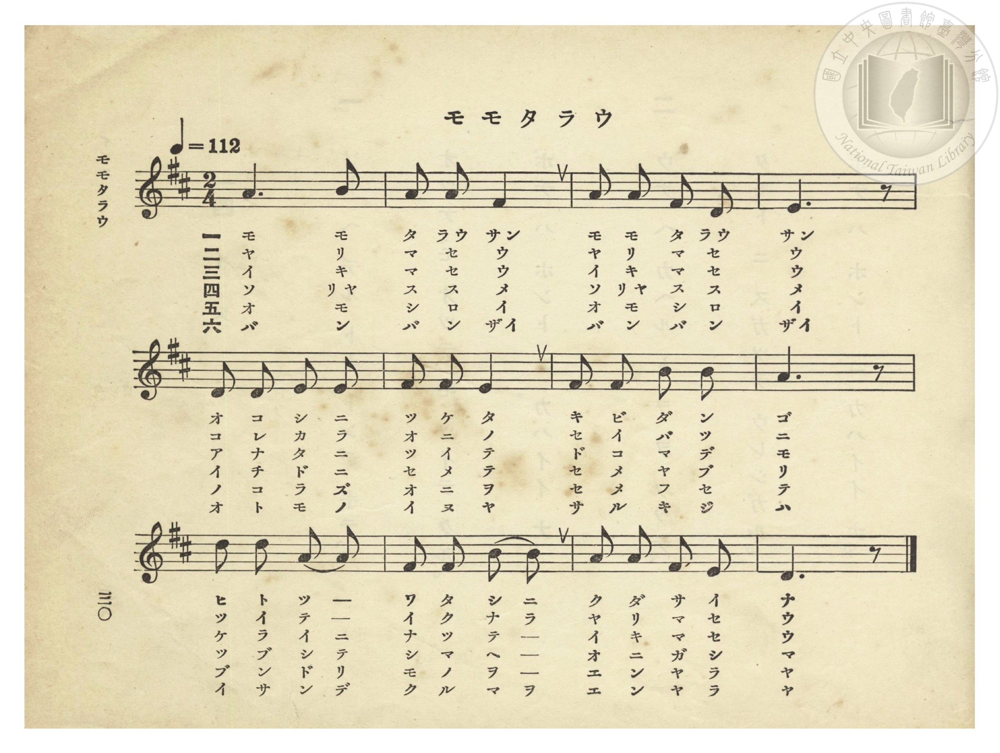
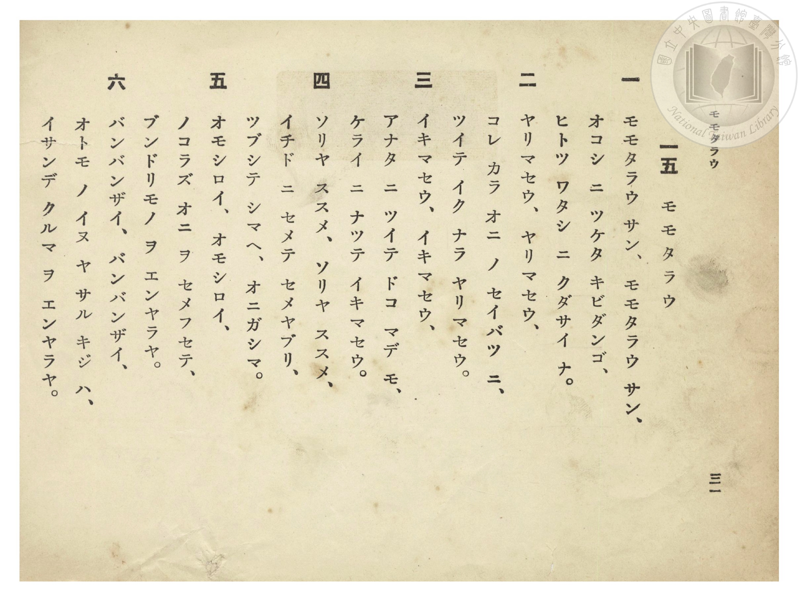
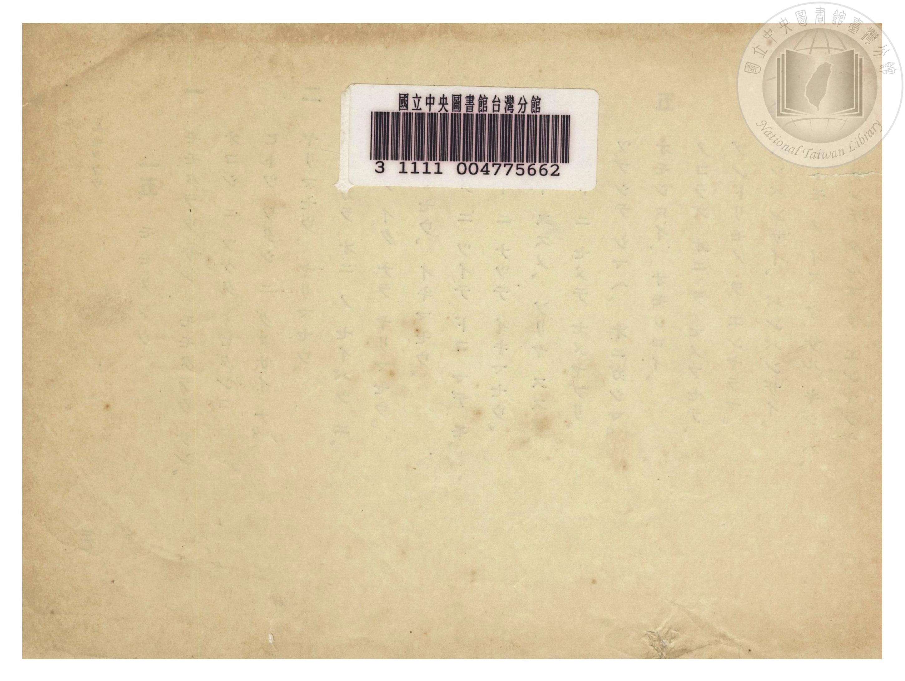

# モモタラウ（桃太郎）

> Re:Shōka 使用 AI 協助辨識與重建樂譜，可能會有錯誤。歡迎回報。

- **NEUTRINO 歌聲合成版**：<br><audio controls src="momotaro_neutrino.mp3"></audio>
- **鋼琴伴奏版**：<br><audio controls src="momotaro.mp3"></audio>


- 詞：文部省《尋常小學唱歌》
- 曲：岡野貞一（文部省《尋常小學唱歌》）
- 臺灣總督府《公學校唱歌》第一學年用（昭和九年三月第一版、昭和十一年二月第四版，索書號 0729 73）

## 說明


- 出處：臺灣總督府編《公學校唱歌》第一學年用，第十五課〈モモタラウ〉（桃太郎），原書第 30–32 頁（掃描檔 P034.jpg–P036.jpg）。
- 調性與拍號：ニ長調（D 大調五聲音階），2/4 拍，速度 != 112。
- 背景與曲風：岡野貞一作曲，原出自明治 44 年（1911）文部省《尋常小學唱歌（一）》〈桃太郎〉，後亦收錄於昭和 18 年（1943）國民學校《うたのほん 下》第二課〈モモタラウ〉。全曲共 12 小節、歌詞六節，完整敘述桃太郎以黍糰子收服犬、猿、雉並征伐鬼島滿載而歸的故事。


## 跨冊／重複收錄參照

> 同曲＋同名異曲（《公學校唱歌》第一學年與《うたのほん》下卷為文部省詞・岡野貞一曲『尋常小學唱歌』同曲；《新定兒童唱歌》第二學年為田邊友三郎詞・田村虎藏曲『幼年唱歌』版）

- **[同名異曲]** 《新定兒童唱歌》尋常科第二學年用（2020.006.0847.0002）：[**〈ももたらう（桃太郎）〉**](../../../shintei_jido_shoka/grade_2_2020.006.0847.0002/2_04_momotaro/index.md)（`D` / `2/4` — [原始 TMD](../../../shintei_jido_shoka/grade_2_2020.006.0847.0002/2_04_momotaro/momotaro.tmd)）
- **[同曲]** 《うたのほん》（唱歌課本）下卷（2006.006.0878）：[**〈モモタラウ（桃太郎）〉**](../../../utanohon/ge_2006.006.0878/2_momotaro/index.md)（`C` / `2/4` — [原始 TMD](../../../utanohon/ge_2006.006.0878/2_momotaro/momotaro.tmd)）
- 總表：[跨冊重複與同名歌曲總索引](../../../duplicate_songs.md)

## 歌詞

```text
一　モモタラウ サン、モモタラウ サン、
オコシ ニ ツケタ キビダンゴ、
ヒトツ ワタシ ニ クダサイ ナ。

二　ヤリマセウ、ヤリマセウ、
コレ カラ オニ ノ セイバツ ニ、
ツイテ イク ナラ ヤリマセウ。

三　イキマセウ、イキマセウ、
アナタ ニ ツイテ ドコ マデ モ、
ケライ ニ ナッテ イキマセウ。

四　ソリヤ ススメ、ソリヤ ススメ、
イチド ニ セメテ セメヤブリ、
ツブシテ シマヘ、オニガシマ。

五　オモシロイ、オモシロイ、
ノコラズ オニ ヲ セメフセテ、
ブンドリモノ ヲ エンヤラヤ。

六　バンバンザイ、バンバンザイ、
オトモ ノ イヌ ヤ サル キジ ハ、
イサンデ クルマ ヲ エンヤラヤ。
```

## ABC

```abc
X:1
T:モモタラウ（桃太郎）
C:曲：岡野貞一（文部省《尋常小學唱歌》）
M:2/4
L:1/16
Q:1/4=112
K:D
V:V1 name="Piano" snm="Pia"
[V:V1]
A6 B2 | A2 A2 F4 | A2 A2 F2 D2 | E6 z2 |
w: 1.~モ モ | タ ラウ サン | モ モ タ ラウ | サン
w: 2.~ヤ リ | マ セ ウ | ヤ リ マ セ | ウ
w: 3.~イ キ | マ セ ウ | イ キ マ セ | ウ
w: 4.~ソ リヤ | ス ス メ | ソ リヤ ス ス | メ
w: 5.~オ モ | シ ロ イ | オ モ シ ロ | イ
w: 6.~バ ン | バ ン ザイ | バ ン バ ン | ザイ
D2 D2 E2 E2 | F2 F2 E4 | F2 F2 B2 B2 | A6 z2 |
w: 1.~オ コ シ ニ | ツ ケ タ | キ ビ ダ ン | ゴ
w: 2.~コ レ カ ラ | オ ニ ノ | セ イ バ ツ | ニ
w: 3.~ア ナ タ ニ | ツ イ テ | ド コ マ デ | モ
w: 4.~イ チ ド ニ | セ メ テ | セ メ ヤ ブ | リ
w: 5.~ノ コ ラ ズ | オ ニ ヲ | セ メ フ セ | テ
w: 6.~オ ト モ ノ | イ ヌ ヤ | サ ル キ ジ | ハ
d2 d2 A2 A2 | F2 F2 B2 B2 | A2 A2 F2 E2 | D6 z2 |
w: 1.~ヒ ト ツ _ | ワ タ シ ニ | ク ダ サ イ | ナ
w: 2.~ツ イ テ _ | イ ク ナ ラ | ヤ リ マ セ | ウ
w: 3.~ケ ラ イ ニ | ナ ッ テ _ | イ キ マ セ | ウ
w: 4.~ツ ブ シ テ | シ マ ヘ _ | オ ニ ガ シ | マ
w: 5.~ブ ン ド リ | モ ノ ヲ _ | エ ン ヤ ラ | ヤ
w: 6.~イ サ ン デ | ク ル マ ヲ | エ ン ヤ ラ | ヤ
```

## TMD 檔案連結

- [主旋律 TMD 檔案](momotaro.tmd) [[在 TMD Studio 編輯](https://tmdlang.github.io/Tmd-TS/#tmd=s7IKdvYPcrWy4qpTUCpJTLdSSM7PyUlNLsnMz7PKzk9PzM7Ojy_OyM9OVIKrKMvPKc1NtUovSkxJjTdEiBfnlxYlp1oVJ2fk5-fEl6RWlCTl52ejy8cXJKanWgUYGJsgZAqK8stS8xLzgLoLijLzSlJTwNoRClLLMlNSQdLFyYl58WWpRZlpmakpSE5KLSoGuRhqRUlRYl5xclFmAcgbCFX5RSUZ-UBnF2RUWmVkFpfkF2UmJ-bEZyfmIfmuJCMV6Lm0_JzsnPyiVCUuLS2Fx82LQKhp_-PmlY-blr3f0_FsYfPTJateNve939OpoKXFpWirYGhoxGVvq-DCZWOkb2IHMu7Fynnv98x6Nq39ZfOK53MaHzd0Pd3Q_XTHjqcb-p-u3fF0ysZna3seN3SDrX42exNQ7dNNC1-2973YNO_JjgaQLYS0Am0H637Rvut54-LnO_Y-n7v46a45IOWta4AKny1YCFf7fM0aoKkg3Tu3PJ-yAmT8jLVPJ_U82TkXKPJkR-ezOR0QNc87Ox43NEJkn_Y2gnQBFezqgSh4Ons2UMH7PT3Ptyx6NnvHi5nzFQzMjSwVzI3BruHS11KwpRbgUlBQeNwwARg4z2eve7Fq1bMZfY8bJoJFm3c_bd_1YuZUYKih-f759hXEBUAPyDdA_-2a8mLVpscNHWjR_LihEy2mgVqe9s0HehqoUcHY4FHDZGMjhZcLGkHK-pqf9fc_WzVFAZSy9bIK0oGyQKYZiAnU-rihCersF6v2P2tY_qKj_Vl3LzDwgO5_3Nz9cup2oDjQHBeFp0uWA5kgRzVuejl_88tZUJuBqUoBqAXIetkw_-muZQqQNIdkcHPPs5nrQQbP3vRyEdB_KMnpyd454DQG8gEo5NpBgfls024FExMFYIAArTa0NDQEWoU_0QHVgdMm0EPdwCCDhw44sHqe7ut5smvZsynbXva0PJu2B5KEFAwt4DaYgBLJ0zndzzZMhMQO0JLHjW2PG-c_blz3uHH346bJCk92AE0Gx9auHlwRA_T109YVQA89bd2oYGikAHTi8_UNoFS7tgeY7Z62rgVyQQ5a1_Ns6pZnU2e82L8B7tYnu5e-3N37fPOGp2snAN36bE7v8641QL3Pe_YDyZezO5_sWPZ0X-OTPRNertnzdPO2Z7v3v9jT-aKh59naHc9ntTyb2vpkF9CJTVzQ5AlJEzCbVwADEBgJT3asBTFWzXuxdj0wzQJ9_3RD77P2TlD6MIUkCmhiUijQUzAGhTzYPGDoPm5oQPOxwuOmrY-bNwNdh1MC7JamVY-bNj9u2g5MDt1A3PK4aSNQKVB87ePmyY-bgcYCZbfAVDdPetwMDNsWIGs9yESYvqb1IKVAg5uWAAW6oCkM6AOIb0BlGjzaG6cCowwU7qgiQM89a1rxonXDy2mTn_XNfjFxOjDg4IEOlH2xuvtpR9vzrcuedUwE5cqG7qcTlgNtggfDLmCWBbp3yePmVY-b5z1uAiYNYMQD_Y8uAvH45sfNa4DUamCwgIMB7P8-IBOoCqhjAsSbwFiDeh0YNEDhNqCCJUD_gr0J0oluOobPgS5-sncB2K2NcDbIt31Lgen2yb62F8san_bthiSfZ80LgSkIFNHLmp7NmwNU_HLhjGct_S-2z385awXQ5083bEQyEOH5HcAEDowBoNOAEYfkeQwRiOeBSaILHM-wWId4rbkTGC5Aat7j5nZwHQZTvxGceECRC1IP9HkzPCiQTcfwPDCiXmzdDvIe2P_IXFBp2rLwxeppTzs2PJ286sXihS-b90L8CYx8YFoAhVHHhOdNu4BsYFp4um7bi_bFqAbC_Q-sYsD-3wuODKA7m3aCUDOwtACGATZRiL-A3gYmkE5oKt4NkgL7C8ICyk4DaUUkASC_aTtECZACBtMMsAWg1PO4aQ1UEDMYXiyc-3Rq19PO3pcNwNKpEZkL9CXITx2dQPazKbuB6PkCYPGz9eXMxeDicefTXVNf7Oh_unMzpGhBT_RTwP4GOgCYxYG2rwX5CeokFBGID_rA6R4YlbsQaX4T3L_AfAhktMFVAz0PVN0JDj1gigFmDrDiFWBhYOCsBJFYUvyc-c-nz366fzUoxcPYoNjs6oKkb2CRB4zrpx3bnuzpB4l3d4JiHJgMOlY-ndz4dGLD0xn7n07ZDiGRY7l1LTiLA_Mm0AFgsmkb1MPYBGElHKjMWgTN3UBn94ByLaQcXA0u6Zp2AEX6kRIFpIgE5QFQyQYsIuYR6fUXE9YA0bO14FiGsUEV8KwVT_fNA6ViYLXTPR1cdWwBlmvAYh9Ye7ycDWz29TzftO_50nnPuqY9m7z76ZwNkFB5sbsLqAx7kADtprzBBAUKWvpcXL75ufkliUX5VgGZiXn5DjUGNdUgSxRsLLTswAxsLTUFSCvpxcIeBQ1gwwBcrerA2zSaWDQArQIZVqNgqqALhGZglqmCMZANYxkCWUZgWQOFGrBqH8MaUIkEFgPRQB64_EKq08D6ITENxAhZkFKoPJJ5RiC1S6DmrQLrBMZy024gXgY1CVTerYKLg4wBySCZYQwSg5rRtBabGaAyEyiDxwwTkNhemDtAloIEdkJw80KoMXthkjApkF0gSSSTTEEKV6GEEKh-BtoOdiNEFhI2EHGE6-FmmIHMnQA1YzPYlglgFiRTQQMGKgSlQcZAJSEm4U8rwDYaGWnFEAiNgLAGmDqMwWkDwjKDph-MtALyK6gyg7ZRQM4GVuhNG8EpAxIaoHiZDMQNcG9swUwj4AoR3FIApSd4KEJaCxBzQPENSiug4GgB29SNJZ2A0mUXNF0i3APS1wYNVmA9BKl-gbgdmpYx0wpIRyNENcQckP3AtAA3B84HqZwGNgeSKlBSCrg0BNkGav7sQvHXJjRzpsLSLtgGtNQC1tUBzXd9sDQPLWQh5mwFssElLRDvAJvTT2Ra2dFJVlqJAyFQSYKaRkAlCygFGWIpWSZBfdECjQtgCw_cDoanHnCbD5hSQL4B-hCkpgtLiYIWp-D8D24twlIPkaUKMJ2CYwbS5oLY9ri5Gc1kgiULuBE7DeqPNniZAEphM5DKBFDrB5TGt0PLMMzUAjQDnOVBqQ5SWkJrVHhqWQFVAXIxzKeYqQVc8UJVgtM4OHRAeQtSxxIyqZaLS9dOAVZTKQDZylwA)]
- [鋼琴伴奏 TMD 檔案](momotaro_piano.tmd) [[在 TMD Studio 編輯](https://tmdlang.github.io/Tmd-TS/#tmd=s7IKdvYPcrWy4tLSUnjcvAiEmvY_bl75uGnZ-z0dzxY2P12y6mVz3-Pm3S-79zyfsOXJni1Pl_Y_7-x4v6dTQUuLS9FWwdDQiMveVsGFy8ZI38SOq05B6cXKee_3zHo2rf1l84rncxofN3Q93dD9dMeOpxv6n67d8XTKxmdrex43dCuB1D6bvQmo9ummhS_b-15smvdkRwPIXkJagbaDdb9o3_W8cfHzHXufz138dNcckPLWNUCFzxYshKt9vmYN0FSQ7p1bnk9ZATJ-xtqnk3qe7JwLFHmyo_PZnA6IGqC3Hjc0QmSf9jaCdAEV7OqBKHg6ezbY3z3Ptyx6NnvHi5nzFQzMjSwVzI3BruHyzCspyrcKyEzMyw_ycKgxqKnmUgACGwstOzCjRsEUCI2BsEbBSMEQzgKxzeKBTEMFXSA0UKjhqkUxzQfZNBO4aYbxCtGGsSBjkRmmIAZMCmSQb35ufkkiXpfpaynYogMFSJC8WNijoGGiAAz-5-sbdBQCDIxN9LIK0jWxaNDSh3sT5A8zuId14SxDsIdhvgSp9jGsAaU7sBiIBvKa9gNZoAQIZG593LwZrB8kB8YIWZBSqDySeUYgtUug5q0C65wHVLgbiJdBTVoCloGJg4wBySCZYQwSg5rRtBabGUBZkAweM0xAYnth7gBZChLYCcHNC6HG7IVJwqRAdoEkkUwyBSlchRJC24EsoO1gN0JkIWEDEUe4Hm6GGcjcCVAzNoNtmQBmPW7aBjcGJgSlQcZAJSEm4U8ru3rISSuGQAjKAjXg7ABKGxCWGTT9YKQVkF-bQO4G-bUb7OwWIG8jOGVAQgMUL5OBuAHujS2YaQRkRvMaIL0alJ7godgNxH1Qc0DxDUoroOBoAdvUjSWdgNJlFzRdItwD0tcGDdZOqG3AtNLcDk3LmGkFpKMRohpiDsh-YFqAmwPng1ROA5sDSRUoKQXoeohtK4H0LhR_bUIzZyos7YJtQEstYF0d0HzXB0vzzT3Q3AXOfEA2MPRA4d20A2xOP5FpZUcnWWklDoRAJQlqGgGVLKAUhCg_ESXLJKgvWqBxsR4SU4jU0wQUAaUUkG-APgSp6cJSoqDFKTj_g3QCYx6SeogsVYDpFBwzINWQ1AIyoRnNZIIlC8g9wDQA8UcbvEwApbAZSGUCMNabQGl8O7QMw0wtQDPAWR6U6iClJSS-EallBVQFyMUwn2KmFpCrQekBpBKcxsGhA8pbIDdtImgSRkVFqNIDMcxyUVnAWhTCgioG8VFrSJQ6E1RVElWXQh2oa6cArpUVgAyYY6N9gKpR-EZofGM0vgkaH2gJCt8MzFfmAgA)]

## 分析

```text
================================================================================
📊 TMD Song Profile: [ モモタラウ（桃太郎） ]
================================================================================
⏱  Duration:       0:12 (12.9s), 12 measures total
🎼 Key & Tempo:    首調基準 D, != 112.0 BPM, <2/4>
   - 分析範圍：      由實際發聲的音符與和弦推測調性；播放脈絡另行呈現
🎤 人聲音域:    D4 (MIDI 62) – D5 (MIDI 74) [跨度: 12 個半音 / 1.0 個八度, 難度: easy]
   - 最低音:  D4 in [Momotaro #1 @ m.3, 0:02]
   - 最高音: D5 in [Momotaro #1 @ m.9, 0:08]
   - 適合: soprano, mezzo-soprano, contralto, tenor, baritone, bass
🏛  結構:      Momotaro (12.9s)
⚡ 編曲密度:        Peak 1 軌道同時演奏
🗝  調性診斷：       A 大調（純淨自然大調，未偵測到可信轉調）
   - 風格氣質:    純淨自然大調（陽光明朗、易唱易記，無明顯調外色彩）
   - 轉調歷程:    全曲維持單一推測調性（未偵測到可信轉調）
   - 核心骨幹音:  A, F#, D, E, B
   - 調性數值:    A 大調 [相關度: 0.82, 穩定度: Moderate, 自然音純度: 100.0%]
   - 候選調性 (K-S): A 大調 (0.82), D 大調 (0.77), F# 小調 (0.72)
   - 五度圈歷程:   +3
   - 各段落調性細節:
     • [Momotaro #1]: A 大調 (r: 0.82, 自然音純度: 100.0%)

  [ 五度圈游移軌跡 ]
               C  
         F            G  
      Bb               D  
      Eb              [A ]*
         Ab           E  
            Db       B  
               F# 
     (* = active key center)

  [ 十二半音累積音高分佈 ]
     C  :                            0.0%
     C# :                            0.0%
     D  : ██████████████            17.8%
     D# :                            0.0%
     E  : ██████████████            17.8%
     F  :                            0.0%
     F# : █████████████████         22.2%
     G  :                            0.0%
     G# :                            0.0%
     A  : ████████████████████████  31.1%
     A# :                            0.0%
     B  : █████████                 11.1%
--------------------------------------------------------------------------------
Assignment 軌道音域：
  - Piano         : D4 – D5 (12 個半音 / 1.0 個八度, 35 個音符)
================================================================================
```


## 原書掃描頁








