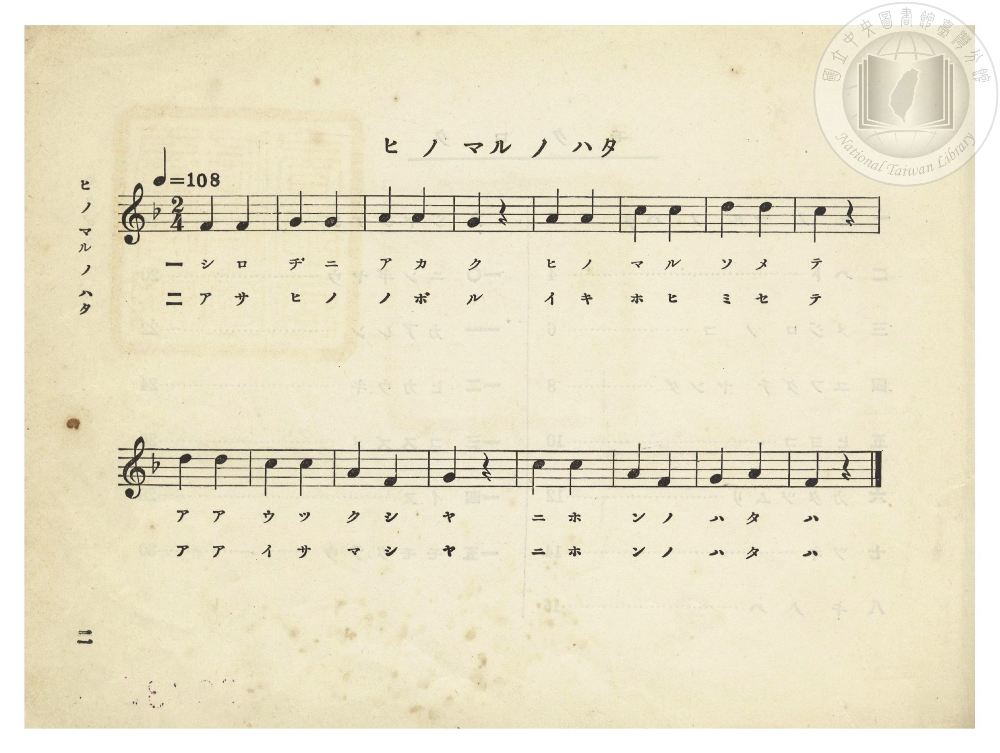
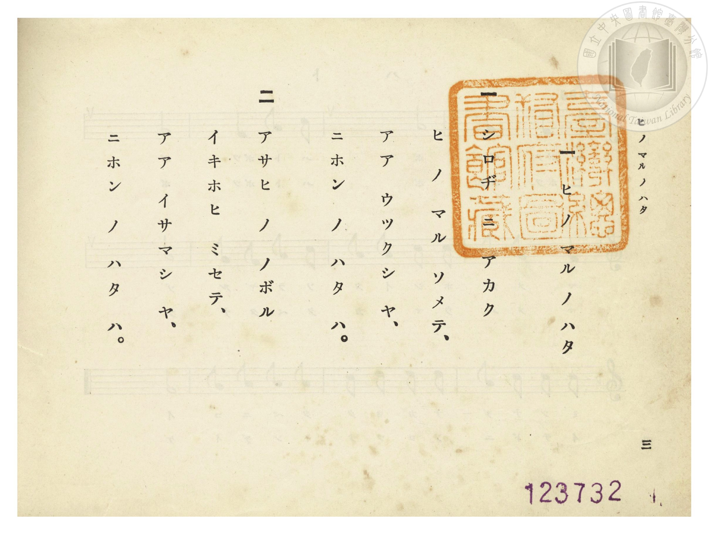

# ヒノマル ノ ハタ（日之丸旗）

> Re:Shōka 使用 AI 協助辨識與重建樂譜，可能會有錯誤。歡迎回報。

- **NEUTRINO 歌聲合成版**：<br><audio controls src="hinomaru_no_hata_neutrino.mp3"></audio>
- **鋼琴伴奏版**：<br><audio controls src="hinomaru_no_hata.mp3"></audio>


- 詞：文部省《尋常小學唱歌》
- 曲：文部省《尋常小學唱歌》
- 臺灣總督府《公學校唱歌》第一學年用（昭和九年三月第一版、昭和十一年二月第四版，索書號 0729 73）

## 說明


- 出處：臺灣總督府編《公學校唱歌》第一學年用，第一課〈ヒノマル ノ ハタ〉（日之丸旗），原書第 2–3 頁（掃描檔 P006.jpg–P007.jpg）。
- 調性與拍號：ヘ長調（F 大調），2/4 拍，速度 != 108。
- 背景與曲風：原出自明治 44 年（1911）文部省《尋常小學唱歌（一）》第一曲〈日の丸の旗〉，亦收錄於大正 4 年《公學校唱歌集》第三學年第二首及《新定兒童唱歌》第一學年用第一學期第一首。全書歌詞採片假名分詞書寫。


## 歌詞

```text
一　シロヂ ニ アカク
ヒ ノ マル ソメテ、
アア ウツクシ ヤ、
ニホン ノ ハタ ハ。

二　アサヒ ノ ノボル
イキホヒ ミセテ、
アア イサマシ ヤ、
ニホン ノ ハタ ハ。
```

## ABC

```abc
X:1
T:ヒノマル ノ ハタ（日之丸旗）
C:曲：文部省《尋常小學唱歌》
M:2/4
L:1/16
Q:1/4=108
K:F
V:V1 name="Piano" snm="Pia"
[V:V1]
F4 F4 | G4 G4 | A4 A4 | G4 z4 |
w: 1.~シ ロ | ヂ ニ | ア カ | ク
w: 2.~ア サ | ヒ ノ | ノ ボ | ル
A4 A4 | c4 c4 | d4 d4 | c4 z4 |
w: 1.~ヒ ノ | マ ル | ソ メ | テ
w: 2.~イ キ | ホ ヒ | ミ セ | テ
d4 d4 | c4 c4 | A4 F4 | G4 z4 |
w: 1.~ア ア | ウ ツ | ク シ | ヤ
w: 2.~ア ア | イ サ | マ シ | ヤ
c4 c4 | A4 F4 | G4 A4 | F4 z4 |
w: 1.~ニ ホ | ン ノ | ハ タ | ハ
w: 2.~ニ ホ | ン ノ | ハ タ | ハ
```

## TMD 檔案連結

- [主旋律 TMD 檔案](hinomaru_no_hata.tmd) [[在 TMD Studio 編輯](https://tmdlang.github.io/Tmd-TS/#tmd=s7IKdvYPcrWy4qpTUCpJTLdSSM7PyUlNLsnMz7PKzk9PzM7Ojy_OyM9OVIKrKMvPKc1NtUovSkxJjTdEiBfnlxYlp1oVJ2fk5-fEl6RWlCTl52ejy8cXJKanWgUYGJghZAqK8stS8xLzgLoLijLzSlJTwNoRClLLMlNSQdLFyYl58WWpRZlpmakpSE5KLSoGuRhqRUlRYl5xclFmAcgbCFX5RSUZ-UBnF2RUWmVkFpfkF2UmJ-bEZyfmIfmuJCMV6LnM3AKgJYk5yJoz0zPzrHLz85JKgQGixKWlpfC4edLj5r7HzfMeN68GcvqAuP9x0_73ezqeTV_6ZGf3kx07nk2f_n5Pp4KWFpeirYKhgQWXva2CG5eNkb6JHcjoFyvnvd8z69m09pfNK57PaXzc0PV0Q_fTHTuebuh_unbH0ykbn63tedzQDXbGs9mbiFb7on3X88bFz3fsfT538dNdc0BqW9cAVT1bsBCu8PmaNU92NIC07tzyfMoKkKtnrH06qefJzrlAkSc7Op_N6YCoed7Z8bihESL7tLcRpAuoYFcPRMHT2bOBCt7v6Xm-ZdGz2TtezJyvYGBuZKlgbgz0uRIXl76Wgi21AJeCgsLjhgnAoHg-e92LVauezeh73DARLNq8-2n7rhczpwLDCM33z7evIC4AeiAiL1ZtetzQgSNyHzd0YsYvUOvTvvlAzwMNUDB61DDZWOHlgkaQur7mZ_39z1ZNUQCleL2sgnSgJJBpDmICNT5uaII6_sWq_c8alr_oaH_W3QsMQqAvHjfPeDl1O1AcaI6bwtMly8FMkF3A1KMAVAZkvWyY_3TXMgVI2kIyrLnn2cz1IMNmb3q5COizWUDngYKnHRRizzbtVjAxUQD6GmiyoaWhIdBU_MkKqA4YLmD3QkMNaDAwjIDB8LhxHTAYgCQwJMBh0_Nk17JnU7a97Gl5Nm0P0NXP1i5WAFuGGQcvZ7fBDOyERgOQvavn5bJpT_u7gOqfTdvwdN2sp62Tnq9eiiva4Nxnc-ZD2EDtwKB42roCGCFALcA89qxv4fPO9qeN7U8n9D7taAOJzN7xdP1qUIhBkxQk_iDKQVqntQOD78mOtSDGqnkv1q4HpjNgMDzd0PusvRMUm9AohEa8QoGeAii9g40DuuFxQ8Pjpu2Pm9c-bm4Cxki3wuOmRY-bVj9uWg-JoknQJAVJXU17HzcvfNwMDI1GsDRI7SIgtexxcwtQC9AkoNIlMNnm7sfNsx83b0ZKlWAKEv1AR0IcDIr1OSuez9z7dNfUJzu6ns2f_GLi9Jfr1j3f0vp8VsvTJateAqXmTH7auwHki6ldILRk1stde57v63u5a_rTicAI7wHG8LM5a0Dq53SDY7gJ7sldwMgAehLo1K0I_wAzzByglyC-WPK4Ceh_oFNBsvMfN-3G4kWgGqD2eeR7cePU5_37gGn72fS1IMfO3fhsRjvQvS8mr3na3fxsw-Kn3YvQ_Pe0u_3p4vX4_Ae0g_KyCgoUtPS5uDwy8_JzE4tK_fI9EksSrQIyE_PyHWoMaqpBVinYmGjZgRnYikoFaKG0sEdBw0IBmCufr2_QgRcnmlg0AC0EGVajYAiENQpGQFijYAyEILYBnG0KhDUKZkAIYgPFwbp8DGuAsQKKjLVAcVjqBYmBYms1mLVeIR4sB4l0EGseEEPk9gJZC8FibSBVEDONYPq3oukDRe4cMGs1xMymJUAMsXk2WCWINR8othvJTPxhtauHnLCChQMoTIyh4QYKK1QRULgZooUVyF-LwG5fBnRhCzSEQGEIcvESaFgBSwCgj0AsSKIGsfqBqvZDWZhhBTETFB6QUAOGMRlm1nJx6dopoKY_BaCIMhcA)]
- [鋼琴伴奏 TMD 檔案](hinomaru_no_hata_piano.tmd) [[在 TMD Studio 編輯](https://tmdlang.github.io/Tmd-TS/#tmd=s7IKdvYPcrWy4tLSUnjcPOlxc9_j5nmPm1cDOX1A3P-4af_7PR3Ppi99srP7yY4dz6ZPf9y8-2X3nucTtjzZs-Xp0v7nnR3v93QqaGlxKdoqGBpYcNnbKrhx2Rjpm9hx1SkovVg57_2eWc-mtb9sXvF8TuPjhq6nG7qf7tjxdEP_07U7nk7Z-Gxtz-OGbiWQ2mezNxGt9kX7rueNi5_v2Pt87uKnu-aA1LauAap6tmAhXOHzNWue7GgAad255fmUFSB_zFj7dFLPk51zgSJPdnQ-m9MBUQP0xOOGRojs095GkC6ggl09EAVPZ88G-7Ln-ZZFz2bveDFzvoKBuZGlgrkx0OdKXFwemXn5uYlFpX75HokliVYBmYl5-UEeDjUGNdVcCkBgY6JlB2boaynYogMFiAteLOxR0LBQAHr1-foGHYUAAwMzvayCdE0sGrT0wYbVKBgCYY2CERDWKBgDIYhtAGebAmGNghkQgthAcbAuH8MahcdN24FRuxYo_ri5CYi7QaymRUC8GsxarxAPlpsETgQg1jwghsjtBbIWgsXaQKogZhrB9G9F0wdKQnPArNUQM5uWADHE5tlglSDWfKDYbiQz8YfVrh5ywgoWDqAwMYaGGyisUEVA4WaIFlYgfy0Cu30Z0IUt0BAChSHIxUugYdUN9hGItRnu-36gqv1QFmZYQcwEhQck1IBhTIaZtdiTnw-25Af0W7xCtGEsyNvxQJZpPIiJIgYKErgAnGECZJhARWCBgyqKpgG3UagWgwwD-kDXTgHVE9E-QMVYRI3AospcAA)]

## 分析

```text
================================================================================
📊 TMD Song Profile: [ ヒノマル ノ ハタ（日之丸旗） ]
================================================================================
⏱  Duration:       0:17 (17.8s), 16 measures total
🎼 Key & Tempo:    首調基準 F, != 108.0 BPM, <2/4>
   - 分析範圍：      由實際發聲的音符與和弦推測調性；播放脈絡另行呈現
🎤 人聲音域:    F4 (MIDI 65) – D5 (MIDI 74) [跨度: 9 個半音 / 0.8 個八度, 難度: easy]
   - 最低音:  F4 in [HinomaruNoHata #1 @ m.1, 0:00]
   - 最高音: D5 in [HinomaruNoHata #1 @ m.7, 0:06]
   - 適合: soprano, mezzo-soprano, contralto, tenor, baritone, bass
🏛  結構:      HinomaruNoHata (17.8s)
⚡ 編曲密度:        Peak 1 軌道同時演奏
🗝  調性診斷：       F 調性不明確（純淨自然大調，未偵測到可信轉調）
   - 風格氣質:    純淨自然大調（陽光明朗、易唱易記，無明顯調外色彩）
   - 轉調歷程:    全曲維持單一推測調性（未偵測到可信轉調）
   - 核心骨幹音:  C, A, F, G, D
   - 調性數值:    F 調性不明確 [相關度: 0.77, 穩定度: Ambiguous, 自然音純度: 100.0%]
   - 候選調性 (K-S): F 大調 (0.77), C 大調 (0.76), A 小調 (0.73)
   - 五度圈歷程:   -1
   - 各段落調性細節:
     • [HinomaruNoHata #1]: F 調性不明確 (r: 0.77, 自然音純度: 100.0%)

  [ 五度圈游移軌跡 ]
               C  
        [F ]*          G  
      Bb               D  
      Eb               A  
         Ab           E  
            Db       B  
               F# 
     (* = active key center)

  [ 十二半音累積音高分佈 ]
     C  : ████████████████████████  25.0%
     C# :                            0.0%
     D  : ██████████████            14.3%
     D# :                            0.0%
     E  :                            0.0%
     F  : █████████████████         17.9%
     F# :                            0.0%
     G  : █████████████████         17.9%
     G# :                            0.0%
     A  : ████████████████████████  25.0%
     A# :                            0.0%
     B  :                            0.0%
--------------------------------------------------------------------------------
Assignment 軌道音域：
  - Piano         : F4 – D5 (9 個半音 / 0.8 個八度, 28 個音符)
================================================================================
```


## 原書掃描頁






