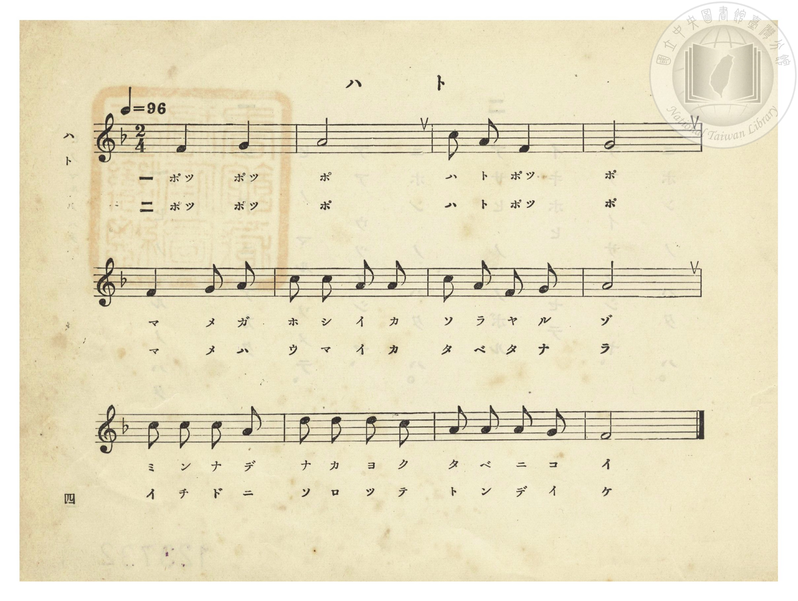
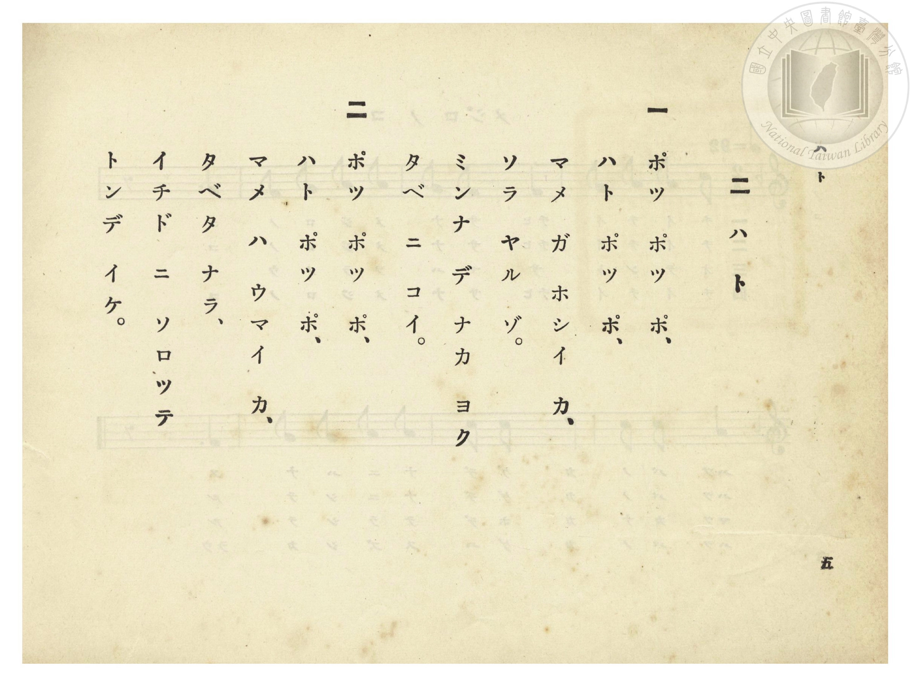

# ハト（鴿子）

> Re:Shōka 使用 AI 協助辨識與重建樂譜，可能會有錯誤。歡迎回報。

- **鋼琴伴奏版**：<br><audio controls src="hato.mp3"></audio>
- **NEUTRINO 歌聲合成版**：<br><audio controls src="hato_neutrino.mp3"></audio>

- 詞：文部省《尋常小學唱歌》
- 曲：文部省《尋常小學唱歌》
- 臺灣總督府《公學校唱歌》第一學年用（昭和九年三月第一版、昭和十一年二月第四版，索書號 0729 73）

## 說明


- 出處：臺灣總督府編《公學校唱歌》第一學年用，第二課〈ハト〉（鴿子），原書第 4–5 頁（掃描檔 P008.jpg–P009.jpg）。
- 調性與拍號：ヘ長調（F 大調），2/4 拍，速度 != 96。
- 背景與曲風：原出自明治 44 年（1911）文部省《尋常小學唱歌（一）》第二曲〈鳩〉，亦收錄於《新定兒童唱歌》第一學年用第一學期第二首。描寫孩童呼喚鴿子、餵食豆子並看群鴿齊飛的生動情景。


## 歌詞

```text
一　ポッ ポッ ポ、
ハト ポッ ポ、
マメ ガ ホシイ カ、
ソラ ヤル ゾ。
ミンナ デ ナカ ヨク
タベ ニ コイ。

二　ポッ ポッ ポ、
ハト ポッ ポ、
マメ ハ ウマイ カ、
タベタ ナラ、
イチド ニ ソロッテ
トンデ イケ。
```

## ABC

```abc
X:1
T:ハト（鴿子）
C:曲：文部省《尋常小學唱歌》
M:2/4
L:1/16
Q:1/4=96
K:F
V:V1 name="Piano" snm="Pia"
[V:V1]
F4 G4 | A8 | c2 A2 F4 | G8 |
w: 1.~ポッ ポッ | ポ | ハ ト ポッ | ポ
w: 2.~ポッ ポッ | ポ | ハ ト ポッ | ポ
F4 G2 A2 | c2 c2 A2 A2 | c2 A2 F2 G2 | A8 |
w: 1.~マ メ ガ | ホ シ イ カ | ソ ラ ヤ ル | ゾ
w: 2.~マ メ ハ | ウ マ イ カ | タ ベ タ ナ | ラ
c2 c2 c2 A2 | d2 d2 d2 c2 | A2 A2 A2 G2 | F8 |
w: 1.~ミ ン ナ デ | ナ カ ヨ ク | タ ベ ニ コ | イ
w: 2.~イ チ ド ニ | ソ ロ ッ テ | ト ン デ イ | ケ
```

## TMD 檔案連結

- [主旋律 TMD 檔案](hato.tmd) [[在 TMD Studio 編輯](https://tmdlang.github.io/Tmd-TS/#tmd=s7IKdvYPcrWy4qpTUCpJTLdSSM7PyUlNLsnMz7PKzk9PzM7Ojy_OyM9OVIKrKMvPKc1NtUovSkxJjTdEiBfnlxYlp1oVJ2fk5-fEl6RWlCTl52ejy8cXJKanWgUYGFggZAqK8stS8xLzgLoLijLzSlJTwNoRClLLMlNSQdLFyYl58WWpRZlpmakpSE5KLSoGuRhqRUlRYl5xclFmAcgbCFX5RSUZ-UBnF2RUWmVkFpfkF2UmJ-bEZyfmIfmuJCMV6LnEvMzcxBxkrZnpmXlWufl5SaXA4FDi0tJSeNzc_7i54_2ejpdb9j9dO-H9nk4FLS0uRVsFSzMue1sFNy4bI30TO5ARL1bOe79n1rNp7S-bVzyf0_i4oevphu6nO3Y83dD_dO2Op1M2Plvb87ihG2zds9mbiFb7on3X88bFz3fsfT538dNdc0BqW9cAVT1bsBCu8PmaNU92NIC07tzyfMoKoHOfzVj7dFLPk51zgSJPdnQ-m9MBUfO8s-NxQyNE9mlvI0gXUMGuHoiCp7NnAxW839PzfMuiZ7N3vJg5X8HA3MhSwdwY6HElLi59LQVbagEuBQWFxw0TgEHxfPa6F6tWPZvR97hhIli0effT9l0vZk4FhhGa759vX0FcAPSARHb1vFi16XFDByQSHzd0IscjUM3TvvlAXwJVKpg8aphsqvByQSMo6Pqan_X3P1s1RQGUgPWyCtKBkkCmJYgJ1Pi4oQnqyher9j9rWP6io_1Zdy8wrIDOfdw84-XU7UBxoDluCk-XLAczQXYBk4kCUBmQ9bJh_tNdyxTAaQjJrOaeZzPXg8yavenlIqAPZgFdBwqGdlDIPNu0W8HERAHoO6DBhpaGhkBD8ScfoDpgiICdCw4dYBTPBoXFy80rwQHR82TXsmdTtr3saXk2bQ_QhGfTNjxdN-tp66Tnq5fiClY499mc-RAzXy6bBvQCMLierl_9dO1KkN6Je55OmwUJZWBKe7lk68vF819sbANyn-xY9nxO9_N9S4CyL_d2vVw8-_msludT5j_tnvqsuRXoe1BoQJMFJGqArgBmq6etK4B-BQbNkx1rQYxV816sBaqdCPTi0w29z9o7QREFjR1onCoU6CmYAj0PNg7o5scNDY-b5z5ubgYGNZxqaISEPShxYBOf97h5ocLjpjVA5uzHTdsfNy0B8lbDpJv2Pm5eCZRa8rh5NZC3Dx6V8x83b37c3AVktQNxF1ALkFrxuGk9RNv-x80zgQLdQOZmoJFQbUC_QPwFivhJUyEIlFjAAQnnPmve_GJZ49MJzZAQfTq97_2e-U_2tYES_NZlT_YueNow8emE5UBDgWnv6bptz4GZeNkqIPmsZfbTORuAIfFi63ageqAJEGXwMNoFjG-yw6i5H-ibZSAeWhiBPAskweHQDEx4UGFgmDU-bu6EBgMwINcCzX3c3AYxE5hfgQEIDDyguqaNpAUQNFyW7gX5EBw6QMbLxXuf7GoDJrYXKzeCksiGjZCAeDZ1CzAdAsMFmBSfTpj4dMnK5yt3IcIFaCvlxRwUKGjpc3F5JJbkWwVkJublO9QY1FSDLFCwsdCyAzOwla0KkBz3YmGPggYw92_of76-QQdeLGli0QC0BmRYjYKhgq6CERDXKBgDSRCsUTAFskHiNWAZsBhYtY9hDSxudREMsBhcLziOEWkATRpijBHFxuAPCWB5TnZIGIP9DwoBCAsUEkbIoYMUEvPA7ofkfRB_NpC1HZQcQWkbJNK0FygKzvxADBHZhyUo4OYAPQ1SswwshmwOKGcASwNIDgHbtZLIsNjRSU5YgEIA5PcaBTMwNAWHAAiCwgIUUuhhMR-IN4NdB8qSIBEgC1KkAen1yL6AlGlgkSWYoQHydXMjEEOyPSwU1wIxqEhpA5sNShgg28CZH6xmI9ykWi4uXTsFUB5SANLKXAA)]
- [鋼琴伴奏 TMD 檔案](hato_piano.tmd) [[在 TMD Studio 編輯](https://tmdlang.github.io/Tmd-TS/#tmd=s7IKdvYPcrWy4tLSUnjc3P-4ueP9no6XW_Y_XTvhcfPul917nk_Y8mTPlqdL-593AqU6FbS0uBRtFSzNuOxtFdy4bIz0Tey46hSUXqyc937PrGfT2l82r3g-p_FxQ9fTDd1Pd-x4uqH_6dodT6dsfLa253FDtxJI7bPZm4hW-6J91_PGxc937H0-d_HTXXNAalvXAFU9W7AQrvD5mjVPdjSAtO7c8nzKCqAHns1Y-3RSz5Odc4EiT3Z0PpvTAVED9MPjhkaI7NPeRpAuoIJdPRAFT2fPBnuy5_mWRc9m73gxc76CgbmRpYK5MdDjSlxcHokl-VYBmYl5-UEeDjUGNdVcCkBgY6FlB2boaynYogMFiL0vFvYoaJgoAD34fH2DjkKAgYGFXlZBuiYWDVr6YMNqFAwVdBWMgLhGwRhIgmCNgimQDRKvAcuAxcCqfQxrgLE393FzM1AIzgCLwfUCYxeIO3BIQ4wxotgY_CGxq4f8kDAG-x8UAhAWKCSMkEMHKSTmgd2_UOFx0xqw-2YDWduBeAkQrwaJNO0Fiq4EYqBIM0RkH5aggJsD9DRIzTKwGLI5-4EiM6F0F9iulUSGxY5OcsICFAIgv9comIGhKTgEQBAUFqCQQg-L-UC8Gey6x83tYBcCWUDXP25eAaTXI_uiuRvI3gwWWYIZGiBfNzcCcSdYJSwU1wJxMxC3gc0GJQyQbe1g9SA1G-Em1SJnIR_kLGQCzUJAH8QrRJvGx0JZhigM03iYJJJiVCWY2tGVmmBVagBxnq6dAsiF0T5AFXC2EZitzAUA)]

## 分析

```text
================================================================================
📊 TMD Song Profile: [ ハト（鴿子） ]
================================================================================
⏱  Duration:       0:15 (15.0s), 12 measures total
🎼 Key & Tempo:    首調基準 F, != 96.0 BPM, <2/4>
   - 分析範圍：      由實際發聲的音符與和弦推測調性；播放脈絡另行呈現
🎤 人聲音域:    F4 (MIDI 65) – D5 (MIDI 74) [跨度: 9 個半音 / 0.8 個八度, 難度: easy]
   - 最低音:  F4 in [Hato #1 @ m.1, 0:00]
   - 最高音: D5 in [Hato #1 @ m.10, 0:11]
   - 適合: soprano, mezzo-soprano, contralto, tenor, baritone, bass
🏛  結構:      Hato (15.0s)
⚡ 編曲密度:        Peak 1 軌道同時演奏
🗝  調性診斷：       A 調性不明確（純淨自然大調，未偵測到可信轉調）
   - 風格氣質:    純淨自然大調（陽光明朗、易唱易記，無明顯調外色彩）
   - 轉調歷程:    全曲維持單一推測調性（未偵測到可信轉調）
   - 核心骨幹音:  A, F, G, C, D
   - 調性數值:    A 調性不明確 [相關度: 0.74, 穩定度: Ambiguous, 自然音純度: 100.0%]
   - 候選調性 (K-S): A 小調 (0.74), F 大調 (0.72), C 大調 (0.57)
   - 五度圈歷程:   +3
   - 各段落調性細節:
     • [Hato #1]: A 調性不明確 (r: 0.74, 自然音純度: 100.0%)

  [ 五度圈游移軌跡 ]
               C  
         F            G  
      Bb               D  
      Eb              [A ]*
         Ab           E  
            Db       B  
               F# 
     (* = active key center)

  [ 十二半音累積音高分佈 ]
     C  : ███████████               16.7%
     C# :                            0.0%
     D  : ████                       6.2%
     D# :                            0.0%
     E  :                            0.0%
     F  : ████████████████          22.9%
     F# :                            0.0%
     G  : █████████████             18.7%
     G# :                            0.0%
     A  : ████████████████████████  35.4%
     A# :                            0.0%
     B  :                            0.0%
--------------------------------------------------------------------------------
Assignment 軌道音域：
  - Piano         : F4 – D5 (9 個半音 / 0.8 個八度, 32 個音符)
================================================================================
```


## 原書掃描頁






